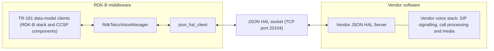
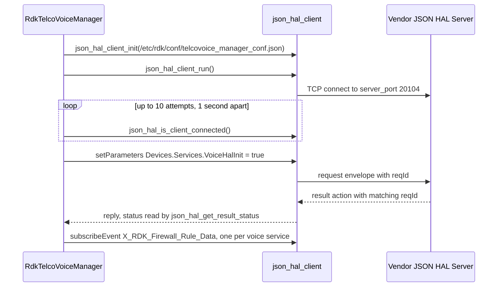

# RdkTelcoVoiceManager

`RdkTelcoVoiceManager` is the RDK-B middleware component that owns voice-service configuration on a
broadband gateway. It presents `TR-104` Voice over IP objects inside the `TR-181` data model under
`Device.Services.VoiceService.`, and translates reads and writes on that surface into requests on a
`JSON` HAL that vendor voice software implements.

The voice HAL differs structurally from most RDK-B HALs: it is **not** a C header, and no vendor
library is linked across the HAL boundary. The contract is a `JSON` Schema, and the two participants
are separate processes exchanging messages over a `TCP` socket. That is why there is no separate
`rdkb-halif-telcovoice` repository — the interface contract lives here, beside the manager that
speaks it. Everything else in this repository is the manager middleware around that contract.

Its role is configuration and observation rather than media handling. This component owns the voice
parameter tree, validates and persists changes to it, and forwards them over the HAL. `SIP`
signalling, call processing and media handling are performed by the vendor software behind the HAL.

## Documentation

This page is the repository landing page and stays at the level of the component. The HAL contract is
specified separately, and those documents are the authority for it:

| Document | What it covers |
| --- | --- |
| [`docs/pages/halSpec.md`](docs/pages/halSpec.md) | The voice `JSON` HAL interface specification — architecture, initialization and startup, threading, process and memory models, blocking behaviour, error handling, the non-functional requirements, and the complete action and object surface. |
| [`docs/pages/halSpecDetailed.md`](docs/pages/halSpecDetailed.md) | The per-parameter reference — every parameter definition in both shipped schemas with its type, constraint, access and description, plus the object index, the enumeration appendix, worked message examples and the known contract defects. |
| [`CHANGELOG.md`](CHANGELOG.md) | Release history, and the distinction between the repository release tag and the `JSON` HAL schema version. |

The documentation is generated by `docs/generate_docs.sh`, which writes HTML into `docs/output/html`.
That output directory is git-ignored, so the Markdown sources above are the files to read.

## Architecture

`RdkTelcoVoiceManager` is the **client** of the interface, through the `json_hal_client` library, and
the vendor supplies the **server**, the Vendor JSON HAL Server
[`source/TR-181/middle_layer_src/telcovoicemgr_dml_hal.c`]. The manager is itself the owning service:
other RDK-B components are clients of its `TR-181` data model, not of the HAL.

Two message buses are in play. The component serves its `TR-181` parameter tree over the
**CCSP message bus**, registered as `com.cisco.spvtg.ccsp.telcovoicemanager`
[`source/TelcoVoiceManager/telcovoicemgr_ssp_internal.h`, used in
`source/TelcoVoiceManager/telcovoicemgr_ssp_main.c`]. It separately opens an **RBus** handle as
`TELCOVOICEMANAGER` [`source/TR-181/middle_layer_src/telcovoicemgr_rbus_handler_apis.c`], used
only for its own outbound subscriptions to WAN Manager.

## JSON HAL contract

**Module identity.** Messages carry the module name `voicehal` and the schema version `0.0.1`, both
fixed as constants in the schema [`definitions.moduleName.const` and
`definitions.schemaVersion.const`, identical in both shipped schemas]. The schema's own description of
that version states that it must not be modified, so the client and the vendor server must agree on
it. It is not tied to the repository release tag, most recently `v2.0.5` in
[`CHANGELOG.md`](CHANGELOG.md).

**Object tree.** Every parameter sits under `Device.Services.VoiceService.`, with one exception:
`servicesVoiceHalInit`, the HAL initialization flag.
[`docs/pages/halSpecDetailed.md`](docs/pages/halSpecDetailed.md) documents each parameter.

**Actions.** The `action` enumeration carries eleven members, of which eight bind a payload;
[`docs/pages/halSpec.md`](docs/pages/halSpec.md) names them all. This component issues only a narrow
part of the vocabulary; the constants and call sites below are in
`source/TR-181/middle_layer_src/telcovoicemgr_dml_hal.h` and
`source/TR-181/middle_layer_src/telcovoicemgr_dml_hal.c`:

| Action | Issued by this component | Notes |
| --- | --- | --- |
| `getParameters` | Yes, as `GET_PARAMETER_METHOD` | Answered by `getParametersResponse`. |
| `setParameters` | Yes, as `SET_PARAMETER_METHOD` | Answered by the generic `result` action; **there is no `setParametersResponse`** in the vocabulary. Status is read with `json_hal_get_result_status`. |
| `subscribeEvent` | Indirectly, through `json_hal_client_subscribe_event` | One subscription per voice service instance, on `X_RDK_Firewall_Rule_Data` with notification type `onChangeSyncTimeout`. Delivered back as unsolicited `publishEvent`. |
| `getSchema`, `getActiveSubscriptions` and their responses | No | The schema path is read from configuration. |
| `deleteObject` | No, and not usable | See [Known contract defects](#known-contract-defects). |

**Request paths.** Requests are synchronous on the calling thread. The component sends them with
`json_hal_client_send_and_get_reply_with_timeout` and `HAL_SEND_AND_REPLY_TIMEOUT`, a nominal
60-second budget that the library counts in receive-loop ticks, not a maximum elapsed wait, so a
caller that needs a hard deadline enforces its own; see
[Blocking calls](docs/pages/halSpec.md#blocking-calls).

**Transport.** The interface is carried by the `json-hal-library` client and server, which are the
authority for the message envelope and the client semantics:
[rdkcentral/json-hal-library@`86a0a300`](https://github.com/rdkcentral/json-hal-library/tree/86a0a300b976f8e3295064af8fb3fd1c793c9e64).

**Shipped schema variants.** Two schemas are shipped, corresponding to the two `TR-104` data models.
Each is consumed by `RdkTelcoVoiceManager` alone, which loads the one installed at its configured
schema path (see [Known contract defects](#known-contract-defects)); the Vendor JSON HAL Server
implements it.

| Schema | Parameter definitions | Consumed by |
| --- | --- | --- |
| [`hal_schema/telcovoice_hal_schema_v1.json`](hal_schema/telcovoice_hal_schema_v1.json) | 353 | `RdkTelcoVoiceManager`, `TR-104` v1 builds |
| [`hal_schema/telcovoice_hal_schema_v2.json`](hal_schema/telcovoice_hal_schema_v2.json) | 776 | `RdkTelcoVoiceManager`, `TR-104` v2 builds |

The two are not related by addition: only **23** definition keys are present in both, and some of
those differ in type, constraint or list membership, so a caller must not assume a shared key means
a shared contract. [`docs/pages/halSpecDetailed.md`](docs/pages/halSpecDetailed.md#variant-differences)
carries the per-variant comparison.

## Build-time variant selection

Two preprocessor macros vary this component:

| Build input | How this repository uses it | Effect |
| --- | --- | --- |
| `FEATURE_RDKB_VOICE_DM_TR104_V2` | Selects the parameter header [`source/TR-181/middle_layer_src/telcovoicemgr_dml_hal.h`]; the `automake` conditional `VOICE_V2`, true when the environment variable `ISRDKB_VOICE_DM_TR104_V2` is `true` [`configure.ac`], selects the matching source set [`source/TR-181/middle_layer_src/Makefile.am`] | Builds against the `TR-104` v2 data model rather than v1. A build that sets one mechanism without the other is incoherent. |
| `TELCO_VOICE_FEATURE_ENABLE_PERSIST` | Guards blocks in `source/TR-181/integration_src.shared/telcovoicemgr_services_apis.c` and `source/TR-181/middle_layer_src/telcovoicemgr_dml_hal_param_v2.c` | Persists the voice enable state locally instead of deriving it from `WAN` link state. The guarded blocks compile out when it is undefined. |

Which data model a **built** manager drives is discoverable at runtime independently of the build:
reading `Device.X_RDK_TelcoVoice.DatamodelVersion` returns the literal `TR104V2` or `TR104V1`
[`source/TR-181/middle_layer_src/telcovoicemgr_dml_telcovoice.c`].

The variant-paired artefacts:

| Artefact | v1 | v2 |
| --- | --- | --- |
| `TR-181` data model | [`config/RdkTelcoVoiceManager_v1.xml`](config/RdkTelcoVoiceManager_v1.xml) — 49 objects, 372 parameters | [`config/RdkTelcoVoiceManager_v2.xml`](config/RdkTelcoVoiceManager_v2.xml) — 120 objects, 835 parameters |
| HAL schema | `telcovoice_hal_schema_v1.json` | `telcovoice_hal_schema_v2.json` |
| Default configuration | `config/telcovoice_config_default.json` | `config/telcovoice_config_default_v2.json` |
| WebConfig subdocument | `telcovoip` | `telcovoice` [`source/TR-181/integration_src.shared/telcovoicemgr_telcovoice_apis.c`] |

Read-only defaults are installed under `/usr/rdk/voicemanager/` and live values are persisted under
`/opt/secure/` [`source/TR-181/include/telcovoicemgr_dml_json_cfg_init.h`]; reporting settings go to
PSM instead [`source/TR-181/middle_layer_src/telcovoicemgr_dml_report.c`]. The same header also
names region-specific default files for `ITA`, `UK` and `ROI`, which the build or packaging layer
supplies.

## Runtime behaviour

**HAL bring-up.** `TelcoVoiceMgrHal_Init` establishes the order, and every step returns
`ANSC_STATUS_FAILURE` on error, so the component fails initialization rather than proceeding without a
reachable HAL server [`source/TR-181/middle_layer_src/telcovoicemgr_dml_hal.c`]:

The connectivity poll uses a **fixed** one-second interval for at most ten attempts
(`HAL_CONNECTION_RETRY_MAX_COUNT` is `10`
[`source/TR-181/middle_layer_src/telcovoicemgr_dml_hal.h`]), not exponential backoff, and applies to
bring-up only. Once connectivity is confirmed, `TelcoVoiceMgrHal_InitData` writes the HAL
initialization flag. A connection lost after initialization is not re-established by the component,
so recovery comes from process supervision.

**Threads.** The component creates **three** threads of its own:

| Thread | Purpose |
| --- | --- |
| `voice_manager_nw_monitor` [`source/TelcoVoiceManager/telcovoicemgr_nw_monitor.c`] | Listens for `sysevent` notifications on a descriptor kept separate from the get/set descriptor. |
| `StartVoiceReporting` [`source/TR-181/integration_src.shared/voice_report.c`] | Created only when voice telemetry reporting becomes enabled; encodes Avro diagnostics. |
| `handle_parodus` [`source/TR-181/integration_src.shared/voice_report_webpa_intf.c`] | The parodus/WebPA message loop. |

A fourth thread exists but is not this component's: `json_hal_client_run` starts the HAL client's
receive loop inside `json-hal-library` [`source/TR-181/middle_layer_src/telcovoicemgr_dml_hal.c`].
The data-model tree is guarded by a **recursive** mutex so nested accessors can re-enter it
[`source/TR-181/middle_layer_src/telcovoicemgr_dml_data.c`].

**Events consumed.** Three independent inbound paths, so a caller must not assume ordering across
them:

- Seven `sysevent` tuples registered by the network monitor
  [`source/TelcoVoiceManager/telcovoicemgr_nw_monitor.c`] — `lan-status`,
  `ipv4_connection_state`, `ipv6_connection_state`, `ipv4-timeoffset`, `firewall-status`,
  `telcovoicemgr_bound_ifname` and `telcovoicemgr_ipaddr_family`
  [`source/TR-181/include/telcovoicemgr_services_apis_v2.h`].
- Two WAN Manager data elements over RBus —
  `Device.X_RDK_WanManager.InterfaceAvailableStatus` and `.InterfaceActiveStatus`
  [`source/TR-181/middle_layer_src/telcovoicemgr_rbus_handler_apis.h`, subscribed in
  `source/TR-181/middle_layer_src/telcovoicemgr_rbus_handler_apis.c`].
- One HAL event per voice service instance, dispatched to `eventcb_FirewallRuleData`
  [`source/TR-181/middle_layer_src/telcovoicemgr_dml_hal.c`], subscribed from
  `TelcoVoiceMgr_Controller_Init` [`source/TelcoVoiceManager/telcovoicemgr_controller.c`].

Telemetry leaves as Avro records over parodus/WebPA. Errors are propagated as `ANSC_STATUS_FAILURE`
return values and logged through the `CcspTrace*` macros.

## Repository layout

| Path | Contents |
| --- | --- |
| `hal_schema/` | The two `JSON` Schema contracts. |
| `config/` | `RdkTelcoVoiceManager_v1.xml` and `RdkTelcoVoiceManager_v2.xml`, `telcovoice_config_default.json` and `telcovoice_config_default_v2.json`, and [`telcovoice_manager_conf.json`](config/telcovoice_manager_conf.json) — the HAL client configuration, read from `/etc/rdk/conf/telcovoice_manager_conf.json` [`source/TR-181/middle_layer_src/telcovoicemgr_dml_hal.h`], with keys `hal_schema_path` and `server_port` (`20104`). |
| `source/TelcoVoiceManager/` | The service host — process entry point, CCSP message-bus interface, the event-subscription controller and the network monitor. |
| `source/TR-181/` | `include/`, `middle_layer_src/` and `integration_src.shared/`: the data-model middle layer that translates `TR-181` access into `JSON` HAL requests, plus persistence, WebConfig parsing and telemetry. |
| `cfg/` | Autotools support directory, named by `AC_CONFIG_AUX_DIR` and `AC_CONFIG_MACRO_DIR`. |
| `docs/` | The documentation described above. |

## Building

The component builds with Autotools and produces the `telcovoice_manager` binary
[`source/TelcoVoiceManager/Makefile.am`]. `configure.ac` initialises Automake and Libtool and
generates the makefiles for `source/` and its subdirectories; its `AC_INIT` string is the Autotools
package identifier rather than a release version.

**Build options.** One is exposed: `--enable-notify` adds `-DENABLE_SD_NOTIFY` and links `-lsystemd`
[`configure.ac`], which enables the `sd_notifyf` readiness notification the component emits once
its own initialization completes [`source/TelcoVoiceManager/telcovoicemgr_ssp_main.c`].

**Dependencies.** The makefiles declare the libraries. The data-model layer links `-lccsp_common`,
`-ljson_hal_client`, `-ljson-c`, `-lcjson`, `-lrbus` and `-lpthread`
[`source/TR-181/middle_layer_src/Makefile.am`]; the shared integration layer additionally links
`syscfg`, `sysevent`, `utapi`, `utctx`, `hal_platform`, `webconfig_framework`, `msgpackc`, `avro`,
`uuid`, `trower-base64` and `libparodus`
[`source/TR-181/integration_src.shared/Makefile.am`]; the executable links `-lccsp_common`,
`-lrdkloggers`, `-lsyscfg`, `-lsysevent`, `-lwebconfig_framework` and `-lpthread`
[`source/TelcoVoiceManager/Makefile.am`].
[Build Requirements](docs/pages/halSpec.md#build-requirements) states which `json-c` a production
build must link.

## Known contract defects

Three defects affect a caller of this component;
[`docs/pages/halSpecDetailed.md`](docs/pages/halSpecDetailed.md#contract-defects) carries the
schema-level inventory.

1. **The HAL initialization write uses a path the shipped schemas would reject.** The `HALINIT` macro
   is `"Devices.Services.VoiceHalInit"` — plural `Devices.` —
   [`source/TR-181/middle_layer_src/telcovoicemgr_dml_hal.c`], while both schemas constrain
   `servicesVoiceHalInit` to `^Device\.Services\.VoiceHalInit$`. A server validating strictly against
   its schema rejects the initialization write this component sends; see
   [Initialization and Startup](docs/pages/halSpec.md#initialization-and-startup).
2. **The configured schema path matches neither shipped filename.** `telcovoice_manager_conf.json`
   names `/etc/rdk/schemas/telcovoice_hal_schema.json`, and this repository ships
   `telcovoice_hal_schema_v1.json` and `telcovoice_hal_schema_v2.json`. The packaging or provisioning
   layer installs one variant at that path, and nothing on the wire distinguishes the two — both
   declare the same module name and `schemaVersion` — so a deployment must ensure the server's schema
   matches the manager's `DatamodelVersion`; see
   [Optional Components](docs/pages/halSpec.md#optional-components).
3. **`deleteObject` is not usable under either shipped schema.** Its payload definition carries an
   empty `anyOf` array in both files, which no message can satisfy, and the component's own delete
   path, `TelcoVoiceMgrHal_DelParam`, is unreachable as shipped, because `create_json_request_message`
   builds only get and set requests and returns `NULL` for a delete; see
   [API Surface](docs/pages/halSpec.md#api-surface). The unrelated local C function `deleteObject`
   [`source/TR-181/integration_src.shared/telcovoicemgr_dml_json_save.c`] removes an item from the
   local configuration file and sends nothing over the HAL.

## Contributing

Contributions are made by forking the repository and opening a pull request; RDK requires a signed RDK
Contributor License Agreement before code is accepted into the project
[[`CONTRIBUTING.md`](CONTRIBUTING.md)].

## Licence

This component is licensed under the Apache License, Version 2.0. The full text is in
[`LICENSE`](LICENSE) and the attribution notices are in [`NOTICE`](NOTICE).
