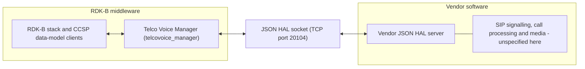
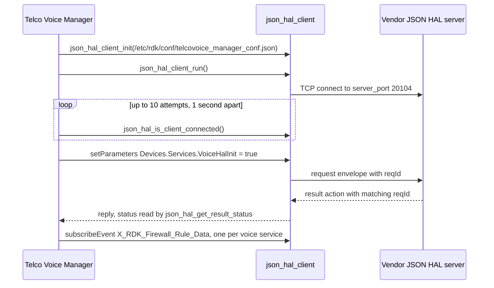

# Telco Voice Manager

Telco Voice Manager is the RDK-B middleware component that owns voice-service configuration on a
broadband gateway. It presents `TR-104` Voice over IP objects inside the `TR-181` data model under
`Device.Services.VoiceService.`, and translates reads and writes on that surface into requests on a
`JSON` HAL that vendor voice software implements [superproject `README.md:51`].

The voice HAL differs structurally from most RDK-B HALs: it is **not** a C header, and no vendor
library is linked across the HAL boundary. The contract is a `JSON` Schema, and the two participants
are separate processes exchanging messages over a `TCP` socket. That is why the workspace carries no
`rdkb-halif-telcovoice` repository — the interface contract lives here, beside the manager that
speaks it. Everything else in this repository is the manager middleware around that contract.

Its role is configuration and observation rather than media handling. This component owns the voice
parameter tree, validates and persists changes to it, and forwards them over the HAL. `SIP`
signalling, call processing and media handling are performed by the vendor software behind the HAL
and are not specified by this repository, so a capability named on this page is one the component
*exposes and configures* rather than one it necessarily implements.

## Documentation

This page is the repository landing page and stays at the level of the component. The HAL contract is
specified separately, and those documents are the authority for it — neither this page nor any other
restates their per-parameter or per-message detail:

| Document | What it covers |
| --- | --- |
| [`docs/pages/halSpec.md`](docs/pages/halSpec.md) | The voice `JSON` HAL interface specification — architecture, initialization and startup, threading, process and memory models, blocking behaviour, error handling, the non-functional requirements, and the complete action and object surface. |
| [`docs/pages/halSpecDetailed.md`](docs/pages/halSpecDetailed.md) | The per-parameter reference — every parameter definition in both shipped schemas with its type, constraint, access and description, plus the object index, the enumeration appendix, worked message examples and the known contract defects. |
| [`CHANGELOG.md`](CHANGELOG.md) | Release history, and the distinction between the repository release tag and the `JSON` HAL schema version. |

The documentation is generated by `docs/generate_docs.sh`, which writes HTML into `docs/output/html`.
That output directory is git-ignored and is published nowhere, so the Markdown sources above are the
files to read.

**A note on sourcing.** Every factual claim on this page about a path, a port, a count, a thread, a
retry bound or a component boundary names the file — and where it helps, the line — that establishes
it. Where this repository establishes nothing, the text says so rather than filling the gap: a guess
is indistinguishable from a fact to a reader, and this page is read by people writing code and tests
against the component. The wider RDK-B inventory records `ifacemanager_telcovoice` as the middleware
service that owns this HAL, and the one to stop before driving the HAL directly [superproject
`README.md:99`].

## Architecture

[`docs/pages/halSpec.md`](docs/pages/halSpec.md) is the authority for this architecture; the chain is
reproduced here only so its shape is visible at a glance. The manager is the **client** of the
interface and the vendor supplies the **server**
[`source/TR-181/middle_layer_src/telcovoicemgr_dml_hal.c:68`]. This manager is itself the owning
service, so no further middleware service sits between the RDK-B stack and the interface. What happens
inside the vendor boundary beyond the server's message handling is outside what this repository
specifies, which is why it is drawn as one unspecified box rather than as a workflow.

Two message buses are in play and their roles are easy to conflate. The component serves its `TR-181`
parameter tree over the **CCSP message bus**, registered as `com.cisco.spvtg.ccsp.telcovoicemanager`
[`source/TelcoVoiceManager/telcovoicemgr_ssp_internal.h:66-67`, used at
`source/TelcoVoiceManager/telcovoicemgr_ssp_main.c:314`]. It separately opens an **RBus** handle as
`TELCOVOICEMANAGER` [`source/TR-181/middle_layer_src/telcovoicemgr_rbus_handler_apis.c:40,153`], used
only for its own outbound subscriptions to WAN Manager.

## JSON HAL contract

**Module identity.** Messages carry the module name `voicehal` and the schema version `0.0.1`, both
fixed as constants in the schema [`definitions.moduleName.const` and
`definitions.schemaVersion.const`, identical in both shipped schemas]. The schema's own description of
that version states that it must not be modified, so the client and the vendor server must agree on
it.

**Object tree.** Every parameter sits under `Device.Services.VoiceService.`, with one exception:
`servicesVoiceHalInit`, whose name pattern is `^Device\.Services\.VoiceHalInit$`.
[`docs/pages/halSpecDetailed.md`](docs/pages/halSpecDetailed.md) documents each parameter.

**Actions.** The `action` enumeration carries eleven members, of which eight bind a payload;
[`docs/pages/halSpec.md`](docs/pages/halSpec.md) names them all. This component issues only a narrow
part of the vocabulary:

| Action | Issued by this component | Notes |
| --- | --- | --- |
| `getParameters` | Yes, as `GET_PARAMETER_METHOD` [`…/telcovoicemgr_dml_hal.h:37`] | Answered by `getParametersResponse`. |
| `setParameters` | Yes, as `SET_PARAMETER_METHOD` [`…/telcovoicemgr_dml_hal.h:38`] | Answered by the generic `result` action; **there is no `setParametersResponse`** in the vocabulary. Status is read with `json_hal_get_result_status` [`…/telcovoicemgr_dml_hal.c:637,1036`]. |
| `subscribeEvent` | Indirectly, through `json_hal_client_subscribe_event` [`…/telcovoicemgr_dml_hal.c:1342`] | One subscription per voice service instance, on `X_RDK_Firewall_Rule_Data` [`…/telcovoicemgr_dml_hal.h:105`] with notification type `onChangeSyncTimeout` [`…:45`]. Delivered back as unsolicited `publishEvent`. |
| `getSchema`, `getActiveSubscriptions` and their responses | No | The literals do not appear in `source/`. The schema path is read from configuration rather than discovered at runtime. |
| `deleteObject` | No, and not usable | See `Known contract defects`. |

**Request paths.** Ten `json_hal_client_send_and_get_reply*` call sites exist in
`source/TR-181/middle_layer_src/telcovoicemgr_dml_hal.c`, and they are not uniform:

- **Nine** use the timed form `json_hal_client_send_and_get_reply_with_timeout` with
  `HAL_SEND_AND_REPLY_TIMEOUT`, which is `60` seconds [`…/telcovoicemgr_dml_hal.h:46`], at `:231`,
  `:268`, `:302`, `:625`, `:721`, `:783`, `:835`, `:900` and `:963`.
- **One** uses the untimed `json_hal_client_send_and_get_reply`, at `:1027` in
  `TelcoVoiceMgrHal_DelParam`. That path is **unreachable as shipped**: its request is built by
  `create_json_request_message`, which handles only `SET_REQUEST_MESSAGE` and `GET_REQUEST_MESSAGE` and
  returns `NULL` for anything else [`…:137-188`, default branch at `:183-185`], so the preceding
  `CHECK(jrequest != NULL)` [macro at `…/telcovoicemgr_dml_hal.h:109`] returns failure before the send
  is reached.

Every request is therefore synchronous from the calling thread, and every request that can actually be
issued is bounded at 60 seconds.

**Transport.** The interface is carried by the `json-hal-library` client and server, which the middle
layer links as `-ljson_hal_client` [`source/TR-181/middle_layer_src/Makefile.am:45`]. That library is
the authority for the message envelope and the client semantics, which neither this page nor the HAL
specification restates:
[rdkcentral/json-hal-library@`86a0a300`](https://github.com/rdkcentral/json-hal-library/tree/86a0a300b976f8e3295064af8fb3fd1c793c9e64).

**Shipped schema variants.** Two schemas are shipped, corresponding to the two `TR-104` data models:

| Schema | Parameter definitions | Corresponds to |
| --- | --- | --- |
| [`hal_schema/telcovoice_hal_schema_v1.json`](hal_schema/telcovoice_hal_schema_v1.json) | 353 | `TR-104` v1 builds |
| [`hal_schema/telcovoice_hal_schema_v2.json`](hal_schema/telcovoice_hal_schema_v2.json) | 776 | `TR-104` v2 builds |

The two are not related by addition: only **23** definition keys are present in both. Four of those 23
declare a different **type or value constraint** between the variants, and a caller must not assume a
shared key means a shared contract:

| Definition key | v1 | v2 |
| --- | --- | --- |
| `voiceServiceCapabilitiesMaxLineCount` | `unsignedInt`, minimum 0 | `int`, minimum -1 |
| `voiceServiceCapabilitiesMaxSessionCount` | `unsignedInt`, minimum 0 | `int`, minimum -1 |
| `voiceServiceCapabilitiesMaxSessionsPerLine` | `unsignedInt`, minimum 0 | `int`, minimum -1 |
| `voiceServiceCapabilitiesToneFileFormats` | Comma-separated list drawn from `G.711MuLaw`, `G.711ALaw`, `MP3`, `WAV`, `AMR` | The same list plus `G.729` |

A fifth shared key, `voiceServiceCapabilitiesRingFileFormats`, declares the same type and the same
constraint in both variants but moves between the read lists — it is reachable through
`getParameterOptionalList` in v1 and through `getParameterSupportedList` in v2, which a v2 vendor is
expected to answer rather than decline. `voiceServiceCapabilitiesToneFileFormats` makes that same
list move in addition to widening its enumeration. Counting list movement as well as type and
constraint therefore gives **five** divergent shared keys rather than four, which is the figure
[`docs/pages/halSpecDetailed.md`](docs/pages/halSpecDetailed.md) reports; the four above are the
subset whose declared type or value constraint changes. Neither `set` list contains any of the five,
so all five are read-only in both variants.

Everything else differs by presence rather than by constraint. `SIP.Client.{i}.MaxSessions`
(`voiceServiceSIPClientMaxSessions`) and `Capabilities.MaxSessionsPerExtension`
(`voiceServiceCapabilitiesMaxSessionsPerExtension`) are **v2-only** — v1 defines no `SIP.Client`
branch at all — so neither is a divergence.
[`docs/pages/halSpecDetailed.md`](docs/pages/halSpecDetailed.md) carries the full per-variant
comparison.

## Build-time variant selection

Two build inputs vary this component, and this repository establishes both as preprocessor macros
rather than as named build-system features:

| Build input | How this repository uses it | Effect |
| --- | --- | --- |
| `FEATURE_RDKB_VOICE_DM_TR104_V2` | Selects the parameter header [`source/TR-181/middle_layer_src/telcovoicemgr_dml_hal.h:28-32`]; the `automake` conditional `VOICE_V2`, true when the environment variable `ISRDKB_VOICE_DM_TR104_V2` is `true` [`configure.ac:75`], selects the matching source set [`source/TR-181/middle_layer_src/Makefile.am:33`] | Builds against the `TR-104` v2 data model rather than v1. A build that sets one mechanism without the other is incoherent. |
| `TELCO_VOICE_FEATURE_ENABLE_PERSIST` | Consumed at exactly three sites — `source/TR-181/integration_src.shared/telcovoicemgr_services_apis.c:1846`, `:2144` and `source/TR-181/middle_layer_src/telcovoicemgr_dml_hal_param_v2.c:255` | Persists the voice enable state locally instead of deriving it from `WAN` link state. The guarded blocks compile out when it is undefined. |

**The external names that define those macros are not established here.** No `DISTRO` feature name,
`bitbake` variable or other build-layer identifier that would set either macro appears anywhere in this
repository's source, configuration, schemas or build files; that mapping lives in the build metadata
layer outside this repository. Naming one here would be an invention, and a reader checking a build
against an invented name would find nothing.

Which data model a **built** manager drives is discoverable at runtime independently of the build:
reading `Device.X_RDK_TelcoVoice.DatamodelVersion` returns the literal `TR104V2` or `TR104V1`
[`source/TR-181/middle_layer_src/telcovoicemgr_dml_telcovoice.c:113-119`].

The variant-paired artefacts, with data-model sizes obtained by parsing the shipped XML and counting
its `<object>` and `<parameter>` elements:

| Artefact | v1 | v2 |
| --- | --- | --- |
| `TR-181` data model | [`config/RdkTelcoVoiceManager_v1.xml`](config/RdkTelcoVoiceManager_v1.xml) — 49 objects, 372 parameters | [`config/RdkTelcoVoiceManager_v2.xml`](config/RdkTelcoVoiceManager_v2.xml) — 120 objects, 835 parameters |
| HAL schema | `telcovoice_hal_schema_v1.json` — 353 parameter definitions | `telcovoice_hal_schema_v2.json` — 776 parameter definitions |
| Default configuration | `config/telcovoice_config_default.json` | `config/telcovoice_config_default_v2.json` |
| WebConfig subdocument | `telcovoip` | `telcovoice` [`source/TR-181/integration_src.shared/telcovoicemgr_telcovoice_apis.c:1127,1129`] |

Read-only defaults are installed under `/usr/rdk/voicemanager/` and live values are persisted under
`/opt/secure/` [`source/TR-181/include/telcovoicemgr_dml_json_cfg_init.h:26,27`]; reporting settings go
to PSM instead [`source/TR-181/middle_layer_src/telcovoicemgr_dml_report.c:648,670`]. The code also
expects region-specific default files for `ITA`, `UK` and `ROI`
[`…/telcovoicemgr_dml_json_cfg_init.h:35-37`]; **none of the three ships in this repository**, so they
are supplied by the build or packaging layer.

## Runtime behaviour

**HAL bring-up.** `TelcoVoiceMgrHal_Init` establishes the order, and every step returns
`ANSC_STATUS_FAILURE` on error, so the component fails initialization rather than proceeding without a
reachable HAL server [`source/TR-181/middle_layer_src/telcovoicemgr_dml_hal.c:65-114`]:

The connectivity poll is a **fixed** one-second interval for at most ten attempts
(`HAL_CONNECTION_RETRY_MAX_COUNT` is `10` [`…/telcovoicemgr_dml_hal.h:54`], loop at
`…/telcovoicemgr_dml_hal.c:87-92`) — not exponential backoff — and it applies to bring-up only. Once
connectivity is confirmed, `TelcoVoiceMgrHal_InitData` writes a boolean to the path in the `HALINIT`
macro through `TelcoVoiceMgrHal_SetParam` [`…/telcovoicemgr_dml_hal.c:116-135`, macro at `:43`]. There
is no reconnection path: `json_hal_is_client_connected` is called at that one site only, and a
connection lost after initialization is not re-established by any code in this repository, so recovery
must come from the process-supervision layer.

**Threads.** The component creates **three** threads of its own, and those are the only
`pthread_create` call sites in the repository; everything else runs on the main thread, and there are
no thread pools and no lock-free queues here.

| Thread | Purpose |
| --- | --- |
| `voice_manager_nw_monitor` [`source/TelcoVoiceManager/telcovoicemgr_nw_monitor.c:170`] | Listens for `sysevent` notifications on a descriptor kept separate from the get/set descriptor [`…:174-181`]. |
| `StartVoiceReporting` [`source/TR-181/integration_src.shared/voice_report.c:2060`] | Created only when voice telemetry reporting becomes enabled; encodes Avro diagnostics. |
| `handle_parodus` [`source/TR-181/integration_src.shared/voice_report_webpa_intf.c:239`] | The parodus/WebPA message loop. |

A fourth thread exists but is not this component's: `json_hal_client_run` starts the HAL client's
receive loop inside `json-hal-library` [`…/telcovoicemgr_dml_hal.c:74`]. The data-model tree is guarded
by a **recursive** mutex so nested accessors can re-enter it
[`source/TR-181/middle_layer_src/telcovoicemgr_dml_data.c:98-101`].

**Events consumed.** Three independent inbound paths, with no correlation or de-duplication layer
between them, so a caller must not assume ordering across them:

- Seven `sysevent` tuples registered by the network monitor
  [`source/TelcoVoiceManager/telcovoicemgr_nw_monitor.c:206,210,212,214,218,220,224`] — `lan-status`,
  `ipv4_connection_state`, `ipv6_connection_state`, `ipv4-timeoffset`, `firewall-status`
  [names at `…:56-66`], `telcovoicemgr_bound_ifname` and `telcovoicemgr_ipaddr_family`
  [`source/TR-181/include/telcovoicemgr_services_apis_v2.h:47-48`].
- Two WAN Manager data elements over RBus —
  `Device.X_RDK_WanManager.InterfaceAvailableStatus` and `.InterfaceActiveStatus`
  [`source/TR-181/middle_layer_src/telcovoicemgr_rbus_handler_apis.h:41-42`, subscribed at `….c:112,118`].
- One HAL event per voice service instance, dispatched to `eventcb_FirewallRuleData`
  [`…/telcovoicemgr_dml_hal.c:1273`], subscribed from `TelcoVoiceMgr_Controller_Init`
  [`source/TelcoVoiceManager/telcovoicemgr_controller.c:41-42,51`].

The component publishes no bus events of its own; telemetry leaves as Avro records over
parodus/WebPA instead. Errors are propagated as `ANSC_STATUS_FAILURE` return values and logged through
the `CcspTrace*` macros; this component implements no recovery state machine and no degraded mode.

## Repository layout

| Path | Contents |
| --- | --- |
| `hal_schema/` | The two `JSON` Schema contracts. No message fixtures ship here. |
| `config/` | The two `TR-181` data-model descriptions, the two default voice configurations, and [`telcovoice_manager_conf.json`](config/telcovoice_manager_conf.json) — the HAL client configuration, read from `/etc/rdk/conf/telcovoice_manager_conf.json` [`source/TR-181/middle_layer_src/telcovoicemgr_dml_hal.h:98`], carrying exactly two keys: `hal_schema_path` and `server_port` (`20104`). |
| `source/TelcoVoiceManager/` | The service host — process entry point, CCSP message-bus interface, the event-subscription controller and the network monitor. |
| `source/TR-181/` | `include/`, `middle_layer_src/` and `integration_src.shared/`: the data-model middle layer that translates `TR-181` access into `JSON` HAL requests, plus persistence, WebConfig parsing and telemetry. |
| `cfg/` | Autotools support directory, named by `AC_CONFIG_AUX_DIR` and `AC_CONFIG_MACRO_DIR`. |
| `docs/` | The documentation described above. |

## Building

The component builds with Autotools and produces the `telcovoice_manager` binary
[`source/TelcoVoiceManager/Makefile.am:20`]. `configure.ac` initialises Automake and Libtool and
generates the makefiles for `source/` and its subdirectories.

**Build options.** One is exposed: `--enable-notify` adds `-DENABLE_SD_NOTIFY` and links `-lsystemd`
[`configure.ac:60-70`], which enables the `sd_notifyf` readiness notification the component emits once
its own initialization completes [`source/TelcoVoiceManager/telcovoicemgr_ssp_main.c:393-394`]. This
repository ships no systemd unit and names no `.service` file, so the ordering of system services
around this component is not established here and is not asserted.

**Dependencies.** `configure.ac` checks only for standard C headers, so the makefiles rather than the
configure script declare the component's libraries. The data-model layer links `-lccsp_common`,
`-ljson_hal_client`, `-ljson-c`, `-lcjson`, `-lrbus` and `-lpthread`
[`source/TR-181/middle_layer_src/Makefile.am:45`]; the shared integration layer additionally links
`syscfg`, `sysevent`, `utapi`, `utctx`, `hal_platform`, `webconfig_framework`, `msgpackc`, `avro`,
`uuid`, `trower-base64` and `libparodus`
[`source/TR-181/integration_src.shared/Makefile.am:27`]; the executable links `-lccsp_common`,
`-lrdkloggers`, `-lsyscfg`, `-lsysevent`, `-lwebconfig_framework` and `-lpthread`
[`source/TelcoVoiceManager/Makefile.am:29`]. No other build recipe or toolchain is specified by this
repository.

**Version identities.** The `AC_INIT` string in `configure.ac` is the Autotools package identifier
rather than a release version. Release history is in [`CHANGELOG.md`](CHANGELOG.md), whose most recent
tag is `v2.0.5`. The `JSON` HAL contract carries its own version, `0.0.1`, which is a fixed constant
in both shipped schemas and is not tied to that tag.

## Known contract defects

Three defects are recorded here because a reader writing against this component will otherwise meet
them as surprises. [`docs/pages/halSpecDetailed.md`](docs/pages/halSpecDetailed.md) carries the
schema-level inventory.

1. **The HAL initialization write uses a path the shipped schemas would reject.** The `HALINIT` macro
   is `"Devices.Services.VoiceHalInit"` — plural `Devices.` —
   [`source/TR-181/middle_layer_src/telcovoicemgr_dml_hal.c:43`], while both schemas constrain
   `servicesVoiceHalInit` to `^Device\.Services\.VoiceHalInit$`. A server validating strictly against
   its schema rejects the initialization write this component sends.
2. **The configured schema path matches neither shipped filename.** `telcovoice_manager_conf.json`
   names `/etc/rdk/schemas/telcovoice_hal_schema.json`, and this repository ships
   `telcovoice_hal_schema_v1.json` and `telcovoice_hal_schema_v2.json`. Nothing here binds a variant to
   that path, and nothing on the wire distinguishes the two — both declare the same module name and the
   same `schemaVersion` — so the binding is made in the packaging or provisioning layer and a
   deployment must ensure the server's schema matches the manager's `DatamodelVersion` itself.
   [`docs/pages/halSpec.md`](docs/pages/halSpec.md) records this under `Optional Components`.
3. **`deleteObject` is not usable under either shipped schema.** Its payload definition carries an
   empty `anyOf` array in both files, and an empty `anyOf` can never be satisfied, so no schema-valid
   `deleteObject` message exists. The component's own delete path is correspondingly unreachable, as
   `JSON HAL contract` records. Note that this repository also contains an unrelated C function named
   `deleteObject` [`source/TR-181/integration_src.shared/telcovoicemgr_dml_json_save.c:692`] which
   removes an item from the local configuration file and sends nothing over the HAL.

## Contributing

Contributions are made by forking the repository and opening a pull request; RDK requires a signed RDK
Contributor License Agreement before code is accepted into the project
[[`CONTRIBUTING.md`](CONTRIBUTING.md)].

## Licence

This component is licensed under the Apache License, Version 2.0. The full text is in
[`LICENSE`](LICENSE) and the attribution notices are in [`NOTICE`](NOTICE).
