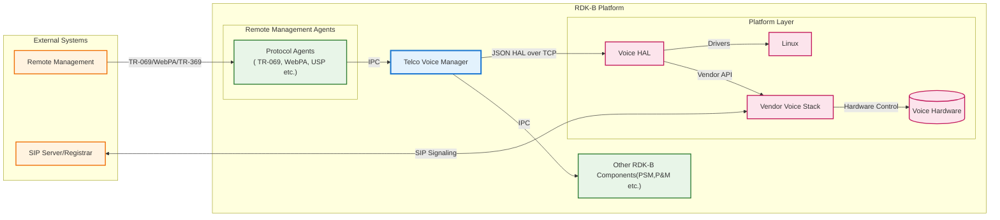
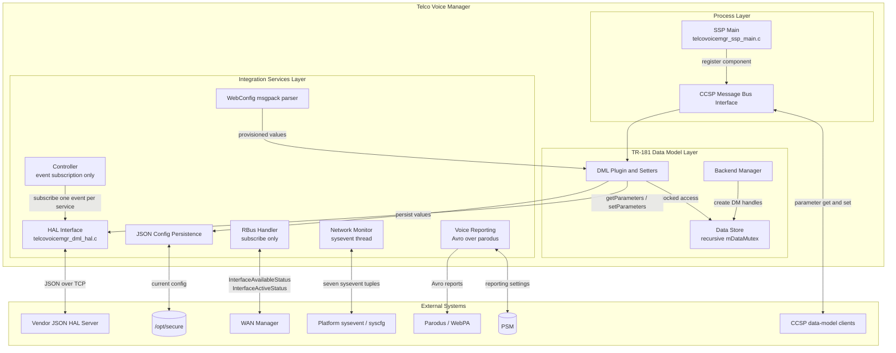
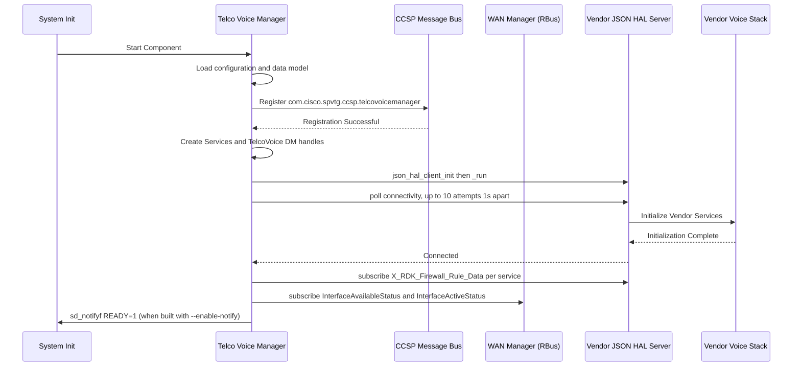
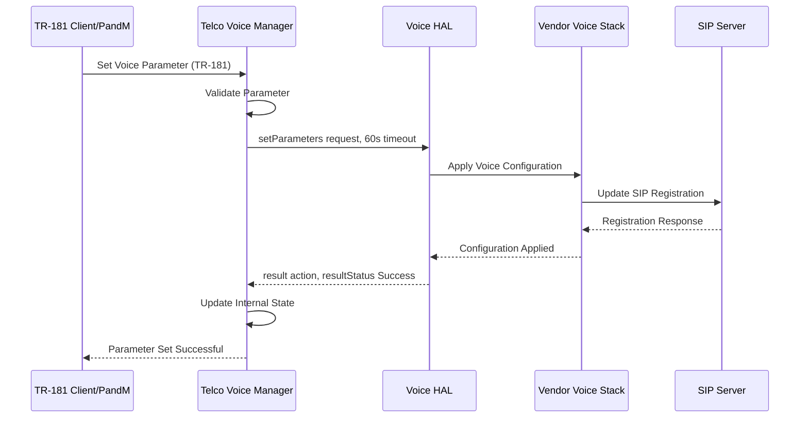
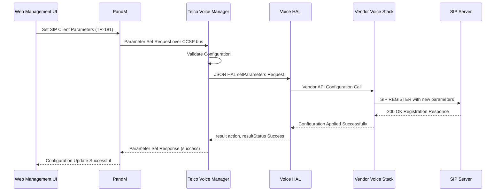
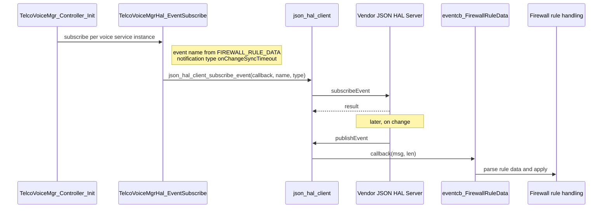

# Telco Voice Manager Documentation

Telco Voice Manager is the RDK-B middleware component that manages voice services for residential and
business environments. It presents TR-104 (Voice over Internet Protocol) objects within a TR-181 data
model and mediates between the RDK-B middleware stack and vendor-specific voice implementations,
covering SIP-based VoIP calling, POTS (Plain Old Telephone Service) support and voice service
provisioning.

Its role is configuration and observation rather than media handling. Telco Voice Manager owns the
voice parameter tree, validates and persists changes to it, and forwards them over a JSON HAL to
vendor voice software, which is where SIP signalling, call processing and media actually happen. That
division matters when reading the rest of this page: a capability described here is one the component
*exposes and configures*, not necessarily one it implements.

## Documentation

This page is the manager overview: what the component is, how it is put together, and how it
behaves at runtime. The HAL contract it speaks to vendor voice software is specified separately:

| Document | What it covers |
|----------|----------------|
| [`docs/pages/halSpec.md`](docs/pages/halSpec.md) | The JSON HAL interface specification — transport and envelope, the deployment contract (configuration file, schema path, server port), the action vocabulary, the event model, error handling and the state model. Start here if you are writing against the HAL rather than against the manager. |
| [`docs/pages/halSpecDetailed.md`](docs/pages/halSpecDetailed.md) | The per-parameter reference for the shipped schemas — all 776 `v2` and 353 `v1` parameter definitions with type, constraint, access and description, plus the object index, the enumeration appendix and worked message examples. |

The transport itself is `json-hal-library`, which is the authority for the client and server
semantics both documents cite rather than restate:
[rdkcentral/json-hal-library@`86a0a300`](https://github.com/rdkcentral/json-hal-library/tree/86a0a300b976f8e3295064af8fb3fd1c793c9e64).

**A note on sourcing.** Every factual claim on this page about a path, a port, a thread, a retry
bound or a component boundary is followed by the file and line that establishes it. Where this
repository does not establish something, the text says so explicitly rather than filling the gap
with a plausible guess — a guess would be indistinguishable from a fact to a reader, and this page
is read by developers writing code and tests against the component.




**Key Features & Responsibilities**:

- **TR-104 Voice Service Management**: implements the TR-104 voice service objects within the TR-181 `Device.` data model, in two variants — 417 parameters in TR-104 v1 and 937 in v2
- **SIP Configuration Management**: exposes SIP client, network, registrar, proxy and credential parameters, and multiple concurrent session limits per client. The component **configures** SIP; it does not implement a SIP stack — registration and call signalling are performed by the vendor voice software behind the HAL
- **POTS Interface Support**: POTS region behaviour and per-FXS-port configuration including receive and transmit gain
- **Multi-Line Voice Services**: multiple voice service, line and FXS instances, each independently configurable
- **Voice Quality Parameters**: gain, echo cancellation and codec parameters are exposed through the data model; the processing behind them belongs to the vendor stack
- **Event Handling**: subscribes to platform `sysevent` notifications, to two WAN Manager elements over RBus, and to one vendor HAL event. Note that this component is an event **consumer** — it publishes no bus events of its own; see `Events consumed and produced`

## Design

The Telco Voice Manager follows a layered architectural approach designed to provide maximum flexibility and vendor independence while maintaining robust voice service management capabilities. The design principles center around clear separation of concerns, with distinct layers handling TR-181 data model management, voice service orchestration, and hardware abstraction. This architecture enables the component to support diverse voice implementations while providing consistent management interfaces and maintaining high availability for critical voice services.

Two message buses are in play, and they have distinct roles that are easy to conflate. The component
serves its TR-181 parameter tree over the **CCSP message bus**, registered as
`com.cisco.spvtg.ccsp.telcovoicemanager`. It separately opens an **RBus** handle, as
`TELCOVOICEMANAGER`, used only for its own outbound subscriptions to WAN Manager. Southbound, it
speaks JSON over a TCP socket to a vendor HAL server using `json-hal-library`. Error handling is by
return-code propagation and logging; the component does not implement recovery or degraded-mode
behaviour, and a HAL connection lost after startup is not re-established here.

Northbound, the parameter tree is consumed by the usual CCSP data-model clients, reporting settings
persist through PSM, bulk provisioning arrives as WebConfig msgpack blobs, and voice telemetry leaves
as Avro records over parodus/WebPA. Southbound, the JSON HAL abstracts the vendor voice
implementation: this component configures and observes, while call processing, SIP signalling and
media handling happen in the vendor stack behind the HAL.



The layering above is the real module set, not an idealised one. Two points where a reader might
expect more than exists: there is no internal SIP or PSTN component — SIP signalling and media are
the vendor stack's, reached only indirectly through the HAL — and the `Controller` box does nothing
but place event subscriptions.


### Prerequisites and Dependencies

**Build-Time Flags and Configuration:**

| Build Flag | How it is selected | Purpose | Default |
|------------|--------------------|---------|---------|
| `FEATURE_RDKB_VOICE_DM_TR104_V2` | The automake conditional `VOICE_V2`, which is true when the environment variable `ISRDKB_VOICE_DM_TR104_V2` is `true` [`configure.ac:75`]. The conditional selects the `v2` source set [`source/TR-181/middle_layer_src/Makefile.am:33`] and the flag selects the parameter header [`source/TR-181/middle_layer_src/telcovoicemgr_dml_hal.h:28-32`]. | Build against the TR-104 v2 data model instead of v1 | Off — `VOICE_V2` is false unless `ISRDKB_VOICE_DM_TR104_V2` is set |
| `TELCO_VOICE_FEATURE_ENABLE_PERSIST` | Passed in by the build layer; this repository consumes it but does not define it [`source/TR-181/middle_layer_src/telcovoicemgr_dml_hal_param_v2.c:255`, `source/TR-181/integration_src.shared/telcovoicemgr_services_apis.c:1846,2144`] | Persist voice service configuration across reboots | Off — the guarded blocks compile out when it is undefined |
| `ENABLE_SD_NOTIFY` | `./configure --enable-notify`, which also adds `-lsystemd` [`configure.ac:60-70`] | Emit `sd_notifyf` readiness notification to systemd [`source/TelcoVoiceManager/telcovoicemgr_ssp_main.c:393-398`] | Off — `configure.ac:70` logs "systemd notify is disabled" |

The build flag is what this repository can be read against. The **DISTRO feature names** that set
these flags live in the Yocto metadata layer, not here, so this page does not name them: nothing in
this repository establishes the mapping, and naming a feature that had since been renamed would be
worse than omitting it.

Which data model a **built** manager drives is discoverable at runtime, independently of the build
flags above: reading `Device.X_RDK_TelcoVoice.DatamodelVersion` returns the literal `TR104V2` or
`TR104V1` [`source/TR-181/middle_layer_src/telcovoicemgr_dml_telcovoice.c:113-119`].

**Data Model Configuration:**

Every pair below ships in this repository except `Runtime Config`, so the variant split is verifiable
rather than nominal. The `Runtime Config` row names files the component creates on the device at run
time; those two are not in this repository.

| Configuration | V1 Setting | V2 Setting | Purpose |
|---------------|------------|------------|---------|
| Data Model XML | `config/RdkTelcoVoiceManager_v1.xml` | `config/RdkTelcoVoiceManager_v2.xml` | TR-181 parameter definitions — 417 parameters over 115 objects in `v1`, 937 over 285 in `v2` |
| HAL Schema | `hal_schema/telcovoice_hal_schema_v1.json` | `hal_schema/telcovoice_hal_schema_v2.json` | HAL API validation schema — 353 parameter definitions in `v1`, 776 in `v2` |
| Default Config | `config/telcovoice_config_default.json` | `config/telcovoice_config_default_v2.json` | Default voice service settings, read from `/usr/rdk/voicemanager/` [`source/TR-181/include/telcovoicemgr_dml_json_cfg_init.h:26,34`] |
| Runtime Config | `telcovoice_config_current.json` | `telcovoice_config_current_v2.json` | Live values, persisted under `/opt/secure/` [`…/telcovoicemgr_dml_json_cfg_init.h:27,29,31`] |
| Telemetry Schema | `source/TR-181/integration_src.shared/VoiceDiagnostics.avsc` | `…/VoiceDiagnostics_V2.avsc` | Avro telemetry data format, consumed via `-lavro` [`source/TR-181/integration_src.shared/Makefile.am:27`] |

The code additionally expects three region-specific default files —
`telcovoice_config_default_ITA.json`, `telcovoice_config_default_UK.json` and
`telcovoice_config_default_ROI.json` [`source/TR-181/include/telcovoicemgr_dml_json_cfg_init.h:35-37`].
**None of the three ships in this repository**, so the region-specific defaults are supplied by the
build or packaging layer; only the generic `telcovoice_config_default*.json` pair is present here.

**RDK-B Platform and Integration Requirements:**

- **Link-time dependencies**: `libccsp_common`, `libjson_hal_client`, `json-c`, `cjson`, `rbus` and `pthread` for the data-model layer [`source/TR-181/middle_layer_src/Makefile.am:45`]; the shared integration layer additionally links `syscfg`, `sysevent`, `utapi`, `utctx`, `hal_platform`, `webconfig_framework`, `msgpackc`, `avro`, `uuid`, `trower-base64` and `libparodus` [`source/TR-181/integration_src.shared/Makefile.am:27`]
- **HAL dependency**: a vendor JSON HAL server reachable on the configured TCP port. The manager is the client and does not implement the server side
- **Message bus**: the component registers on the CCSP message bus as `com.cisco.spvtg.ccsp.telcovoicemanager` [`source/TelcoVoiceManager/telcovoicemgr_ssp_internal.h:66-67`, used at `source/TelcoVoiceManager/telcovoicemgr_ssp_main.c:314`]. It **also** opens a second, separate RBus handle under the component name `TELCOVOICEMANAGER` [`source/TR-181/middle_layer_src/telcovoicemgr_rbus_handler_apis.c:40,153`], which it uses only to *subscribe* to WAN Manager events — see `Component Interactions`
- **TR-181 data model**: the `Device.Services.VoiceService.` tree, registered from the shipped XML data model. Query prefixes are defined at [`source/TR-181/middle_layer_src/telcovoicemgr_dml_hal.h:57,102-103`]
- **Configuration files**: `/etc/rdk/conf/telcovoice_manager_conf.json`, which supplies the HAL schema path and the server port [`source/TR-181/middle_layer_src/telcovoicemgr_dml_hal.h:98`]; read-only defaults under `/usr/rdk/voicemanager/`; and persisted live values under `/opt/secure/` [`source/TR-181/include/telcovoicemgr_dml_json_cfg_init.h:26,27`]
- **Startup order**: the component's own HAL bring-up order is established by `TelcoVoiceMgrHal_Init` [`source/TR-181/middle_layer_src/telcovoicemgr_dml_hal.c:65-114`] — `json_hal_client_init` with the configuration file (`:68`), then `json_hal_client_run` (`:74`), then a bounded connectivity poll (`:85-92`), then `TelcoVoiceMgrHal_InitData` (`:107`). Each step returns `ANSC_STATUS_FAILURE` on error, so the component fails initialization rather than proceeding without a reachable HAL server

**On service names and startup ordering.** This repository ships no systemd unit and names no
`.service` file anywhere in `source/`, so the ordering of *system* services around this component is
not established here and is deliberately not asserted. What is established: the component supports
systemd readiness notification when built with `--enable-notify`, emitting `sd_notifyf` once its own
initialization completes [`source/TelcoVoiceManager/telcovoicemgr_ssp_main.c:393-398`], which is the
hook an ordering constraint would be expressed through. The wider RDK-B inventory records
`ifacemanager_telcovoice` as the middleware service that owns this HAL — the one to stop before
driving the HAL directly [superproject `README.md:99`].

<br>

**Threading Model**

The Telco Voice Manager is multi-threaded, but modestly so: it creates **three** threads of its own,
each single-purpose, and does most of its work on the main thread. There are no thread pools in this
component — a search of `source/` for `thread pool` returns nothing — so a caller should not expect
voice processing to be parallelised across workers here. Parallelism at the media layer, if any,
belongs to the vendor voice stack behind the HAL, which this repository does not specify.

- **Threading Architecture**: three purpose-built threads created with `pthread_create`, plus the main thread. Those three are the complete set — they are the only `pthread_create` call sites in the repository
- **Main Thread**: component initialization, message-bus registration and TR-181 parameter operations. HAL requests are issued synchronously from the calling thread rather than handed to a worker
- **Threads created by this component**:
  - **Network monitor thread** — `voice_manager_nw_monitor`, listening for `sysevent` notifications on a dedicated file descriptor so that notification reads do not contend with `sysevent` get/set on the primary descriptor [`source/TelcoVoiceManager/telcovoicemgr_nw_monitor.c:170`, and the rationale at `:178-180`]
  - **Voice reporting thread** — `StartVoiceReporting`, created only when voice telemetry reporting transitions to enabled, for Avro-encoded voice diagnostics harvesting [`source/TR-181/integration_src.shared/voice_report.c:2060`]
  - **Parodus interface thread** — `handle_parodus`, created by `initparodusTask` for the WebPA/parodus message loop [`source/TR-181/integration_src.shared/voice_report_webpa_intf.c:239`]
- **A fourth thread exists but is not this component's**: `json_hal_client_run` [`source/TR-181/middle_layer_src/telcovoicemgr_dml_hal.c:74`] starts the HAL client's receive loop inside `json-hal-library`. It is that library's thread, created by that library, and its behaviour is specified there rather than here
- **Synchronization**: `pthread` mutexes protect shared state — the data-model tree is guarded by a **recursive** mutex (`PTHREAD_MUTEX_RECURSIVE`) so that nested accessors can re-enter it safely [`source/TR-181/middle_layer_src/telcovoicemgr_dml_data.c:99-101`, locked and released at `:42,55`; declared at `source/TR-181/include/telcovoicemgr_services_apis_v2.h:3137`], and three further mutexes cover voice reporting, the cached device MAC [`source/TR-181/integration_src.shared/voice_report.c:48,50`] and firewall status [`source/TelcoVoiceManager/telcovoicemgr_nw_monitor.c:105`]
- **Condition variables**: exactly one — `VoiceReportCond` [`source/TR-181/integration_src.shared/voice_report.c:49`]. The reporting thread waits on it with `pthread_cond_timedwait` [`:1841`] so that a configuration change can signal it awake early [`:2071,2106,2139,2172`] instead of waiting out the full reporting interval. It is a wake-up mechanism for that one thread, not a general inter-thread coordination scheme
- **Lock-free data structures**: none. There are no lock-free queues in this component; every shared structure named above is mutex-protected

### Component State Flow

**Initialization to Active State**

The Telco Voice Manager follows a structured initialization sequence, and the ordering below is the
one its own code enforces: configuration and data-model loading, CCSP message-bus registration, HAL
connection establishment with a bounded connectivity poll, event subscription, and voice service
provisioning from the persisted configuration. Initialization fails rather than continuing if the HAL
server cannot be reached.

```mermaid
sequenceDiagram
    autonumber
    participant System
    participant ConfigLoader
    participant RBusManager
    participant TR181Handler
    participant HALInterface
    participant ServiceProvisioner
    participant VoiceController
    participant ErrorHandler
    participant NetworkMonitor

    System->>System: Start [*] → Initializing
    Note right of System: Initialize CcspTrace logging<br>Load component configuration<br>Create the data-model tree<br>Initialize the recursive data mutex

    System->>ConfigLoader: Component Start → LoadingConfig
    Note right of ConfigLoader: Load telcovoice_config_default.json<br>Parse HAL schema configuration<br>Validate voice service parameters<br>Load debug and logging settings

    ConfigLoader->>RBusManager: Configuration Validated → RegisteringRBus
    Note right of RBusManager: Register on CCSP message bus<br>Open RBus handle as TELCOVOICEMANAGER<br>Subscribe to WAN Manager interface status<br>Initialize message bus interface

    RBusManager->>TR181Handler: Bus Registration Complete → RegisteringTR181
    Note right of TR181Handler: Register Device.Services.VoiceService objects<br>Create TR-181 parameter handlers<br>Setup DML backend managers<br>Initialize parameter validation

    TR181Handler->>HALInterface: TR-181 Parameters Registered → ConnectingHAL
    Note right of HALInterface: json_hal_client_init with conf file<br>json_hal_client_run<br>Poll connectivity: up to 10 attempts, 1s apart<br>Subscribe X_RDK_Firewall_Rule_Data per service

    HALInterface->>ServiceProvisioner: HAL Interface Connected → ProvisioningServices
    Note right of ServiceProvisioner: Provision SIP client instances<br>Configure POTS interfaces<br>Setup call control services<br>Initialize voice service instances

    ServiceProvisioner->>System: Voice Services Provisioned → Active
    Note right of System: Serve TR-181 get and set requests<br>Forward changes over the HAL<br>React to sysevent and WAN Manager events<br>Report telemetry over parodus

    System->>VoiceController: Configuration Update/Event → RuntimeStateChange
    VoiceController->>NetworkMonitor: Process Voice Service Event
    NetworkMonitor->>NetworkMonitor: Update Service State
    NetworkMonitor->>VoiceController: State Update Complete
    VoiceController->>System: State Updated Successfully → Active

    System->>ErrorHandler: HAL or parameter error
    Note right of ErrorHandler: Errors surface as ANSC_STATUS_FAILURE<br>return codes, logged via CcspTrace

    alt Error during initialization
        ErrorHandler->>System: Init returns ANSC_STATUS_FAILURE
        Note right of System: Component does not reach Active
    else Error during a runtime request
        ErrorHandler->>System: Request returns ANSC_STATUS_FAILURE
        Note right of System: Caller is informed; service state<br>is left as it was
    end

    System->>System: Stop Request/System Shutdown → Shutdown → [*]
```

**What this diagram deliberately does not show.** There is no recovery state machine, no degraded
operating mode and no HAL reconnection path in this component. `json_hal_is_client_connected` is
called at exactly one place — the initial connectivity poll inside `TelcoVoiceMgrHal_Init`
[`source/TR-181/middle_layer_src/telcovoicemgr_dml_hal.c:89`] — and the strings `Degraded`,
`recovery`, `reconnect` and `fallback` do not appear in `source/` at all. Errors are propagated as
`ANSC_STATUS_FAILURE` return values and logged; a HAL connection lost after initialization is not
re-established by any code in this repository. A caller or integrator that needs recovery must
supply it at the process-supervision layer.

**Runtime State Changes and Context Switching**

The component handles various runtime state changes based on network conditions, voice service requirements, and system events. State transitions are triggered by external events such as network connectivity changes, voice service configuration updates, or hardware status changes.

**State Change Triggers.** The triggers this component actually listens for are enumerable, because
they are registered explicitly. The network monitor thread registers `sysevent` notifications for
seven tuples [`source/TelcoVoiceManager/telcovoicemgr_nw_monitor.c:206,210,212,214,218,220,224`],
whose names are defined at [`…/telcovoicemgr_nw_monitor.c:56-66`]:

| Trigger | `sysevent` tuple | Effect |
|---------|------------------|--------|
| LAN status change | `lan-status` | Re-evaluates the address the voice stack binds to |
| IPv4 connectivity change | `ipv4_connection_state` | Same, for the IPv4 family |
| IPv6 connectivity change | `ipv6_connection_state` | Same, for the IPv6 family |
| Bound interface change | the interface-name update tuple | Rebinds the voice service to the new interface |
| Address family change | the IP-family update tuple | Switches the service between IPv4 and IPv6 operation |
| Firewall status change | `firewall-status` | Re-applies voice firewall rule data |
| Time offset change | `ipv4-timeoffset` | Updates the local time offset |

Separately, the component subscribes over RBus to two WAN Manager data elements —
`Device.X_RDK_WanManager.InterfaceAvailableStatus` and `.InterfaceActiveStatus`
[`source/TR-181/middle_layer_src/telcovoicemgr_rbus_handler_apis.h:41-42`, subscribed at
`…/telcovoicemgr_rbus_handler_apis.c:112,118`] — and enables or disables the voice stack in response
to a Remote-LTE interface becoming active [`…/telcovoicemgr_rbus_handler_apis.c:74,83`].

**Context Switching Scenarios.** One is established by this repository and is the substantive case:

- **IPv4/IPv6 and LAN/WAN binding.** Each voice service carries `X_RDK_BoundIfName` and `X_RDK_IpAddressFamily`, and the network monitor reads both to decide whether to track LAN or WAN status for that service [`source/TelcoVoiceManager/telcovoicemgr_nw_monitor.c:138-169`]. The shipped default is `Any_WAN` with `IPv6` [`config/telcovoice_config_default_v2.json`]. The code notes that LAN IPv6 is not ready until WAN IPv6 is ready, and binds to the same interface and IP in both modes [`…/telcovoicemgr_nw_monitor.c:160-169`].

Emergency-only operating modes, time-of-day profile switching and SIP failover to a backup registrar
are **not** implemented in this component. Emergency-call and codec parameters exist in the data
model, and SIP registrar and outbound-proxy parameters are configurable, but the behaviour behind
them belongs to the vendor voice stack behind the HAL; this repository defines the parameters, not
the switching policy.

### Call Flow

**Initialization Call Flow:**



If the connectivity poll does not succeed within its ten attempts, `TelcoVoiceMgrHal_Init` returns
`ANSC_STATUS_FAILURE` and the component does not reach the ready state
[`source/TR-181/middle_layer_src/telcovoicemgr_dml_hal.c:102-105`].

**Voice Service Request Processing Call Flow:**



Two details of this exchange are worth stating explicitly because they are easy to assume wrongly.
The reply is carried by the protocol's generic `result` action — **there is no `setParametersResponse`
in the action vocabulary** — and the call is synchronous from the caller's thread, bounded by
`HAL_SEND_AND_REPLY_TIMEOUT`, which is 60 seconds
[`source/TR-181/middle_layer_src/telcovoicemgr_dml_hal.h:46`, applied at nine request sites in
`…/telcovoicemgr_dml_hal.c`, including `:231,268,302`].

## TR‑181 Data Models

### Supported TR-181 Parameters

The Telco Voice Manager implements Broadband Forum TR-104 voice service objects within the TR-181
`Device.` data model, together with RDK-specific `X_RDK_*` extensions. Two data models ship, and the
counts below are taken from the shipped XML rather than estimated:

| Data model | Objects | Parameters | Source |
|------------|---------|------------|--------|
| TR-104 v1 | 115 | 417 | `config/RdkTelcoVoiceManager_v1.xml` |
| TR-104 v2 | 285 | 937 | `config/RdkTelcoVoiceManager_v2.xml` |

**On the standards revision.** This page does not cite a TR-181 issue-and-amendment number. Nothing
in this repository records which revision of the Broadband Forum `Device:` model these definitions
were written against, and naming a revision that turned out not to match would mislead anyone
checking a parameter against the published model. Readers who need the authoritative parameter
semantics should resolve them against the Broadband Forum `Device:` model directly; the per-parameter
reference in [`docs/pages/halSpecDetailed.md`](docs/pages/halSpecDetailed.md) identifies the model
version it derives from.

### Object Hierarchy

```
Device.
└── Services.
    └── VoiceService.{i}.
        ├── Enable (boolean, R/W)
        ├── Status (string, R)
        ├── Alias (string, R/W)
        ├── X_RDK_BoundIfName (string, R/W)
        ├── X_RDK_IpAddressFamily (string, R/W)
        ├── X_RDK_Debug.
        │   ├── CCTKTraceGroup (string, R/W)
        │   ├── CCTKTraceLevel (string, R/W)
        │   └── ModuleLogLevels (string, R/W)
        ├── POTS.
        │   ├── Region (string, R/W)
        │   └── FXS.{i}.
        │       ├── Enable (boolean, R/W)
        │       ├── Alias (string, R/W)
        │       ├── Name (string, R/W)
        │       └── VoiceProcessing.
        │           ├── ReceiveGain (int, R/W)
        │           └── TransmitGain (int, R/W)
        ├── SIP.
        │   ├── Client.{i}.
        │   │   ├── Enable (boolean, R/W)
        │   │   ├── Status (string, R)
        │   │   ├── Alias (string, R/W)
        │   │   ├── AuthUserName (string, R/W)
        │   │   ├── AuthPassword (string, R/W)
        │   │   ├── RegisterURI (string, R/W)
        │   │   └── MaxSessions (unsignedInt, R/W)
        │   └── Network.{i}.
        │       ├── Enable (boolean, R/W)
        │       ├── Status (string, R)
        │       ├── Alias (string, R/W)
        │       ├── OutboundProxy (string, R/W)
        │       ├── ProxyServer (string, R/W)
        │       ├── RegistrarServer (string, R/W)
        │       └── DSCPMark (unsignedInt, R/W)
        └── CallControl.
            └── Line.{i}.
                ├── Enable (boolean, R/W)
                ├── Status (string, R)
                ├── Alias (string, R/W)
                ├── DirectoryNumber (string, R/W)
                └── SIP (string, R/W)
```

### Parameter Definitions

**Core Parameters.** Default values below are the ones the shipped default configuration actually
sets [`config/telcovoice_config_default_v2.json`], not illustrative examples.

| Parameter Path | Type and Access | Shipped Default | Description |
|----------------|-----------------|-----------------|-------------|
| `Device.Services.VoiceService.{i}.Enable` | boolean, R/W | not set in the default file | Enable or disable the voice service instance. The HAL schema constrains the corresponding value to `Enable` or `Disable` (`voiceStateEnumList`). |
| `Device.Services.VoiceService.{i}.Status` | string, R | not set — read-only status | Operational status of the voice service. The HAL schema constrains it to `Stopped`, `Starting`, `Started`, `Stopping` or `Error` (`voiceStatusEnumList`, identical in both shipped schemas). Note that this is **not** a `Disabled`/`Enabled` pair. |
| `Device.Services.VoiceService.{i}.Alias` | string, R/W | `VOICESERVICE1` | Human-readable name for the voice service instance. |
| `Device.Services.VoiceService.{i}.X_RDK_BoundIfName` | string, R/W | `Any_WAN` | Interface the voice service binds to; read by the network monitor to decide LAN or WAN tracking [`source/TelcoVoiceManager/telcovoicemgr_nw_monitor.c:138-141`]. |
| `Device.Services.VoiceService.{i}.X_RDK_IpAddressFamily` | string, R/W | `IPv6` | Address family for voice operation [`…/telcovoicemgr_nw_monitor.c:149-151`]. |
| `Device.Services.VoiceService.{i}.POTS.Region` | string, R/W | `UK` | Region setting governing POTS ring patterns, dial tones and regulatory behaviour. Region-specific default files exist for ITA, UK and ROI but do not ship here. |
| `…POTS.FXS.{i}.VoiceProcessing.ReceiveGain` and `.TransmitGain` | int, R/W | `0` and `0` | Receive and transmit gain adjustment for the FXS port. |
| `…SIP.Client.{i}.Enable` | boolean, R/W | `false` | Enable or disable an individual SIP client instance. |
| `…SIP.Client.{i}.AuthUserName` | string, R/W | `defaultauthname` | SIP authentication user name used for REGISTER and INVITE. The companion `AuthPassword` is stored obfuscated in the default file and is deliberately not reproduced here. |
| `…SIP.Client.{i}.MaxSessions` | unsignedInt, R/W | `5` | Maximum concurrent sessions for the client. The two schema variants disagree on this parameter's type and floor, so consult [`docs/pages/halSpecDetailed.md`](docs/pages/halSpecDetailed.md) before relying on a bound. |
| `…SIP.Network.{i}.ProxyServer` and `.RegistrarServer` | string, R/W | `defaultServer` | SIP proxy and registrar host. Both default ports are `5060`. |
| `…SIP.Network.{i}.DSCPMark` | unsignedInt, R/W | `26` | DSCP marking for SIP signalling traffic, range 0-63. |


### Parameter Registration and Access

- **Implemented Parameters**: 937 parameters across 285 objects in the TR-104 v2 data model, or 417 across 115 objects in v1, counted from the shipped XML (`config/RdkTelcoVoiceManager_v2.xml`, `config/RdkTelcoVoiceManager_v1.xml`). Coverage spans SIP client and network configuration, POTS and FXS control, call control, call logging, codec and VoIP profiles, and the `X_RDK_*` extensions
- **Parameter Registration**: parameters are declared in the XML data model and served by the component's DML plugin, which registers on the CCSP message bus under `com.cisco.spvtg.ccsp.telcovoicemanager` [`source/TelcoVoiceManager/telcovoicemgr_ssp_internal.h:66-67`, `…/telcovoicemgr_ssp_main.c:314`]
- **Access Mechanism**: external components read and write these parameters through the standard CCSP data-model path; the component's `CcspBaseIf_*` and `CCSP_Message_Bus_Init` usage is the transport. Note that the component's **RBus** handle is used only for its own outbound subscriptions to WAN Manager, not to serve its parameter tree — the two buses have different roles here and are easy to conflate
- **Persistence**: values that must survive a reboot are written to a JSON store under `/opt/secure/` and, for reporting settings, to PSM via `PSM_Get_Record_Value2` and `PSM_Set_Record_Value2` [`source/TR-181/middle_layer_src/telcovoicemgr_dml_report.c:648,670`]
- **Validation Rules**: parameter validation is performed by the DML setters before a value is forwarded to the HAL, and the HAL schema independently constrains type and range on the wire. Where the two shipped schemas disagree on a constraint, the schema the vendor server loads is the one that governs — see the variant note under `Key Configuration Files`

## Internal Modules

The Telco Voice Manager is architected as a collection of specialized modules, each responsible for specific aspects of voice service management. The modular design enables clear separation of concerns while maintaining tight integration between voice service functions and external system interfaces.

| Module/Class | Description | Key Files |
|-------------|------------|-----------|
| **Voice Controller** | Small initialization module, 65 lines and two functions. `TelcoVoiceMgr_Controller_Init` places the HAL event subscriptions — one `X_RDK_Firewall_Rule_Data` subscription per voice service instance — and returns. It does not orchestrate service state, and it holds no state machine. | `telcovoicemgr_controller.c`, `telcovoicemgr_controller.h` |
| **SSP Main Engine** | Process entry point: component initialization, CCSP message-bus registration as `com.cisco.spvtg.ccsp.telcovoicemanager`, signal handling and shutdown. Emits `sd_notifyf` readiness when built with `--enable-notify`. | `telcovoicemgr_ssp_main.c`, `telcovoicemgr_ssp_global.h` |
| **Message Bus Interface** | CCSP message-bus integration: bus initialization and the component-side plumbing that serves the TR-181 parameter tree. It does **not** publish events — see `Events consumed and produced`. | `telcovoicemgr_ssp_messagebus_interface.c`, `telcovoicemgr_ssp_messagebus_interface.h` |
| **RBus Handler** | Separate RBus client, opened under the component name `TELCOVOICEMANAGER`, used only to subscribe to two WAN Manager data elements and to enable or disable the call-control line on Remote-LTE transitions in TR-104 v2 builds. | `telcovoicemgr_rbus_handler_apis.c`, `telcovoicemgr_rbus_handler_apis.h` |
| **Network Monitor** | Owns one thread listening for `sysevent` notifications on a dedicated descriptor, covering LAN status, IPv4 and IPv6 connectivity, bound-interface and address-family changes, firewall status and time offset. Re-evaluates which address the voice service binds to; SIP re-registration itself is performed by the vendor stack. | `telcovoicemgr_nw_monitor.c`, `telcovoicemgr_nw_monitor.h` |
| **DML Backend Manager** | COSA backend-manager object with a create, initialize and remove lifecycle. Initialization creates the `Services` and `TelcoVoice` data-model handles. | `telcovoicemgr_dml_backendmgr.c`, `telcovoicemgr_dml_backendmgr.h` |
| **HAL Interface** | The JSON HAL client wrapper: `TelcoVoiceMgrHal_Init` for connection bring-up, the `getParameters` and `setParameters` request builders with their 60-second reply timeout, `TelcoVoiceMgrHal_EventSubscribe`, and the `eventcb_FirewallRuleData` callback. | `telcovoicemgr_dml_hal.c`, `telcovoicemgr_dml_hal.h` |
| **Data Store** | Holds the in-memory data-model tree and its recursive `mDataMutex`; the locked-accessor pair `TelcoVoiceMgrDmlGetDataLocked` and `TelcoVoiceMgrDmlGetDataRelease` is how every other module reaches shared state safely. | `telcovoicemgr_dml_data.c`, `telcovoicemgr_dml_data_v1.c`, `telcovoicemgr_dml_data_v2.c` |
| **JSON Config Persistence** | Reads read-only defaults from `/usr/rdk/voicemanager/` and reads and writes live values under `/opt/secure/`, including the local `deleteObject` helper that removes an object from the current configuration and rewrites NVRAM. | `telcovoicemgr_dml_json_cfg_init.c`, `telcovoicemgr_dml_json_save.c` |
| **WebConfig Integration** | Parses msgpack provisioning blobs for one registered subdocument — `telcovoice` in v2 builds, `telcovoip` in v1 — covering the VoiceService, SIP Network, SIP Client, VoIP Profile, Line and POTS FXS tables. | `telcovoicemgr_webconfig.c`, `telcovoicemgr_webconfig.h` |
| **Voice Analytics** | Owns the voice reporting thread and the parodus/WebPA interface thread; encodes voice diagnostics as Avro using the shipped `.avsc` schemas and reports them northbound. Waits on the single condition variable in the component so a configuration change can cut a reporting interval short. | `voice_report.c`, `voice_report.h`, `voice_report_webpa_intf.c` |

## Component Interactions

The Telco Voice Manager maintains extensive interactions with both RDK-B middleware components and external voice service systems, utilizing multiple communication protocols and message formats to ensure comprehensive voice service management and seamless integration within the broader RDK-B ecosystem.

### Interaction Matrix

| Target Component/Layer | Interaction Purpose | Key APIs/Endpoints |
|------------------------|--------------------|--------------------|
| **RDK-B Middleware Components** |
| CCSP data-model consumers (PandM, TR-069 PA and other bus clients) | Read and write the voice service parameter tree; receive parameter-change notifications | The `Device.Services.VoiceService.` tree over the CCSP message bus, via `CCSP_Message_Bus_Init` and the `CcspBaseIf_*` family. This page does not name `CCSP_DM_*` entry points, because no such symbol appears in `source/` |
| PSM | Persist voice reporting settings | `PSM_Get_Record_Value2` and `PSM_Set_Record_Value2`, called with `bus_handle` and `g_Subsystem` [`source/TR-181/middle_layer_src/telcovoicemgr_dml_report.c:648,670`]. The record names are built at the call site; no `dmsb.voice.*` namespace appears anywhere in `source/` |
| WebConfig Framework | Bulk configuration and remote provisioning via msgpack blobs | One registered subdocument: `telcovoice` when built for TR-104 v2, `telcovoip` otherwise [`source/TR-181/integration_src.shared/telcovoicemgr_telcovoice_apis.c:1124-1130`; count fixed at `source/TR-181/include/telcovoicemgr_webconfig.h:53`]. Blob parsing covers the VoiceService, SIP Network, SIP Client, VoIP Profile, Line and POTS FXS tables [`source/TR-181/integration_src.shared/telcovoicemgr_webconfig.c`] |
| WAN Manager (over RBus) | Learn when a WAN interface becomes available or active, and enable or disable the voice stack accordingly | Subscribes to `Device.X_RDK_WanManager.InterfaceAvailableStatus` and `Device.X_RDK_WanManager.InterfaceActiveStatus` [`source/TR-181/middle_layer_src/telcovoicemgr_rbus_handler_apis.h:41-42`, `…/telcovoicemgr_rbus_handler_apis.c:112,118`] |
| Parodus / WebPA | Report voice telemetry northbound | `libparodus` client on a dedicated thread [`source/TR-181/integration_src.shared/voice_report_webpa_intf.c:239`], service name `voip` [`…:188`] |
| **System & HAL Layers** |
| Voice HAL (vendor JSON HAL server) | Read and write vendor voice state; receive one subscribed event | `getParameters` and `setParameters` [`source/TR-181/middle_layer_src/telcovoicemgr_dml_hal.h:37-38`]; event subscription via `json_hal_client_subscribe_event` [`…/telcovoicemgr_dml_hal.c:1342`] |
| Platform Services | Network state tracking and firewall coordination | `sysevent` notifications on seven tuples [`source/TelcoVoiceManager/telcovoicemgr_nw_monitor.c:56-66,206-224`] and `syscfg` reads. This page does not claim a `/proc/net/route` dependency: that path does not appear in `source/` |
| systemd | Readiness notification, when built with `--enable-notify` | `sd_notifyf` [`source/TelcoVoiceManager/telcovoicemgr_ssp_main.c:393-398`] |
| **External Systems** |
| SIP Servers/Registrars | SIP registration and call signalling | Not reached by this component. The manager configures registrar, proxy and credential parameters and passes them over the HAL; the SIP protocol exchange itself is performed by the vendor voice stack |


**Events consumed and produced.** This is the part of the component most easily described the wrong
way round, so it is stated precisely.

The Telco Voice Manager **publishes no RBus events**. There is no `rbusEvent_Publish` or
`rbusEvent_Register` call anywhere in `source/`; its RBus handle exists solely to place the two
outbound subscriptions below. Parameter-change notification to CCSP bus clients is provided by the
standard data-model plumbing, not by a component-specific event topic, and this page therefore names
no such topics.

What the component **subscribes to**:

| Direction | Event | Source | Effect |
|-----------|-------|--------|--------|
| Inbound, RBus | `Device.X_RDK_WanManager.InterfaceAvailableStatus` | WAN Manager | Subscribed [`source/TR-181/middle_layer_src/telcovoicemgr_rbus_handler_apis.c:112`], but the handler branch only logs the new value [`…:62-67`] — no state change follows from it |
| Inbound, RBus | `Device.X_RDK_WanManager.InterfaceActiveStatus` | WAN Manager | Subscribed [`…:118`]. On a Remote-LTE interface becoming active the handler disables the call-control line, remembering the previous user-configured value, and restores it when a non-LTE interface returns [`…:68-100`]. **This behaviour is compiled in only for TR-104 v2**: both branches are guarded by `FEATURE_RDKB_VOICE_DM_TR104_V2` [`…:75,84`], so a v1 build subscribes and logs but does not act |
| Inbound, JSON HAL | `Device.Services.VoiceService.{i}.X_RDK_Firewall_Rule_Data` | Vendor HAL server | The single HAL event subscribed, one subscription per voice service instance, with notification type `onChangeSyncTimeout`; delivered to `eventcb_FirewallRuleData` [`source/TelcoVoiceManager/telcovoicemgr_controller.c:41-42`, callback at `source/TR-181/middle_layer_src/telcovoicemgr_dml_hal.c:1273`] |
| Inbound, `sysevent` | seven network and firewall tuples | Platform | Listed under `Component State Flow` [`source/TelcoVoiceManager/telcovoicemgr_nw_monitor.c:206-224`] |

Voice telemetry does travel northbound, but as Avro-encoded reports over the parodus/WebPA path
rather than as bus events [`source/TR-181/integration_src.shared/voice_report.c`,
`…/voice_report_webpa_intf.c`].

### IPC Flow Patterns

**Primary IPC Flow - SIP Client Configuration Update:**



**Event Notification Flow - HAL event delivery:**

The one HAL event this component subscribes to is firewall rule data, and the flow below is that
subscription end to end. It is shown in place of a general "voice status event" fan-out because no
such fan-out exists: the component publishes no bus events (see `Events consumed and produced`).



Northbound telemetry travels on a separate path entirely: the voice reporting thread encodes Avro
records and sends them over parodus/WebPA [`source/TR-181/integration_src.shared/voice_report.c:2060`,
`…/voice_report_webpa_intf.c:239`], rather than being fanned out to bus subscribers.

## Implementation Details

### Major HAL APIs Integration

The Telco Voice Manager reaches vendor voice software over the JSON HAL as a **client**, using
`json-hal-library` for the transport. The shipped schemas define an eleven-member action vocabulary,
but this component uses only a narrow part of it, and the table below is restricted to what it
actually issues. The full contract, including the actions this component never sends, is in
[`docs/pages/halSpec.md`](docs/pages/halSpec.md).

**Actions this component issues:**

| HAL Action | Purpose | Where it is issued | Reply |
|------------|---------|--------------------|-------|
| `getParameters` | Read voice service configuration and status from the vendor stack. Declared as `GET_PARAMETER_METHOD` [`source/TR-181/middle_layer_src/telcovoicemgr_dml_hal.h:37`] | `…/telcovoicemgr_dml_hal.c`, via `json_hal_client_send_and_get_reply_with_timeout` at nine request sites | `getParametersResponse` carrying name, value and type per parameter |
| `setParameters` | Write voice service parameters — SIP, POTS, call control. Declared as `SET_PARAMETER_METHOD` [`…/telcovoicemgr_dml_hal.h:38`] | Same | The generic `result` action; **there is no `setParametersResponse`** in the vocabulary. Status is read with `json_hal_get_result_status` [`…/telcovoicemgr_dml_hal.c:637,1036`] |
| Event subscription | Subscribe to one parameter per voice service instance. The `subscribeEvent` action string is not written by this repository — it is formed inside `json-hal-library` by `json_hal_client_subscribe_event` [`…/telcovoicemgr_dml_hal.c:1342`], wrapped as `TelcoVoiceMgrHal_EventSubscribe` [`…:1340`] | Called from `TelcoVoiceMgr_subscribe_hal_events` [`source/TelcoVoiceManager/telcovoicemgr_controller.c:24-49`, reached from `TelcoVoiceMgr_Controller_Init` at `:56`] | Subscription acknowledgement, then unsolicited `publishEvent` messages to the registered callback |

**Notification types.** The subscription above passes `onChangeSyncTimeout`
[`source/TR-181/middle_layer_src/telcovoicemgr_dml_hal.h:45`, used at
`source/TelcoVoiceManager/telcovoicemgr_controller.c:42`]. The schema's `notificationType` enumeration
has exactly four members — `interval`, `onChange`, `onChangeSync` and `onChangeSyncTimeout` — in both
shipped variants. `onChange` is also defined as a macro [`…/telcovoicemgr_dml_hal.h:44`] but no call
site uses it. There is **no `periodic` notification type**; `interval` is the member that serves that
purpose.

**Actions this component does not use, and one that cannot be used at all:**

| HAL Action | Status here |
|------------|-------------|
| `getSchema` and `getSchemaResponse` | Never issued. The literal `getSchema` does not appear in `source/`. The component does not discover the schema at runtime; it reads the schema *path* from its configuration file and the library validates against it |
| `getActiveSubscriptions` and `getActiveSubscriptionsResponse` | Never issued |
| `deleteObject` | **Not usable under either shipped schema.** Its payload definition carries an empty `anyOf` array in both `telcovoice_hal_schema_v1.json` and `telcovoice_hal_schema_v2.json`, and an empty `anyOf` can never be satisfied, so no schema-valid `deleteObject` message exists. Nothing in this component sends one |

A warning about the name `deleteObject`, because the collision is genuinely misleading: this
repository **does** contain a C function called `deleteObject` [declared
`source/TR-181/include/telcovoicemgr_dml_json_cfg_init.h:173`, defined
`source/TR-181/integration_src.shared/telcovoicemgr_dml_json_save.c:692`, called from
`source/TR-181/middle_layer_src/telcovoicemgr_dml_v2_CallControl.c:4792,5607`]. It is unrelated to the
HAL action. Its documented behaviour is to delete an array item from the local current-configuration
JSON file and write the result back to NVRAM — a purely local persistence operation that sends
nothing over the HAL.

### Key Implementation Logic

- **Initialization and object lifecycle**: there is no state-machine engine in this component, and the two files most often assumed to hold one are small and narrowly scoped. `telcovoicemgr_controller.c` is 65 lines containing two functions — `TelcoVoiceMgr_subscribe_hal_events` and `TelcoVoiceMgr_Controller_Init`, whose entire job is to place the HAL event subscriptions described above. `telcovoicemgr_dml_backendmgr.c` is a COSA backend-manager object with a create, initialize and remove trio [`:114,159,199`]; initialization creates the `Services` and `TelcoVoice` data-model handles [`:170,173`] and nothing more. Voice service *state* lives in the data-model tree, guarded by the recursive `mDataMutex`, and is changed by the DML setters and by the inbound event handlers — not by a central dispatcher. The status values a caller can observe are the `voiceStatusEnumList` members listed under `Parameter Definitions`; this repository does not specify which transitions between them are legal, so a caller should not infer a transition graph from the value set.
  
- **Event Processing**: three inbound event paths are active, and they are independent of one another. HAL events arrive on the `json-hal-library` receive thread and are dispatched to the callback registered at subscription time — currently only `eventcb_FirewallRuleData` [`source/TR-181/middle_layer_src/telcovoicemgr_dml_hal.c:1273`]. Platform events arrive as `sysevent` notifications on the network monitor thread [`source/TelcoVoiceManager/telcovoicemgr_nw_monitor.c:206-224`]. WAN Manager events arrive on the RBus handler [`source/TR-181/middle_layer_src/telcovoicemgr_rbus_handler_apis.c:47`]. There is no event-correlation or duplicate-suppression layer between them: each handler acts on its own event directly, and nothing in `source/` de-duplicates or sequences events across the three paths. A caller that needs ordering guarantees across these paths should not assume the component provides them.

- **Error Handling Strategy**: errors are propagated as `ANSC_STATUS_FAILURE` return values and logged through the `CcspTrace*` macros; the component does not implement recovery state machines or graceful degradation. Two bounds are worth knowing precisely, because both are fixed constants rather than adaptive algorithms:
  - **Connection establishment.** `TelcoVoiceMgrHal_Init` polls `json_hal_is_client_connected` at a **fixed one-second interval for at most ten attempts** — `HAL_CONNECTION_RETRY_MAX_COUNT` is `10` [`source/TR-181/middle_layer_src/telcovoicemgr_dml_hal.h:54`] and the loop sleeps one second per attempt [`…/telcovoicemgr_dml_hal.c:85-92`], which the code's own comment describes as waiting "10seconds" for the connection [`…:81-83`]. **This is not exponential backoff**, and it applies only to bring-up: if the connection is not established within that window, initialization returns `ANSC_STATUS_FAILURE` [`…:102-105`] and the component does not retry.
  - **Request timeout.** Each HAL request is bounded by `HAL_SEND_AND_REPLY_TIMEOUT`, **60 seconds** [`…/telcovoicemgr_dml_hal.h:46`], passed to `json_hal_client_send_and_get_reply_with_timeout` at all nine request sites [`…/telcovoicemgr_dml_hal.c:231,268,302,625,721,783,835,900,963`].
  
  Result status on a completed exchange is read with `json_hal_get_result_status` [`…/telcovoicemgr_dml_hal.c:637,1036`]; the schemas define four values — `Success`, `Failed`, `Invalid Argument` and `Not Supported`. A caller should expect `Not Supported` as a normal outcome for parameters a vendor implements optionally, rather than treating it as a fault.

- **Logging & Debugging**: component logging goes through the `CcspTrace{Error,Warning,Info}` macros, so verbosity follows the standard CCSP logging configuration. Vendor-side tracing is controlled through the data model rather than through this component's own logging, under `Device.Services.VoiceService.{i}.X_RDK_Debug.` [`source/TR-181/middle_layer_src/telcovoicemgr_dml_hal.h:59`], which exposes three controls whose shipped defaults are visible in `config/telcovoice_config_default_v2.json`:
  - `CCTKTraceGroup` and `CCTKTraceLevel` — call-toolkit trace group and level, defaulting to `None` and `Off`
  - `ModuleLogLevels` — per-module levels as a comma-separated list, shipped as `general=3,cmgr=3,disp=3,sipcctk=3,bos=3,ept=3,cms=3,prov=3,lhapi=3,istw=3,dsphal=4,slicslac=4`, which names the modules that can be traced individually — including `sipcctk` for SIP and `dsphal`/`slicslac` for the DSP and line-interface layers
  
  These are settings the component forwards to the vendor stack; the log destinations and formats behind them are the vendor's, and this repository does not specify them. `LogServer` and `LogServerPort` are also present in the default configuration, shipped as an empty string and `0` respectively — that is, no remote log target is configured by default.

### Key Configuration Files

| Configuration File | Purpose | How values change after install |
|--------------------|---------|--------------------------------|
| `config/telcovoice_manager_conf.json` | The HAL client's own configuration, read at initialization from `/etc/rdk/conf/telcovoice_manager_conf.json` [`source/TR-181/middle_layer_src/telcovoicemgr_dml_hal.h:98`]. It contains **exactly two keys**: `hal_schema_path`, set to `/etc/rdk/schemas/telcovoice_hal_schema.json`, and `server_port`, set to `20104`. It carries no logging settings. | Not overridden at runtime. This component reads the file once during `TelcoVoiceMgrHal_Init` and provides no mechanism to reload or override it; changing it requires replacing the file and restarting |
| `config/telcovoice_config_default.json` and `config/telcovoice_config_default_v2.json` | Default voice service configuration — SIP client and network, POTS and FXS, call control, VoIP profile and `X_RDK_Debug` settings. Installed read-only under `/usr/rdk/voicemanager/` [`source/TR-181/include/telcovoicemgr_dml_json_cfg_init.h:26,34`] | Defaults are not edited in place. Live values are written to a separate current-configuration file under `/opt/secure/` [`…/telcovoicemgr_dml_json_cfg_init.h:27,29,31`], updated by TR-181 sets and by WebConfig blobs |
| `config/RdkTelcoVoiceManager_v1.xml` and `config/RdkTelcoVoiceManager_v2.xml` | TR-181 data model definitions and parameter metadata: 417 parameters over 115 objects, and 937 over 285 respectively | Fixed at build time. Which model is compiled in follows `FEATURE_RDKB_VOICE_DM_TR104_V2`; the built result is readable at `Device.X_RDK_TelcoVoice.DatamodelVersion` |
| `hal_schema/telcovoice_hal_schema_v1.json` and `hal_schema/telcovoice_hal_schema_v2.json` | The JSON HAL contract the vendor server validates against — 353 and 776 parameter definitions respectively. Both declare module `voicehal` and `schemaVersion` `0.0.1` | Not modified. The schema is a contract, not a tunable, and `schemaVersion` is a fixed constant in both files |

**The variant question, stated rather than resolved.** The configuration above names a single schema
path, `/etc/rdk/schemas/telcovoice_hal_schema.json`, and that filename matches **neither** of the two
schemas this repository ships. Nothing here binds a variant to that path or produces the unversioned
name, so the binding is made outside this repository, in the packaging or provisioning layer. Nor can
it be recovered from the wire: both schemas declare the same module name and the same
`schemaVersion`, so no field in any message distinguishes them. What *is* determinable here is which
data model the **manager** was built against, via `Device.X_RDK_TelcoVoice.DatamodelVersion` — a
different question from which schema the vendor server loaded, and a deployment must ensure the two
agree because this interface provides nothing that checks it.
[`docs/pages/halSpec.md`](docs/pages/halSpec.md) records this under `Optional Components`, and
[`docs/pages/halSpecDetailed.md`](docs/pages/halSpecDetailed.md) carries the per-parameter divergences
between the variants.
| `telcovoice_hal_schema_v2.json` | HAL API schema definition for parameter validation and capability discovery | Vendor-specific schema extensions, HAL version updates |