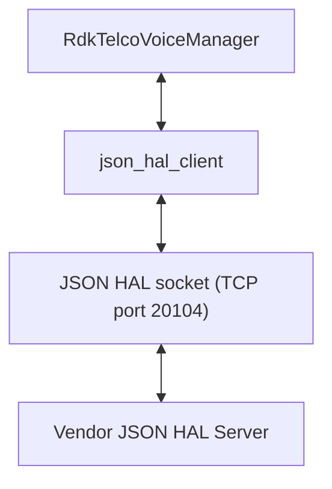
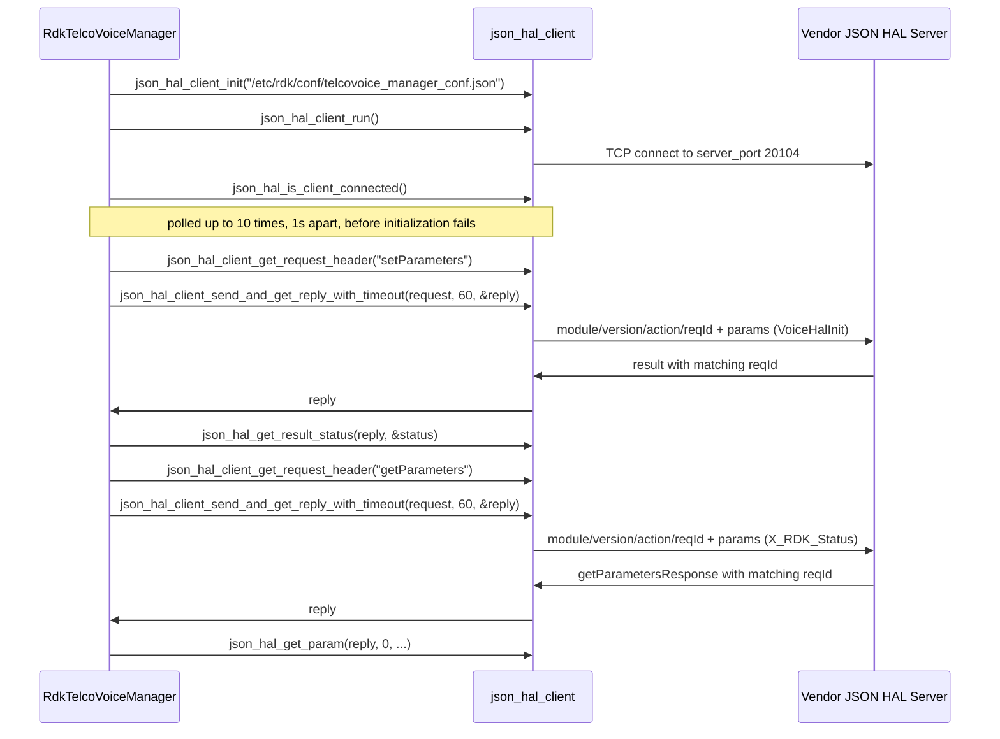
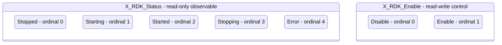

# Telco Voice HAL Documentation

## Version History

| Date | Comment | Version |
| --- | --- | --- |
| 2026-08-24 | Initial release. Specifies the Telco Voice `JSON` HAL contract carried by `hal_schema/telcovoice_hal_schema_v1.json` and `hal_schema/telcovoice_hal_schema_v2.json`, recorded as an `Unreleased` entry in [CHANGELOG.md](https://github.com/rdkcentral/telco-voice-manager/blob/main/CHANGELOG.md). | 1.0.0 |

## Acronyms

- `DECT` \- Digital Enhanced Cordless Telecommunications
- `DML` \- Data Model Layer, the `TR-181` parameter surface `RdkTelcoVoiceManager` exposes to the rest of `RDK-B`
- `FXO` \- Foreign Exchange Office, the port that connects to an external analogue line
- `FXS` \- Foreign Exchange Subscriber, the port that a telephone handset plugs into
- `HAL` \- Hardware Abstraction Layer
- `IPC` \- Inter-Process Communication
- `ISDN` \- Integrated Services Digital Network
- `JSON` \- JavaScript Object Notation
- `JSON-RPC` \- The remote procedure call convention carried over `JSON`, used by this HAL's transport
- `MGCP` \- Media Gateway Control Protocol
- `POTS` \- Plain Old Telephone Service
- `RDK-B` \- Reference Design Kit for Broadband Devices
- `RTP` \- Real-time Transport Protocol
- `SIP` \- Session Initiation Protocol
- `TCP` \- Transmission Control Protocol
- `TR-104` \- Broadband Forum Technical Report 104, which defines the `VoiceService` service data model
- `TR-181` \- Broadband Forum Technical Report 181, which defines the `Device:2` root data model
- `VoIP` \- Voice over Internet Protocol
- `WAN` \- Wide Area Network, the upstream connection whose state the voice service can be tied to

## Description

The diagram below describes a high-level software architecture of the Telco Voice HAL module
stack.

Diagrams in this document are fenced `mermaid` blocks. They render on GitHub; the generated
documentation site shows their source text.

The Telco Voice HAL is the interface between `RdkTelcoVoiceManager` and the vendor's voice
software. It is a `JSON` Schema contract rather than a C header: the two participants are separate
processes that exchange `JSON` messages over a `TCP` socket, and no library is linked across the HAL
boundary. The per-parameter detail that inline Doxygen carries for a C HAL is in
[halSpecDetailed.md](halSpecDetailed.md).

`RdkTelcoVoiceManager` is the `RDK-B` middleware component that owns voice services, and it is the
**client** of this interface; the vendor supplies the **server**, the Vendor JSON HAL Server of the
diagram. The manager presents voice
configuration and status to the rest of `RDK-B` as a `TR-181` `DML` surface under
`Device.Services.VoiceService`, and translates reads and writes on that surface into `JSON` HAL
requests through `json_hal_client`, the client library of `json-hal-library`. Other `RDK-B`
components reach voice services through that data model, not through this interface.

**Schema contracts and their consumer.** Each shipped schema file is consumed by
`RdkTelcoVoiceManager` alone, and the Vendor JSON HAL Server implements it:

| Schema file | Consumed by | Data model |
| --- | --- | --- |
| `hal_schema/telcovoice_hal_schema_v1.json` | `RdkTelcoVoiceManager` built for the `TR-104` v1 model | `VoiceService:1.x` |
| `hal_schema/telcovoice_hal_schema_v2.json` | `RdkTelcoVoiceManager` built for the `TR-104` v2 model | `VoiceService:2` |

The manager loads one schema, from the single path its client configuration names; which file is
installed at that path is the open question `Optional Components` states.

**Data model.** The `Device.Services.` container is defined by the `TR-181` root model
([`Device.Services.` in `Device:2.21`](https://cwmp-data-models.broadband-forum.org/tr-181-2-21-0-cwmp.html#D.Device:2.Device.Services.)),
and `VoiceService` is the `TR-104` service model that plugs into it. The `v2` schema matches
`VoiceService:2`, published as
[tr-104-2-0-1-cwmp](https://cwmp-data-models.broadband-forum.org/tr-104-2-0-1-cwmp.html): the
revision that introduced the `CallControl` and `Interwork` objects, modelled each `VoIP` connection
through `Client`, `Network` and `VoIPProfile` tables, and added `FXO`, `DECT`, `ISDN` and `SIP` proxy
and registrar support. The `v1` schema matches `TR-104` Issue 1, organised around `VoiceProfile`.
Both published Issue 1 revisions, `VoiceService:1.0`
([tr-104-1-0-0](https://cwmp-data-models.broadband-forum.org/tr-104-1-0-0.html)) and
`VoiceService:1.1`, define every non-vendor path the `v1` schema uses, so this document writes
`VoiceService:1.x` for either.

## Optional Components

**Two data-model variants ship, and the binding of a variant to a deployment is made outside this
repository.** The two schema files differ in scale and organisation:

| Schema file | Parameter definitions | Object definitions | Tree organised around |
| --- | --- | --- | --- |
| `telcovoice_hal_schema_v1.json` | 353 | 44 | `VoiceProfile` (280 of the 353 parameters) |
| `telcovoice_hal_schema_v2.json` | 776 | 115 | `SIP` (152), `CallControl` (148) and `CallLog` (95) |

The client configuration, `config/telcovoice_manager_conf.json`, names a single schema path,
`/etc/rdk/schemas/telcovoice_hal_schema.json`, which matches neither shipped filename; packaging or
device provisioning installs one variant there. Both variants declare the same `module` and
`schemaVersion` constants, so no message field identifies the variant in use. A deployment must install
the schema that matches the data model `RdkTelcoVoiceManager` was built for, which the manager
reports at runtime as `Platform or Product Customization` describes. Only 23 parameter definition
keys and 6 object definition keys are common to both files, and some of those differ in type or
constraint, so a client and server using different variants fail on individual parameters rather
than at the envelope. [halSpecDetailed.md](halSpecDetailed.md) lists the divergences key by key.

**Optional parameters.** Each schema divides its parameter surface into a supported list and an
optional list: `getParameters` accepts `getParameterSupportedList` or `getParameterOptionalList`, and
`setParameters` accepts `setParameterSupportedList` or `setParameterOptionalList`. A vendor server may
leave a parameter that is reachable only through an optional list unimplemented, so a caller treats
`Not Supported` on such a parameter as a normal outcome. [halSpecDetailed.md](halSpecDetailed.md)
records list membership per parameter, which also decides whether a parameter is writable.

**Optional actions.** `deleteObject` is in the action enumeration but is not usable under either
schema; `API Surface` gives the reason.

## Component Runtime Execution Requirements

### Initialization and Startup

`RdkTelcoVoiceManager` brings up the client side of this interface in a fixed order in
`TelcoVoiceMgrHal_Init()`, and issues no `JSON` HAL request before the sequence completes. The
`json_hal_*` functions are entry points of the `json-hal-library` transport client, declared by its
`json_hal_client.h`; they are not part of this HAL contract, which declares no functions.

1. `json_hal_client_init(TELCOVOICEMGR_CONF_FILE)` \- reads the client configuration
   `/etc/rdk/conf/telcovoice_manager_conf.json`, which supplies the schema path and the server port.
2. `json_hal_client_run()` \- starts the client socket thread, which connects to the vendor server.
3. `json_hal_is_client_connected()` \- polled up to `HAL_CONNECTION_RETRY_MAX_COUNT` (`10`) times,
   one second apart. The interval is fixed, not an exponential backoff, so the connection window is
   about ten seconds.
4. `TelcoVoiceMgrHal_InitData()` \- writes the HAL initialization flag, a boolean, with
   `setParameters`.

A failure at any step fails initialization, and no voice service is brought up.

**Vendor obligation.** The vendor server must accept connections on the configured port within the
connection window.

**Initialization-flag name mismatch.** The manager sends the flag as
`Devices.Services.VoiceHalInit`, with a plural `Devices`, while both schemas define
`Device.Services.VoiceHalInit`. A server that validates `setParameters` against the schema rejects
this first write, and one that matches the name loosely accepts it, so the outcome of initialization
depends on how strictly the vendor server validates.

### Threading Model

**One library thread carries all transport work.** `json_hal_client_run()` starts a single thread
inside `json_hal_client` that owns the socket. That thread delivers every reply, runs every
registered event callback and counts every request timeout. Callbacks registered with
`json_hal_client_subscribe_event()` therefore run on the library thread, not on the registering
thread, and they run while the library holds its non-recursive event-subscription lock.

**Caller obligations for event callbacks:**

- Do the minimum and return. While a callback runs, no reply is delivered and no timeout is counted
  for any outstanding request.
- Never make a synchronous HAL call from a callback. The call waits for a signal that only the
  library thread can send, so it never returns.
- Never call `json_hal_client_subscribe_event()` or `json_hal_client_terminate()` from a callback.
  Both take the lock the dispatch already holds, and deadlock.
- Hand further work, including any HAL read or write, to a thread the caller owns, and synchronize
  any state the callback shares with other threads.

**Concurrent requests.** `json_hal_client` does not synchronize request submission: it advances its
shared request-identifier counter, appends to its shared pending-request list and writes to the
socket without taking a lock. A caller therefore serializes each complete request exchange, from
building the request header to receiving its reply, because `reqId` correlation alone does not make
concurrent submission safe.

**Vendor obligation.** The vendor server must serve a single long-lived client connection that
carries sequential requests and unsolicited events, and every reply must carry the `reqId` of the
request it answers.

### Process Model

**Two processes across a socket.** The vendor implementation is a separate process reached over
`TCP`, not a shared object loaded into the caller, so:

- The two sides start, stop and fail independently; either may restart while the other runs.
- Every HAL call is an `IPC` round trip that can fail for transport reasons. A caller handles a
  transport failure separately from a `Failed` result status.
- Loss of the connection is a normal state, observable through `json_hal_is_client_connected()`.

**Fixed roles.** `RdkTelcoVoiceManager` is always the client and the vendor voice software is always
the server. The server listens on the port the shared client configuration names, `20104`, so both
sides agree on it without discovery. The exchange is `JSON-RPC` style, with the envelope described in
`Theory of operation and key concepts`; `API Surface` lists which side originates each action.

### Memory Model

No memory is shared across the HAL boundary; only serialized `JSON` documents cross it. On the
client side, requests and replies are reference-counted `json_object` handles: a request is built by
`json_hal_client_get_request_header()`, which fills in the envelope, and a reply is returned through
the out-parameter of `json_hal_client_send_and_get_reply_with_timeout()` or
`json_hal_client_send_and_get_reply()`. Both are released with `json_object_put()`.

#### Caller Responsibilities

- Release the request and the reply with `json_object_put()` on every path, including failure
  paths. Initialise the reply pointer to `NULL` and test it before releasing it, because an early
  failure leaves it untouched.
- Copy any value needed from a reply before releasing the reply.
- Copy everything needed from an event callback's buffer before the callback returns. The buffer
  belongs to the library and becomes invalid on return; it is never stored, passed to another
  thread or freed by the caller.
- Use a new request handle for each send, so that each `reqId` identifies one exchange.

#### Module Responsibilities

- The client library owns its receive buffers, reassembles a reply that spans several reads, and
  hands the caller a reply handle only for a complete parsed document; ownership of that handle then
  passes to the caller. Reassembly ends at the first read that does not fill the buffer, so a reply
  that arrives in short segments can be cut short and the exchange lost.
  [halSpecDetailed.md](halSpecDetailed.md) describes the read paths.
- The vendor server owns everything on its side of the socket, and must serve a fresh connection
  from a restarted manager without operator intervention.
- Process separation isolates allocations, not data: a malformed or hostile message still reaches
  the manager's parsing path, so a caller treats every received name and value as untrusted input.

### Power Management Requirements

This interface does not take part in device power management: no action, result status or
parameter signals or reports a device power-state transition. Parameters whose names contain `Power`
describe signal and line characteristics: the `TonePattern` `Power` entries are tone levels,
`DECT.Base.RFPowerControl` is radio transmit power, and `ISDN.BRI.PowerSourceOne` is an `ISDN` line
power source. A component that needs voice services quiesced before a power event writes
`X_RDK_Enable` through the ordinary parameter surface and sequences that write itself.

### Asynchronous Notification Model

**Subscribe, then receive.** The client registers interest with `subscribeEvent`, whose `params`
entries carry a parameter `name` and a `notificationType`. The server acknowledges it with `result`
and then sends unsolicited `publishEvent` messages carrying the parameter `name`, `type` and `value`.
Callbacks run on the library thread under the obligations in `Threading Model`.

**Notification types.** `notificationType` is one of `interval`, `onChange`, `onChangeSync` and
`onChangeSyncTimeout`, with `onChange` as the default. `onChangeSync` and `onChangeSyncTimeout` are
specific to this HAL, and there is no `periodic` member. `RdkTelcoVoiceManager` subscribes with
`onChangeSyncTimeout`.

**One subscribable parameter.** In both variants `subscribeEventSupportedList` binds exactly one
parameter, `Device.Services.VoiceService.{i}.X_RDK_Firewall_Rule_Data`; every other parameter is
polled with `getParameters`. Its value is a semicolon-terminated list of firewall rule tuples, each an
enable flag, a `SIP` or `RTP` protocol, a port and an IPv4 or IPv6 address, and
[halSpecDetailed.md](halSpecDetailed.md) gives the exact pattern. `RdkTelcoVoiceManager` applies the
rules to the voice service instance the event names.

**Tracking subscriptions.** `getActiveSubscriptions` returns no defined list (`API Surface`), so a
caller tracks its own subscriptions; `Internal Error Handling` describes how a caller confirms that
one is live.

**Vendor obligation.** A server must acknowledge a subscription to the supported parameter with
`result`, publish on change only for subscribed parameters, and accept a repeat subscription after a
client reconnects, because a restarted manager subscribes again.

### Blocking calls

The send-and-reply calls are synchronous: each blocks the calling thread until the server's reply
arrives or the wait expires, so HAL requests are not issued from a thread with latency obligations of
its own. `RdkTelcoVoiceManager` uses `json_hal_client_send_and_get_reply_with_timeout()` with
`HAL_SEND_AND_REPLY_TIMEOUT`, 60 seconds. The library counts the wait in receive-loop ticks of up to
250 milliseconds and clamps it to between 40 and 480 ticks, nominally 10 to 120 seconds, and the
untimed `json_hal_client_send_and_get_reply()` uses the 40-tick floor, so a caller that needs a hard
deadline enforces its own. At startup, the connection poll of `Initialization and Startup` blocks for
up to ten one-second attempts. `publishEvent` messages of every `notificationType`, including
`onChangeSync` and `onChangeSyncTimeout`, arrive asynchronously on the library thread, and no caller
blocks waiting for them.

### Internal Error Handling

**Errors are reported in the reply.** There is no error callback or error event. A failed
send-and-reply call is a transport failure, and the request may never have been processed; a
`Result.Status` in the reply means the server received the request and answered it with one of the
four `resultStatusEnumList` values. `json_hal_get_result_status()` only classifies that value, true
for `Success` and false for the other three, so a caller that acts per status reads the `Status`
string from the reply's `Result` object and compares it for equality with each value:

| Status | Meaning | What the caller should do |
| --- | --- | --- |
| `Success` | The server reported success. The status is the vendor's answer, not proof that a write took effect. | Proceed. For a write whose effect matters, read the affected parameter back: `Device.Services.VoiceService.{i}.X_RDK_Status` for service enablement. |
| `Failed` | The request was understood but could not be applied. | Do not retry unchanged. Log the parameter and the status, and report the failure upward. |
| `Invalid Argument` | A parameter name, type or value was not acceptable. | Do not retry. Correct the request against the parameter's name, datatype and constraint in the schema. |
| `Not Supported` | The vendor or the transport has no implementation or handler for the parameter or action, or a server built with `JSON_SCHEMA_VALIDATION_ENABLED` found its own reply invalid after the action ran. The status alone proves neither an unimplemented capability nor an unapplied write. | For a write, read the affected state back before retrying or ceasing to use the parameter; do not re-send the request unchanged. For a parameter reachable only through an optional list, this is a normal outcome. |

**Subscription status is not returned.** `json_hal_client_subscribe_event()` returns success
whenever a reply arrives, without reading its status, so a refused subscription is
indistinguishable from an accepted one. A later `publishEvent` for the parameter is the only evidence
that a subscription is live.

**Vendor obligation.** A server must answer every request promptly, including one it cannot satisfy,
with the status that describes the outcome; an unanswered request costs the caller its full wait. It
must not report `Success` for a write it did not apply.

### Persistence Model

`Success` on `setParameters` reports the server's answer, not a verified or persisted effect. No
action or result status requests or reports persistence, so a caller does not infer that a
written value survives a reboot, a vendor restart or a reconnection.

**Manager-side persistence.** `RdkTelcoVoiceManager` persists values in its own local store, above
the HAL boundary. For the voice enable control, the behaviour depends on the build macro
`TELCO_VOICE_FEATURE_ENABLE_PERSIST`:

- **Defined:** the manager stores the enable value locally after the HAL write succeeds, and the
  stored configuration is authoritative.
- **Not defined, the default:** the manager derives the enable state from `WAN` link state and
  stores nothing.

**Consequence.** A caller re-applies any value it needs after a restart on either side of the
socket, and a vendor server accepts re-application of a value it has already received.

## Non functional requirements

### Logging and debugging requirements

**Debug controls.** In both schemas, `Device.Services.VoiceService.{i}.X_RDK_Debug.` holds five
read-write parameters that control the vendor voice software's diagnostics: `ModuleLogLevels` sets
per-module log levels, `LogServer` and `LogServerPort` name a remote destination for protocol-message
logs, and `CCTKTraceGroup` and `CCTKTraceLevel` select the vendor stack's trace group bitmask and
trace level. [halSpecDetailed.md](halSpecDetailed.md) gives their types and constraints.

**Log levels are the `printk` scale.** `ModuleLogLevels` is a comma-separated list of `name=value`
pairs, each naming a vendor-defined voice module and a level from `0`, an emergency log, to `7`, a
debug log; a keyword such as `ERROR` is not a valid level. A caller can therefore raise verbosity for
one module while leaving the rest quiet.

**Manager-side logging.** `RdkTelcoVoiceManager` logs through the `RDK-B` trace facility, tracing
`JSON` requests and replies at informational level and failures at error level. Those traces carry
whole messages, and the manager's credential filter covers only some requests, so whole-message
tracing must be sanitized or disabled before a build reaches a subscriber device.

**Sensitive data.** Implementations must not log credentials, secrets, security-sensitive information, or other sensitive data.
Subscriber personal data, such as telephone numbers and call records, is sensitive data under this
rule. The rule binds the vendor implementation and every caller, and it applies:

- at every log level, including debug builds;
- to every output: vendor logs, the remote log server set through `LogServer` and `LogServerPort`,
  `syslog`, standard output and error, trace buffers, crash dumps and telemetry.

A diagnostic involving a sensitive value records only the parameter path, the outcome and a fixed
redaction marker in place of the value, never the value itself. A rejected value is never logged.
Buffers that held sensitive data, including serialized `JSON` messages, are cleared after use on
every path.

**Vendor obligation.** A vendor implementation honours the level written to `ModuleLogLevels`, does
not exceed it in normal operation, and includes a timestamp, the level and a message in each entry.

### Memory and performance requirements

The bounds a caller designs against are those of the transport:

| Bound | Value | Consequence |
| --- | --- | --- |
| Request size | 16384 bytes | The vendor server reads each request once into a fixed buffer, so a caller splits a larger `params` batch across requests. |
| Reply size | Not capped at one buffer | The client accumulates a multi-read reply on the heap, as `Memory Model` describes, so a caller accepts replies larger than 16384 bytes. |
| Server connection backlog | 32 | The listen backlog on the vendor side of the socket. |

Reply-wait bounds are in `Blocking calls`.

**Caller Responsibilities:**

- Poll at a moderate interval. Only one parameter is subscribable, and a tight poll loop over a
  socket round trip is the likeliest way to make this interface a bottleneck.
- Release reply handles promptly, as `Memory Model` requires; a leaked `JSON` document is the one
  unbounded growth this interface makes easy.

**Vendor Implementation Responsibility:**

- Keep resource use bounded over the long-lived connection, which the manager opens once at
  startup.
- Publish events only for genuine changes to the subscribed parameter, never for every internal
  update.

### Quality Control

**Review route.** Changes reach this repository through GitHub pull requests, as
[`CONTRIBUTING.md`](https://github.com/rdkcentral/telco-voice-manager/blob/main/CONTRIBUTING.md)
directs, from contributors who have signed the RDK Contributor License Agreement. The `CLA` workflow,
`.github/workflows/cla.yml`, which delegates to `rdkcentral/cmf-actions/.github/workflows/cla.yml@v1`,
is the repository's automated check, and the pull-request reviewer is responsible for keeping this
document current.

**Freshness trigger.** Any change to a file listed in `Source References` obliges a review of the
topics that rely on it: the schemas for the protocol, data-structure and state topics, the client
configuration for the schema path and port, and the manager's HAL client source for initialization,
timeouts and logging.

**Recommended verification practice.** Static analysis with a tool such as `Coverity` and a
zero-warning policy; licence and composition scanning with a tool such as `Black Duck`; and dynamic
memory checking with a tool such as `Valgrind`, which suits the reference-counted `json_object`
handling of `Memory Model`. A vendor also validates every message its server sends and receives
against the shipped schema, which catches the initialization-flag mismatch in
`Initialization and Startup`.

### Licensing

`RdkTelcoVoiceManager`, including the schemas that form this HAL contract, is released under the
**Apache License, Version 2.0**. The licence text is in `LICENSE`, `COPYING` links to the same text,
and the attributions are in `NOTICE`; a schema file shipped on its own takes its licence terms from
those root files. An integrator redistributing the component preserves all three attributions:

| Holder | Terms |
| --- | --- |
| Copyright (c) 2020 Sky | Apache License, Version 2.0. The component's own copyright. |
| Copyright 2014 Cisco Systems, Inc. | Apache License, Version 2.0. Included material. |
| Copyright (c) 1986 Gary S. Brown | Usable, including code or tables extracted from it, without restriction. |

**Vendor obligation.** A vendor server implementation is expected to be released under the Apache
License, Version 2.0, consistent with the rest of the `RDK-B` HAL estate, and carries forward in its
own notice file the terms of any third-party material it incorporates.

### Build Requirements

**No HAL library is built or linked.** A vendor delivers a server process that speaks the protocol
and validates against the shipped schema; this repository delivers the schema file for the path in
`Optional Components`.

**Client side.** `RdkTelcoVoiceManager` builds with `autotools` into the `telcovoice_manager`
executable. Its middle layer, which contains all HAL interaction, links
`-lccsp_common -ljson_hal_client -ljson-c -lcjson -lrbus -lpthread`, and the executable also links
`-lrdkloggers`, `-lsyscfg`, `-lsysevent` and `-lwebconfig_framework`. `json_hal_client` comes from
`json-hal-library` at commit `86a0a300b976f8e3295064af8fb3fd1c793c9e64`.

**The `json-c` dependency.** `json-hal-library` declares `json-c (0.11)` as its minimum, and its
upstream native build is exercised against `json-c-0.15-20200726`. Unpatched upstream `json-c 0.11`
must not be deployed in production: it is affected by `CVE-2013-6370`, a buffer overflow;
`CVE-2013-6371`, a hash-collision denial of service; and `CVE-2020-12762`, an integer overflow
leading to an out-of-bounds write, fixed in `json-c 0.15`. The transport is loopback-only
(`127.0.0.1`), so the exposure is a hostile or faulty local peer, but received bytes reach the
`json-c` parser before any schema validation. A production build therefore links a distribution
`json-c` that carries backports of these fixes, or upstream `0.15` or later.

**Build-time selection.** The data model the manager is compiled against is a build decision;
`Variability Management` and `Platform or Product Customization` describe the controls.

### Variability Management

**The schema version is fixed.** The envelope's `version` field is bound to the `schemaVersion`
definition, a `const` of `0.0.1` in both schema files. Its description states that the value must
not be modified and that HAL operation cannot be performed without the correct supported version, and
each schema file states that its contents must not be modified and that the RDK community team makes
and releases the necessary changes. Consequently:

- A vendor sends `0.0.1` in the `version` field of every message and rejects a message carrying any
  other value.
- Neither participant extends a shipped schema locally. Payload objects set
  `additionalProperties: false`, so a locally added field makes the message invalid.
- A parameter a deployment needs but the schema lacks is an upstream change request.

Interface evolution follows [Semantic Versioning 2.0.0](https://semver.org/spec/v2.0.0.html), and a
vendor implementation complies with a specific schema version. The schema version is distinct from
the repository's release tags, and the `v1` and `v2` in the schema filenames name data-model
variants, not schema versions.

**Build inputs.** Two preprocessor macros vary the manager, and each is off in a build that does not
define it:

| Build input | What it varies |
| --- | --- |
| `FEATURE_RDKB_VOICE_DM_TR104_V2` | Which `TR-104` data model the manager implements, and therefore which schema a deployment must install. |
| `TELCO_VOICE_FEATURE_ENABLE_PERSIST` | Whether the voice enable state is persisted locally or follows `WAN` link state, as `Persistence Model` describes. |

The data-model choice travels through two mechanisms that must agree. The macro selects the
parameter header and parameter path templates the middle layer compiles against, and the `automake`
conditional `VOICE_V2`, true when the environment variable `ISRDKB_VOICE_DM_TR104_V2` is `true`,
selects the matching source set. A build that sets one without the other is incoherent.

### Platform or Product Customization

**One macro selects the shape of the whole parameter tree.** The two models that
`FEATURE_RDKB_VOICE_DM_TR104_V2` chooses between address the same telephony concepts through
different objects, so the setting decides which paths exist. Under `v2` the manager addresses lines
as `Device.Services.VoiceService.%d.CallControl.Line.%d.` and under `v1` as
`Device.Services.VoiceService.%d.VoiceProfile.%d.Line.%d.`.

| | `v1` (macro not defined) | `v2` (macro defined) |
| --- | --- | --- |
| Organised around | `VoiceProfile`, with `Capabilities` and `PhyInterface` alongside | A flattened tree led by `SIP`, `CallControl`, `CallLog`, `Capabilities` and `VoIPProfile` |
| Telephony scope | `VoIP` with `SIP` and `MGCP` signalling, addressed per profile and line | Adds `POTS` with `FXS` and `FXO`, `DECT`, `ISDN`, `H323`, `Trunk`, `Interwork`, `Terminal`, `Tone`, `CodecProfile`, `ClockSynchronization` and `ReservedPorts` |

**Paths do not port between variants.** The common surface is mostly the `X_RDK_*` extensions listed
in `API Surface`, which is why the runtime topics of this document use them; `Optional Components`
gives the size of the shared surface and where it diverges.

**Discovering the variant at runtime.** `Device.X_RDK_TelcoVoice.DatamodelVersion`, on
`RdkTelcoVoiceManager`'s own data model, returns `TR104V2` or `TR104V1`: the model the manager was
compiled for. It reports the manager's build, not the schema file installed on the device.

## Interface API Documentation

### Theory of operation and key concepts

**One envelope, one action field, one conditional payload.** Every message in either direction is a
single `JSON` object with four required fields, `module`, `version`, `action` and `reqId`, and the
`action` value decides which payload, if any, it also carries. There is no other framing or message
type.

**Correlation is by `reqId` only.** `reqId` is a **string** of digits matching `^[0-9]+$`, so `"42"`
is valid and `42` is not. A reply carries the `reqId` of the request it answers, and the client
matches on that field rather than on arrival order.

**Module and version are constants.** `module` is the `const` `voicehal` in both schemas; it
identifies the contract rather than routing between modules, and a message bearing any other value
is invalid. `version` is fixed as `Variability Management` sets out.

**Parameters are `TR-181` paths carried as data.** Reads and writes name data model paths, such as
`Device.Services.VoiceService.1.X_RDK_Status`, inside a `params` array, and the schema validates each
entry against that path's parameter definition. Those definitions take the place of a C HAL's
function signatures, and [halSpecDetailed.md](halSpecDetailed.md) documents each.

#### Object Lifecycles

- **Objects are addressed, not constructed.** An object definition carries only a `name`, an
  instance-path expression such as `^Device\.Services\.VoiceService\.\d+\.$`, whose numeric segment
  identifies the instance.
- **Instances are created on the vendor side.** No action creates an instance and there is no
  `addObject`; a caller discovers instances through the parameter surface.
- **Instances are not deleted through this interface,** because `deleteObject` is unusable
  (`API Surface`).
- **No handle outlives a message.** The only lifetimes a caller manages are the local `JSON` handles
  of `Memory Model`.

#### Method Sequencing

- **Initialization first.** The bring-up in `Initialization and Startup`, with connectivity confirmed
  by polling, completes before any request is issued.
- **Then ordering follows the data.** The schema imposes no order among `getParameters`,
  `setParameters`, `getSchema` and `subscribeEvent`; a caller learns an instance number before it
  addresses a parameter within that instance.
- **Subscribe once at start-up.** `RdkTelcoVoiceManager` subscribes during its controller start-up
  rather than per read, and subscribes again after a restart.
- **Two actions carry the traffic.** The manager defines action constants only for `getParameters`
  and `setParameters` (`GET_PARAMETER_METHOD` and `SET_PARAMETER_METHOD`); a vendor server still
  implements every action it is expected to answer.

#### State-Dependent Behavior

- **One control and one observable.** `Device.Services.VoiceService.{i}.X_RDK_Enable`, read-write,
  drives the voice service and `Device.Services.VoiceService.{i}.X_RDK_Status`, read-only, reports
  it. `State Diagram` gives both value sets.
- **Transport state is a separate axis.** A request can fail because the socket is disconnected in
  any voice state, as `Process Model` describes.
- **A write's effect can lag.** `Success` on `X_RDK_Enable` means the value was accepted; a caller
  reads `X_RDK_Status` to learn that the service has started or stopped.
- **Unsupported parameters do not depend on state.** A parameter the vendor does not implement
  returns `Not Supported` in every state (`Optional Components`).

### Data Structures and Defines

The equivalents of a C HAL's types are schema definitions. A caller builds and reads the ones below,
each specified in the topic named; [halSpecDetailed.md](halSpecDetailed.md) gives their exact
constraints under `Transport and Protocol`, `Object Index`, `Parameter Reference` and
`Enumeration Appendix`.

| Definition | What it is | Specified in |
| --- | --- | --- |
| Envelope | The required root of every message | `Theory of operation and key concepts` |
| `params` | A non-empty array of distinct parameter entries. Each entry has a `name`, plus a `type` and a `value` in `setParameters` and `getParametersResponse` | This topic; `Asynchronous Notification Model` for event entries |
| `Result` | The `result` payload | `Internal Error Handling` |
| `SchemaInfo` | The `getSchemaResponse` payload, whose one field is `FilePath` | This topic |
| Parameter definition | Constrains an entry's `name` (a `const` path or an instance regular expression), `type` (the `TR-181` datatype, of which `hexBinary` is `v2`-only) and `value` | `Parameter Reference` in [halSpecDetailed.md](halSpecDetailed.md) |
| Object definition | An instance path | `Object Lifecycles` |
| `action` | The eleven actions | `API Surface` |
| `resultStatusEnumList` | The values of `Result.Status` | `Internal Error Handling` |
| `notificationType` | The subscription types | `Asynchronous Notification Model` |
| `voiceStatusEnumList`, `voiceStateEnumList` | The values of `X_RDK_Status` and `X_RDK_Enable` | `State Diagram` |

A caller treats every enumeration as closed.

**The schema path in `SchemaInfo.FilePath` is server-supplied: compare it, never dereference it.** Its pattern admits
`..` segments, absolute paths, links and device nodes, so a valid reply says nothing about the path's
safety. A caller compares it for exact equality with the configured `hal_schema_path`,
`/etc/rdk/schemas/telcovoice_hal_schema.json`, never opens, resolves or derives a path from it, and
on a mismatch fails closed, reporting its configured path rather than the received text. The
transport library opens only the configured path.

### API Surface

This topic is the boundary between the overview and the protocol detail in
[halSpecDetailed.md](halSpecDetailed.md), which carries every parameter definition, object path,
enumeration and worked message exchange.

**The callable surface is eleven action values**, declared identically and in the same order in both
schemas:

| Action | Originated by | Payload it must carry |
| --- | --- | --- |
| `getSchema` | Client | none |
| `getParameters` | Client | `params` |
| `getParametersResponse` | Server | `params` |
| `setParameters` | Client | `params` |
| `subscribeEvent` | Client | `params` |
| `getActiveSubscriptions` | Client | none |
| `getActiveSubscriptionsResponse` | Server | none |
| `getSchemaResponse` | Server | `SchemaInfo` |
| `publishEvent` | Server, unsolicited | `params` |
| `deleteObject` | Client | `params`, but unusable |
| `result` | Server | `Result` |

**Eight actions bind a payload; three are the bare envelope.** `getActiveSubscriptionsResponse` has
no defined content, so whatever a server places there is vendor-specific, and the client library
offers no call that issues `getActiveSubscriptions`.

**There is no `setParametersResponse`.** `setParameters` and `subscribeEvent` are acknowledged by the
generic `result` action carrying `Result.Status`, while `getParameters` and `getSchema` have dedicated
responses.

**Object deletion is not supported.** The `deleteObject` payload definition carries an empty `anyOf`
in both schemas, which no message can satisfy. A caller does not attempt object deletion through
this interface, and a vendor need not implement it.

**The object tree.** Every voice parameter lives under `Device.Services.VoiceService`, addressed per
instance as `Device.Services.VoiceService.{i}.` and below. The one definition outside that tree, in
both variants, is `Device.Services.VoiceHalInit`, the boolean initialization flag written at
start-up. The parameters common to both variants are the `X_RDK_*` extensions, chiefly
`X_RDK_Enable`, `X_RDK_Status`, `X_RDK_FactoryReset`, `X_RDK_Firewall_Rule_Data`,
`X_RDK_BoundIfName`, `X_RDK_BoundIpAddr`, `X_RDK_IpAddressFamily`, `X_RDK_DnsServers`,
`X_RDK_DisableLoopCurrentUntilRegistered` and the five `X_RDK_Debug` parameters.

### Sequence Diagram

A cold start followed by one read. Every call is a `json-hal-library` entry point declared by
`json_hal_client.h` or `json_hal_common.h`, and every action is a member of the schemas' `action`
enumeration.

The first message a server sees is the `setParameters` write of the initialization flag, answered by
`result`; the read is answered by `getParametersResponse`. Events take a separate path:
`RdkTelcoVoiceManager` calls `json_hal_client_subscribe_event()` once, and the server's
`publishEvent` messages then arrive unsolicited, as `Asynchronous Notification Model` describes.

### State Diagram

The state-bearing part of this interface is two parameters per voice service instance. Each is bound
to its own enumeration, which no other parameter uses and which is identical in both variants:

| Parameter | Access | Values, with the ordinal the manager's data model assigns |
| --- | --- | --- |
| `Device.Services.VoiceService.{i}.X_RDK_Status` | Read-only | `Stopped` 0, `Starting` 1, `Started` 2, `Stopping` 3, `Error` 4 (`voiceStatusEnumList`) |
| `Device.Services.VoiceService.{i}.X_RDK_Enable` | Read-write | `Disable` 0, `Enable` 1 (`voiceStateEnumList`) |

The interface closes both value sets but defines no transitions between their values, so the diagram
declares the states without edges or an initial state.

- **Rely on the value set, not on an ordering.** A status outside the five values is a vendor defect.
  The client library does not validate replies against the schema, and `RdkTelcoVoiceManager` ignores
  an unrecognised status string and keeps its previous value, so a caller rejects or logs such a
  value rather than modelling a sixth state.
- **Read the current state.** `X_RDK_Status` is polled, not subscribable, so intermediate values can
  be missed between reads; a caller reads it rather than tracking state locally.
- **Leaving `Error`.** A caller may write `Disable` and then `Enable`, or use `X_RDK_FactoryReset`,
  and reads `X_RDK_Status` to see the result.
- **Not a registration diagram.** `SIP` and `DECT` registration statuses are unconstrained strings,
  read like any other parameter.
- **Transport state is separate.** The socket can be disconnected in any of the five states, as
  `Process Model` describes.

## Source References

- [rdkcentral/telco-voice-manager/hal_schema/telcovoice_hal_schema_v1.json](https://github.com/rdkcentral/telco-voice-manager/blob/main/hal_schema/telcovoice_hal_schema_v1.json) — `v1` schema contract
- [rdkcentral/telco-voice-manager/hal_schema/telcovoice_hal_schema_v2.json](https://github.com/rdkcentral/telco-voice-manager/blob/main/hal_schema/telcovoice_hal_schema_v2.json) — `v2` schema contract
- [rdkcentral/telco-voice-manager/config/telcovoice_manager_conf.json](https://github.com/rdkcentral/telco-voice-manager/blob/main/config/telcovoice_manager_conf.json) — client configuration: schema path and server port
- [rdkcentral/telco-voice-manager/config/RdkTelcoVoiceManager_v1.xml](https://github.com/rdkcentral/telco-voice-manager/blob/main/config/RdkTelcoVoiceManager_v1.xml) — `v1` `TR-181` data model and value ordinals
- [rdkcentral/telco-voice-manager/config/RdkTelcoVoiceManager_v2.xml](https://github.com/rdkcentral/telco-voice-manager/blob/main/config/RdkTelcoVoiceManager_v2.xml) — `v2` `TR-181` data model and value ordinals
- [rdkcentral/telco-voice-manager/source/TR-181/middle_layer_src/telcovoicemgr_dml_hal.h](https://github.com/rdkcentral/telco-voice-manager/blob/main/source/TR-181/middle_layer_src/telcovoicemgr_dml_hal.h) — HAL client constants: configuration path, timeout, retry count, action and notification-type names, path templates
- [rdkcentral/telco-voice-manager/source/TR-181/middle_layer_src/telcovoicemgr_dml_hal.c](https://github.com/rdkcentral/telco-voice-manager/blob/main/source/TR-181/middle_layer_src/telcovoicemgr_dml_hal.c) — HAL bring-up, requests, event handling and tracing
- [rdkcentral/telco-voice-manager/source/TR-181/middle_layer_src/telcovoicemgr_dml_telcovoice.c](https://github.com/rdkcentral/telco-voice-manager/blob/main/source/TR-181/middle_layer_src/telcovoicemgr_dml_telcovoice.c) — `DatamodelVersion` reporting
- [rdkcentral/telco-voice-manager/source/TR-181/middle_layer_src/telcovoicemgr_dml_hal_param_v1.c](https://github.com/rdkcentral/telco-voice-manager/blob/main/source/TR-181/middle_layer_src/telcovoicemgr_dml_hal_param_v1.c) — `v1` status mapping
- [rdkcentral/telco-voice-manager/source/TR-181/middle_layer_src/telcovoicemgr_dml_hal_param_v2.c](https://github.com/rdkcentral/telco-voice-manager/blob/main/source/TR-181/middle_layer_src/telcovoicemgr_dml_hal_param_v2.c) — `v2` status mapping and enable-state caching
- [rdkcentral/telco-voice-manager/source/TR-181/middle_layer_src/Makefile.am](https://github.com/rdkcentral/telco-voice-manager/blob/main/source/TR-181/middle_layer_src/Makefile.am) — middle-layer libraries and `VOICE_V2` source set
- [rdkcentral/telco-voice-manager/source/TR-181/integration_src.shared/telcovoicemgr_services_apis.c](https://github.com/rdkcentral/telco-voice-manager/blob/main/source/TR-181/integration_src.shared/telcovoicemgr_services_apis.c) — enable-state persistence and `WAN`-derived enable state
- [rdkcentral/telco-voice-manager/source/TelcoVoiceManager/telcovoicemgr_controller.c](https://github.com/rdkcentral/telco-voice-manager/blob/main/source/TelcoVoiceManager/telcovoicemgr_controller.c) — event subscription at start-up
- [rdkcentral/telco-voice-manager/source/TelcoVoiceManager/Makefile.am](https://github.com/rdkcentral/telco-voice-manager/blob/main/source/TelcoVoiceManager/Makefile.am) — `telcovoice_manager` executable and its libraries
- [rdkcentral/telco-voice-manager/configure.ac](https://github.com/rdkcentral/telco-voice-manager/blob/main/configure.ac) — `VOICE_V2` conditional
- [rdkcentral/telco-voice-manager/CHANGELOG.md](https://github.com/rdkcentral/telco-voice-manager/blob/main/CHANGELOG.md) — release history
- [rdkcentral/telco-voice-manager/CONTRIBUTING.md](https://github.com/rdkcentral/telco-voice-manager/blob/main/CONTRIBUTING.md) — contribution route
- [rdkcentral/telco-voice-manager/LICENSE](https://github.com/rdkcentral/telco-voice-manager/blob/main/LICENSE) — licence text
- [rdkcentral/telco-voice-manager/NOTICE](https://github.com/rdkcentral/telco-voice-manager/blob/main/NOTICE) — copyright attributions
- [rdkcentral/telco-voice-manager/.github/workflows/cla.yml](https://github.com/rdkcentral/telco-voice-manager/blob/main/.github/workflows/cla.yml) — contributor licence check
- [rdkcentral/json-hal-library/json_hal_client.h](https://github.com/rdkcentral/json-hal-library/blob/86a0a300b976f8e3295064af8fb3fd1c793c9e64/json_hal_client.h) — client entry points
- [rdkcentral/json-hal-library/json_hal_client.c](https://github.com/rdkcentral/json-hal-library/blob/86a0a300b976f8e3295064af8fb3fd1c793c9e64/json_hal_client.c) — client thread, event dispatch, locking, request timeouts and subscription
- [rdkcentral/json-hal-library/json_hal_common.h](https://github.com/rdkcentral/json-hal-library/blob/86a0a300b976f8e3295064af8fb3fd1c793c9e64/json_hal_common.h) — message helpers
- [rdkcentral/json-hal-library/json_hal_common.c](https://github.com/rdkcentral/json-hal-library/blob/86a0a300b976f8e3295064af8fb3fd1c793c9e64/json_hal_common.c) — configuration and schema loading
- [rdkcentral/json-hal-library/json_hal_server.c](https://github.com/rdkcentral/json-hal-library/blob/86a0a300b976f8e3295064af8fb3fd1c793c9e64/json_hal_server.c) — server request dispatch, reply validation and result-status substitution
- [rdkcentral/json-hal-library/tcp_client.c](https://github.com/rdkcentral/json-hal-library/blob/86a0a300b976f8e3295064af8fb3fd1c793c9e64/tcp_client.c) — client receive loop and reply reassembly
- [rdkcentral/json-hal-library/tcp_client.h](https://github.com/rdkcentral/json-hal-library/blob/86a0a300b976f8e3295064af8fb3fd1c793c9e64/tcp_client.h) — loopback server address and loop timeout
- [rdkcentral/json-hal-library/tcp_server.c](https://github.com/rdkcentral/json-hal-library/blob/86a0a300b976f8e3295064af8fb3fd1c793c9e64/tcp_server.c) — server receive buffer and listen backlog
- [rdkcentral/json-hal-library/json-rpc-common/json_rpc_common.h](https://github.com/rdkcentral/json-hal-library/blob/86a0a300b976f8e3295064af8fb3fd1c793c9e64/json-rpc-common/json_rpc_common.h) — message buffer size
- [rdkcentral/json-hal-library/README.md](https://github.com/rdkcentral/json-hal-library/blob/86a0a300b976f8e3295064af8fb3fd1c793c9e64/README.md) — declared `json-c` dependency
- [rdkcentral/json-hal-library/cov_docker_script/component_config.json](https://github.com/rdkcentral/json-hal-library/blob/86a0a300b976f8e3295064af8fb3fd1c793c9e64/cov_docker_script/component_config.json) — `json-c` revision of the upstream build
