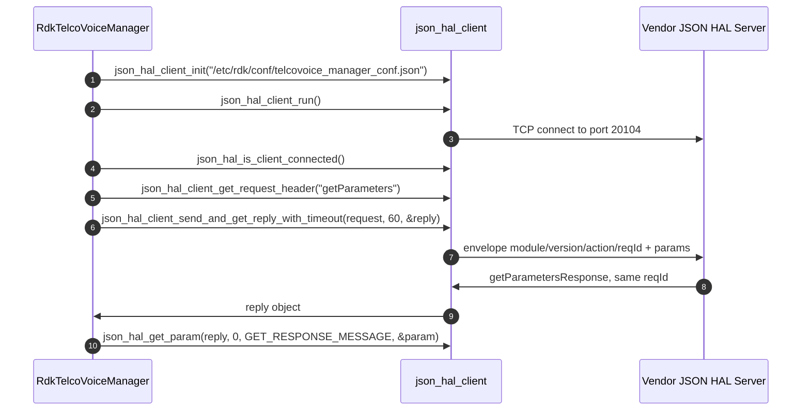
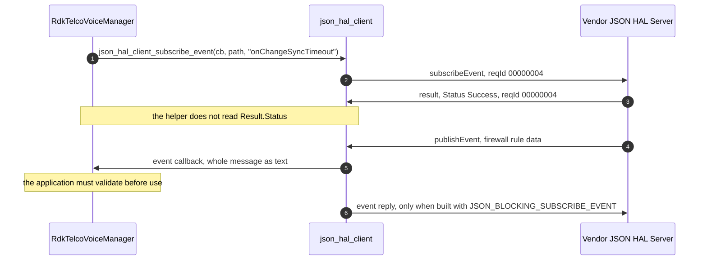

# Telco Voice HAL Detailed API Reference

This is the per-parameter and per-action reference for the Telco Voice `JSON` HAL. A `C` HAL carries
this detail as inline Doxygen in its header; this interface has no header, so the detail is carried
here. [halSpec.md](halSpec.md) is the interface specification and points to this document for depth.

## Purpose

This document covers the two schema files this repository ships,
`hal_schema/telcovoice_hal_schema_v1.json` and `hal_schema/telcovoice_hal_schema_v2.json`. Both are
consumed by RdkTelcoVoiceManager alone; the vendor JSON HAL server implements whichever one a
deployment installs. RdkTelcoVoiceManager is built against one of the two `TR-104` data models
(`FEATURE_RDKB_VOICE_DM_TR104_V2` selects `v2`) and reads the schema from the path its configuration
names, `/etc/rdk/schemas/telcovoice_hal_schema.json`. That name matches neither shipped file, and
nothing in this repository installs either file under it, so which variant a device runs is decided
by the build or packaging layer. Both variants declare the same `moduleName` and `schemaVersion`, so
the variant cannot be told from the wire, and every row that differs between them is shown per
variant.

Every Description cell is the schema's own `description`, with its `(Access = …)` marker moved to the
Access column. Twenty descriptions do not describe their parameter; each is reproduced and then
corrected or marked underived (`D13` under `Contract Defects`).

### Broadband Forum data model

The schemas record no model revision. It was identified by matching every non-vendor path, with its
`Device.Services.` prefix removed, and its datatype against the Broadband Forum model index at
[cwmp-data-models.broadband-forum.org](https://cwmp-data-models.broadband-forum.org/):

| Schema file | Broadband Forum model | Reference |
|---|---|---|
| `telcovoice_hal_schema_v1.json` | `TR-104` Issue 1: earliest compatible publication `VoiceService:1.0` (`tr-104-1-0-0`); `VoiceService:1.1` (`tr-104-1-1-0`) is equally consistent | [tr-104-1-0-0](https://cwmp-data-models.broadband-forum.org/tr-104-1-0-0.html); machine-readable `tr-104-1-0-0-full.xml` on the same host |
| `telcovoice_hal_schema_v2.json` | `TR-104` Issue 2, `VoiceService:2.0` as published in `tr-104-2-0-1` | [tr-104-2-0-1-cwmp](https://cwmp-data-models.broadband-forum.org/tr-104-2-0-1-cwmp.html); machine-readable [tr-104-2-0-1-cwmp-full.xml](https://cwmp-data-models.broadband-forum.org/tr-104-2-0-1-cwmp-full.xml) |

- `v1`: 324 of its 325 non-`X_RDK` parameters exist verbatim in `VoiceService:1.0`, and
  `VoiceService:1.1` matches the same 324, so the schema identifies the issue but not the minor
  revision. Every `v1` semantic in this document is one both revisions agree on. Issue 2 matches 8
  of the 325.
- `v2`: 733 of its 734 non-`X_RDK` parameters exist verbatim in `tr-104-2-0-1`. `tr-104-2-0-0`
  matches 732, lacking `VoiceService.{i}.CallLog.{i}.Session.{i}.SIPSessionID`, and `tr-104-2-0-2`
  matches the same set as `2-0-1`. Issue 1 matches 8 of the 734.
- The one unmatched parameter in both files is `Device.Services.VoiceHalInit`
  (`servicesVoiceHalInit`), this HAL's own initialisation parameter and the only definition outside
  the `VoiceService` tree.

No matched parameter's datatype contradicts the model. The differences between `type.const` and the
model datatype are renderings:

| Model datatype | Schema `type.const` | `v1` | `v2` |
|---|---|---|---|
| A list | `string`, carrying the comma-separated list | 3 | 19 |
| A named string type such as `IPAddress` or `dateTime` | `string` | 1 | 9 |
| `StatsCounter64` | `unsignedLong`, its base type | 0 | 8 |
| `StatsCounter32` | `unsignedInt`, its base type | 0 | 6 |
| `DiagnosticsState` | `string` | 0 | 3 |
| Any | none — the ten definitions under `Definitions the schema leaves unconstrained` | 1 | 9 |

**Vendor extensions.** The 28 `v1` and 42 `v2` `X_RDK_*` parameters have no counterpart in the model.
Their type, writability, character restrictions and defaults come from
`config/RdkTelcoVoiceManager_v1.xml`, `config/RdkTelcoVoiceManager_v2.xml`,
`config/telcovoice_config_default_v2.json` and the setters under `source/TR-181/`. Where none of these
establishes a meaning, the row marks the semantic underived.

**Counts, per file.** A definition present in both files is counted once per file.

| | `v1` | `v2` |
|---|---|---|
| Definitions in the file | 418 | 913 |
| Parameter definitions | 353 | 776 |
| Object definitions | 44 | 115 |
| Enumeration definitions | 5 | 5 |
| Envelope and action-payload definitions | 16 | 17 |
| Parameters carrying a `description` | 353 | 776 |
| Parameters carrying an `(Access = …)` marker | 351 | 769 |
| Keys in `setParameterSupportedList` | 58 | 215 |
| Keys in `setParameterOptionalList` | 179 | 315 |
| Keys in `getParameterSupportedList` | 148 | 489 (from 501 references — see `D14`) |
| Keys in `getParameterOptionalList` | 248 | 399 |

List rows count distinct keys: `v2`'s `getParameterSupportedList` has 501 branches for 489 keys
(`D14`). The 1,129 parameter definitions are 1,106 distinct keys; 23 keys are defined in both files,
and 8 of those differ (`Variant differences`).

## Transport and Protocol

RdkTelcoVoiceManager reaches this interface as a client of `json-hal-library` at commit
`86a0a300b976f8e3295064af8fb3fd1c793c9e64`. The transport behaviour below is that revision's.

### The envelope

Every message in both directions is one `JSON` object whose root requires four properties in both
schemas:

| Field | Constraint | Notes |
|---|---|---|
| `module` | `const` `voicehal` | `moduleName` definition. A message naming any other module is rejected. |
| `version` | `const` `0.0.1` | `schemaVersion` definition, whose own description states that the value must not be modified and that HAL operation cannot be performed without the correct supported version. |
| `reqId` | `string`, pattern `^[0-9]+$` | A decimal digit string. **Not** a JSON number: an integer `reqId` is rejected by both schemas. |
| `action` | one of eleven members | The `action` enumeration, reproduced under `Enumeration Appendix`. |

The root does not declare `additionalProperties: false`, so members beyond these four validate. The
payload members `params`, `Result` and `SchemaInfo` are not root properties; the `allOf` bindings
below attach them per action.

**The `reqId` length.** The schema constrains only the character set. The pinned server copies `reqId`
into a 64-byte buffer (`BUF_64`): 1 to 63 digits correlate normally, while 64 or more are left
without a terminating `NUL`, so the reply carries an undefined `reqId` and the caller waits for its
timeout instead of receiving an error. `json_hal_client_get_request_header` produces eight to ten
digits, so the exposure is a client other than `json_hal_client`. A server should reject a `reqId`
longer than 63 digits with `Invalid Argument`, and a test author should treat a 64-digit `reqId` as
input the transport mishandles. `action` is copied the same way, but its longest member,
`getActiveSubscriptionsResponse`, is 30 characters, so only a non-conforming value reaches the limit.

### Action vocabulary and payload bindings

The `action` enumeration has eleven members, listed in schema order. Eight are bound to a payload by
an `allOf` block; three travel as the bare envelope.

| # | Action | Direction | Payload the schema binds | Required members of each `params` entry |
|---|---|---|---|---|
| 1 | `getSchema` | client to server | none — bare envelope | not applicable |
| 2 | `getParameters` | client to server | `params`, array, `minItems` 1, `uniqueItems` | `name` |
| 3 | `getParametersResponse` | server to client | `params`, array, `minItems` 1, `uniqueItems` | `name`, `type`, `value` |
| 4 | `setParameters` | client to server | `params`, array, `minItems` 1, `uniqueItems` | `name`, `type`, `value` |
| 5 | `subscribeEvent` | client to server | `params`, array, `minItems` 1, `uniqueItems` | `name`, `notificationType` |
| 6 | `getActiveSubscriptions` | client to server | none — bare envelope | not applicable |
| 7 | `getActiveSubscriptionsResponse` | server to client | none — bare envelope | not applicable |
| 8 | `getSchemaResponse` | server to client | `SchemaInfo`, object | `FilePath`, a string matching `^(.+)/([^/]+)$` |
| 9 | `publishEvent` | server to client | `params`, array, `minItems` 1, `uniqueItems` | `name`, `type`, `value` |
| 10 | `deleteObject` | client to server | `params`, array, `minItems` 1, `uniqueItems` | `name` — but see `Contract Defects`: the payload branch list is empty, so no valid message exists |
| 11 | `result` | server to client | `Result`, object, `additionalProperties: false` | `Status`, from `resultStatusEnumList` |

**There is no `setParametersResponse`.** A write is acknowledged by the generic `result` action, as
are a subscription and a delete attempt, so `result` is the reply in three workflows. The
bare-envelope pair `getActiveSubscriptions` and `getActiveSubscriptionsResponse` defines no member
for a subscription list (`D7`).

### Correlation, blocking and timeouts

- **Correlation is by `reqId`.** Each outstanding request has its own tracking record and condition
  variable, and the receive thread matches each reply to it by `reqId`. A server must echo the
  request's `reqId` verbatim.
- **The caller must serialise submission.** The request-identifier counter (`get_req_id()`, seeded
  from `DEFAULT_SEQ_START_NUMBER`, 100), the append to the pending-request list and the socket write
  are each unsynchronised. Concurrent submissions can receive the same identifier, so a reply reaches
  the wrong waiter; they can also corrupt the list or interleave bytes on the stream. Keep at most one thread inside the complete submission per client instance; guarding only the
  write leaves the counter and the list exposed. `reqId` gives correlation, not thread safety.
- **The identifier has no wrap value.** The counter is a signed `int`; its `if (g_req_id > INT_MAX)`
  reset can never fire, and incrementing past `INT_MAX` is undefined behaviour. A test must neither
  expect a wrap nor name a value the identifier wraps to.
- **The reply wait is bounded and clamped.** `json_hal_client_send_and_get_reply` waits 40 ticks of
  250 ms, about ten seconds. `json_hal_client_send_and_get_reply_with_timeout` clamps its timeout to
  between 10 and 120 seconds. RdkTelcoVoiceManager passes 60 seconds.

### Message framing

Neither direction carries a length prefix or a delimiter. Both ends read into buffers of
`MAX_BUFFER_SIZE`, 16384 bytes, and neither reassembles a message reliably.

- **Client to server:** the server performs one `recv` per readable descriptor and treats it as the
  whole message. A request split across reads, at any size, is parsed as an invalid fragment and gets
  no reply.
- **Server to client:** a read that fills the buffer is appended to an unbounded accumulator without
  parsing; any other read is parsed as a complete document. A reply split by a short read is parsed on
  its first segment, consumed without a result, and the request expires on its timeout. A reply whose
  last read exactly fills the buffer is never parsed, and because a non-empty accumulator suppresses
  the idle callback that expires requests, the waiting caller does not return. Message length neither
  causes nor excludes this; it depends on how the stream is segmented.
- Accumulation and parsing stop at the first embedded `NUL`.

Keep each request, and the reply it will provoke, under 16 KiB, sizing a `params` batch by its longest
path and value. Several small reads are safer than one large one.

### The validation boundary

- **The client loads the schema and validates nothing.** `json_hal_client_init` reads
  `hal_schema_path` and `server_port` from the configuration file, then parses the schema to take
  `definitions.moduleName.const` and `definitions.schemaVersion.const` as the `module` and `version`
  of every outgoing message. If the schema file is absent, unparseable or missing either `const`,
  initialisation fails and no socket thread starts. No message is validated against the schema in
  either direction.
- **The server validates only its own replies, and only when built with
  `JSON_SCHEMA_VALIDATION_ENABLED`.** It then validates the reply its action callback produced and
  sends `Not Supported` in its place if the reply does not conform. The transport never validates an
  inbound request.

A server must therefore validate each request it receives — envelope, action, and each `params`
entry's `name`, `type` and `value` — and a client must validate each reply and event before using it.
RdkTelcoVoiceManager does not do so on its event path (`Event Model`).

### Per-action validation behaviour

`Rejected` means a conforming validator reports the instance invalid. `Accepted` means the schema
states nothing that would reject it, which does not mean the server tolerates it.

| Action | Direction | Any of the four envelope fields missing | `params` / payload member absent | `params: []` | `null` as a `value` | Member no schema defines |
|---|---|---|---|---|---|---|
| `getSchema` | client to server | Rejected | Accepted — no payload is bound | Accepted — `params` is unconstrained for this action | not applicable | Accepted at the root |
| `getParameters` | client to server | Rejected | Rejected — `params` is required | Rejected — `minItems` 1 | Rejected — a `params` entry permits only the members its definition declares, and `additionalProperties: false` forbids the rest | Rejected inside a `params` entry, accepted at the root |
| `getParametersResponse` | server to client | Rejected | Rejected — `params` is required | Rejected — `minItems` 1 | Rejected — every leaf that declares a `value` constrains its JSON type | Rejected inside a `params` entry, accepted at the root |
| `setParameters` | client to server | Rejected | Rejected — `params` is required | Rejected — `minItems` 1 | Rejected — same constraint as above | Rejected inside a `params` entry, accepted at the root |
| `subscribeEvent` | client to server | Rejected | Rejected — `params` is required | Rejected — `minItems` 1 | Rejected — `notificationType` is an enumeration and `name` is a pattern | Rejected inside a `params` entry, accepted at the root |
| `getActiveSubscriptions` | client to server | Rejected | Accepted — no payload is bound | Accepted — `params` is unconstrained for this action | not applicable | Accepted at the root |
| `getActiveSubscriptionsResponse` | server to client | Rejected | Accepted — no payload is bound | Accepted — `params` is unconstrained for this action | not applicable | Accepted at the root |
| `getSchemaResponse` | server to client | Rejected | Rejected — `SchemaInfo` is required | not applicable | Rejected — `FilePath` must be a string matching its pattern | Rejected inside `SchemaInfo`, accepted at the root |
| `publishEvent` | server to client | Rejected | Rejected — `params` is required | Rejected — `minItems` 1 | Rejected — the one subscribable event constrains `value` by pattern | Rejected inside a `params` entry, accepted at the root |
| `deleteObject` | client to server | Rejected | Rejected — `params` is required | Rejected — `minItems` 1 | Rejected — as is every other instance, because the branch list is empty | Rejected — every instance is |
| `result` | server to client | Rejected | Rejected — `Result` is required | not applicable | Rejected — `Status` must be an enumerated member | Rejected inside `Result`, accepted at the root |

`params: []` is rejected for the eight actions that bind a payload and accepted for the three that do
not. The client's request helper attaches an empty `params` array to every action whose name does not
begin with `getSchema`, so a helper-built `getActiveSubscriptions` validates only because nothing
constrains `params` for that action. Unknown members are rejected inside a payload and accepted at the
root.

**The `uniqueItems` keyword does not make a parameter name unique.** It rejects only byte-identical entries, so
one `params` array may name the same parameter twice with different content and still validate.
Measured with a draft-07 validator on `Device.Services.VoiceService.1.VoiceProfile.1.Enable` (`v1`),
`Device.Services.VoiceService.1.ISDN.BRI.1.Enable` (`v2`) and, for both event rows,
`Device.Services.VoiceService.1.X_RDK_Firewall_Rule_Data`:

| Case | `v1` | `v2` |
| --- | --- | --- |
| `setParameters`, one parameter named twice with two different values | **valid** | **valid** |
| `getParametersResponse`, one parameter named twice with two different values | **valid** | not measurable — the read path raises first, see `D2` |
| `subscribeEvent`, one parameter named twice with `onChange` and `onChangeSync` | **valid** | **valid** |
| `publishEvent`, one parameter named twice with two different values | **valid** | **valid** |
| `getParameters`, one parameter named twice | invalid — `uniqueItems` | not measurable — see `D2` |
| any of the above repeated byte-for-byte | invalid — `uniqueItems` | invalid — `uniqueItems` |

Only `getParameters` and `deleteObject` are protected, because their entries carry `name` alone. The
schema gives `params` no order and `result` carries one `Status` for the whole message, so a caller
cannot learn which of two values was applied. A caller must de-duplicate by `name` before dispatch, a
vendor must define the behaviour, and a test author must not read schema validity here as
well-formedness.

### The transport helpers

Callers reach this interface through these `json-hal-library` helpers, and their limits are part of
the contract in practice.

| Helper | What it does | Limit a caller must plan for |
|---|---|---|
| `json_hal_client_init` | Loads the configuration file and the schema file it names, taking `moduleName` and `schemaVersion` from the schema | Builds no validator. Fails if the schema file is absent, unparseable or missing either `const` |
| `json_hal_client_get_request_header` | Builds the envelope: `module` and `version` from configuration, `reqId` as a decimal string of at least eight digits, `action` as given | Attaches an empty `params` array to every action whose name does not begin with `getSchema`; `getSchemaResponse` matches that prefix too and receives none |
| `json_hal_client_send_and_get_reply` | Sends and blocks for the correlated reply | Ten-second floor on the wait, and the caller must serialise submissions. The reply out-parameter is written on success only: initialise it to `NULL` and do not read it after a failure. Even on success it is `NULL` if the received bytes do not parse |
| `json_hal_get_param` | Copies one `params` entry into a caller-supplied `hal_param_t` — `char name[256]; char value[2048]; eParamType type` | The copy outlives the reply and must not be freed. Usable lengths are 255 and 2047 bytes; a longer source is truncated and left unterminated (`CWE-170`). The `type` test is a prefix comparison, so `stringList` is read as `string`. An unknown `type`, and the `PUBLISHEVENT_RESPONSE_MESSAGE` action, return success with the structure still zeroed |
| `json_hal_add_param` | Renders a `hal_param_t` into a `params` entry, converting numbers with `atoi`, `atol` or `atoll` and emitting them through `json_object_new_int` or `json_object_new_int64` | Emits unsigned values through signed constructors (`Numeric conversion`). The `ato*` functions report no error, so non-numeric text reads as zero. A `boolean` is accepted only as `true`, `TRUE`, `false` or `FALSE` |
| `json_hal_client_subscribe_event` | Sends `subscribeEvent`, releases the reply, then appends the callback to the `static` list `g_event_tracking` | Never reads `Result.Status`: success means a reply arrived, not that the server accepted the subscription |
| `json_hal_server_publish_event` | Publishes an event to subscribed clients | Composes a message neither voice schema accepts (`D5`) |
| Event dispatch | Matches a delivered event to a registered callback | Compares only `strlen(received_name)` bytes, so a received name that is a prefix of a subscribed path matches it |
| `json_hal_get_result_status` | Reduces `Result.Status` to a `json_bool` | `TRUE` on a prefix match with `Success`, `FALSE` for the other three values alike, and the out-parameter unwritten when `Status` is absent (`Error Handling`) |

There is no helper for `getActiveSubscriptions`; a caller composes the envelope itself and has no
defined response to parse.

**Subscription acceptance cannot be observed.** `json_hal_client_subscribe_event` is the only way to
register an event callback, and it discards the reply's status. Sending `subscribeEvent` through
`json_hal_client_send_and_get_reply` exposes the status but registers no callback, so the event is
dropped; doing both sends a second request whose status is again discarded; and
`getActiveSubscriptions` has no defined response (`D7`). The only positive evidence is the arrival of
an event, which for the one subscribable parameter happens only when the firewall rule data changes.
Closing this needs a `json-hal-library` change: either the helper reads `Result.Status` and fails on
refusal, or callback registration is exposed separately from the subscription exchange.

### Numeric conversion

`hal_param_t` carries every value as text, and both conversions go through signed types:

| Direction and datatype | Conversion | Boundary input | Behaviour |
|---|---|---|---|
| Reading `unsignedInt` | Selected by a prefix comparison on `type`; `json_object_get_int()`, which returns `int32_t`, into an `unsigned int` formatted `"%d"`, with `param->type` set to `PARAM_UNSIGNED_INTEGER` | JSON `4294967295` | Depends on the `json-c` revision, then a mismatched format specification, for which the C standard defines no behaviour |
| Reading `unsignedLong` | `json_object_get_int64()` into an `unsigned long` formatted `"%ld"` | JSON `18446744073709551615` | The same |
| Writing `unsignedInt` | `atoll()` then `json_object_new_int()`, which takes `int32_t` | `"4294967295"` | Implementation-defined; a negative result fails the definition's own `minimum: 0` |
| Writing `unsignedLong` | `atoll()` then `json_object_new_int64()` | `"18446744073709551615"` | Undefined: `atoll` is not `strtoll` and has no `ERANGE` |

The declared dependency is `json-c` 0.11 or later, and the upstream build exercises
`json-c-0.15-20200726`. A local build against `json-c` 0.18 clamped both accessors to their maximum;
that is one revision's behaviour, not the contract. Booleans do not round-trip: the read path formats
them as `"0"` or `"1"`, which the write path rejects, so a value from `json_hal_get_param` cannot be
handed straight back to `json_hal_add_param`. 74 `v1` and 148 `v2` parameters are `boolean`.

No definition declares a `maximum` above `INT32_MAX` — the largest is 65535 — so the loss is reachable
only where no `maximum` is declared:

| Datatype | Definitions | With no `maximum` | Note |
|---|---|---|---|
| `unsignedInt`, `v1` | 139 | 95 | 60 are `minimum: 0`, 29 are `minimum: 1`, and 5 declare `{"type": "integer"}` with neither bound — on those five a **negative** value is schema-valid despite the `unsignedInt` label |
| `unsignedInt`, `v2` | 213 | 142 | 113 are `minimum: 0`, 23 are `minimum: 1`, 6 declare `{"type": "integer"}` only |
| `unsignedLong`, `v2` | 8 | 8 | All are `{"type": "integer", "minimum": 0}`: the `CallLog` session RTP packet and byte counters, source and destination |

For those parameters, do not use the helpers as the numeric boundary. Read `value` from the reply
object and parse it with a full-string, range-checked conversion; write a range-checked JSON number
through a constructor wide enough to hold it. Do not quote numbers: every numeric definition binds
`value` to `{"type": "integer"}` (139 `unsignedInt` and 19 `int` in `v1`; 213 `unsignedInt`, 53 `int`
and 8 `unsignedLong` in `v2`), so a JSON string is invalid.

## Deployment contract

| Item | Value |
|---|---|
| Client configuration file | `/etc/rdk/conf/telcovoice_manager_conf.json` |
| Schema path that file names | `/etc/rdk/schemas/telcovoice_hal_schema.json` |
| Server `TCP` port | 20104 |
| `module` on the wire | `voicehal`, the `moduleName` `const` in both schemas |
| `version` on the wire | `0.0.1`, the `schemaVersion` `const` in both schemas |
| Schema files shipped | `hal_schema/telcovoice_hal_schema_v1.json`, `hal_schema/telcovoice_hal_schema_v2.json` |

The file at the schema path is a runtime dependency: `json_hal_client_init` parses it and takes the
wire `module` and `version` from it, so a device without it fails client initialisation and
RdkTelcoVoiceManager does not start voice service. Whichever variant is installed there (`Purpose`)
must declare `voicehal` and `0.0.1`. The data model RdkTelcoVoiceManager was built for, `TR104V1` or
`TR104V2`, is readable at run time through `Device.X_RDK_TelcoVoice.DatamodelVersion`; it describes
that build, not the schema the vendor server loaded. Where the variants disagree, the file the
server loaded governs.

## Variant differences

23 parameter definition keys are present in both schemas, and 8 of them differ in type, constraint,
set-list membership or description. Each is shown per variant here and in the Parameter Reference.

| Definition key | TR-181 path | v1 | v2 |
|---|---|---|---|
| `voiceServiceCapabilitiesH323FastStart` | `Device.Services.VoiceService.{i}.Capabilities.H323.FastStart` | **v1:** `boolean` - JSON boolean - Support for H323 fast start. | **v2:** `boolean` - JSON boolean - Support for H.323 fast start. |
| `voiceServiceCapabilitiesH323H235AuthenticationMethods` | `Device.Services.VoiceService.{i}.Capabilities.H323.H235AuthenticationMethods` | **v1:** `string` - JSON string; maxLength 256; pattern `^(dhExch\|pwdSymEnc\|pwdHash\|certSign\|ipsec\|tls)(,(dhExch\|pwdSymEnc\|pwdHash\|certSign\|ipsec\|tls))*$` - Comma-separated list (maximum list length 256) of strings. | **v2:** `string` - JSON string; maxLength 256; pattern `^(dhExch\|pwdSymEnc\|pwdHash\|certSign\|ipsec\|tls)(,(dhExch\|pwdSymEnc\|pwdHash\|certSign\|ipsec\|tls))*$` - Comma-separated list of strings. |
| `voiceServiceCapabilitiesMGCPExtensions` | `Device.Services.VoiceService.{i}.Capabilities.MGCP.Extensions` | **v1:** `string` - JSON string; maxLength 256 - Comma-separated list (maximum list length 256) of strings. | **v2:** `string` - JSON string; maxLength 256 - Comma-separated list of strings. |
| `voiceServiceCapabilitiesMaxLineCount` | `Device.Services.VoiceService.{i}.Capabilities.MaxLineCount` | **v1:** `unsignedInt` - JSON integer; minimum 0 - Maximum total number of lines supported across all profiles. | **v2:** `int` - JSON integer; minimum -1 - Maximum total number of CallControl.Line objects supported. |
| `voiceServiceCapabilitiesMaxSessionCount` | `Device.Services.VoiceService.{i}.Capabilities.MaxSessionCount` | **v1:** `unsignedInt` - JSON integer; minimum 0 - Maximum total number of voice sessions supported across all lines and profiles. | **v2:** `int` - JSON integer; minimum -1 - Maximum total number of voice sessions supported across all CallControl.Line objects. |
| `voiceServiceCapabilitiesMaxSessionsPerLine` | `Device.Services.VoiceService.{i}.Capabilities.MaxSessionsPerLine` | **v1:** `unsignedInt` - JSON integer; minimum 0 - Maximum number of voice sessions supported for any given line across all profiles. | **v2:** `int` - JSON integer; minimum -1 - Maximum number of voice sessions supported for any given CallControl.Line object. |
| `voiceServiceCapabilitiesRingFileFormats` | `Device.Services.VoiceService.{i}.Capabilities.RingFileFormats` | **v1:** `string` - JSON string; maxLength 256; pattern `^(MIDI\|SMAF\|RTTTL\|MP3\|WAV\|AMR)(,(MIDI\|SMAF\|RTTTL\|MP3\|WAV\|AMR))*$` - Comma-separated list (maximum list length 256) of strings. | **v2:** `string` - JSON string; maxLength 256; pattern `^(MIDI\|SMAF\|RTTTL\|MP3\|WAV\|AMR)(,(MIDI\|SMAF\|RTTTL\|MP3\|WAV\|AMR))*$` - Comma-separated list of strings. |
| `voiceServiceCapabilitiesToneFileFormats` | `Device.Services.VoiceService.{i}.Capabilities.ToneFileFormats` | **v1:** `string` - JSON string; maxLength 256; pattern `^(G.711MuLaw\|G.711ALaw\|MP3\|WAV\|AMR)(,(G.711MuLaw\|G.711ALaw\|MP3\|WAV\|AMR))*$` - Comma-separated list (maximum list length 256) of strings. | **v2:** `string` - JSON string; maxLength 256; pattern `^(G.711MuLaw\|G.711ALaw\|G.729\|MP3\|WAV\|AMR)(,(G.711MuLaw\|G.711ALaw\|G.729\|MP3\|WAV\|AMR))*$` - Comma-separated list of strings. |

### Access marker disagreements

The `Access` column follows `setParameterSupportedList` and `setParameterOptionalList` membership,
which a conforming server enforces. The `(Access = …)` marker, present on 351 of 353 `v1` and 769 of
776 `v2` parameters, is only a cross-check, and it contradicts the lists in three places:

| Variant | Definition key | TR-181 path | `(Access = ...)` marker says | Set-list membership |
|---|---|---|---|---|
| v1 | `voiceServiceX_RDK_BoundIpAddr` | `Device.Services.VoiceService.{i}.X_RDK_BoundIpAddr` | `Read-Write` | in neither set list |
| v2 | `voiceServiceSIPClientX_RDK_LastChange` | `Device.Services.VoiceService.{i}.SIP.Client.{i}.X_RDK_LastChange` | `Read` | `setParameterOptionalList` |
| v2 | `voiceServiceX_RDK_BoundIpAddr` | `Device.Services.VoiceService.{i}.X_RDK_BoundIpAddr` | `Read-Write` | in neither set list |

Treat `voiceServiceX_RDK_BoundIpAddr` as read-only: it is in neither set list, so a conforming server
rejects a write. `voiceServiceSIPClientX_RDK_LastChange` is in `setParameterOptionalList` despite its
`Read` marker, so a write validates; a caller must not depend on the write taking effect.

### Definitions the schema leaves unconstrained

Ten date and time definitions — one in `v1`, nine in `v2` — declare `name` and a `type` with no
`const`, no `value` property and `additionalProperties: false`.

| Variant | Definition key | TR-181 path | Value constraint | List membership |
|---|---|---|---|---|
| v1 | `voiceServiceVoiceProfileLineSessionSessionStartTime` | `Device.Services.VoiceService.{i}.VoiceProfile.{i}.Line.{i}.Session.{i}.SessionStartTime` | type label absent, constraint absent | `getParameterSupportedList` |
| v2 | `voiceServiceCallLogSessionStart` | `Device.Services.VoiceService.{i}.CallLog.{i}.Session.{i}.Start` | type label absent, constraint absent | `getParameterSupportedList` |
| v2 | `voiceServiceCallLogStart` | `Device.Services.VoiceService.{i}.CallLog.{i}.Start` | type label absent, constraint absent | `getParameterSupportedList` |
| v2 | `voiceServiceDECTPortableLastUpdateDateTime` | `Device.Services.VoiceService.{i}.DECT.Portable.{i}.LastUpdateDateTime` | type label absent, constraint absent | `getParameterOptionalList` |
| v2 | `voiceServiceDECTPortableSubscriptionTime` | `Device.Services.VoiceService.{i}.DECT.Portable.{i}.SubscriptionTime` | type label absent, constraint absent | `getParameterOptionalList` |
| v2 | `voiceServiceInterworkFirewallRuleSetTime` | `Device.Services.VoiceService.{i}.Interwork.{i}.FirewallRuleSetTime` | type label absent, constraint absent | `getParameterOptionalList` and `setParameterOptionalList` |
| v2 | `voiceServiceInterworkInterworkingRuleSetTime` | `Device.Services.VoiceService.{i}.Interwork.{i}.InterworkingRuleSetTime` | type label absent, constraint absent | `getParameterOptionalList` and `setParameterOptionalList` |
| v2 | `voiceServiceInterworkMapLastTime` | `Device.Services.VoiceService.{i}.Interwork.{i}.Map.{i}.LastTime` | type label absent, constraint absent | `getParameterOptionalList` |
| v2 | `voiceServiceSIPClientContactExpireTime` | `Device.Services.VoiceService.{i}.SIP.Client.{i}.Contact.{i}.ExpireTime` | type label absent, constraint absent | `getParameterOptionalList` |
| v2 | `voiceServiceSIPRegistrarAccountContactExpireTime` | `Device.Services.VoiceService.{i}.SIP.Registrar.{i}.Account.{i}.Contact.{i}.ExpireTime` | type label absent, constraint absent | `getParameterSupportedList` |

Because `value` is forbidden while `getParametersResponse` and `setParameters` require it, no message
can carry a value for these parameters: a `getParameters` request naming one is valid, but every
response to it and every write is invalid. All ten are advertised as readable — four in
`getParameterSupportedList`, six (all `v2`) in `getParameterOptionalList` — and
`voiceServiceInterworkFirewallRuleSetTime` and `voiceServiceInterworkInterworkingRuleSetTime` are also
in `setParameterOptionalList`, so a write to either is admitted and then fails as a schema violation
rather than as an unsupported parameter. Do not build a feature or a test on a value for any of the
ten, and do not treat the six optional reads as required. `D3` records them as a contract defect.

### String values with no declared length bound

Nineteen definitions — 9 in `v1`, 10 in `v2` — declare a `string` `value` with neither `maxLength` nor
`enum`. Every other string is bounded; the largest `maxLength` is 389
(`voiceServiceVoiceProfileLineSIPURI` in `v1`; `voiceServiceSIPClientRegisterURI` and
`voiceServiceSIPRegistrarAccountURI` in `v2`). `json_hal_get_param` copies a value into a 2048-byte
array, so only these nineteen can exceed its 2047 usable bytes, and a longer value is truncated and
left unterminated (`CWE-170`). Treat a value read for one of them as possibly incomplete.

| Variant | Definition key | TR-181 path | Access and value constraint |
|---|---|---|---|
| v1 | `voiceServicePhyInterfaceTestsX_RDK_TestResult` | `Device.Services.VoiceService.{i}.PhyInterface.{i}.Tests.X_RDK_TestResult` | Read - no constraint |
| v1 | `voiceServiceVoiceProfileLineX_RDK_OutboundProxyAddresses` | `Device.Services.VoiceService.{i}.VoiceProfile.{i}.Line.{i}.X_RDK_OutboundProxyAddresses` | Read - no constraint |
| v1 | `voiceServiceVoiceProfileSIPX_RDK-Central_COM_ConferencingURI` | `Device.Services.VoiceService.{i}.VoiceProfile.{i}.SIP.X_RDK-Central_COM_ConferencingURI` | Read-Write - no constraint |
| v1 | `voiceServiceVoiceProfileX_RDK-Central_COM_DigitMap` | `Device.Services.VoiceService.{i}.VoiceProfile.{i}.X_RDK-Central_COM_DigitMap` | Read-Write - no constraint |
| v1 | `voiceServiceVoiceProfileX_RDK-Central_COM_EmergencyDigitMap` | `Device.Services.VoiceService.{i}.VoiceProfile.{i}.X_RDK-Central_COM_EmergencyDigitMap` | Read-Write - no constraint |
| v1 | `voiceServiceX_RDK_DebugLogServer` | `Device.Services.VoiceService.{i}.X_RDK_Debug.LogServer` | Read-Write - no constraint |
| v1 | `voiceServiceX_RDK_DebugModuleLogLevels` | `Device.Services.VoiceService.{i}.X_RDK_Debug.ModuleLogLevels` | Read-Write - no constraint |
| v1 | `voiceServiceX_RDK_DnsServers` | `Device.Services.VoiceService.{i}.X_RDK_DnsServers` | Read-Write - no constraint |
| v1 | `voiceServiceX_RDK_Firewall_Rule_Data` | `Device.Services.VoiceService.{i}.X_RDK_Firewall_Rule_Data` | Read - `pattern` only, no `maxLength` |
| v2 | `voiceServiceCallControlGroupExtensions` | `Device.Services.VoiceService.{i}.CallControl.Group.{i}.Extensions` | Read-Write - no constraint |
| v2 | `voiceServiceSIPNetworkX_RDK_ConferencingOption` | `Device.Services.VoiceService.{i}.SIP.Network.{i}.X_RDK_ConferencingOption` | Read-Write - no constraint |
| v2 | `voiceServiceTerminalDiagTestsX_RDK_TestResult` | `Device.Services.VoiceService.{i}.Terminal.{i}.DiagTests.X_RDK_TestResult` | Read - no constraint |
| v2 | `voiceServiceVoIPProfileX_RDK-Central_COM_DigitMap` | `Device.Services.VoiceService.{i}.VoIPProfile.{i}.X_RDK-Central_COM_DigitMap` | Read-Write - no constraint |
| v2 | `voiceServiceVoIPProfileX_RDK-Central_COM_EmergencyDigitMap` | `Device.Services.VoiceService.{i}.VoIPProfile.{i}.X_RDK-Central_COM_EmergencyDigitMap` | Read-Write - no constraint |
| v2 | `voiceServiceX_RDK_DebugLogServer` | `Device.Services.VoiceService.{i}.X_RDK_Debug.LogServer` | Read-Write - no constraint |
| v2 | `voiceServiceX_RDK_DebugModuleLogLevels` | `Device.Services.VoiceService.{i}.X_RDK_Debug.ModuleLogLevels` | Read-Write - no constraint |
| v2 | `voiceServiceX_RDK_DnsServers` | `Device.Services.VoiceService.{i}.X_RDK_DnsServers` | Read-Write - no constraint |
| v2 | `voiceServiceX_RDK_Firewall_Rule_Data` | `Device.Services.VoiceService.{i}.X_RDK_Firewall_Rule_Data` | Read - `pattern` only, no `maxLength` |
| v2 | `voiceServiceX_RDK_LocalTimeZone` | `Device.Services.VoiceService.{i}.X_RDK_LocalTimeZone` | Read - no constraint |

**Parameter names are unbounded as well.** Every name matcher in both files is a `pattern` — 397 in
`v1`, 891 in `v2` — whose instance indices are unbounded `\d+`, so a conforming name can be any
length; only `servicesVoiceHalInit` has a fixed name. With single-digit indices the longest paths are
110 bytes in `v1`
(`Device.Services.VoiceService.1.VoiceProfile.1.Line.1.CallingFeatures.X_RDK-Central_COM_ConferenceCallingEnable`)
and 111 bytes in `v2`
(`Device.Services.VoiceService.1.CallLog.1.Session.1.Destination.VoiceQuality.WorstVoIPQualityIndicatorTimestamps`);
about 50 digits per index take them to 256 bytes and 135 to 512. A conforming name can therefore
overrun every bound on the name path:

| Bound | Applies to | Effect of a longer name |
|---|---|---|
| 255 bytes | `hal_param_t.name`, filled by `json_hal_get_param` | Truncated and unterminated |
| 512 bytes | `event_name`, the receive thread's copy before event dispatch | Unterminated, then measured with `strlen`: undefined behaviour before any callback runs |
| 255 bytes | RdkTelcoVoiceManager's `get_event_param`, for the event `name` and `value` | Truncated, terminated |

Compare each name's length with the destination's capacity before copying, and treat an over-long
name as a rejected message, logged with its `reqId`. The 512-byte copy happens in the transport before
any callback can intervene, so only the server can exclude that case, and a test author should treat
an over-long event name as input the transport mishandles. RdkTelcoVoiceManager's 255-byte event copy
is the narrowest bound on the event path, and the one subscribable parameter,
`voiceServiceX_RDK_Firewall_Rule_Data`, is among the unbounded definitions above.

## Object Index

153 distinct object definition keys: 44 in `telcovoice_hal_schema_v1.json` and 115 in
`telcovoice_hal_schema_v2.json`, 6 of them in both. An object definition carries a `name` and no
`type`, so it names an instance path rather than a value. `v1 + v2` means the key exists in both
files, not that its values agree; `The six shared objects` gives the per-variant values.

| Object definition key | Instance path | Variants |
|---|---|---|
| `voiceService` | `Device.Services.VoiceService.{i}.` | v1 + v2 - **values differ, see below** |
| `voiceServiceCallControl` | `Device.Services.VoiceService.{i}.CallControl.` | v2 |
| `voiceServiceCallControlCallingFeatures` | `Device.Services.VoiceService.{i}.CallControl.CallingFeatures.` | v2 |
| `voiceServiceCallControlCallingFeaturesSet` | `Device.Services.VoiceService.{i}.CallControl.CallingFeatures.Set.{i}.` | v2 |
| `voiceServiceCallControlCallingFeaturesSetCFT` | `Device.Services.VoiceService.{i}.CallControl.CallingFeatures.Set.{i}.CFT.{i}.` | v2 |
| `voiceServiceCallControlCallingFeaturesSetFollowMe` | `Device.Services.VoiceService.{i}.CallControl.CallingFeatures.Set.{i}.FollowMe.{i}.` | v2 |
| `voiceServiceCallControlCallingFeaturesSetSCF` | `Device.Services.VoiceService.{i}.CallControl.CallingFeatures.Set.{i}.SCF.{i}.` | v2 |
| `voiceServiceCallControlCallingFeaturesSetSCREJ` | `Device.Services.VoiceService.{i}.CallControl.CallingFeatures.Set.{i}.SCREJ.{i}.` | v2 |
| `voiceServiceCallControlCallingFeaturesSetVoice2Mail` | `Device.Services.VoiceService.{i}.CallControl.CallingFeatures.Set.{i}.Voice2Mail.` | v2 |
| `voiceServiceCallControlExtension` | `Device.Services.VoiceService.{i}.CallControl.Extension.{i}.` | v2 |
| `voiceServiceCallControlExtensionStats` | `Device.Services.VoiceService.{i}.CallControl.Extension.{i}.Stats.` | v2 |
| `voiceServiceCallControlExtensionStatsDSP` | `Device.Services.VoiceService.{i}.CallControl.Extension.{i}.Stats.DSP.` | v2 |
| `voiceServiceCallControlExtensionStatsIncomingCalls` | `Device.Services.VoiceService.{i}.CallControl.Extension.{i}.Stats.IncomingCalls.` | v2 |
| `voiceServiceCallControlExtensionStatsOutgoingCalls` | `Device.Services.VoiceService.{i}.CallControl.Extension.{i}.Stats.OutgoingCalls.` | v2 |
| `voiceServiceCallControlExtensionStatsRTP` | `Device.Services.VoiceService.{i}.CallControl.Extension.{i}.Stats.RTP.` | v2 |
| `voiceServiceCallControlGroup` | `Device.Services.VoiceService.{i}.CallControl.Group.{i}.` | v2 |
| `voiceServiceCallControlIncomingMap` | `Device.Services.VoiceService.{i}.CallControl.IncomingMap.{i}.` | v2 |
| `voiceServiceCallControlLine` | `Device.Services.VoiceService.{i}.CallControl.Line.{i}.` | v2 |
| `voiceServiceCallControlLineStats` | `Device.Services.VoiceService.{i}.CallControl.Line.{i}.Stats.` | v2 |
| `voiceServiceCallControlLineStatsDSP` | `Device.Services.VoiceService.{i}.CallControl.Line.{i}.Stats.DSP.` | v2 |
| `voiceServiceCallControlLineStatsIncomingCalls` | `Device.Services.VoiceService.{i}.CallControl.Line.{i}.Stats.IncomingCalls.` | v2 |
| `voiceServiceCallControlLineStatsOutgoingCalls` | `Device.Services.VoiceService.{i}.CallControl.Line.{i}.Stats.OutgoingCalls.` | v2 |
| `voiceServiceCallControlLineStatsRTP` | `Device.Services.VoiceService.{i}.CallControl.Line.{i}.Stats.RTP.` | v2 |
| `voiceServiceCallControlMailbox` | `Device.Services.VoiceService.{i}.CallControl.Mailbox.{i}.` | v2 |
| `voiceServiceCallControlNumberingPlan` | `Device.Services.VoiceService.{i}.CallControl.NumberingPlan.{i}.` | v2 |
| `voiceServiceCallControlNumberingPlanPrefixInfo` | `Device.Services.VoiceService.{i}.CallControl.NumberingPlan.{i}.PrefixInfo.{i}.` | v2 |
| `voiceServiceCallControlOutgoingMap` | `Device.Services.VoiceService.{i}.CallControl.OutgoingMap.{i}.` | v2 |
| `voiceServiceCallLog` | `Device.Services.VoiceService.{i}.CallLog.{i}.` | v2 |
| `voiceServiceCallLogSession` | `Device.Services.VoiceService.{i}.CallLog.{i}.Session.{i}.` | v2 |
| `voiceServiceCallLogSessionDestination` | `Device.Services.VoiceService.{i}.CallLog.{i}.Session.{i}.Destination.` | v2 |
| `voiceServiceCallLogSessionDestinationDSP` | `Device.Services.VoiceService.{i}.CallLog.{i}.Session.{i}.Destination.DSP.` | v2 |
| `voiceServiceCallLogSessionDestinationDSPReceiveCodec` | `Device.Services.VoiceService.{i}.CallLog.{i}.Session.{i}.Destination.DSP.ReceiveCodec.` | v2 |
| `voiceServiceCallLogSessionDestinationDSPTransmitCodec` | `Device.Services.VoiceService.{i}.CallLog.{i}.Session.{i}.Destination.DSP.TransmitCodec.` | v2 |
| `voiceServiceCallLogSessionDestinationRTP` | `Device.Services.VoiceService.{i}.CallLog.{i}.Session.{i}.Destination.RTP.` | v2 |
| `voiceServiceCallLogSessionDestinationVoiceQuality` | `Device.Services.VoiceService.{i}.CallLog.{i}.Session.{i}.Destination.VoiceQuality.` | v2 |
| `voiceServiceCallLogSessionSource` | `Device.Services.VoiceService.{i}.CallLog.{i}.Session.{i}.Source.` | v2 |
| `voiceServiceCallLogSessionSourceDSP` | `Device.Services.VoiceService.{i}.CallLog.{i}.Session.{i}.Source.DSP.` | v2 |
| `voiceServiceCallLogSessionSourceDSPReceiveCodec` | `Device.Services.VoiceService.{i}.CallLog.{i}.Session.{i}.Source.DSP.ReceiveCodec.` | v2 |
| `voiceServiceCallLogSessionSourceDSPTransmitCodec` | `Device.Services.VoiceService.{i}.CallLog.{i}.Session.{i}.Source.DSP.TransmitCodec.` | v2 |
| `voiceServiceCallLogSessionSourceRTP` | `Device.Services.VoiceService.{i}.CallLog.{i}.Session.{i}.Source.RTP.` | v2 |
| `voiceServiceCallLogSessionSourceVoiceQuality` | `Device.Services.VoiceService.{i}.CallLog.{i}.Session.{i}.Source.VoiceQuality.` | v2 |
| `voiceServiceCallLogSessionX_RDKCENTRAL-COM_Stats` | `Device.Services.VoiceService.{i}.CallLog.{i}.Session.{i}.X_RDKCENTRAL-COM_Stats.` | v2 |
| `voiceServiceCallLogSignalingPerformance` | `Device.Services.VoiceService.{i}.CallLog.{i}.SignalingPerformance.{i}.` | v2 |
| `voiceServiceCapabilities` | `Device.Services.VoiceService.{i}.Capabilities.` | v1 + v2 - identical in both |
| `voiceServiceCapabilitiesCodec` | `Device.Services.VoiceService.{i}.Capabilities.Codec.{i}.` | v2 |
| `voiceServiceCapabilitiesCodecs` | `Device.Services.VoiceService.{i}.Capabilities.Codecs.{i}.` | v1 |
| `voiceServiceCapabilitiesH323` | `Device.Services.VoiceService.{i}.Capabilities.H323.` | v1 + v2 - **values differ, see below** |
| `voiceServiceCapabilitiesISDN` | `Device.Services.VoiceService.{i}.Capabilities.ISDN.` | v2 |
| `voiceServiceCapabilitiesMGCP` | `Device.Services.VoiceService.{i}.Capabilities.MGCP.` | v1 + v2 - **values differ, see below** |
| `voiceServiceCapabilitiesPOTS` | `Device.Services.VoiceService.{i}.Capabilities.POTS.` | v2 |
| `voiceServiceCapabilitiesQualityIndicator` | `Device.Services.VoiceService.{i}.Capabilities.QualityIndicator.` | v2 |
| `voiceServiceCapabilitiesSIP` | `Device.Services.VoiceService.{i}.Capabilities.SIP.` | v1 + v2 - **values differ, see below** |
| `voiceServiceCapabilitiesSIPClient` | `Device.Services.VoiceService.{i}.Capabilities.SIP.Client.` | v2 |
| `voiceServiceCapabilitiesSIPRegistrar` | `Device.Services.VoiceService.{i}.Capabilities.SIP.Registrar.` | v2 |
| `voiceServiceClockSynchronization` | `Device.Services.VoiceService.{i}.ClockSynchronization.` | v2 |
| `voiceServiceClockSynchronizationClockSource` | `Device.Services.VoiceService.{i}.ClockSynchronization.ClockSource.{i}.` | v2 |
| `voiceServiceCodecProfile` | `Device.Services.VoiceService.{i}.CodecProfile.{i}.` | v2 |
| `voiceServiceDECT` | `Device.Services.VoiceService.{i}.DECT.` | v2 |
| `voiceServiceDECTBase` | `Device.Services.VoiceService.{i}.DECT.Base.{i}.` | v2 |
| `voiceServiceDECTBaseStats` | `Device.Services.VoiceService.{i}.DECT.Base.{i}.Stats.` | v2 |
| `voiceServiceDECTPortable` | `Device.Services.VoiceService.{i}.DECT.Portable.{i}.` | v2 |
| `voiceServiceH323` | `Device.Services.VoiceService.{i}.H323.` | v2 |
| `voiceServiceH323Client` | `Device.Services.VoiceService.{i}.H323.Client.{i}.` | v2 |
| `voiceServiceH323Network` | `Device.Services.VoiceService.{i}.H323.Network.{i}.` | v2 |
| `voiceServiceISDN` | `Device.Services.VoiceService.{i}.ISDN.` | v2 |
| `voiceServiceISDNBRI` | `Device.Services.VoiceService.{i}.ISDN.BRI.{i}.` | v2 |
| `voiceServiceISDNPRI` | `Device.Services.VoiceService.{i}.ISDN.PRI.{i}.` | v2 |
| `voiceServiceInterwork` | `Device.Services.VoiceService.{i}.Interwork.{i}.` | v2 |
| `voiceServiceInterworkMap` | `Device.Services.VoiceService.{i}.Interwork.{i}.Map.{i}.` | v2 |
| `voiceServiceInterworkUserInterface` | `Device.Services.VoiceService.{i}.Interwork.{i}.UserInterface.{i}.` | v2 |
| `voiceServiceMGCP` | `Device.Services.VoiceService.{i}.MGCP.` | v2 |
| `voiceServiceMGCPClient` | `Device.Services.VoiceService.{i}.MGCP.Client.{i}.` | v2 |
| `voiceServiceMGCPNetwork` | `Device.Services.VoiceService.{i}.MGCP.Network.{i}.` | v2 |
| `voiceServicePOTS` | `Device.Services.VoiceService.{i}.POTS.` | v2 |
| `voiceServicePOTSFXO` | `Device.Services.VoiceService.{i}.POTS.FXO.{i}.` | v2 |
| `voiceServicePOTSFXODiagTests` | `Device.Services.VoiceService.{i}.POTS.FXO.{i}.DiagTests.` | v2 |
| `voiceServicePOTSFXS` | `Device.Services.VoiceService.{i}.POTS.FXS.{i}.` | v2 |
| `voiceServicePOTSFXSDiagTests` | `Device.Services.VoiceService.{i}.POTS.FXS.{i}.DiagTests.` | v2 |
| `voiceServicePOTSFXSVoiceProcessing` | `Device.Services.VoiceService.{i}.POTS.FXS.{i}.VoiceProcessing.` | v2 |
| `voiceServicePOTSRinger` | `Device.Services.VoiceService.{i}.POTS.Ringer.` | v2 |
| `voiceServicePOTSRingerEvent` | `Device.Services.VoiceService.{i}.POTS.Ringer.Event.{i}.` | v2 |
| `voiceServicePhyInterface` | `Device.Services.VoiceService.{i}.PhyInterface.{i}.` | v1 |
| `voiceServicePhyInterfaceTests` | `Device.Services.VoiceService.{i}.PhyInterface.{i}.Tests.` | v1 |
| `voiceServiceReservedPorts` | `Device.Services.VoiceService.{i}.ReservedPorts.` | v2 |
| `voiceServiceSIP` | `Device.Services.VoiceService.{i}.SIP.` | v2 |
| `voiceServiceSIPClient` | `Device.Services.VoiceService.{i}.SIP.Client.{i}.` | v2 |
| `voiceServiceSIPClientContact` | `Device.Services.VoiceService.{i}.SIP.Client.{i}.Contact.{i}.` | v2 |
| `voiceServiceSIPClientEventSubscribe` | `Device.Services.VoiceService.{i}.SIP.Client.{i}.EventSubscribe.{i}.` | v2 |
| `voiceServiceSIPNetwork` | `Device.Services.VoiceService.{i}.SIP.Network.{i}.` | v2 |
| `voiceServiceSIPNetworkEventSubscribe` | `Device.Services.VoiceService.{i}.SIP.Network.{i}.EventSubscribe.{i}.` | v2 |
| `voiceServiceSIPNetworkFQDNServer` | `Device.Services.VoiceService.{i}.SIP.Network.{i}.FQDNServer.{i}.` | v2 |
| `voiceServiceSIPNetworkResponseMap` | `Device.Services.VoiceService.{i}.SIP.Network.{i}.ResponseMap.{i}.` | v2 |
| `voiceServiceSIPProxy` | `Device.Services.VoiceService.{i}.SIP.Proxy.{i}.` | v2 |
| `voiceServiceSIPRegistrar` | `Device.Services.VoiceService.{i}.SIP.Registrar.{i}.` | v2 |
| `voiceServiceSIPRegistrarAccount` | `Device.Services.VoiceService.{i}.SIP.Registrar.{i}.Account.{i}.` | v2 |
| `voiceServiceSIPRegistrarAccountContact` | `Device.Services.VoiceService.{i}.SIP.Registrar.{i}.Account.{i}.Contact.{i}.` | v2 |
| `voiceServiceTerminal` | `Device.Services.VoiceService.{i}.Terminal.{i}.` | v2 |
| `voiceServiceTerminalAudio` | `Device.Services.VoiceService.{i}.Terminal.{i}.Audio.{i}.` | v2 |
| `voiceServiceTerminalAudioVoiceProcessing` | `Device.Services.VoiceService.{i}.Terminal.{i}.Audio.{i}.VoiceProcessing.` | v2 |
| `voiceServiceTerminalButtonMap` | `Device.Services.VoiceService.{i}.Terminal.{i}.ButtonMap.` | v2 |
| `voiceServiceTerminalButtonMapButton` | `Device.Services.VoiceService.{i}.Terminal.{i}.ButtonMap.Button.{i}.` | v2 |
| `voiceServiceTerminalDiagTests` | `Device.Services.VoiceService.{i}.Terminal.{i}.DiagTests.` | v2 |
| `voiceServiceTerminalRinger` | `Device.Services.VoiceService.{i}.Terminal.{i}.Ringer.` | v2 |
| `voiceServiceTerminalRingerDescription` | `Device.Services.VoiceService.{i}.Terminal.{i}.Ringer.Description.{i}.` | v2 |
| `voiceServiceTerminalRingerPattern` | `Device.Services.VoiceService.{i}.Terminal.{i}.Ringer.Pattern.{i}.` | v2 |
| `voiceServiceTone` | `Device.Services.VoiceService.{i}.Tone.` | v2 |
| `voiceServiceToneDescription` | `Device.Services.VoiceService.{i}.Tone.Description.{i}.` | v2 |
| `voiceServiceToneEventProfile` | `Device.Services.VoiceService.{i}.Tone.EventProfile.{i}.` | v2 |
| `voiceServiceToneEventProfileEvent` | `Device.Services.VoiceService.{i}.Tone.EventProfile.{i}.Event.{i}.` | v2 |
| `voiceServiceTonePattern` | `Device.Services.VoiceService.{i}.Tone.Pattern.{i}.` | v2 |
| `voiceServiceTrunk` | `Device.Services.VoiceService.{i}.Trunk.{i}.` | v2 |
| `voiceServiceVoIPProfile` | `Device.Services.VoiceService.{i}.VoIPProfile.{i}.` | v2 |
| `voiceServiceVoIPProfileFaxT38` | `Device.Services.VoiceService.{i}.VoIPProfile.{i}.FaxT38.` | v2 |
| `voiceServiceVoIPProfileRTP` | `Device.Services.VoiceService.{i}.VoIPProfile.{i}.RTP.` | v2 |
| `voiceServiceVoIPProfileRTPRTCP` | `Device.Services.VoiceService.{i}.VoIPProfile.{i}.RTP.RTCP.` | v2 |
| `voiceServiceVoIPProfileRTPRedundancy` | `Device.Services.VoiceService.{i}.VoIPProfile.{i}.RTP.Redundancy.` | v2 |
| `voiceServiceVoIPProfileRTPSRTP` | `Device.Services.VoiceService.{i}.VoIPProfile.{i}.RTP.SRTP.` | v2 |
| `voiceServiceVoiceProfile` | `Device.Services.VoiceService.{i}.VoiceProfile.{i}.` | v1 |
| `voiceServiceVoiceProfileButtonMap` | `Device.Services.VoiceService.{i}.VoiceProfile.{i}.ButtonMap.` | v1 |
| `voiceServiceVoiceProfileButtonMapButton` | `Device.Services.VoiceService.{i}.VoiceProfile.{i}.ButtonMap.Button.{i}.` | v1 |
| `voiceServiceVoiceProfileFaxT38` | `Device.Services.VoiceService.{i}.VoiceProfile.{i}.FaxT38.` | v1 |
| `voiceServiceVoiceProfileH323` | `Device.Services.VoiceService.{i}.VoiceProfile.{i}.H323.` | v1 |
| `voiceServiceVoiceProfileLine` | `Device.Services.VoiceService.{i}.VoiceProfile.{i}.Line.{i}.` | v1 |
| `voiceServiceVoiceProfileLineCallingFeatures` | `Device.Services.VoiceService.{i}.VoiceProfile.{i}.Line.{i}.CallingFeatures.` | v1 |
| `voiceServiceVoiceProfileLineCodec` | `Device.Services.VoiceService.{i}.VoiceProfile.{i}.Line.{i}.Codec.` | v1 |
| `voiceServiceVoiceProfileLineCodecList` | `Device.Services.VoiceService.{i}.VoiceProfile.{i}.Line.{i}.Codec.List.{i}.` | v1 |
| `voiceServiceVoiceProfileLineH323` | `Device.Services.VoiceService.{i}.VoiceProfile.{i}.Line.{i}.H323.` | v1 |
| `voiceServiceVoiceProfileLineMGCP` | `Device.Services.VoiceService.{i}.VoiceProfile.{i}.Line.{i}.MGCP.` | v1 |
| `voiceServiceVoiceProfileLineRinger` | `Device.Services.VoiceService.{i}.VoiceProfile.{i}.Line.{i}.Ringer.` | v1 |
| `voiceServiceVoiceProfileLineRingerDescription` | `Device.Services.VoiceService.{i}.VoiceProfile.{i}.Line.{i}.Ringer.Description.{i}.` | v1 |
| `voiceServiceVoiceProfileLineRingerEvent` | `Device.Services.VoiceService.{i}.VoiceProfile.{i}.Line.{i}.Ringer.Event.{i}.` | v1 |
| `voiceServiceVoiceProfileLineRingerPattern` | `Device.Services.VoiceService.{i}.VoiceProfile.{i}.Line.{i}.Ringer.Pattern.{i}.` | v1 |
| `voiceServiceVoiceProfileLineSIP` | `Device.Services.VoiceService.{i}.VoiceProfile.{i}.Line.{i}.SIP.` | v1 |
| `voiceServiceVoiceProfileLineSIPEventSubscribe` | `Device.Services.VoiceService.{i}.VoiceProfile.{i}.Line.{i}.SIP.EventSubscribe.{i}.` | v1 |
| `voiceServiceVoiceProfileLineSession` | `Device.Services.VoiceService.{i}.VoiceProfile.{i}.Line.{i}.Session.{i}.` | v1 |
| `voiceServiceVoiceProfileLineStats` | `Device.Services.VoiceService.{i}.VoiceProfile.{i}.Line.{i}.Stats.` | v1 |
| `voiceServiceVoiceProfileLineVoiceProcessing` | `Device.Services.VoiceService.{i}.VoiceProfile.{i}.Line.{i}.VoiceProcessing.` | v1 |
| `voiceServiceVoiceProfileMGCP` | `Device.Services.VoiceService.{i}.VoiceProfile.{i}.MGCP.` | v1 |
| `voiceServiceVoiceProfileNumberingPlan` | `Device.Services.VoiceService.{i}.VoiceProfile.{i}.NumberingPlan.` | v1 |
| `voiceServiceVoiceProfileNumberingPlanPrefixInfo` | `Device.Services.VoiceService.{i}.VoiceProfile.{i}.NumberingPlan.PrefixInfo.{i}.` | v1 |
| `voiceServiceVoiceProfileRTP` | `Device.Services.VoiceService.{i}.VoiceProfile.{i}.RTP.` | v1 |
| `voiceServiceVoiceProfileRTPRTCP` | `Device.Services.VoiceService.{i}.VoiceProfile.{i}.RTP.RTCP.` | v1 |
| `voiceServiceVoiceProfileRTPRedundancy` | `Device.Services.VoiceService.{i}.VoiceProfile.{i}.RTP.Redundancy.` | v1 |
| `voiceServiceVoiceProfileRTPSRTP` | `Device.Services.VoiceService.{i}.VoiceProfile.{i}.RTP.SRTP.` | v1 |
| `voiceServiceVoiceProfileSIP` | `Device.Services.VoiceService.{i}.VoiceProfile.{i}.SIP.` | v1 |
| `voiceServiceVoiceProfileSIPEventSubscribe` | `Device.Services.VoiceService.{i}.VoiceProfile.{i}.SIP.EventSubscribe.{i}.` | v1 |
| `voiceServiceVoiceProfileSIPResponseMap` | `Device.Services.VoiceService.{i}.VoiceProfile.{i}.SIP.ResponseMap.{i}.` | v1 |
| `voiceServiceVoiceProfileServiceProviderInfo` | `Device.Services.VoiceService.{i}.VoiceProfile.{i}.ServiceProviderInfo.` | v1 |
| `voiceServiceVoiceProfileTone` | `Device.Services.VoiceService.{i}.VoiceProfile.{i}.Tone.` | v1 |
| `voiceServiceVoiceProfileToneDescription` | `Device.Services.VoiceService.{i}.VoiceProfile.{i}.Tone.Description.{i}.` | v1 |
| `voiceServiceVoiceProfileToneEvent` | `Device.Services.VoiceService.{i}.VoiceProfile.{i}.Tone.Event.{i}.` | v1 |
| `voiceServiceVoiceProfileTonePattern` | `Device.Services.VoiceService.{i}.VoiceProfile.{i}.Tone.Pattern.{i}.` | v1 |
| `voiceServiceX_RDK_Debug` | `Device.Services.VoiceService.{i}.X_RDK_Debug.` | v1 + v2 - identical in both |

### The six shared objects

The six shared keys have identical instance paths. Four differ in `description` and one in list
membership:

| Object definition key | `v1` | `v2` |
|---|---|---|
| `voiceService` | **v1:** "The top-level object for VoIP CPE." - `getParameterSupportedList` | **v2:** "The top-level object for CPE with voice capabilities." - `getParameterSupportedList` |
| `voiceServiceCapabilities` | **v1:** "The overall capabilities of the VoIP CPE." - `getParameterSupportedList` | **v2:** identical text - `getParameterSupportedList` |
| `voiceServiceCapabilitiesH323` | **v1:** "H.323-specific capabilities." - `getParameterSupportedList` | **v2:** "H.323-specific capabilities (as defined in [H.323])." - `getParameterSupportedList` |
| `voiceServiceCapabilitiesMGCP` | **v1:** "MGCP-specific capabilities." - `getParameterSupportedList` | **v2:** "MGCP-specific capabilities (as defined in [RFC3435])." - `getParameterSupportedList` |
| `voiceServiceCapabilitiesSIP` | **v1:** "SIP-specific capabilities." - **list differs:** `getParameterSupportedList` | **v2:** "SIP-specific capabilities (as defined in [RFC3261])." - **list differs:** `getParameterOptionalList` |
| `voiceServiceX_RDK_Debug` | **v1:** "Object associated with voice debug parameters." - `getParameterOptionalList` and `setParameterOptionalList` | **v2:** identical text - same two lists |

Each quoted string is the schema's `description` without its `(Access = …)` marker. Every marker is
`Read-Only` except `voiceServiceX_RDK_Debug`'s `Read-Write`, which agrees with its set-list
membership. The difference that changes caller behaviour is `voiceServiceCapabilitiesSIP`: it moves
from `getParameterSupportedList` in `v1` to `getParameterOptionalList` in `v2`, so a `v2` server may
decline `Device.Services.VoiceService.{i}.Capabilities.SIP.` with `Not Supported` where a `v1` server
is expected to serve it. The other description changes reword `voiceService` and add the standard's
references `[H.323]`, `[RFC3435]` and `[RFC3261]`.

## Parameter Reference

Every parameter definition in both schemas appears once, grouped by the first path segment under
`Device.Services.VoiceService.{i}.`, with `Device.Services.VoiceHalInit` first. The first column reads
TR-181 path · definition key · variant marking (`v1 only`, `v2 only` or `v1 + v2`), with each `\d+`
index of the definition's `name` written `{i}`; where the variants disagree, the other cells read
**v1:** …; **v2:** …. Type and Constraint gives `type.const` and the `value` constraint, Access follows
set-list membership and names the lists, flagging any marker disagreement, Description is the
schema's text without the access marker, and a `|` inside a pattern is written `\|`, so remove the
backslash when copying a pattern out.

### Service initialisation

1 definition key in this group - 1 defined in `telcovoice_hal_schema_v1.json`, 1 in `telcovoice_hal_schema_v2.json`.

| TR-181 Parameter | Type and Constraint | Access | Description |
|---|---|---|---|
| `Device.Services.VoiceHalInit` · `servicesVoiceHalInit` · *v1 + v2* | `boolean` - JSON boolean | Read-Write - no `(Access = ...)` marker (`setParameterOptionalList`) | The top-level object for VoIP CPE. |

### Capabilities

89 definition keys in this group - 51 defined in `telcovoice_hal_schema_v1.json`, 46 in `telcovoice_hal_schema_v2.json`.

**Capability lists report what a vendor can express, not what a deployment should select.** The
schema constrains only their syntax.

- **Do not select** `Null`, `MD5`, `SHA-1`, `RC4`, `RC2`, `DES`, `3DES` or `Static` SRTP keying for a
  new configuration. `Null` gives no protection; `RC4` is prohibited in TLS (RFC 7465); `MD5` carries
  the weaknesses in RFC 6151; `SHA-1` is deprecated for TLS (RFC 9155); `DES` and `3DES` are
  disallowed for new protection (NIST SP 800-131A Rev. 2); `RC2` is obsolete; and `Static` keying
  has no per-session freshness or forward secrecy. Negotiate TLS 1.2 or later (RFC 8996).
- **Where `v2` offers them, select** `AEAD` (or `SHA-2` where no `AEAD` suite is available) in
  `Device.Services.VoiceService.{i}.Capabilities.SIP.Client.TLSAuthenticationProtocols` and
  `Device.Services.VoiceService.{i}.Capabilities.SIP.Registrar.TLSAuthenticationProtocols`, `AES` or
  `Camellia` in the matching `TLSEncryptionProtocols`, and `ECDHE-RSA` or `ECDHE-ECDSA` in the matching
  `TLSKeyExchangeProtocols`. `RSA` and `DSS` key exchange give no forward secrecy, and `DHE-RSA` and
  `DHE-DSS` rely on finite-field group sizes that are commonly inadequate.
- **The `v1` data model cannot express a compliant suite.**
  `Device.Services.VoiceService.{i}.Capabilities.SIP.TLSEncryptionProtocols` admits only `Null`,
  `RC4`, `RC2`, `DES` and `3DES`,
  `Device.Services.VoiceService.{i}.Capabilities.SIP.TLSAuthenticationProtocols` only `Null`, `MD5`
  and `SHA-1`, and `Device.Services.VoiceService.{i}.Capabilities.SIP.TLSKeyExchangeProtocols` only
  `RSA` and `DSS`. Securing a `v1` deployment needs the `v2` data model or an external policy on what
  the vendor negotiates. Of the `Device.Services.VoiceService.{i}.Capabilities.SRTPKeyingMethods`
  members `Null`, `Static`, `SDP` and `IKE`, `SDP` protects media keys only over protected signalling,
  and `IKE` establishes them in its own authenticated exchange.
- **The `H.235` authentication methods.** In
  `Device.Services.VoiceService.{i}.Capabilities.H323.H235AuthenticationMethods`, `dhExch` alone is
  unauthenticated and `pwdSymEnc` and `pwdHash` rest on a shared password; rely on `certSign`, `tls`
  or `ipsec`.

| TR-181 Parameter | Type and Constraint | Access | Description |
|---|---|---|---|
| `Device.Services.VoiceService.{i}.Capabilities.ButtonMap` · `voiceServiceCapabilitiesButtonMap` · *v1 only* | `boolean` - JSON boolean | Read-Only (`getParameterSupportedList`) | Support for a configurable button map. |
| `Device.Services.VoiceService.{i}.Capabilities.Codec.{i}.BitRate` · `voiceServiceCapabilitiesCodecBitRate` · *v2 only* | `unsignedInt` - JSON integer; minimum 0 | Read-Only (`getParameterSupportedList`) | Bit rate, specified in bits per second. |
| `Device.Services.VoiceService.{i}.Capabilities.Codec.{i}.Codec` · `voiceServiceCapabilitiesCodecCodec` · *v2 only* | `string` - JSON string; maxLength 256 | Read-Only (`getParameterSupportedList`) | Identifier of the type of codec. |
| `Device.Services.VoiceService.{i}.Capabilities.Codec.{i}.PacketizationPeriod` · `voiceServiceCapabilitiesCodecPacketizationPeriod` · *v2 only* | `string` - JSON string; maxLength 256 | Read-Only (`getParameterSupportedList`) | Comma-separated list of strings (maximum item length 64). |
| `Device.Services.VoiceService.{i}.Capabilities.Codec.{i}.SilenceSuppression` · `voiceServiceCapabilitiesCodecSilenceSuppression` · *v2 only* | `boolean` - JSON boolean | Read-Only (`getParameterSupportedList`) | If true indicates support for silence suppression for this codec. |
| `Device.Services.VoiceService.{i}.Capabilities.Codecs.{i}.BitRate` · `voiceServiceCapabilitiesCodecsBitRate` · *v1 only* | `unsignedInt` - JSON integer; minimum 0 | Read-Only (`getParameterSupportedList`) | Bit rate, specified in bits per second. |
| `Device.Services.VoiceService.{i}.Capabilities.Codecs.{i}.Codec` · `voiceServiceCapabilitiesCodecsCodec` · *v1 only* | `string` - JSON string; maxLength 64 | Read-Only (`getParameterSupportedList`) | Identifier of the type of codec. |
| `Device.Services.VoiceService.{i}.Capabilities.Codecs.{i}.EntryID` · `voiceServiceCapabilitiesCodecsEntryID` · *v1 only* | `unsignedInt` - JSON integer; minimum 1 | Read-Only (`getParameterSupportedList`) | Unique identifier for each entry in this table. |
| `Device.Services.VoiceService.{i}.Capabilities.Codecs.{i}.PacketizationPeriod` · `voiceServiceCapabilitiesCodecsPacketizationPeriod` · *v1 only* | `string` - JSON string; maxLength 256 | Read-Only (`getParameterSupportedList`) | Comma-separated list of strings (maximum item length 64). |
| `Device.Services.VoiceService.{i}.Capabilities.Codecs.{i}.SilenceSuppression` · `voiceServiceCapabilitiesCodecsSilenceSuppression` · *v1 only* | `boolean` - JSON boolean | Read-Only (`getParameterSupportedList`) | If true indicates support for silence suppression for this codec. |
| `Device.Services.VoiceService.{i}.Capabilities.DSCPCoupled` · `voiceServiceCapabilitiesDSCPCoupled` · *v1 only* | `boolean` - JSON boolean | Read-Only (`getParameterSupportedList`) | If true indicates that the CPE is constrained such that transmitted call control packets use the same DSCP marking as transmitted RTP packets. |
| `Device.Services.VoiceService.{i}.Capabilities.DigitMap` · `voiceServiceCapabilitiesDigitMap` · *v1 only* | `boolean` - JSON boolean | Read-Only (`getParameterOptionalList`) | Support for a configurable digit map string. |
| `Device.Services.VoiceService.{i}.Capabilities.EthernetTaggingCoupled` · `voiceServiceCapabilitiesEthernetTaggingCoupled` · *v1 only* | `boolean` - JSON boolean | Read-Only (`getParameterSupportedList`) | If true indicates that the CPE is constrained such that transmitted call control packets use the same Ethernet tagging (VLAN ID Ethernet Priority) as transmitted RTP packets. |
| `Device.Services.VoiceService.{i}.Capabilities.FacilityActions` · `voiceServiceCapabilitiesFacilityActions` · *v2 only* | `string` - JSON string; maxLength 256; `pattern` admitting a comma-separated sequence drawn from 56 upper-case facility-action labels, which `maxLength` caps at 36 items even at the shortest label - every label and the exact expression are under `Value patterns too long for a table cell` | Read-Only (`getParameterSupportedList`) | Comma-separated list of strings. |
| `Device.Services.VoiceService.{i}.Capabilities.FaxPassThrough` · `voiceServiceCapabilitiesFaxPassThrough` · *v1 only* | `boolean` - JSON boolean | Read-Only (`getParameterSupportedList`) | Support for fax pass-through. |
| `Device.Services.VoiceService.{i}.Capabilities.FaxT38` · `voiceServiceCapabilitiesFaxT38` · *v1 only* | `boolean` - JSON boolean | Read-Only (`getParameterSupportedList`) | Support for T.38 fax. |
| `Device.Services.VoiceService.{i}.Capabilities.FileBasedRingGeneration` · `voiceServiceCapabilitiesFileBasedRingGeneration` · *v1 only* | `boolean` - JSON boolean | Read-Only (`getParameterOptionalList`) | Support for ring generation by file playback. |
| `Device.Services.VoiceService.{i}.Capabilities.FileBasedToneGeneration` · `voiceServiceCapabilitiesFileBasedToneGeneration` · *v1 only* | `boolean` - JSON boolean | Read-Only (`getParameterOptionalList`) | Support for tone generation by file playback. |
| `Device.Services.VoiceService.{i}.Capabilities.H323.FastStart` · `voiceServiceCapabilitiesH323FastStart` · *v1 + v2* | **v1:** `boolean` - JSON boolean; **v2:** `boolean` - JSON boolean | **v1:** Read-Only (`getParameterSupportedList`); **v2:** Read-Only (`getParameterSupportedList`) | **v1:** Support for H323 fast start.; **v2:** Support for H.323 fast start. |
| `Device.Services.VoiceService.{i}.Capabilities.H323.H235AuthenticationMethods` · `voiceServiceCapabilitiesH323H235AuthenticationMethods` · *v1 + v2* | **v1:** `string` - JSON string; maxLength 256; pattern `^(dhExch\|pwdSymEnc\|pwdHash\|certSign\|ipsec\|tls)(,(dhExch\|pwdSymEnc\|pwdHash\|certSign\|ipsec\|tls))*$`; **v2:** `string` - JSON string; maxLength 256; pattern `^(dhExch\|pwdSymEnc\|pwdHash\|certSign\|ipsec\|tls)(,(dhExch\|pwdSymEnc\|pwdHash\|certSign\|ipsec\|tls))*$` | **v1:** Read-Only (`getParameterSupportedList`); **v2:** Read-Only (`getParameterSupportedList`) | **v1:** Comma-separated list (maximum list length 256) of strings.; **v2:** Comma-separated list of strings. |
| `Device.Services.VoiceService.{i}.Capabilities.ISDN.AoC` · `voiceServiceCapabilitiesISDNAoC` · *v2 only* | `boolean` - JSON boolean | Read-Only (`getParameterSupportedList`) | The external ISDN ports support one or more of the followings AOC-services: |
| `Device.Services.VoiceService.{i}.Capabilities.ISDN.DDI` · `voiceServiceCapabilitiesISDNDDI` · *v2 only* | `boolean` - JSON boolean | Read-Only (`getParameterSupportedList`) | The external ISDN ports support [I.251.1] Number identification supplementary services: Direct-dialling-In. |
| `Device.Services.VoiceService.{i}.Capabilities.ISDN.ECT` · `voiceServiceCapabilitiesISDNECT` · *v2 only* | `boolean` - JSON boolean | Read-Only (`getParameterSupportedList`) | The external ISDN ports support [I.252.7] Call offering supplementary services: |
| `Device.Services.VoiceService.{i}.Capabilities.ISDN.MCID` · `voiceServiceCapabilitiesISDNMCID` · *v2 only* | `boolean` - JSON boolean | Read-Only (`getParameterSupportedList`) | The external ISDN ports support [I.251.7] Number identification supplementary services: Malicious call Identification. |
| `Device.Services.VoiceService.{i}.Capabilities.ISDN.MSN` · `voiceServiceCapabilitiesISDNMSN` · *v2 only* | `boolean` - JSON boolean | Read-Only (`getParameterSupportedList`) | The external ISDN ports support [I.251.2] Number identification supplementary services: Multiple Subscriber Number. |
| `Device.Services.VoiceService.{i}.Capabilities.ISDN.MWI` · `voiceServiceCapabilitiesISDNMWI` · *v2 only* | `boolean` - JSON boolean | Read-Only (`getParameterSupportedList`) | The external ISDN ports support Message Waiting Indication (MWI). |
| `Device.Services.VoiceService.{i}.Capabilities.MGCP.Extensions` · `voiceServiceCapabilitiesMGCPExtensions` · *v1 + v2* | **v1:** `string` - JSON string; maxLength 256; **v2:** `string` - JSON string; maxLength 256 | **v1:** Read-Only (`getParameterSupportedList`); **v2:** Read-Only (`getParameterSupportedList`) | **v1:** Comma-separated list (maximum list length 256) of strings.; **v2:** Comma-separated list of strings. |
| `Device.Services.VoiceService.{i}.Capabilities.MaxCallLogCount` · `voiceServiceCapabilitiesMaxCallLogCount` · *v2 only* | `int` - JSON integer; minimum -1 | Read-Only (`getParameterOptionalList`) | Maximum total number of CallLog objects supported. |
| `Device.Services.VoiceService.{i}.Capabilities.MaxExtensionCount` · `voiceServiceCapabilitiesMaxExtensionCount` · *v2 only* | `int` - JSON integer; minimum -1 | Read-Only (`getParameterOptionalList`) | Maximum total number of CallControl.Extension objects supported. |
| `Device.Services.VoiceService.{i}.Capabilities.MaxLineCount` · `voiceServiceCapabilitiesMaxLineCount` · *v1 + v2* | **v1:** `unsignedInt` - JSON integer; minimum 0; **v2:** `int` - JSON integer; minimum -1 | **v1:** Read-Only (`getParameterSupportedList`); **v2:** Read-Only (`getParameterSupportedList`) | **v1:** Maximum total number of lines supported across all profiles.; **v2:** Maximum total number of CallControl.Line objects supported. |
| `Device.Services.VoiceService.{i}.Capabilities.MaxProfileCount` · `voiceServiceCapabilitiesMaxProfileCount` · *v1 only* | `unsignedInt` - JSON integer; minimum 0 | Read-Only (`getParameterSupportedList`) | Maximum total number of distinct voice profiles supported. |
| `Device.Services.VoiceService.{i}.Capabilities.MaxSessionCount` · `voiceServiceCapabilitiesMaxSessionCount` · *v1 + v2* | **v1:** `unsignedInt` - JSON integer; minimum 0; **v2:** `int` - JSON integer; minimum -1 | **v1:** Read-Only (`getParameterSupportedList`); **v2:** Read-Only (`getParameterSupportedList`) | **v1:** Maximum total number of voice sessions supported across all lines and profiles.; **v2:** Maximum total number of voice sessions supported across all CallControl.Line objects. |
| `Device.Services.VoiceService.{i}.Capabilities.MaxSessionsPerExtension` · `voiceServiceCapabilitiesMaxSessionsPerExtension` · *v2 only* | `int` - JSON integer; minimum -1 | Read-Only (`getParameterSupportedList`) | Maximum number of voice sessions supported for any given CallControl.Extension object. |
| `Device.Services.VoiceService.{i}.Capabilities.MaxSessionsPerLine` · `voiceServiceCapabilitiesMaxSessionsPerLine` · *v1 + v2* | **v1:** `unsignedInt` - JSON integer; minimum 0; **v2:** `int` - JSON integer; minimum -1 | **v1:** Read-Only (`getParameterSupportedList`); **v2:** Read-Only (`getParameterSupportedList`) | **v1:** Maximum number of voice sessions supported for any given line across all profiles.; **v2:** Maximum number of voice sessions supported for any given CallControl.Line object. |
| `Device.Services.VoiceService.{i}.Capabilities.ModemPassThrough` · `voiceServiceCapabilitiesModemPassThrough` · *v1 only* | `boolean` - JSON boolean | Read-Only (`getParameterSupportedList`) | Support for modem pass-through. |
| `Device.Services.VoiceService.{i}.Capabilities.NetworkConnectionModes` · `voiceServiceCapabilitiesNetworkConnectionModes` · *v2 only* | `string` - JSON string; maxLength 256 | Read-Only (`getParameterSupportedList`) | Comma-separated list of strings. |
| `Device.Services.VoiceService.{i}.Capabilities.NumberingPlan` · `voiceServiceCapabilitiesNumberingPlan` · *v1 only* | `boolean` - JSON boolean | Read-Only (`getParameterSupportedList`) | Support for a configurable numbering plan. |
| `Device.Services.VoiceService.{i}.Capabilities.POTS.ChargingPulse` · `voiceServiceCapabilitiesPOTSChargingPulse` · *v2 only* | `boolean` - JSON boolean | Read-Only (`getParameterOptionalList`) | The external POTS ports support transmittal of a charging pulse according to TR1 TR 110. |
| `Device.Services.VoiceService.{i}.Capabilities.POTS.ClipGeneration` · `voiceServiceCapabilitiesPOTSClipGeneration` · *v2 only* | `boolean` - JSON boolean | Read-Only (`getParameterOptionalList`) | The external POTS ports support Calling Line identification (CLIP). |
| `Device.Services.VoiceService.{i}.Capabilities.POTS.DialType` · `voiceServiceCapabilitiesPOTSDialType` · *v2 only* | `string` - JSON string; maxLength 256 | Read-Only (`getParameterOptionalList`) | The supported supported dial type. |
| `Device.Services.VoiceService.{i}.Capabilities.PSTNSoftSwitchOver` · `voiceServiceCapabilitiesPSTNSoftSwitchOver` · *v1 only* | `boolean` - JSON boolean | Read-Only (`getParameterSupportedList`) | If true indicates the CPE is capable of supporting the PSO_Activate Facility Action, which allows a call to be switched to a PSTN FXO (Foreign eXchange Office) line. |
| `Device.Services.VoiceService.{i}.Capabilities.PatternBasedRingGeneration` · `voiceServiceCapabilitiesPatternBasedRingGeneration` · *v1 only* | `boolean` - JSON boolean | Read-Only (`getParameterOptionalList`) | Support for ring generation by pattern specification. |
| `Device.Services.VoiceService.{i}.Capabilities.PatternBasedToneGeneration` · `voiceServiceCapabilitiesPatternBasedToneGeneration` · *v1 only* | `boolean` - JSON boolean | Read-Only (`getParameterOptionalList`) | Support for tone generation by pattern specification. |
| `Device.Services.VoiceService.{i}.Capabilities.QualityIndicator.MaxQIValues` · `voiceServiceCapabilitiesQualityIndicatorMaxQIValues` · *v2 only* | `unsignedInt` - JSON integer; minimum 0; maximum 127 | Read-Only (`getParameterSupportedList`) | Specifies the maximum number of QI values which can be reported for a session. |
| `Device.Services.VoiceService.{i}.Capabilities.QualityIndicator.MaxWorstQIValues` · `voiceServiceCapabilitiesQualityIndicatorMaxWorstQIValues` · *v2 only* | `unsignedInt` - JSON integer; minimum 0; maximum 127 | Read-Only (`getParameterSupportedList`) | Maximum number of worst QI values which the CPE is able to store and report. |
| `Device.Services.VoiceService.{i}.Capabilities.QualityIndicator.QIModelsSupported` · `voiceServiceCapabilitiesQualityIndicatorQIModelsSupported` · *v2 only* | `string` - JSON string; maxLength 256 | Read-Only (`getParameterOptionalList`) | Comma-separated list of supported models for evaluation of VoIP Quality Indicator. |
| `Device.Services.VoiceService.{i}.Capabilities.RTCP` · `voiceServiceCapabilitiesRTCP` · *v1 only* | `boolean` - JSON boolean | Read-Only (`getParameterSupportedList`) | Support for RTCP. |
| `Device.Services.VoiceService.{i}.Capabilities.RTPRedundancy` · `voiceServiceCapabilitiesRTPRedundancy` · *v1 only* | `boolean` - JSON boolean | Read-Only (`getParameterSupportedList`) | Support for RTP payload redundancy as defined in [RFC2198]. |
| `Device.Services.VoiceService.{i}.Capabilities.Regions` · `voiceServiceCapabilitiesRegions` · *v1 only* | `string` - JSON string; maxLength 256 | Read-Only (`getParameterSupportedList`) | Comma-separated list (maximum list length 256) of strings. |
| `Device.Services.VoiceService.{i}.Capabilities.RingDescriptionsEditable` · `voiceServiceCapabilitiesRingDescriptionsEditable` · *v1 only* | `boolean` - JSON boolean | Read-Only (`getParameterOptionalList`) | If true indicates that VoiceProfile.{i}.Line.{i}.Ringer.Description. - **D13 - shipped text truncated at the model's markup.** Per `VoiceService:1.0` the sentence continues "and ...Ringer.Pattern. are editable (if entries can be added, removed, or modified)", and applies only where `Capabilities.RingGeneration` is true. So the parameter reports whether ringer description and ringer pattern entries may be added, removed or modified. |
| `Device.Services.VoiceService.{i}.Capabilities.RingFileFormats` · `voiceServiceCapabilitiesRingFileFormats` · *v1 + v2* | **v1:** `string` - JSON string; maxLength 256; pattern `^(MIDI\|SMAF\|RTTTL\|MP3\|WAV\|AMR)(,(MIDI\|SMAF\|RTTTL\|MP3\|WAV\|AMR))*$`; **v2:** `string` - JSON string; maxLength 256; pattern `^(MIDI\|SMAF\|RTTTL\|MP3\|WAV\|AMR)(,(MIDI\|SMAF\|RTTTL\|MP3\|WAV\|AMR))*$` | **v1:** Read-Only (`getParameterOptionalList`); **v2:** Read-Only (`getParameterSupportedList`) | **v1:** Comma-separated list (maximum list length 256) of strings.; **v2:** Comma-separated list of strings. |
| `Device.Services.VoiceService.{i}.Capabilities.RingGeneration` · `voiceServiceCapabilitiesRingGeneration` · *v1 only* | `boolean` - JSON boolean | Read-Only (`getParameterSupportedList`) | Support for ring generation. |
| `Device.Services.VoiceService.{i}.Capabilities.RingPatternEditable` · `voiceServiceCapabilitiesRingPatternEditable` · *v1 only* | `boolean` - JSON boolean | Read-Only (`getParameterOptionalList`) | If true indicates that VoiceProfile.{i}.Line.{i}.Ringer.Pattern. - **D13 - shipped text truncated at the model's markup.** Per `VoiceService:1.0` the sentence continues "is editable (if entries can be added, removed, or modified)", and applies only where `Capabilities.PatternBasedRingGeneration` is true. So the parameter reports whether ringer pattern entries may be added, removed or modified. |
| `Device.Services.VoiceService.{i}.Capabilities.SIP.Client.EventTypes` · `voiceServiceCapabilitiesSIPClientEventTypes` · *v2 only* | `string` - JSON string; maxLength 256 | Read-Only (`getParameterSupportedList`) | Comma-separated list of strings. |
| `Device.Services.VoiceService.{i}.Capabilities.SIP.Client.Extensions` · `voiceServiceCapabilitiesSIPClientExtensions` · *v2 only* | `string` - JSON string; maxLength 256 | Read-Only (`getParameterSupportedList`) | Comma-separated list of strings. |
| `Device.Services.VoiceService.{i}.Capabilities.SIP.Client.TLSAuthenticationKeySizes` · `voiceServiceCapabilitiesSIPClientTLSAuthenticationKeySizes` · *v2 only* | `string` - JSON string; maxLength 256 | Read-Only (`getParameterSupportedList`) | Comma-separated list of unsigned integers. |
| `Device.Services.VoiceService.{i}.Capabilities.SIP.Client.TLSAuthenticationProtocols` · `voiceServiceCapabilitiesSIPClientTLSAuthenticationProtocols` · *v2 only* | `string` - JSON string; maxLength 256; pattern `^(Null\|MD5\|SHA-1\|SHA-2\|AEAD)(,(Null\|MD5\|SHA-1\|SHA-2\|AEAD))*$` | Read-Only (`getParameterSupportedList`) | Comma-separated list of strings. |
| `Device.Services.VoiceService.{i}.Capabilities.SIP.Client.TLSEncryptionKeySizes` · `voiceServiceCapabilitiesSIPClientTLSEncryptionKeySizes` · *v2 only* | `string` - JSON string; maxLength 256 | Read-Only (`getParameterSupportedList`) | Comma-separated list of unsigned integers. |
| `Device.Services.VoiceService.{i}.Capabilities.SIP.Client.TLSEncryptionProtocols` · `voiceServiceCapabilitiesSIPClientTLSEncryptionProtocols` · *v2 only* | `string` - JSON string; maxLength 256; pattern `^(Null\|RC4\|RC2\|DES\|3DES\|AES\|Camellia)(,(Null\|RC4\|RC2\|DES\|3DES\|AES\|Camellia))*$` | Read-Only (`getParameterSupportedList`) | Comma-separated list of strings. |
| `Device.Services.VoiceService.{i}.Capabilities.SIP.Client.TLSKeyExchangeProtocols` · `voiceServiceCapabilitiesSIPClientTLSKeyExchangeProtocols` · *v2 only* | `string` - JSON string; maxLength 256; pattern `^(RSA\|DSS\|DHE-RSA\|DHE-DSS\|ECDHE-RSA\|ECDHE-ECDSA)(,(RSA\|DSS\|DHE-RSA\|DHE-DSS\|ECDHE-RSA\|ECDHE-ECDSA))*$` | Read-Only (`getParameterSupportedList`) | Comma-separated list of strings. |
| `Device.Services.VoiceService.{i}.Capabilities.SIP.Client.URISchemes` · `voiceServiceCapabilitiesSIPClientURISchemes` · *v2 only* | `string` - JSON string; maxLength 256 | Read-Only (`getParameterSupportedList`) | Comma-separated list of strings. |
| `Device.Services.VoiceService.{i}.Capabilities.SIP.EventSubscription` · `voiceServiceCapabilitiesSIPEventSubscription` · *v1 only* | `boolean` - JSON boolean | Read-Only (`getParameterSupportedList`) | Support for SIP event subscription. |
| `Device.Services.VoiceService.{i}.Capabilities.SIP.Extensions` · `voiceServiceCapabilitiesSIPExtensions` · *v1 only* | `string` - JSON string; maxLength 256 | Read-Only (`getParameterSupportedList`) | Comma-separated list (maximum list length 256) of strings. |
| `Device.Services.VoiceService.{i}.Capabilities.SIP.Registrar.EventTypes` · `voiceServiceCapabilitiesSIPRegistrarEventTypes` · *v2 only* | `string` - JSON string; maxLength 256 | Read-Only (`getParameterSupportedList`) | Comma-separated list of strings. |
| `Device.Services.VoiceService.{i}.Capabilities.SIP.Registrar.Extensions` · `voiceServiceCapabilitiesSIPRegistrarExtensions` · *v2 only* | `string` - JSON string; maxLength 256 | Read-Only (`getParameterSupportedList`) | Comma-separated list of strings. |
| `Device.Services.VoiceService.{i}.Capabilities.SIP.Registrar.TLSAuthenticationKeySizes` · `voiceServiceCapabilitiesSIPRegistrarTLSAuthenticationKeySizes` · *v2 only* | `string` - JSON string; maxLength 256 | Read-Only (`getParameterSupportedList`) | Comma-separated list of unsigned integers. |
| `Device.Services.VoiceService.{i}.Capabilities.SIP.Registrar.TLSAuthenticationProtocols` · `voiceServiceCapabilitiesSIPRegistrarTLSAuthenticationProtocols` · *v2 only* | `string` - JSON string; maxLength 256; pattern `^(Null\|MD5\|SHA-1\|SHA-2\|AEAD)(,(Null\|MD5\|SHA-1\|SHA-2\|AEAD))*$` | Read-Only (`getParameterSupportedList`) | Comma-separated list of strings. |
| `Device.Services.VoiceService.{i}.Capabilities.SIP.Registrar.TLSEncryptionKeySizes` · `voiceServiceCapabilitiesSIPRegistrarTLSEncryptionKeySizes` · *v2 only* | `string` - JSON string; maxLength 256 | Read-Only (`getParameterSupportedList`) | Comma-separated list of unsigned integers. |
| `Device.Services.VoiceService.{i}.Capabilities.SIP.Registrar.TLSEncryptionProtocols` · `voiceServiceCapabilitiesSIPRegistrarTLSEncryptionProtocols` · *v2 only* | `string` - JSON string; maxLength 256; pattern `^(Null\|RC4\|RC2\|DES\|3DES\|AES\|Camellia)(,(Null\|RC4\|RC2\|DES\|3DES\|AES\|Camellia))*$` | Read-Only (`getParameterSupportedList`) | Comma-separated list of strings. |
| `Device.Services.VoiceService.{i}.Capabilities.SIP.Registrar.TLSKeyExchangeProtocols` · `voiceServiceCapabilitiesSIPRegistrarTLSKeyExchangeProtocols` · *v2 only* | `string` - JSON string; maxLength 256; pattern `^(RSA\|DSS\|DHE-RSA\|DHE-DSS\|ECDHE-RSA\|ECDHE-ECDSA)(,(RSA\|DSS\|DHE-RSA\|DHE-DSS\|ECDHE-RSA\|ECDHE-ECDSA))*$` | Read-Only (`getParameterSupportedList`) | Comma-separated list of strings. |
| `Device.Services.VoiceService.{i}.Capabilities.SIP.Registrar.URISchemes` · `voiceServiceCapabilitiesSIPRegistrarURISchemes` · *v2 only* | `string` - JSON string; maxLength 256 | Read-Only (`getParameterSupportedList`) | Comma-separated list of strings. |
| `Device.Services.VoiceService.{i}.Capabilities.SIP.ResponseMap` · `voiceServiceCapabilitiesSIPResponseMap` · *v1 only* | `boolean` - JSON boolean | Read-Only (`getParameterSupportedList`) | Support for SIP response map. |
| `Device.Services.VoiceService.{i}.Capabilities.SIP.Role` · `voiceServiceCapabilitiesSIPRole` · *v1 only* | `string` - JSON string; maxLength 256 | Read-Only (`getParameterSupportedList`) | The role of this VoIP CPE. |
| `Device.Services.VoiceService.{i}.Capabilities.SIP.TLSAuthenticationKeySizes` · `voiceServiceCapabilitiesSIPTLSAuthenticationKeySizes` · *v1 only* | `string` - JSON string; maxLength 256 | Read-Only (`getParameterOptionalList`) | Comma-separated list (maximum list length 256) of unsigned integers. |
| `Device.Services.VoiceService.{i}.Capabilities.SIP.TLSAuthenticationProtocols` · `voiceServiceCapabilitiesSIPTLSAuthenticationProtocols` · *v1 only* | `string` - JSON string; maxLength 256; pattern `^(Null\|MD5\|SHA-1)(,(Null\|MD5\|SHA-1))*$` | Read-Only (`getParameterOptionalList`) | Comma-separated list (maximum list length 256) of strings. |
| `Device.Services.VoiceService.{i}.Capabilities.SIP.TLSEncryptionKeySizes` · `voiceServiceCapabilitiesSIPTLSEncryptionKeySizes` · *v1 only* | `string` - JSON string; maxLength 256 | Read-Only (`getParameterOptionalList`) | Comma-separated list (maximum list length 256) of unsigned integers. |
| `Device.Services.VoiceService.{i}.Capabilities.SIP.TLSEncryptionProtocols` · `voiceServiceCapabilitiesSIPTLSEncryptionProtocols` · *v1 only* | `string` - JSON string; maxLength 256; pattern `^(Null\|RC4\|RC2\|DES\|3DES)(,(Null\|RC4\|RC2\|DES\|3DES))*$` | Read-Only (`getParameterOptionalList`) | Comma-separated list (maximum list length 256) of strings. |
| `Device.Services.VoiceService.{i}.Capabilities.SIP.TLSKeyExchangeProtocols` · `voiceServiceCapabilitiesSIPTLSKeyExchangeProtocols` · *v1 only* | `string` - JSON string; maxLength 256; pattern `^(RSA\|DSS)(,(RSA\|DSS))*$` | Read-Only (`getParameterOptionalList`) | Comma-separated list (maximum list length 256) of strings. |
| `Device.Services.VoiceService.{i}.Capabilities.SIP.Transports` · `voiceServiceCapabilitiesSIPTransports` · *v1 only* | `string` - JSON string; maxLength 256; pattern `^(UDP\|TCP\|TLS\|SCTP)(,(UDP\|TCP\|TLS\|SCTP))*$` | Read-Only (`getParameterSupportedList`) | Comma-separated list (maximum list length 256) of strings. |
| `Device.Services.VoiceService.{i}.Capabilities.SIP.URISchemes` · `voiceServiceCapabilitiesSIPURISchemes` · *v1 only* | `string` - JSON string; maxLength 256 | Read-Only (`getParameterSupportedList`) | Comma-separated list (maximum list length 256) of strings. |
| `Device.Services.VoiceService.{i}.Capabilities.SRTP` · `voiceServiceCapabilitiesSRTP` · *v1 only* | `boolean` - JSON boolean | Read-Only (`getParameterSupportedList`) | Support for SRTP. |
| `Device.Services.VoiceService.{i}.Capabilities.SRTPEncryptionKeySizes` · `voiceServiceCapabilitiesSRTPEncryptionKeySizes` · *v1 only* | `string` - JSON string; maxLength 256 | Read-Only (`getParameterOptionalList`) | Comma-separated list (maximum list length 256) of unsigned integers. |
| `Device.Services.VoiceService.{i}.Capabilities.SRTPKeyingMethods` · `voiceServiceCapabilitiesSRTPKeyingMethods` · *v1 only* | `string` - JSON string; maxLength 256; pattern `^(Null\|Static\|SDP\|IKE)(,(Null\|Static\|SDP\|IKE))*$` | Read-Only (`getParameterOptionalList`) | Comma-separated list (maximum list length 256) of strings. |
| `Device.Services.VoiceService.{i}.Capabilities.SignalingProtocols` · `voiceServiceCapabilitiesSignalingProtocols` · *v1 only* | `string` - JSON string; maxLength 256 | Read-Only (`getParameterSupportedList`) | Comma-separated list (maximum list length 256) of strings. |
| `Device.Services.VoiceService.{i}.Capabilities.ToneDescriptionsEditable` · `voiceServiceCapabilitiesToneDescriptionsEditable` · *v1 only* | `boolean` - JSON boolean | Read-Only (`getParameterOptionalList`) | If true indicates that VoiceProfile.{i}.Tone.Description. - **D13 - shipped text truncated at the model's markup.** Per `VoiceService:1.0` the sentence continues "and ...Tone.Pattern. are editable (if entries can be added, removed, or modified)", and applies only where `Capabilities.ToneGeneration` is true. So the parameter reports whether tone description and tone pattern entries may be added, removed or modified. |
| `Device.Services.VoiceService.{i}.Capabilities.ToneFileFormats` · `voiceServiceCapabilitiesToneFileFormats` · *v1 + v2* | **v1:** `string` - JSON string; maxLength 256; pattern `^(G.711MuLaw\|G.711ALaw\|MP3\|WAV\|AMR)(,(G.711MuLaw\|G.711ALaw\|MP3\|WAV\|AMR))*$`; **v2:** `string` - JSON string; maxLength 256; pattern `^(G.711MuLaw\|G.711ALaw\|G.729\|MP3\|WAV\|AMR)(,(G.711MuLaw\|G.711ALaw\|G.729\|MP3\|WAV\|AMR))*$` | **v1:** Read-Only (`getParameterOptionalList`); **v2:** Read-Only (`getParameterSupportedList`) | **v1:** Comma-separated list (maximum list length 256) of strings.; **v2:** Comma-separated list of strings. |
| `Device.Services.VoiceService.{i}.Capabilities.ToneGeneration` · `voiceServiceCapabilitiesToneGeneration` · *v1 only* | `boolean` - JSON boolean | Read-Only (`getParameterSupportedList`) | Support for tone generation. |
| `Device.Services.VoiceService.{i}.Capabilities.UserConnectionModes` · `voiceServiceCapabilitiesUserConnectionModes` · *v2 only* | `string` - JSON string; maxLength 256 | Read-Only (`getParameterSupportedList`) | Comma-separated list of strings. |
| `Device.Services.VoiceService.{i}.Capabilities.VoicePortTests` · `voiceServiceCapabilitiesVoicePortTests` · *v1 only* | `boolean` - JSON boolean | Read-Only (`getParameterSupportedList`) | Support for remotely accessible voice-port tests. |

### VoiceProfile

280 definition keys in this group - 280 defined in `telcovoice_hal_schema_v1.json`, 0 in `telcovoice_hal_schema_v2.json`.

| TR-181 Parameter | Type and Constraint | Access | Description |
|---|---|---|---|
| `Device.Services.VoiceService.{i}.VoiceProfile.{i}.ButtonMap.Button.{i}.ButtonMessage` · `voiceServiceVoiceProfileButtonMapButtonButtonMessage` · *v1 only* | `string` - JSON string; maxLength 64 | Read-Write (`setParameterOptionalList`, `getParameterOptionalList`) | This string represents the message to be displayed on the screen when the button or function key is pressed. |
| `Device.Services.VoiceService.{i}.VoiceProfile.{i}.ButtonMap.Button.{i}.ButtonName` · `voiceServiceVoiceProfileButtonMapButtonButtonName` · *v1 only* | `string` - JSON string; maxLength 16 | Read-Only (`getParameterOptionalList`) | Name of the Button. |
| `Device.Services.VoiceService.{i}.VoiceProfile.{i}.ButtonMap.Button.{i}.FacilityAction` · `voiceServiceVoiceProfileButtonMapButtonFacilityAction` · *v1 only* | `string` - JSON string; maxLength 64 | Read-Write (`setParameterOptionalList`, `getParameterOptionalList`) | This is an optional parameter that should only be specified for buttons related to a particular Facility Action (e.g., invocation of Call Return) implemented by the VoIP device. |
| `Device.Services.VoiceService.{i}.VoiceProfile.{i}.ButtonMap.Button.{i}.FacilityActionArgument` · `voiceServiceVoiceProfileButtonMapButtonFacilityActionArgument` · *v1 only* | `string` - JSON string; maxLength 256 | Read-Write (`setParameterOptionalList`, `getParameterOptionalList`) | Optional argument associated with the specified FacilityAction. |
| `Device.Services.VoiceService.{i}.VoiceProfile.{i}.ButtonMap.Button.{i}.QuickDialNumber` · `voiceServiceVoiceProfileButtonMapButtonQuickDialNumber` · *v1 only* | `string` - JSON string; maxLength 40 | Read-Write (`setParameterOptionalList`, `getParameterOptionalList`) | This is a string representing a quick dial destination number. |
| `Device.Services.VoiceService.{i}.VoiceProfile.{i}.ButtonMap.Button.{i}.UserAccess` · `voiceServiceVoiceProfileButtonMapButtonUserAccess` · *v1 only* | `boolean` - JSON boolean | Read-Write (`setParameterOptionalList`, `getParameterOptionalList`) | This parameter indicates whether the user has permission to program the button or function key. |
| `Device.Services.VoiceService.{i}.VoiceProfile.{i}.ButtonMap.NumberOfButtons` · `voiceServiceVoiceProfileButtonMapNumberOfButtons` · *v1 only* | `unsignedInt` - JSON integer; minimum 0 | Read-Only (`getParameterOptionalList`) | Indicates the number of Button objects. |
| `Device.Services.VoiceService.{i}.VoiceProfile.{i}.DTMFMethod` · `voiceServiceVoiceProfileDTMFMethod` · *v1 only* | `string` - JSON string; maxLength 64 | Read-Write (`setParameterSupportedList`, `getParameterSupportedList`) | Method by which DTMF digits MUST be passed. |
| `Device.Services.VoiceService.{i}.VoiceProfile.{i}.DTMFMethodG711` · `voiceServiceVoiceProfileDTMFMethodG711` · *v1 only* | `string` - JSON string; maxLength 64 | Read-Write (`setParameterSupportedList`, `getParameterSupportedList`) | Method by which DTMF digits MUST be passed if the current codec is G.711. |
| `Device.Services.VoiceService.{i}.VoiceProfile.{i}.DigitMap` · `voiceServiceVoiceProfileDigitMap` · *v1 only* | `string` - JSON string; maxLength 256 | Read-Write (`setParameterOptionalList`, `getParameterOptionalList`) | Digit map controlling the transmission of dialed digit information. |
| `Device.Services.VoiceService.{i}.VoiceProfile.{i}.DigitMapEnable` · `voiceServiceVoiceProfileDigitMapEnable` · *v1 only* | `boolean` - JSON boolean | Read-Write (`setParameterOptionalList`, `getParameterOptionalList`) | Enables use of DigitMap. |
| `Device.Services.VoiceService.{i}.VoiceProfile.{i}.Enable` · `voiceServiceVoiceProfileEnable` · *v1 only* | `string` - JSON string; maxLength 256 | Read-Write (`setParameterSupportedList`, `getParameterSupportedList`) | Enables or disables all lines in this profile, or places them into a quiescent state. |
| `Device.Services.VoiceService.{i}.VoiceProfile.{i}.FaxPassThrough` · `voiceServiceVoiceProfileFaxPassThrough` · *v1 only* | `string` - JSON string; maxLength 256 | Read-Write (`setParameterOptionalList`, `getParameterOptionalList`) | Specifies the behavior of the CPE for pass-through of fax data. |
| `Device.Services.VoiceService.{i}.VoiceProfile.{i}.FaxT38.BitRate` · `voiceServiceVoiceProfileFaxT38BitRate` · *v1 only* | `unsignedInt` - JSON integer; minimum 2400; maximum 33600 | Read-Write (`setParameterOptionalList`, `getParameterOptionalList`) | Maximum data rate for fax. |
| `Device.Services.VoiceService.{i}.VoiceProfile.{i}.FaxT38.Enable` · `voiceServiceVoiceProfileFaxT38Enable` · *v1 only* | `boolean` - JSON boolean | Read-Write (`setParameterOptionalList`, `getParameterOptionalList`) | Enable or disable the use of T.38. |
| `Device.Services.VoiceService.{i}.VoiceProfile.{i}.FaxT38.HighSpeedPacketRate` · `voiceServiceVoiceProfileFaxT38HighSpeedPacketRate` · *v1 only* | `unsignedInt` - JSON integer; minimum 10; maximum 40 | Read-Write (`setParameterOptionalList`, `getParameterOptionalList`) | The rate at which high speed data will be sent across the network, in milliseconds. |
| `Device.Services.VoiceService.{i}.VoiceProfile.{i}.FaxT38.HighSpeedRedundancy` · `voiceServiceVoiceProfileFaxT38HighSpeedRedundancy` · *v1 only* | `unsignedInt` - JSON integer; minimum 0; maximum 3 | Read-Write (`setParameterOptionalList`, `getParameterOptionalList`) | Specifies the packet-level redundancy for high-speed data transmissions (i.e., T.4 image data). |
| `Device.Services.VoiceService.{i}.VoiceProfile.{i}.FaxT38.LowSpeedRedundancy` · `voiceServiceVoiceProfileFaxT38LowSpeedRedundancy` · *v1 only* | `unsignedInt` - JSON integer; minimum 0; maximum 5 | Read-Write (`setParameterOptionalList`, `getParameterOptionalList`) | Specifies the packet-level redundancy for low-speed data transmissions (i.e., T.30 handshaking information). |
| `Device.Services.VoiceService.{i}.VoiceProfile.{i}.FaxT38.TCFMethod` · `voiceServiceVoiceProfileFaxT38TCFMethod` · *v1 only* | `string` - JSON string; maxLength 256 | Read-Write (`setParameterOptionalList`, `getParameterOptionalList`) | The method with which data is handled over the network. |
| `Device.Services.VoiceService.{i}.VoiceProfile.{i}.H323.AuthPassword` · `voiceServiceVoiceProfileH323AuthPassword` · *v1 only* | `string` - JSON string; maxLength 256 | Read-Write (`setParameterSupportedList`, `getParameterSupportedList`) | Password to be used when H.235 is enabled. |
| `Device.Services.VoiceService.{i}.VoiceProfile.{i}.H323.DSCPMark` · `voiceServiceVoiceProfileH323DSCPMark` · *v1 only* | `unsignedInt` - JSON integer; minimum 0; maximum 63 | Read-Write (`setParameterOptionalList`, `getParameterOptionalList`) | Diffserv code point to be used for outgoing H.323 signaling packets. |
| `Device.Services.VoiceService.{i}.VoiceProfile.{i}.H323.EthernetPriorityMark` · `voiceServiceVoiceProfileH323EthernetPriorityMark` · *v1 only* | `int` - JSON integer; minimum -1 | Read-Write (`setParameterOptionalList`, `getParameterOptionalList`) | Ethernet priority code (as defined in [802.1D-2004]) to be used for outgoing H.323 signaling packets for this profile. |
| `Device.Services.VoiceService.{i}.VoiceProfile.{i}.H323.Gatekeeper` · `voiceServiceVoiceProfileH323Gatekeeper` · *v1 only* | `string` - JSON string; maxLength 256 | Read-Write (`setParameterSupportedList`, `getParameterSupportedList`) | Host name or IP address of H.323 Gatekeeper. |
| `Device.Services.VoiceService.{i}.VoiceProfile.{i}.H323.GatekeeperID` · `voiceServiceVoiceProfileH323GatekeeperID` · *v1 only* | `string` - JSON string; maxLength 256 | Read-Write (`setParameterSupportedList`, `getParameterSupportedList`) | Gatekeeper ID. |
| `Device.Services.VoiceService.{i}.VoiceProfile.{i}.H323.GatekeeperPort` · `voiceServiceVoiceProfileH323GatekeeperPort` · *v1 only* | `unsignedInt` - JSON integer; minimum 0 | Read-Write (`setParameterSupportedList`, `getParameterSupportedList`) | Destination port to be used in connecting to the H.323 Gatekeeper. |
| `Device.Services.VoiceService.{i}.VoiceProfile.{i}.H323.H235Authentication` · `voiceServiceVoiceProfileH323H235Authentication` · *v1 only* | `boolean` - JSON boolean | Read-Write (`setParameterSupportedList`, `getParameterSupportedList`) | Enables or disables usage of H.235 security baseline security profile as defined in [ITU-H.235.1] baseline security profile. |
| `Device.Services.VoiceService.{i}.VoiceProfile.{i}.H323.SendersID` · `voiceServiceVoiceProfileH323SendersID` · *v1 only* | `string` - JSON string; maxLength 256 | Read-Write (`setParameterSupportedList`, `getParameterSupportedList`) | In ITU-T based H.235 authentication, the sendersID is the ID of the gateway as received from the Gatekeeper. |
| `Device.Services.VoiceService.{i}.VoiceProfile.{i}.H323.TimeToLive` · `voiceServiceVoiceProfileH323TimeToLive` · *v1 only* | `unsignedInt` - JSON integer; minimum 0 | Read-Write (`setParameterSupportedList`, `getParameterSupportedList`) | Defines the TimeToLive specification in the registration with the Gatekeeper in seconds. |
| `Device.Services.VoiceService.{i}.VoiceProfile.{i}.H323.VLANIDMark` · `voiceServiceVoiceProfileH323VLANIDMark` · *v1 only* | `int` - JSON integer; minimum -1 | Read-Write (`setParameterOptionalList`, `getParameterOptionalList`) | VLAN ID (as defined in [802.1Q-2005]) to be used for outgoing H.323 signaling packets for this profile. |
| `Device.Services.VoiceService.{i}.VoiceProfile.{i}.Line.{i}.CallState` · `voiceServiceVoiceProfileLineCallState` · *v1 only* | `string` - JSON string; maxLength 256 | Read-Only (`getParameterSupportedList`) | Indicates the call state for this line. |
| `Device.Services.VoiceService.{i}.VoiceProfile.{i}.Line.{i}.CallingFeatures.AnonymousCalEnable` · `voiceServiceVoiceProfileLineCallingFeaturesAnonymousCalEnable` · *v1 only* | `boolean` - JSON boolean | Read-Write (`setParameterOptionalList`, `getParameterOptionalList`) | Enable or disable Anonymous Call capability in the endpoint. |
| `Device.Services.VoiceService.{i}.VoiceProfile.{i}.Line.{i}.CallingFeatures.AnonymousCallBlockEnable` · `voiceServiceVoiceProfileLineCallingFeaturesAnonymousCallBlockEnable` · *v1 only* | `boolean` - JSON boolean | Read-Write (`setParameterOptionalList`, `getParameterOptionalList`) | Enable or disable Anonymous Call Block capability in the endpoint. |
| `Device.Services.VoiceService.{i}.VoiceProfile.{i}.Line.{i}.CallingFeatures.CallForwardOnBusyEnable` · `voiceServiceVoiceProfileLineCallingFeaturesCallForwardOnBusyEnable` · *v1 only* | `boolean` - JSON boolean | Read-Write (`setParameterOptionalList`, `getParameterOptionalList`) | Enable or disable call forwarding-on-busy by the endpoint. |
| `Device.Services.VoiceService.{i}.VoiceProfile.{i}.Line.{i}.CallingFeatures.CallForwardOnBusyNumber` · `voiceServiceVoiceProfileLineCallingFeaturesCallForwardOnBusyNumber` · *v1 only* | `string` - JSON string; maxLength 32 | Read-Write (`setParameterOptionalList`, `getParameterOptionalList`) | Directory number to which all incoming calls to this line should be forwarded if CallForwardOnBusyEnable is true and the line is busy. |
| `Device.Services.VoiceService.{i}.VoiceProfile.{i}.Line.{i}.CallingFeatures.CallForwardOnNoAnswerEnable` · `voiceServiceVoiceProfileLineCallingFeaturesCallForwardOnNoAnswerEnable` · *v1 only* | `boolean` - JSON boolean | Read-Write (`setParameterOptionalList`, `getParameterOptionalList`) | Enable or disable call forwarding-on-no-answer by the endpoint. |
| `Device.Services.VoiceService.{i}.VoiceProfile.{i}.Line.{i}.CallingFeatures.CallForwardOnNoAnswerNumber` · `voiceServiceVoiceProfileLineCallingFeaturesCallForwardOnNoAnswerNumber` · *v1 only* | `string` - JSON string; maxLength 32 | Read-Write (`setParameterOptionalList`, `getParameterOptionalList`) | Directory number to which all incoming calls to this line should be forwarded if CallForwardOnNoAnswerEnable is true and there is no local answer. |
| `Device.Services.VoiceService.{i}.VoiceProfile.{i}.Line.{i}.CallingFeatures.CallForwardOnNoAnswerRingCount` · `voiceServiceVoiceProfileLineCallingFeaturesCallForwardOnNoAnswerRingCount` · *v1 only* | `unsignedInt` - JSON integer; minimum 0 | Read-Write (`setParameterOptionalList`, `getParameterOptionalList`) | Number of rings before considering there to be no answer for call forwarding-on-no-answer. |
| `Device.Services.VoiceService.{i}.VoiceProfile.{i}.Line.{i}.CallingFeatures.CallForwardUnconditionalEnable` · `voiceServiceVoiceProfileLineCallingFeaturesCallForwardUnconditionalEnable` · *v1 only* | `boolean` - JSON boolean | Read-Write (`setParameterOptionalList`, `getParameterOptionalList`) | Enable or disable call forwarding by the endpoint. |
| `Device.Services.VoiceService.{i}.VoiceProfile.{i}.Line.{i}.CallingFeatures.CallForwardUnconditionalNumber` · `voiceServiceVoiceProfileLineCallingFeaturesCallForwardUnconditionalNumber` · *v1 only* | `string` - JSON string; maxLength 32 | Read-Write (`setParameterOptionalList`, `getParameterOptionalList`) | Directory number to which all incoming calls to this line should be forwarded if CallForwardUnconditionalEnable is true. |
| `Device.Services.VoiceService.{i}.VoiceProfile.{i}.Line.{i}.CallingFeatures.CallReturnEnable` · `voiceServiceVoiceProfileLineCallingFeaturesCallReturnEnable` · *v1 only* | `boolean` - JSON boolean | Read-Write (`setParameterOptionalList`, `getParameterOptionalList`) | Enable or disable Call Return capability in the endpoint. |
| `Device.Services.VoiceService.{i}.VoiceProfile.{i}.Line.{i}.CallingFeatures.CallTransferEnable` · `voiceServiceVoiceProfileLineCallingFeaturesCallTransferEnable` · *v1 only* | `boolean` - JSON boolean | Read-Write (`setParameterOptionalList`, `getParameterOptionalList`) | Enable or disable call transfer by the endpoint. |
| `Device.Services.VoiceService.{i}.VoiceProfile.{i}.Line.{i}.CallingFeatures.CallWaitingEnable` · `voiceServiceVoiceProfileLineCallingFeaturesCallWaitingEnable` · *v1 only* | `boolean` - JSON boolean | Read-Write (`setParameterOptionalList`, `getParameterOptionalList`) | Enable or disable call waiting in the endpoint. |
| `Device.Services.VoiceService.{i}.VoiceProfile.{i}.Line.{i}.CallingFeatures.CallWaitingStatus` · `voiceServiceVoiceProfileLineCallingFeaturesCallWaitingStatus` · *v1 only* | `string` - JSON string; maxLength 256 | Read-Only (`getParameterOptionalList`) | Status of endpoint managed call waiting, if supported. |
| `Device.Services.VoiceService.{i}.VoiceProfile.{i}.Line.{i}.CallingFeatures.CallerIDEnable` · `voiceServiceVoiceProfileLineCallingFeaturesCallerIDEnable` · *v1 only* | `boolean` - JSON boolean | Read-Write (`setParameterOptionalList`, `getParameterOptionalList`) | Enable or disable the transmission of caller ID information on outgoing calls. |
| `Device.Services.VoiceService.{i}.VoiceProfile.{i}.Line.{i}.CallingFeatures.CallerIDName` · `voiceServiceVoiceProfileLineCallingFeaturesCallerIDName` · *v1 only* | `string` - JSON string; maxLength 256 | Read-Write (`setParameterOptionalList`, `getParameterOptionalList`) | String used to identify the caller. |
| `Device.Services.VoiceService.{i}.VoiceProfile.{i}.Line.{i}.CallingFeatures.CallerIDNameEnable` · `voiceServiceVoiceProfileLineCallingFeaturesCallerIDNameEnable` · *v1 only* | `boolean` - JSON boolean | Read-Write (`setParameterOptionalList`, `getParameterOptionalList`) | Enable or disable the transmission of caller ID name information on outgoing calls. |
| `Device.Services.VoiceService.{i}.VoiceProfile.{i}.Line.{i}.CallingFeatures.ConferenceCallingSessionCount` · `voiceServiceVoiceProfileLineCallingFeaturesConferenceCallingSessionCount` · *v1 only* | `unsignedInt` - JSON integer; minimum 9 | Read-Only (`getParameterOptionalList`) | Number of active sessions on this line. |
| `Device.Services.VoiceService.{i}.VoiceProfile.{i}.Line.{i}.CallingFeatures.ConferenceCallingStatus` · `voiceServiceVoiceProfileLineCallingFeaturesConferenceCallingStatus` · *v1 only* | `string` - JSON string; maxLength 256 | Read-Only (`getParameterOptionalList`) | Status of endpoint managed conference calling, if supported. |
| `Device.Services.VoiceService.{i}.VoiceProfile.{i}.Line.{i}.CallingFeatures.DoNotDisturbEnable` · `voiceServiceVoiceProfileLineCallingFeaturesDoNotDisturbEnable` · *v1 only* | `boolean` - JSON boolean | Read-Write (`setParameterOptionalList`, `getParameterOptionalList`) | Enable or disable Do Not Disturb capability in the endpoint. |
| `Device.Services.VoiceService.{i}.VoiceProfile.{i}.Line.{i}.CallingFeatures.MWIEnable` · `voiceServiceVoiceProfileLineCallingFeaturesMWIEnable` · *v1 only* | `boolean` - JSON boolean | Read-Write (`setParameterOptionalList`, `getParameterOptionalList`) | Enable or disable Message Waiting Indication by the endpoint. |
| `Device.Services.VoiceService.{i}.VoiceProfile.{i}.Line.{i}.CallingFeatures.MaxSessions` · `voiceServiceVoiceProfileLineCallingFeaturesMaxSessions` · *v1 only* | `unsignedInt` - JSON integer; minimum 0 | Read-Write (`setParameterOptionalList`, `getParameterOptionalList`) | Indicates the maximum number of simultaneous sessions that may be conferenced together by the endpoint. |
| `Device.Services.VoiceService.{i}.VoiceProfile.{i}.Line.{i}.CallingFeatures.MessageWaiting` · `voiceServiceVoiceProfileLineCallingFeaturesMessageWaiting` · *v1 only* | `boolean` - JSON boolean | Read-Only (`getParameterOptionalList`) | Indicates whether or not a message is currently waiting on this line as known by the CPE. |
| `Device.Services.VoiceService.{i}.VoiceProfile.{i}.Line.{i}.CallingFeatures.RepeatDialEnable` · `voiceServiceVoiceProfileLineCallingFeaturesRepeatDialEnable` · *v1 only* | `boolean` - JSON boolean | Read-Write (`setParameterOptionalList`, `getParameterOptionalList`) | Enable or disable Repeat Dial capability in the endpoint. |
| `Device.Services.VoiceService.{i}.VoiceProfile.{i}.Line.{i}.CallingFeatures.X_RDK-Central_COM_ConferenceCallingEnable` · `voiceServiceVoiceProfileLineCallingFeaturesX_RDK-Central_COM_ConferenceCallingEnable` · *v1 only* | `boolean` - JSON boolean | Read-Write (`setParameterOptionalList`, `getParameterOptionalList`) | Conference calling enable. |
| `Device.Services.VoiceService.{i}.VoiceProfile.{i}.Line.{i}.CallingFeatures.X_RDK-Central_COM_HoldEnable` · `voiceServiceVoiceProfileLineCallingFeaturesX_RDK-Central_COM_HoldEnable` · *v1 only* | `boolean` - JSON boolean | Read-Write (`setParameterOptionalList`, `getParameterOptionalList`) | Hold enable. |
| `Device.Services.VoiceService.{i}.VoiceProfile.{i}.Line.{i}.CallingFeatures.X_RDK-Central_COM_PhoneCallerIDEnable` · `voiceServiceVoiceProfileLineCallingFeaturesX_RDK-Central_COM_PhoneCallerIDEnable` · *v1 only* | `boolean` - JSON boolean | Read-Write (`setParameterOptionalList`, `getParameterOptionalList`) | Phone caller id enable. |
| `Device.Services.VoiceService.{i}.VoiceProfile.{i}.Line.{i}.Codec.List.{i}.BitRate` · `voiceServiceVoiceProfileLineCodecListBitRate` · *v1 only* | `unsignedInt` - JSON integer; minimum 0 | Read-Only (`getParameterSupportedList`) | Bit rate, in bits per second. |
| `Device.Services.VoiceService.{i}.VoiceProfile.{i}.Line.{i}.Codec.List.{i}.Codec` · `voiceServiceVoiceProfileLineCodecListCodec` · *v1 only* | `string` - JSON string; maxLength 64 | Read-Only (`getParameterSupportedList`) | Identifier of the codec type. |
| `Device.Services.VoiceService.{i}.VoiceProfile.{i}.Line.{i}.Codec.List.{i}.Enable` · `voiceServiceVoiceProfileLineCodecListEnable` · *v1 only* | `boolean` - JSON boolean | Read-Write (`setParameterSupportedList`, `getParameterSupportedList`) | Enable or disable the use of this combination of codec parameters. |
| `Device.Services.VoiceService.{i}.VoiceProfile.{i}.Line.{i}.Codec.List.{i}.EntryID` · `voiceServiceVoiceProfileLineCodecListEntryID` · *v1 only* | `unsignedInt` - JSON integer; minimum 1 | Read-Only (`getParameterSupportedList`) | Unique identifier for each entry in this table. |
| `Device.Services.VoiceService.{i}.VoiceProfile.{i}.Line.{i}.Codec.List.{i}.PacketizationPeriod` · `voiceServiceVoiceProfileLineCodecListPacketizationPeriod` · *v1 only* | `string` - JSON string; maxLength 256 | Read-Write (`setParameterSupportedList`, `getParameterSupportedList`) | Comma-separated list of strings (maximum item length 64). |
| `Device.Services.VoiceService.{i}.VoiceProfile.{i}.Line.{i}.Codec.List.{i}.Priority` · `voiceServiceVoiceProfileLineCodecListPriority` · *v1 only* | `unsignedInt` - JSON integer; minimum 1 | Read-Write (`setParameterSupportedList`, `getParameterSupportedList`) | Indicates the priority for this combination of codec parameters, where 1 is the highest priority. |
| `Device.Services.VoiceService.{i}.VoiceProfile.{i}.Line.{i}.Codec.List.{i}.SilenceSuppression` · `voiceServiceVoiceProfileLineCodecListSilenceSuppression` · *v1 only* | `boolean` - JSON boolean | Read-Write (`setParameterSupportedList`, `getParameterSupportedList`) | Indicates support for silence suppression for this codec. |
| `Device.Services.VoiceService.{i}.VoiceProfile.{i}.Line.{i}.Codec.ReceiveBitRate` · `voiceServiceVoiceProfileLineCodecReceiveBitRate` · *v1 only* | `unsignedInt` - JSON integer; minimum 0 | Read-Only (`getParameterSupportedList`) | Codec bit rate in bits per second for the codec currently in use for the incoming voice stream. |
| `Device.Services.VoiceService.{i}.VoiceProfile.{i}.Line.{i}.Codec.ReceiveCodec` · `voiceServiceVoiceProfileLineCodecReceiveCodec` · *v1 only* | `string` - JSON string; maxLength 64 | Read-Only (`getParameterSupportedList`) | The codec currently in use for the incoming voice stream. |
| `Device.Services.VoiceService.{i}.VoiceProfile.{i}.Line.{i}.Codec.ReceiveSilenceSuppression` · `voiceServiceVoiceProfileLineCodecReceiveSilenceSuppression` · *v1 only* | `boolean` - JSON boolean | Read-Only (`getParameterSupportedList`) | Whether or not silence suppression is in use for the incoming voice stream. |
| `Device.Services.VoiceService.{i}.VoiceProfile.{i}.Line.{i}.Codec.TransmitBitRate` · `voiceServiceVoiceProfileLineCodecTransmitBitRate` · *v1 only* | `unsignedInt` - JSON integer; minimum 0 | Read-Only (`getParameterSupportedList`) | Codec bit rate in bits per second for the codec currently in use for the outgoing voice stream. |
| `Device.Services.VoiceService.{i}.VoiceProfile.{i}.Line.{i}.Codec.TransmitCodec` · `voiceServiceVoiceProfileLineCodecTransmitCodec` · *v1 only* | `string` - JSON string; maxLength 64 | Read-Only (`getParameterSupportedList`) | The codec currently in use for the outgoing voice stream. |
| `Device.Services.VoiceService.{i}.VoiceProfile.{i}.Line.{i}.Codec.TransmitPacketizationPeriod` · `voiceServiceVoiceProfileLineCodecTransmitPacketizationPeriod` · *v1 only* | `unsignedInt` - JSON integer; minimum 0 | Read-Only (`getParameterSupportedList`) | Current outgoing packetization period in milliseconds. |
| `Device.Services.VoiceService.{i}.VoiceProfile.{i}.Line.{i}.Codec.TransmitSilenceSuppression` · `voiceServiceVoiceProfileLineCodecTransmitSilenceSuppression` · *v1 only* | `boolean` - JSON boolean | Read-Only (`getParameterSupportedList`) | Whether or not silence suppression is in use for the outgoing voice stream. |
| `Device.Services.VoiceService.{i}.VoiceProfile.{i}.Line.{i}.DirectoryNumber` · `voiceServiceVoiceProfileLineDirectoryNumber` · *v1 only* | `string` - JSON string; maxLength 32 | Read-Write (`setParameterOptionalList`, `getParameterOptionalList`) | Directory number associated with this line. |
| `Device.Services.VoiceService.{i}.VoiceProfile.{i}.Line.{i}.Enable` · `voiceServiceVoiceProfileLineEnable` · *v1 only* | `string` - JSON string; maxLength 256 | Read-Write (`setParameterSupportedList`, `getParameterSupportedList`) | Enables or disables this line, or places it into a quiescent state. |
| `Device.Services.VoiceService.{i}.VoiceProfile.{i}.Line.{i}.H323.H323ID` · `voiceServiceVoiceProfileLineH323H323ID` · *v1 only* | `string` - JSON string; maxLength 32 | Read-Write (`setParameterSupportedList`, `getParameterSupportedList`) | The H.323 ID assigned to the line. |
| `Device.Services.VoiceService.{i}.VoiceProfile.{i}.Line.{i}.MGCP.LineName` · `voiceServiceVoiceProfileLineMGCPLineName` · *v1 only* | `string` - JSON string; maxLength 32 | Read-Write (`setParameterSupportedList`, `getParameterSupportedList`) | Used to identify the line when using MGCP signaling. |
| `Device.Services.VoiceService.{i}.VoiceProfile.{i}.Line.{i}.PhyReferenceList` · `voiceServiceVoiceProfileLinePhyReferenceList` · *v1 only* | `string` - JSON string; maxLength 32 | Read-Write (`setParameterSupportedList`, `getParameterSupportedList`) | Comma-separated list (maximum list length 32) of strings. |
| `Device.Services.VoiceService.{i}.VoiceProfile.{i}.Line.{i}.RingMuteStatus` · `voiceServiceVoiceProfileLineRingMuteStatus` · *v1 only* | `boolean` - JSON boolean | Read-Only (`getParameterOptionalList`) | Whether or not ringing has been locally muted. |
| `Device.Services.VoiceService.{i}.VoiceProfile.{i}.Line.{i}.RingVolumeStatus` · `voiceServiceVoiceProfileLineRingVolumeStatus` · *v1 only* | `unsignedInt` - JSON integer; minimum 0; maximum 100 | Read-Only (`getParameterOptionalList`) | Percent value of current ringer volume level. |
| `Device.Services.VoiceService.{i}.VoiceProfile.{i}.Line.{i}.Ringer.Description.{i}.EntryID` · `voiceServiceVoiceProfileLineRingerDescriptionEntryID` · *v1 only* | `unsignedInt` - JSON integer; minimum 1 | Read-Only (`getParameterOptionalList`) | Unique identifier of this ring description. |
| `Device.Services.VoiceService.{i}.VoiceProfile.{i}.Line.{i}.Ringer.Description.{i}.RingEnable` · `voiceServiceVoiceProfileLineRingerDescriptionRingEnable` · *v1 only* | `boolean` - JSON boolean | Read-Write (`setParameterOptionalList`, `getParameterOptionalList`) | Enables or disables the ring description entry. |
| `Device.Services.VoiceService.{i}.VoiceProfile.{i}.Line.{i}.Ringer.Description.{i}.RingFile` · `voiceServiceVoiceProfileLineRingerDescriptionRingFile` · *v1 only* | `string` - JSON string; maxLength 256 | Read-Write (`setParameterOptionalList`, `getParameterOptionalList`) | This is the file name of a ring file that has been downloaded to the CPE. |
| `Device.Services.VoiceService.{i}.VoiceProfile.{i}.Line.{i}.Ringer.Description.{i}.RingName` · `voiceServiceVoiceProfileLineRingerDescriptionRingName` · *v1 only* | `string` - JSON string; maxLength 64 | Read-Write (`setParameterOptionalList`, `getParameterOptionalList`) | Name of the ring description. |
| `Device.Services.VoiceService.{i}.VoiceProfile.{i}.Line.{i}.Ringer.Description.{i}.RingPattern` · `voiceServiceVoiceProfileLineRingerDescriptionRingPattern` · *v1 only* | `unsignedInt` - JSON integer; minimum 0 | Read-Write (`setParameterOptionalList`, `getParameterOptionalList`) | The instance of VoiceProfile.{i}.Line.{i}.Ringer.Pattern.{i}.EntryID that begins the ring pattern for this ring description. |
| `Device.Services.VoiceService.{i}.VoiceProfile.{i}.Line.{i}.Ringer.Event.{i}.Function` · `voiceServiceVoiceProfileLineRingerEventFunction` · *v1 only* | `string` - JSON string; maxLength 64 | Read-Only (`getParameterOptionalList`) | The event for which the ring pattern is to apply. |
| `Device.Services.VoiceService.{i}.VoiceProfile.{i}.Line.{i}.Ringer.Event.{i}.RingID` · `voiceServiceVoiceProfileLineRingerEventRingID` · *v1 only* | `unsignedInt` - JSON integer; minimum 0 | Read-Write (`setParameterOptionalList`, `getParameterOptionalList`) | The value of an instance of VoiceProfile.{i}.Line.{i}.Ringer.Description.{i}.EntryID for the ring to be associated with the given event. |
| `Device.Services.VoiceService.{i}.VoiceProfile.{i}.Line.{i}.Ringer.Pattern.{i}.Duration` · `voiceServiceVoiceProfileLineRingerPatternDuration` · *v1 only* | `unsignedInt` - JSON integer; minimum 0 | Read-Write (`setParameterOptionalList`, `getParameterOptionalList`) | The duration of this phase of the ring pattern, in milliseconds. |
| `Device.Services.VoiceService.{i}.VoiceProfile.{i}.Line.{i}.Ringer.Pattern.{i}.EntryID` · `voiceServiceVoiceProfileLineRingerPatternEntryID` · *v1 only* | `unsignedInt` - JSON integer; minimum 1 | Read-Write (`setParameterOptionalList`, `getParameterOptionalList`) | Identifier of a ring-pattern entry. |
| `Device.Services.VoiceService.{i}.VoiceProfile.{i}.Line.{i}.Ringer.Pattern.{i}.NextEntryID` · `voiceServiceVoiceProfileLineRingerPatternNextEntryID` · *v1 only* | `unsignedInt` - JSON integer; minimum 0 | Read-Write (`setParameterOptionalList`, `getParameterOptionalList`) | The value of EntryID for the next phase of the ring pattern, after the value specified by Duration of this phase has completed. |
| `Device.Services.VoiceService.{i}.VoiceProfile.{i}.Line.{i}.Ringer.Pattern.{i}.RingerOn` · `voiceServiceVoiceProfileLineRingerPatternRingerOn` · *v1 only* | `boolean` - JSON boolean | Read-Write (`setParameterOptionalList`, `getParameterOptionalList`) | If true, indicates the ringer is to be on for the specified period. |
| `Device.Services.VoiceService.{i}.VoiceProfile.{i}.Line.{i}.SIP.AuthPassword` · `voiceServiceVoiceProfileLineSIPAuthPassword` · *v1 only* | `string` - JSON string; maxLength 128 | Read-Write (`setParameterSupportedList`, `getParameterSupportedList`) | Password used to authenticate the connection to the server. |
| `Device.Services.VoiceService.{i}.VoiceProfile.{i}.Line.{i}.SIP.AuthUserName` · `voiceServiceVoiceProfileLineSIPAuthUserName` · *v1 only* | `string` - JSON string; maxLength 128 | Read-Write (`setParameterSupportedList`, `getParameterSupportedList`) | Username used to authenticate the connection to the server. |
| `Device.Services.VoiceService.{i}.VoiceProfile.{i}.Line.{i}.SIP.EventSubscribe.{i}.AuthPassword` · `voiceServiceVoiceProfileLineSIPEventSubscribeAuthPassword` · *v1 only* | `string` - JSON string; maxLength 128 | Read-Write (`setParameterOptionalList`, `getParameterOptionalList`) | Password used to authenticate the connection to the event notify server. |
| `Device.Services.VoiceService.{i}.VoiceProfile.{i}.Line.{i}.SIP.EventSubscribe.{i}.AuthUserName` · `voiceServiceVoiceProfileLineSIPEventSubscribeAuthUserName` · *v1 only* | `string` - JSON string; maxLength 128 | Read-Write (`setParameterOptionalList`, `getParameterOptionalList`) | Username used to authenticate the connection to the event notify server. |
| `Device.Services.VoiceService.{i}.VoiceProfile.{i}.Line.{i}.SIP.EventSubscribe.{i}.Event` · `voiceServiceVoiceProfileLineSIPEventSubscribeEvent` · *v1 only* | `string` - JSON string; maxLength 32 | Read-Only (`getParameterOptionalList`) | SIP event name corresponding to the value given in VoiceProfile.{i}.SIP.EventSubscribe.{i}.. |
| `Device.Services.VoiceService.{i}.VoiceProfile.{i}.Line.{i}.SIP.SIPEventSubscribeNumberOfElements` · `voiceServiceVoiceProfileLineSIPSIPEventSubscribeNumberOfElements` · *v1 only* | `unsignedInt` - JSON integer; minimum 0 | Read-Only (`getParameterOptionalList`) | Indicates the number of EventSubscribe objects. |
| `Device.Services.VoiceService.{i}.VoiceProfile.{i}.Line.{i}.SIP.URI` · `voiceServiceVoiceProfileLineSIPURI` · *v1 only* | `string` - JSON string; maxLength 389 | Read-Write (`setParameterSupportedList`, `getParameterSupportedList`) | URI by which the user agent will identify itself for this line. |
| `Device.Services.VoiceService.{i}.VoiceProfile.{i}.Line.{i}.Session.{i}.FarEndIPAddress` · `voiceServiceVoiceProfileLineSessionFarEndIPAddress` · *v1 only* | `string` - JSON string; maxLength 45 | Read-Only (`getParameterSupportedList`) | [IPAddress] The IP address of far end VoIP device. |
| `Device.Services.VoiceService.{i}.VoiceProfile.{i}.Line.{i}.Session.{i}.FarEndUDPPort` · `voiceServiceVoiceProfileLineSessionFarEndUDPPort` · *v1 only* | `unsignedInt` - JSON integer; minimum 0; maximum 65535 | Read-Only (`getParameterSupportedList`) | The UDP port used for current RTP session in the far end device. |
| `Device.Services.VoiceService.{i}.VoiceProfile.{i}.Line.{i}.Session.{i}.LocalUDPPort` · `voiceServiceVoiceProfileLineSessionLocalUDPPort` · *v1 only* | `unsignedInt` - JSON integer; minimum 0; maximum 65535 | Read-Only (`getParameterSupportedList`) | The local UDP port used for current RTP session. |
| `Device.Services.VoiceService.{i}.VoiceProfile.{i}.Line.{i}.Session.{i}.SessionDuration` · `voiceServiceVoiceProfileLineSessionSessionDuration` · *v1 only* | `unsignedInt` - JSON integer; minimum 0 | Read-Only (`getParameterSupportedList`) | Duration time of the current session, in seconds. |
| `Device.Services.VoiceService.{i}.VoiceProfile.{i}.Line.{i}.Session.{i}.SessionStartTime` · `voiceServiceVoiceProfileLineSessionSessionStartTime` · *v1 only* | *no `type.const`* - *no `value` constraint* | Read-Only (`getParameterSupportedList`) | The time that the session started, in UTC. |
| `Device.Services.VoiceService.{i}.VoiceProfile.{i}.Line.{i}.Stats.AverageFarEndInterarrivalJitter` · `voiceServiceVoiceProfileLineStatsAverageFarEndInterarrivalJitter` · *v1 only* | `unsignedInt` - JSON integer; minimum 0 | Read-Only (`getParameterOptionalList`) | Average far-end interarrival jitter in microseconds since the beginning of the current call. |
| `Device.Services.VoiceService.{i}.VoiceProfile.{i}.Line.{i}.Stats.AverageReceiveInterarrivalJitter` · `voiceServiceVoiceProfileLineStatsAverageReceiveInterarrivalJitter` · *v1 only* | `unsignedInt` - JSON integer; minimum 0 | Read-Only (`getParameterOptionalList`) | Average receive interarrival jitter in microseconds since the beginning of the current call. |
| `Device.Services.VoiceService.{i}.VoiceProfile.{i}.Line.{i}.Stats.AverageRoundTripDelay` · `voiceServiceVoiceProfileLineStatsAverageRoundTripDelay` · *v1 only* | `unsignedInt` - JSON integer; minimum 0 | Read-Only (`getParameterOptionalList`) | Average round trip delay in microseconds since the beginning of the current call. |
| `Device.Services.VoiceService.{i}.VoiceProfile.{i}.Line.{i}.Stats.BytesReceived` · `voiceServiceVoiceProfileLineStatsBytesReceived` · *v1 only* | `unsignedInt` - JSON integer; minimum 0 | Read-Only (`getParameterSupportedList`) | Total number of RTP payload bytes received for this line. |
| `Device.Services.VoiceService.{i}.VoiceProfile.{i}.Line.{i}.Stats.BytesSent` · `voiceServiceVoiceProfileLineStatsBytesSent` · *v1 only* | `unsignedInt` - JSON integer; minimum 0 | Read-Only (`getParameterSupportedList`) | Total number of RTP payload bytes sent for this line. |
| `Device.Services.VoiceService.{i}.VoiceProfile.{i}.Line.{i}.Stats.CallsDropped` · `voiceServiceVoiceProfileLineStatsCallsDropped` · *v1 only* | `unsignedInt` - JSON integer; minimum 0 | Read-Only (`getParameterSupportedList`) | Total calls that were successfully connected (incoming or outgoing), but dropped unexpectedly while in progress without explicit user termination. |
| `Device.Services.VoiceService.{i}.VoiceProfile.{i}.Line.{i}.Stats.FarEndInterarrivalJitter` · `voiceServiceVoiceProfileLineStatsFarEndInterarrivalJitter` · *v1 only* | `unsignedInt` - JSON integer; minimum 0 | Read-Only (`getParameterOptionalList`) | Current Interarrival jitter in microseconds as reported from the far-end device via RTCP. |
| `Device.Services.VoiceService.{i}.VoiceProfile.{i}.Line.{i}.Stats.FarEndPacketLossRate` · `voiceServiceVoiceProfileLineStatsFarEndPacketLossRate` · *v1 only* | `unsignedInt` - JSON integer; minimum 0; maximum 100 | Read-Only (`getParameterOptionalList`) | Current far end receive packet lost rate in percent, calculated as defined in [Section6.4/RFC3550]. |
| `Device.Services.VoiceService.{i}.VoiceProfile.{i}.Line.{i}.Stats.IncomingCallsAnswered` · `voiceServiceVoiceProfileLineStatsIncomingCallsAnswered` · *v1 only* | `unsignedInt` - JSON integer; minimum 0 | Read-Only (`getParameterSupportedList`) | Total incoming calls answered by the local user. |
| `Device.Services.VoiceService.{i}.VoiceProfile.{i}.Line.{i}.Stats.IncomingCallsConnected` · `voiceServiceVoiceProfileLineStatsIncomingCallsConnected` · *v1 only* | `unsignedInt` - JSON integer; minimum 0 | Read-Only (`getParameterSupportedList`) | Total incoming calls that successfully completed call setup signaling. |
| `Device.Services.VoiceService.{i}.VoiceProfile.{i}.Line.{i}.Stats.IncomingCallsFailed` · `voiceServiceVoiceProfileLineStatsIncomingCallsFailed` · *v1 only* | `unsignedInt` - JSON integer; minimum 0 | Read-Only (`getParameterSupportedList`) | Total incoming calls that failed to successfully complete call setup signaling. |
| `Device.Services.VoiceService.{i}.VoiceProfile.{i}.Line.{i}.Stats.IncomingCallsReceived` · `voiceServiceVoiceProfileLineStatsIncomingCallsReceived` · *v1 only* | `unsignedInt` - JSON integer; minimum 0 | Read-Only (`getParameterSupportedList`) | Total incoming calls received. |
| `Device.Services.VoiceService.{i}.VoiceProfile.{i}.Line.{i}.Stats.OutgoingCallsAnswered` · `voiceServiceVoiceProfileLineStatsOutgoingCallsAnswered` · *v1 only* | `unsignedInt` - JSON integer; minimum 0 | Read-Only (`getParameterSupportedList`) | Total outgoing calls answered by the called party. |
| `Device.Services.VoiceService.{i}.VoiceProfile.{i}.Line.{i}.Stats.OutgoingCallsAttempted` · `voiceServiceVoiceProfileLineStatsOutgoingCallsAttempted` · *v1 only* | `unsignedInt` - JSON integer; minimum 0 | Read-Only (`getParameterSupportedList`) | Total outgoing calls attempted. |
| `Device.Services.VoiceService.{i}.VoiceProfile.{i}.Line.{i}.Stats.OutgoingCallsConnected` · `voiceServiceVoiceProfileLineStatsOutgoingCallsConnected` · *v1 only* | `unsignedInt` - JSON integer; minimum 0 | Read-Only (`getParameterSupportedList`) | Total outgoing calls that successfully completed call setup signaling. |
| `Device.Services.VoiceService.{i}.VoiceProfile.{i}.Line.{i}.Stats.OutgoingCallsFailed` · `voiceServiceVoiceProfileLineStatsOutgoingCallsFailed` · *v1 only* | `unsignedInt` - JSON integer; minimum 0 | Read-Only (`getParameterSupportedList`) | Total outgoing calls that failed to successfully complete call setup signaling. |
| `Device.Services.VoiceService.{i}.VoiceProfile.{i}.Line.{i}.Stats.Overruns` · `voiceServiceVoiceProfileLineStatsOverruns` · *v1 only* | `unsignedInt` - JSON integer; minimum 0 | Read-Only (`getParameterSupportedList`) | Total number of times the receive jitter buffer has overrun for this line. |
| `Device.Services.VoiceService.{i}.VoiceProfile.{i}.Line.{i}.Stats.PacketsLost` · `voiceServiceVoiceProfileLineStatsPacketsLost` · *v1 only* | `unsignedInt` - JSON integer; minimum 0 | Read-Only (`getParameterSupportedList`) | Total number of RTP packets that have been lost for this line. |
| `Device.Services.VoiceService.{i}.VoiceProfile.{i}.Line.{i}.Stats.PacketsReceived` · `voiceServiceVoiceProfileLineStatsPacketsReceived` · *v1 only* | `unsignedInt` - JSON integer; minimum 0 | Read-Only (`getParameterSupportedList`) | Total number of RTP packets received for this line. |
| `Device.Services.VoiceService.{i}.VoiceProfile.{i}.Line.{i}.Stats.PacketsSent` · `voiceServiceVoiceProfileLineStatsPacketsSent` · *v1 only* | `unsignedInt` - JSON integer; minimum 0 | Read-Only (`getParameterSupportedList`) | Total number of RTP packets sent for this line. |
| `Device.Services.VoiceService.{i}.VoiceProfile.{i}.Line.{i}.Stats.ReceiveInterarrivalJitter` · `voiceServiceVoiceProfileLineStatsReceiveInterarrivalJitter` · *v1 only* | `unsignedInt` - JSON integer; minimum 0 | Read-Only (`getParameterOptionalList`) | Current receive interarrival jitter in microseconds. |
| `Device.Services.VoiceService.{i}.VoiceProfile.{i}.Line.{i}.Stats.ReceivePacketLossRate` · `voiceServiceVoiceProfileLineStatsReceivePacketLossRate` · *v1 only* | `unsignedInt` - JSON integer; minimum 0; maximum 100 | Read-Only (`getParameterOptionalList`) | Current receive packet loss rate in percent, calculated as defined in [Section6.4/RFC3550]. |
| `Device.Services.VoiceService.{i}.VoiceProfile.{i}.Line.{i}.Stats.ResetStatistics` · `voiceServiceVoiceProfileLineStatsResetStatistics` · *v1 only* | `boolean` - JSON boolean | Read-Write (`setParameterSupportedList`, `getParameterSupportedList`) | When set to one, resets the statistics for this voice line. |
| `Device.Services.VoiceService.{i}.VoiceProfile.{i}.Line.{i}.Stats.RoundTripDelay` · `voiceServiceVoiceProfileLineStatsRoundTripDelay` · *v1 only* | `unsignedInt` - JSON integer; minimum 0 | Read-Only (`getParameterOptionalList`) | Current round trip delay in microseconds calculated as defined in [Section6.4/RFC3550]. |
| `Device.Services.VoiceService.{i}.VoiceProfile.{i}.Line.{i}.Stats.ServerDownTime` · `voiceServiceVoiceProfileLineStatsServerDownTime` · *v1 only* | `unsignedInt` - JSON integer; minimum 0 | Read-Only (`getParameterOptionalList`) | The number of seconds the CPE is unable to maintain a connection to the server. |
| `Device.Services.VoiceService.{i}.VoiceProfile.{i}.Line.{i}.Stats.TotalCallTime` · `voiceServiceVoiceProfileLineStatsTotalCallTime` · *v1 only* | `unsignedInt` - JSON integer; minimum 0 | Read-Only (`getParameterSupportedList`) | Cumulative call duration in seconds. |
| `Device.Services.VoiceService.{i}.VoiceProfile.{i}.Line.{i}.Stats.Underruns` · `voiceServiceVoiceProfileLineStatsUnderruns` · *v1 only* | `unsignedInt` - JSON integer; minimum 0 | Read-Only (`getParameterSupportedList`) | Total number of times the receive jitter buffer has underrun for this line. |
| `Device.Services.VoiceService.{i}.VoiceProfile.{i}.Line.{i}.Status` · `voiceServiceVoiceProfileLineStatus` · *v1 only* | `string` - JSON string; maxLength 256 | Read-Only (`getParameterSupportedList`) | Indicates the status of this line. |
| `Device.Services.VoiceService.{i}.VoiceProfile.{i}.Line.{i}.VoiceProcessing.EchoCancellationEnable` · `voiceServiceVoiceProfileLineVoiceProcessingEchoCancellationEnable` · *v1 only* | `boolean` - JSON boolean | Read-Write (`setParameterOptionalList`, `getParameterOptionalList`) | Enable or disable echo cancellation for this line. |
| `Device.Services.VoiceService.{i}.VoiceProfile.{i}.Line.{i}.VoiceProcessing.EchoCancellationInUse` · `voiceServiceVoiceProfileLineVoiceProcessingEchoCancellationInUse` · *v1 only* | `boolean` - JSON boolean | Read-Only (`getParameterOptionalList`) | Indication of whether or not echo cancellation is currently in use for this line. |
| `Device.Services.VoiceService.{i}.VoiceProfile.{i}.Line.{i}.VoiceProcessing.EchoCancellationTail` · `voiceServiceVoiceProfileLineVoiceProcessingEchoCancellationTail` · *v1 only* | `unsignedInt` - JSON integer; minimum 0 | Read-Only (`getParameterOptionalList`) | Tail length in milliseconds of the echo canceller associated with this line (whether or not it is currently in use). |
| `Device.Services.VoiceService.{i}.VoiceProfile.{i}.Line.{i}.VoiceProcessing.ReceiveGain` · `voiceServiceVoiceProfileLineVoiceProcessingReceiveGain` · *v1 only* | `int` - JSON integer | Read-Write (`setParameterOptionalList`, `getParameterOptionalList`) | Gain in 0.1 dB to apply to the received voice signal after decoding. |
| `Device.Services.VoiceService.{i}.VoiceProfile.{i}.Line.{i}.VoiceProcessing.TransmitGain` · `voiceServiceVoiceProfileLineVoiceProcessingTransmitGain` · *v1 only* | `int` - JSON integer | Read-Write (`setParameterOptionalList`, `getParameterOptionalList`) | Gain in 01. - **D13 - shipped text truncated at the model's markup.** Per `VoiceService:1.0` the parameter is the gain applied to the transmitted voice signal before encoding, as a modifier of the default transmit gain. `01.` is the model's units string `01. dB` truncated at its period; that string is itself an upstream typo for tenths of a decibel. |
| `Device.Services.VoiceService.{i}.VoiceProfile.{i}.Line.{i}.X_RDK_OutboundProxyAddresses` · `voiceServiceVoiceProfileLineX_RDK_OutboundProxyAddresses` · *v1 only* | `string` - JSON string | Read-Only (`getParameterOptionalList`) | Ordered list of resolved IP Addresses from the configured FQDN. |
| `Device.Services.VoiceService.{i}.VoiceProfile.{i}.MGCP.AllowPiggybackEvents` · `voiceServiceVoiceProfileMGCPAllowPiggybackEvents` · *v1 only* | `boolean` - JSON boolean | Read-Write (`setParameterSupportedList`, `getParameterSupportedList`) | Indicates whether or not piggyback events are allowed to the MGCP call agent. |
| `Device.Services.VoiceService.{i}.VoiceProfile.{i}.MGCP.CallAgent1` · `voiceServiceVoiceProfileMGCPCallAgent1` · *v1 only* | `string` - JSON string; maxLength 256 | Read-Write (`setParameterSupportedList`, `getParameterSupportedList`) | Host name or IP address of the main MGCP call agent. |
| `Device.Services.VoiceService.{i}.VoiceProfile.{i}.MGCP.CallAgent2` · `voiceServiceVoiceProfileMGCPCallAgent2` · *v1 only* | `string` - JSON string; maxLength 256 | Read-Write (`setParameterSupportedList`, `getParameterSupportedList`) | Host name or IP address of the backup MGCP call agent. |
| `Device.Services.VoiceService.{i}.VoiceProfile.{i}.MGCP.CallAgentPort1` · `voiceServiceVoiceProfileMGCPCallAgentPort1` · *v1 only* | `unsignedInt` - JSON integer; minimum 0; maximum 65535 | Read-Write (`setParameterSupportedList`, `getParameterSupportedList`) | Destination port to be used in connecting with the main MGCP call agent. |
| `Device.Services.VoiceService.{i}.VoiceProfile.{i}.MGCP.CallAgentPort2` · `voiceServiceVoiceProfileMGCPCallAgentPort2` · *v1 only* | `unsignedInt` - JSON integer; minimum 0; maximum 65535 | Read-Write (`setParameterSupportedList`, `getParameterSupportedList`) | Destination port to be used in connecting with the backup MGCP call agent. |
| `Device.Services.VoiceService.{i}.VoiceProfile.{i}.MGCP.DSCPMark` · `voiceServiceVoiceProfileMGCPDSCPMark` · *v1 only* | `unsignedInt` - JSON integer; minimum 0; maximum 63 | Read-Write (`setParameterOptionalList`, `getParameterOptionalList`) | Diffserv code point to be used for outgoing MGCP signaling packets. |
| `Device.Services.VoiceService.{i}.VoiceProfile.{i}.MGCP.Domain` · `voiceServiceVoiceProfileMGCPDomain` · *v1 only* | `string` - JSON string; maxLength 256 | Read-Write (`setParameterSupportedList`, `getParameterSupportedList`) | CPE domain string. |
| `Device.Services.VoiceService.{i}.VoiceProfile.{i}.MGCP.EthernetPriorityMark` · `voiceServiceVoiceProfileMGCPEthernetPriorityMark` · *v1 only* | `int` - JSON integer; minimum -1 | Read-Write (`setParameterOptionalList`, `getParameterOptionalList`) | Ethernet priority code (as defined in [802.1D-2004]) to be used for outgoing MGCP signaling packets for this profile. |
| `Device.Services.VoiceService.{i}.VoiceProfile.{i}.MGCP.LocalPort` · `voiceServiceVoiceProfileMGCPLocalPort` · *v1 only* | `unsignedInt` - JSON integer; minimum 0; maximum 65535 | Read-Write (`setParameterSupportedList`, `getParameterSupportedList`) | Port listening for incoming call control signaling. |
| `Device.Services.VoiceService.{i}.VoiceProfile.{i}.MGCP.MaxRetranCount` · `voiceServiceVoiceProfileMGCPMaxRetranCount` · *v1 only* | `unsignedInt` - JSON integer; minimum 0; maximum 65535 | Read-Write (`setParameterSupportedList`, `getParameterSupportedList`) | Max number of message retransfers. |
| `Device.Services.VoiceService.{i}.VoiceProfile.{i}.MGCP.RegisterMode` · `voiceServiceVoiceProfileMGCPRegisterMode` · *v1 only* | `string` - JSON string; maxLength 256 | Read-Write (`setParameterSupportedList`, `getParameterSupportedList`) | Register mode. |
| `Device.Services.VoiceService.{i}.VoiceProfile.{i}.MGCP.RetranIntervalTimer` · `voiceServiceVoiceProfileMGCPRetranIntervalTimer` · *v1 only* | `unsignedInt` - JSON integer; minimum 0; maximum 65535 | Read-Write (`setParameterSupportedList`, `getParameterSupportedList`) | Message retransfer interval, in seconds. |
| `Device.Services.VoiceService.{i}.VoiceProfile.{i}.MGCP.SendRSIPImmediately` · `voiceServiceVoiceProfileMGCPSendRSIPImmediately` · *v1 only* | `boolean` - JSON boolean | Read-Write (`setParameterSupportedList`, `getParameterSupportedList`) | Indicates whether or not to send RSIP immediately on restart. |
| `Device.Services.VoiceService.{i}.VoiceProfile.{i}.MGCP.User` · `voiceServiceVoiceProfileMGCPUser` · *v1 only* | `string` - JSON string; maxLength 64 | Read-Write (`setParameterSupportedList`, `getParameterSupportedList`) | User string used in accessing the call agent. |
| `Device.Services.VoiceService.{i}.VoiceProfile.{i}.MGCP.VLANIDMark` · `voiceServiceVoiceProfileMGCPVLANIDMark` · *v1 only* | `int` - JSON integer; minimum -1 | Read-Write (`setParameterOptionalList`, `getParameterOptionalList`) | VLAN ID (as defined in [802.1Q-2005]) to be used for outgoing MGCP signaling packets for this profile. |
| `Device.Services.VoiceService.{i}.VoiceProfile.{i}.MaxSessions` · `voiceServiceVoiceProfileMaxSessions` · *v1 only* | `unsignedInt` - JSON integer; minimum 0 | Read-Write (`setParameterSupportedList`, `getParameterSupportedList`) | Limit on the number of simultaneous voice sessions across all lines in this VoiceProfile. |
| `Device.Services.VoiceService.{i}.VoiceProfile.{i}.ModemPassThrough` · `voiceServiceVoiceProfileModemPassThrough` · *v1 only* | `string` - JSON string; maxLength 256 | Read-Write (`setParameterOptionalList`, `getParameterOptionalList`) | Specifies the behavior of the CPE for pass-through of modem data. |
| `Device.Services.VoiceService.{i}.VoiceProfile.{i}.Name` · `voiceServiceVoiceProfileName` · *v1 only* | `string` - JSON string; maxLength 64 | Read-Write (`setParameterSupportedList`, `getParameterSupportedList`) | Human-readable string to identify the profile instance. |
| `Device.Services.VoiceService.{i}.VoiceProfile.{i}.NonVoiceBandwidthReservedDownstream` · `voiceServiceVoiceProfileNonVoiceBandwidthReservedDownstream` · *v1 only* | `unsignedInt` - JSON integer; minimum 0 | Read-Write (`setParameterOptionalList`, `getParameterOptionalList`) | For bandwidth-based admission control, indicates the amount of downstream bandwidth, in bits per second, that must be left available for non-voice traffic when determining whether a session can proceed. |
| `Device.Services.VoiceService.{i}.VoiceProfile.{i}.NonVoiceBandwidthReservedUpstream` · `voiceServiceVoiceProfileNonVoiceBandwidthReservedUpstream` · *v1 only* | `unsignedInt` - JSON integer; minimum 0 | Read-Write (`setParameterOptionalList`, `getParameterOptionalList`) | For bandwidth-based admission control, indicates the amount of upstream bandwidth, in bits per second, that must be left available for non-voice traffic when determining whether a session can proceed. |
| `Device.Services.VoiceService.{i}.VoiceProfile.{i}.NumberOfLines` · `voiceServiceVoiceProfileNumberOfLines` · *v1 only* | `unsignedInt` - JSON integer; minimum 0 | Read-Only (`getParameterSupportedList`) | Number of instances of VoiceProfile.{i}.Line.{i}. |
| `Device.Services.VoiceService.{i}.VoiceProfile.{i}.NumberingPlan.InterDigitTimerOpen` · `voiceServiceVoiceProfileNumberingPlanInterDigitTimerOpen` · *v1 only* | `unsignedInt` - JSON integer; minimum 1; maximum 50000 | Read-Write (`setParameterOptionalList`, `getParameterOptionalList`) | This timer is the maximum allowable time (expressed in milliseconds) between the dialing of digits once the minimum number of digits defined on a prefix based has been reached. |
| `Device.Services.VoiceService.{i}.VoiceProfile.{i}.NumberingPlan.InterDigitTimerStd` · `voiceServiceVoiceProfileNumberingPlanInterDigitTimerStd` · *v1 only* | `unsignedInt` - JSON integer; minimum 1; maximum 50000 | Read-Write (`setParameterOptionalList`, `getParameterOptionalList`) | This timer is the maximum allowable time (expressed in milliseconds) between the dialing of digits. |
| `Device.Services.VoiceService.{i}.VoiceProfile.{i}.NumberingPlan.InvalidNumberTone` · `voiceServiceVoiceProfileNumberingPlanInvalidNumberTone` · *v1 only* | `unsignedInt` - JSON integer; minimum 0 | Read-Write (`setParameterOptionalList`, `getParameterOptionalList`) | The tone that should be provided to the user when the number dialed is determined to be invalid. |
| `Device.Services.VoiceService.{i}.VoiceProfile.{i}.NumberingPlan.MaximumNumberOfDigits` · `voiceServiceVoiceProfileNumberingPlanMaximumNumberOfDigits` · *v1 only* | `unsignedInt` - JSON integer; minimum 1; maximum 40 | Read-Write (`setParameterOptionalList`, `getParameterOptionalList`) | This is the maximum number of digits that may be collected before an outgoing request (e.g., a SIP INVITE) must be initiated. |
| `Device.Services.VoiceService.{i}.VoiceProfile.{i}.NumberingPlan.MinimumNumberOfDigits` · `voiceServiceVoiceProfileNumberingPlanMinimumNumberOfDigits` · *v1 only* | `unsignedInt` - JSON integer; minimum 1; maximum 40 | Read-Write (`setParameterOptionalList`, `getParameterOptionalList`) | This is the minimum number of digits that must be collected before an outgoing request (e.g., a SIP INVITE) can be initiated. |
| `Device.Services.VoiceService.{i}.VoiceProfile.{i}.NumberingPlan.PrefixInfo.{i}.DialTone` · `voiceServiceVoiceProfileNumberingPlanPrefixInfoDialTone` · *v1 only* | `unsignedInt` - JSON integer; minimum 0 | Read-Write (`setParameterOptionalList`, `getParameterOptionalList`) | The tone to be played by the VoIP device when the user has dialed exactly the same digits as defined in the prefix. |
| `Device.Services.VoiceService.{i}.VoiceProfile.{i}.NumberingPlan.PrefixInfo.{i}.FacilityAction` · `voiceServiceVoiceProfileNumberingPlanPrefixInfoFacilityAction` · *v1 only* | `string` - JSON string; maxLength 64 | Read-Write (`setParameterOptionalList`, `getParameterOptionalList`) | This is a string representing a Facility Action implemented by the VoIP device. |
| `Device.Services.VoiceService.{i}.VoiceProfile.{i}.NumberingPlan.PrefixInfo.{i}.FacilityActionArgument` · `voiceServiceVoiceProfileNumberingPlanPrefixInfoFacilityActionArgument` · *v1 only* | `string` - JSON string; maxLength 256 | Read-Write (`setParameterOptionalList`, `getParameterOptionalList`) | Optional argument associated with FacilityAction. |
| `Device.Services.VoiceService.{i}.VoiceProfile.{i}.NumberingPlan.PrefixInfo.{i}.NumberOfDigitsToRemove` · `voiceServiceVoiceProfileNumberingPlanPrefixInfoNumberOfDigitsToRemove` · *v1 only* | `unsignedInt` - JSON integer; minimum 0; maximum 40 | Read-Write (`setParameterOptionalList`, `getParameterOptionalList`) | If this parameter has a non-zero value, the specified number of digits will be removed from the internal digit buffer (which contains the dialed digits) from the position specified by PosOfDigitsToRemove. |
| `Device.Services.VoiceService.{i}.VoiceProfile.{i}.NumberingPlan.PrefixInfo.{i}.PosOfDigitsToRemove` · `voiceServiceVoiceProfileNumberingPlanPrefixInfoPosOfDigitsToRemove` · *v1 only* | `unsignedInt` - JSON integer; minimum 0; maximum 40 | Read-Write (`setParameterOptionalList`, `getParameterOptionalList`) | This parameter is used in conjunction with NumberOfDigitsToRemove. |
| `Device.Services.VoiceService.{i}.VoiceProfile.{i}.NumberingPlan.PrefixInfo.{i}.PrefixMaxNumberOfDigits` · `voiceServiceVoiceProfileNumberingPlanPrefixInfoPrefixMaxNumberOfDigits` · *v1 only* | `unsignedInt` - JSON integer; minimum 1; maximum 40 | Read-Write (`setParameterOptionalList`, `getParameterOptionalList`) | This is the maximum number of allowable digits for the prefix range. |
| `Device.Services.VoiceService.{i}.VoiceProfile.{i}.NumberingPlan.PrefixInfo.{i}.PrefixMinNumberOfDigits` · `voiceServiceVoiceProfileNumberingPlanPrefixInfoPrefixMinNumberOfDigits` · *v1 only* | `unsignedInt` - JSON integer; minimum 1; maximum 40 | Read-Write (`setParameterOptionalList`, `getParameterOptionalList`) | This is the minimum number of allowable digits for the prefix range. |
| `Device.Services.VoiceService.{i}.VoiceProfile.{i}.NumberingPlan.PrefixInfo.{i}.PrefixRange` · `voiceServiceVoiceProfileNumberingPlanPrefixInfoPrefixRange` · *v1 only* | `string` - JSON string; maxLength 42 | Read-Write (`setParameterOptionalList`, `getParameterOptionalList`) | This is a string representation of a range of prefixes. |
| `Device.Services.VoiceService.{i}.VoiceProfile.{i}.NumberingPlan.PrefixInfoMaxEntries` · `voiceServiceVoiceProfileNumberingPlanPrefixInfoMaxEntries` · *v1 only* | `unsignedInt` - JSON integer; minimum 0 | Read-Only (`getParameterOptionalList`) | This is the maximum number of instances of VoiceProfile.{i}.NumberingPlan.PrefixInfo.{i}. |
| `Device.Services.VoiceService.{i}.VoiceProfile.{i}.PSTNFailOver` · `voiceServiceVoiceProfilePSTNFailOver` · *v1 only* | `boolean` - JSON boolean | Read-Write (`setParameterOptionalList`, `getParameterOptionalList`) | Specifies whether or not the CPE SHOULD fail over to PSTN service, if available, on loss of connectivity to the VoIP service. |
| `Device.Services.VoiceService.{i}.VoiceProfile.{i}.RTP.DSCPMark` · `voiceServiceVoiceProfileRTPDSCPMark` · *v1 only* | `unsignedInt` - JSON integer; minimum 0; maximum 63 | Read-Write (`setParameterSupportedList`, `getParameterSupportedList`) | Diffserv code point to be used for outgoing RTP packets for this profile. |
| `Device.Services.VoiceService.{i}.VoiceProfile.{i}.RTP.EthernetPriorityMark` · `voiceServiceVoiceProfileRTPEthernetPriorityMark` · *v1 only* | `int` - JSON integer; minimum -1 | Read-Write (`setParameterOptionalList`, `getParameterOptionalList`) | Ethernet priority code (as defined in [802.1D-2004]) to be used for outgoing RTP packets for this profile. |
| `Device.Services.VoiceService.{i}.VoiceProfile.{i}.RTP.LocalPortMax` · `voiceServiceVoiceProfileRTPLocalPortMax` · *v1 only* | `unsignedInt` - JSON integer; minimum 0; maximum 65535 | Read-Write (`setParameterSupportedList`, `getParameterSupportedList`) | Top of port range to be used for incoming RTP streams for this profile. |
| `Device.Services.VoiceService.{i}.VoiceProfile.{i}.RTP.LocalPortMin` · `voiceServiceVoiceProfileRTPLocalPortMin` · *v1 only* | `unsignedInt` - JSON integer; minimum 0; maximum 65535 | Read-Write (`setParameterSupportedList`, `getParameterSupportedList`) | Base of port range to be used for incoming RTP streams for this profile. |
| `Device.Services.VoiceService.{i}.VoiceProfile.{i}.RTP.RTCP.Enable` · `voiceServiceVoiceProfileRTPRTCPEnable` · *v1 only* | `boolean` - JSON boolean | Read-Write (`setParameterOptionalList`, `getParameterOptionalList`) | Enable or disable RTCP. |
| `Device.Services.VoiceService.{i}.VoiceProfile.{i}.RTP.RTCP.LocalCName` · `voiceServiceVoiceProfileRTPRTCPLocalCName` · *v1 only* | `string` - JSON string; maxLength 64 | Read-Write (`setParameterOptionalList`, `getParameterOptionalList`) | Local Cname (canonical name). |
| `Device.Services.VoiceService.{i}.VoiceProfile.{i}.RTP.RTCP.TxRepeatInterval` · `voiceServiceVoiceProfileRTPRTCPTxRepeatInterval` · *v1 only* | `unsignedInt` - JSON integer; minimum 1 | Read-Write (`setParameterOptionalList`, `getParameterOptionalList`) | Transmission repeat interval, in milliseconds. |
| `Device.Services.VoiceService.{i}.VoiceProfile.{i}.RTP.Redundancy.BlockPayloadType` · `voiceServiceVoiceProfileRTPRedundancyBlockPayloadType` · *v1 only* | `unsignedInt` - JSON integer; minimum 0; maximum 127 | Read-Only (`getParameterOptionalList`) | Block Payload Type of redundancy packet. |
| `Device.Services.VoiceService.{i}.VoiceProfile.{i}.RTP.Redundancy.DTMFRedundancy` · `voiceServiceVoiceProfileRTPRedundancyDTMFRedundancy` · *v1 only* | `int` - JSON integer; minimum -1; maximum 5 | Read-Write (`setParameterOptionalList`, `getParameterOptionalList`) | Specifies the redundancy number for DTMF transmissions. |
| `Device.Services.VoiceService.{i}.VoiceProfile.{i}.RTP.Redundancy.Enable` · `voiceServiceVoiceProfileRTPRedundancyEnable` · *v1 only* | `boolean` - JSON boolean | Read-Write (`setParameterOptionalList`, `getParameterOptionalList`) | Enable or disable the use of RTP payload redundancy as defined by [RFC2198]. |
| `Device.Services.VoiceService.{i}.VoiceProfile.{i}.RTP.Redundancy.FaxAndModemRedundancy` · `voiceServiceVoiceProfileRTPRedundancyFaxAndModemRedundancy` · *v1 only* | `int` - JSON integer; minimum -1; maximum 5 | Read-Write (`setParameterOptionalList`, `getParameterOptionalList`) | Specifies the redundancy number for fax and modem pass-through data transmissions. |
| `Device.Services.VoiceService.{i}.VoiceProfile.{i}.RTP.Redundancy.MaxSessionsUsingRedundancy` · `voiceServiceVoiceProfileRTPRedundancyMaxSessionsUsingRedundancy` · *v1 only* | `unsignedInt` - JSON integer; minimum 0 | Read-Write (`setParameterOptionalList`, `getParameterOptionalList`) | The maximum number of sessions using [RFC2198] payload redundancy simultaneously in this VoiceProfile. |
| `Device.Services.VoiceService.{i}.VoiceProfile.{i}.RTP.Redundancy.ModemRedundancy` · `voiceServiceVoiceProfileRTPRedundancyModemRedundancy` · *v1 only* | `int` - JSON integer; minimum -1; maximum 5 | Read-Write (`setParameterOptionalList`, `getParameterOptionalList`) | Specifies the redundancy number for modem pass-through data transmissions. |
| `Device.Services.VoiceService.{i}.VoiceProfile.{i}.RTP.Redundancy.PayloadType` · `voiceServiceVoiceProfileRTPRedundancyPayloadType` · *v1 only* | `unsignedInt` - JSON integer; minimum 0; maximum 127 | Read-Write (`setParameterOptionalList`, `getParameterOptionalList`) | The Payload Type of RTP packet as defined in [RFC2198]. |
| `Device.Services.VoiceService.{i}.VoiceProfile.{i}.RTP.Redundancy.VoiceRedundancy` · `voiceServiceVoiceProfileRTPRedundancyVoiceRedundancy` · *v1 only* | `int` - JSON integer; minimum -1; maximum 5 | Read-Write (`setParameterOptionalList`, `getParameterOptionalList`) | Specifies the redundancy number for general voice transmissions. |
| `Device.Services.VoiceService.{i}.VoiceProfile.{i}.RTP.SRTP.Enable` · `voiceServiceVoiceProfileRTPSRTPEnable` · *v1 only* | `boolean` - JSON boolean | Read-Write (`setParameterOptionalList`, `getParameterOptionalList`) | Enable or disable the use of SRTP. |
| `Device.Services.VoiceService.{i}.VoiceProfile.{i}.RTP.SRTP.EncryptionKeySizes` · `voiceServiceVoiceProfileRTPSRTPEncryptionKeySizes` · *v1 only* | `string` - JSON string; maxLength 256 | Read-Write (`setParameterOptionalList`, `getParameterOptionalList`) | Comma-separated list (maximum list length 256) of strings. |
| `Device.Services.VoiceService.{i}.VoiceProfile.{i}.RTP.SRTP.KeyingMethods` · `voiceServiceVoiceProfileRTPSRTPKeyingMethods` · *v1 only* | `string` - JSON string; maxLength 256 | Read-Write (`setParameterOptionalList`, `getParameterOptionalList`) | Comma-separated list (maximum list length 256) of strings. |
| `Device.Services.VoiceService.{i}.VoiceProfile.{i}.RTP.TelephoneEventPayloadType` · `voiceServiceVoiceProfileRTPTelephoneEventPayloadType` · *v1 only* | `unsignedInt` - JSON integer; minimum 0; maximum 128 | Read-Write (`setParameterSupportedList`, `getParameterSupportedList`) | Payload type to be used for RTP telephone events. |
| `Device.Services.VoiceService.{i}.VoiceProfile.{i}.RTP.VLANIDMark` · `voiceServiceVoiceProfileRTPVLANIDMark` · *v1 only* | `int` - JSON integer; minimum -1 | Read-Write (`setParameterOptionalList`, `getParameterOptionalList`) | VLAN ID (as defined in [802.1Q-2005]) to be used for outgoing RTP packets for this profile. |
| `Device.Services.VoiceService.{i}.VoiceProfile.{i}.RTP.X_RDK_SKBMark` · `voiceServiceVoiceProfileRTPX_RDK_SKBMark` · *v1 only* | `unsignedInt` - JSON integer | Read-Only (`getParameterOptionalList`) | *no description in the schema* - **D13 - the schema's `description` is the access marker alone.** Per RdkTelcoVoiceManager: the `SIP` or `RTP` socket-buffer mark it reads from the `WAN` data model and applies when it installs the voice traffic rules; `unsignedInt`, and declared without `<writable>` in `RdkTelcoVoiceManager_v*.xml`, hence read-only. |
| `Device.Services.VoiceService.{i}.VoiceProfile.{i}.Region` · `voiceServiceVoiceProfileRegion` · *v1 only* | `string` - JSON string; maxLength 256 | Read-Write (`setParameterOptionalList`, `getParameterOptionalList`) | The value MUST be a member of the list reported by the Capabilities.Regions parameter, or else be an empty string. |
| `Device.Services.VoiceService.{i}.VoiceProfile.{i}.Reset` · `voiceServiceVoiceProfileReset` · *v1 only* | `boolean` - JSON boolean | Read-Write (`setParameterSupportedList`, `getParameterSupportedList`) | When written as true, forces the all lines in this profile to be reset, causing it to re-initialize and perform all start-up actions such as registration. |
| `Device.Services.VoiceService.{i}.VoiceProfile.{i}.SIP.DSCPMark` · `voiceServiceVoiceProfileSIPDSCPMark` · *v1 only* | `unsignedInt` - JSON integer; minimum 0; maximum 63 | Read-Write (`setParameterOptionalList`, `getParameterOptionalList`) | Diffserv code point to be used for outgoing SIP signaling packets. |
| `Device.Services.VoiceService.{i}.VoiceProfile.{i}.SIP.EthernetPriorityMark` · `voiceServiceVoiceProfileSIPEthernetPriorityMark` · *v1 only* | `int` - JSON integer; minimum -1 | Read-Write (`setParameterOptionalList`, `getParameterOptionalList`) | Ethernet priority code (as defined in [802.1Q-2005]) to be used for outgoing SIP signaling packets for this profile. |
| `Device.Services.VoiceService.{i}.VoiceProfile.{i}.SIP.EventSubscribe.{i}.Event` · `voiceServiceVoiceProfileSIPEventSubscribeEvent` · *v1 only* | `string` - JSON string; maxLength 32 | Read-Write (`setParameterOptionalList`, `getParameterOptionalList`) | SIP event name to appear in the EVENT header of the SIP SUBSCRIBE request. |
| `Device.Services.VoiceService.{i}.VoiceProfile.{i}.SIP.EventSubscribe.{i}.ExpireTime` · `voiceServiceVoiceProfileSIPEventSubscribeExpireTime` · *v1 only* | `unsignedInt` - JSON integer; minimum 0 | Read-Write (`setParameterOptionalList`, `getParameterOptionalList`) | Subscription refresh timer, in seconds. |
| `Device.Services.VoiceService.{i}.VoiceProfile.{i}.SIP.EventSubscribe.{i}.Notifier` · `voiceServiceVoiceProfileSIPEventSubscribeNotifier` · *v1 only* | `string` - JSON string; maxLength 256 | Read-Write (`setParameterOptionalList`, `getParameterOptionalList`) | Host name or IP address of the event notify server. |
| `Device.Services.VoiceService.{i}.VoiceProfile.{i}.SIP.EventSubscribe.{i}.NotifierPort` · `voiceServiceVoiceProfileSIPEventSubscribeNotifierPort` · *v1 only* | `unsignedInt` - JSON integer; minimum 0; maximum 65535 | Read-Write (`setParameterOptionalList`, `getParameterOptionalList`) | Destination port to be used in connecting to the event notifier. |
| `Device.Services.VoiceService.{i}.VoiceProfile.{i}.SIP.EventSubscribe.{i}.NotifierTransport` · `voiceServiceVoiceProfileSIPEventSubscribeNotifierTransport` · *v1 only* | `string` - JSON string; maxLength 256 | Read-Write (`setParameterOptionalList`, `getParameterOptionalList`) | The value MUST be a member of the list reported by the Capabilities.SIP.Transports parameter. |
| `Device.Services.VoiceService.{i}.VoiceProfile.{i}.SIP.InboundAuth` · `voiceServiceVoiceProfileSIPInboundAuth` · *v1 only* | `string` - JSON string; maxLength 256 | Read-Write (`setParameterOptionalList`, `getParameterOptionalList`) | Type of inbound authentication, if any, required. |
| `Device.Services.VoiceService.{i}.VoiceProfile.{i}.SIP.InboundAuthPassword` · `voiceServiceVoiceProfileSIPInboundAuthPassword` · *v1 only* | `string` - JSON string; maxLength 256 | Read-Write (`setParameterOptionalList`, `getParameterOptionalList`) | If inbound authentication is required, the password credentials. |
| `Device.Services.VoiceService.{i}.VoiceProfile.{i}.SIP.InboundAuthUsername` · `voiceServiceVoiceProfileSIPInboundAuthUsername` · *v1 only* | `string` - JSON string; maxLength 256 | Read-Write (`setParameterOptionalList`, `getParameterOptionalList`) | If inbound authentication is required, the username credentials. |
| `Device.Services.VoiceService.{i}.VoiceProfile.{i}.SIP.InviteExpires` · `voiceServiceVoiceProfileSIPInviteExpires` · *v1 only* | `unsignedInt` - JSON integer; minimum 1 | Read-Write (`setParameterOptionalList`, `getParameterOptionalList`) | Invite request Expires header value, in seconds. |
| `Device.Services.VoiceService.{i}.VoiceProfile.{i}.SIP.Organization` · `voiceServiceVoiceProfileSIPOrganization` · *v1 only* | `string` - JSON string; maxLength 256 | Read-Write (`setParameterSupportedList`, `getParameterSupportedList`) | Text string to be used in the Organization header. |
| `Device.Services.VoiceService.{i}.VoiceProfile.{i}.SIP.OutboundProxy` · `voiceServiceVoiceProfileSIPOutboundProxy` · *v1 only* | `string` - JSON string; maxLength 256 | Read-Write (`setParameterSupportedList`, `getParameterSupportedList`) | Host name or IP address of the outbound proxy. |
| `Device.Services.VoiceService.{i}.VoiceProfile.{i}.SIP.OutboundProxyPort` · `voiceServiceVoiceProfileSIPOutboundProxyPort` · *v1 only* | `unsignedInt` - JSON integer; minimum 0; maximum 65535 | Read-Write (`setParameterSupportedList`, `getParameterSupportedList`) | Destination port to be used in connecting to the outbound proxy. |
| `Device.Services.VoiceService.{i}.VoiceProfile.{i}.SIP.ProxyServer` · `voiceServiceVoiceProfileSIPProxyServer` · *v1 only* | `string` - JSON string; maxLength 256 | Read-Write (`setParameterSupportedList`, `getParameterSupportedList`) | Host name or IP address of the SIP proxy server. |
| `Device.Services.VoiceService.{i}.VoiceProfile.{i}.SIP.ProxyServerPort` · `voiceServiceVoiceProfileSIPProxyServerPort` · *v1 only* | `unsignedInt` - JSON integer; minimum 0; maximum 65535 | Read-Write (`setParameterSupportedList`, `getParameterSupportedList`) | Destination port to be used in connecting to the SIP server. |
| `Device.Services.VoiceService.{i}.VoiceProfile.{i}.SIP.ProxyServerTransport` · `voiceServiceVoiceProfileSIPProxyServerTransport` · *v1 only* | `string` - JSON string; maxLength 256 | Read-Write (`setParameterSupportedList`, `getParameterSupportedList`) | The value MUST be a member of the list reported by the Capabilities.SIP.Transports parameter. |
| `Device.Services.VoiceService.{i}.VoiceProfile.{i}.SIP.ReInviteExpires` · `voiceServiceVoiceProfileSIPReInviteExpires` · *v1 only* | `unsignedInt` - JSON integer; minimum 1 | Read-Write (`setParameterOptionalList`, `getParameterOptionalList`) | Re-invite request Expires header value, in seconds. |
| `Device.Services.VoiceService.{i}.VoiceProfile.{i}.SIP.RegisterExpires` · `voiceServiceVoiceProfileSIPRegisterExpires` · *v1 only* | `unsignedInt` - JSON integer; minimum 1 | Read-Write (`setParameterSupportedList`, `getParameterSupportedList`) | Register request Expires header value, in seconds. |
| `Device.Services.VoiceService.{i}.VoiceProfile.{i}.SIP.RegisterRetryInterval` · `voiceServiceVoiceProfileSIPRegisterRetryInterval` · *v1 only* | `unsignedInt` - JSON integer; minimum 1 | Read-Write (`setParameterOptionalList`, `getParameterOptionalList`) | Register retry interval, in seconds. |
| `Device.Services.VoiceService.{i}.VoiceProfile.{i}.SIP.RegistersMinExpires` · `voiceServiceVoiceProfileSIPRegistersMinExpires` · *v1 only* | `unsignedInt` - JSON integer; minimum 1 | Read-Write (`setParameterOptionalList`, `getParameterOptionalList`) | Register request Min-Expires header value, in seconds. |
| `Device.Services.VoiceService.{i}.VoiceProfile.{i}.SIP.RegistrarServer` · `voiceServiceVoiceProfileSIPRegistrarServer` · *v1 only* | `string` - JSON string; maxLength 256 | Read-Write (`setParameterSupportedList`, `getParameterSupportedList`) | Host name or IP address of the SIP registrar server. |
| `Device.Services.VoiceService.{i}.VoiceProfile.{i}.SIP.RegistrarServerPort` · `voiceServiceVoiceProfileSIPRegistrarServerPort` · *v1 only* | `unsignedInt` - JSON integer; minimum 0; maximum 65535 | Read-Write (`setParameterSupportedList`, `getParameterSupportedList`) | Destination port to be used in connecting to the SIP registrar server. |
| `Device.Services.VoiceService.{i}.VoiceProfile.{i}.SIP.RegistrarServerTransport` · `voiceServiceVoiceProfileSIPRegistrarServerTransport` · *v1 only* | `string` - JSON string; maxLength 256 | Read-Write (`setParameterSupportedList`, `getParameterSupportedList`) | The value MUST be a member of the list reported by the Capabilities.SIP.Transports parameter. |
| `Device.Services.VoiceService.{i}.VoiceProfile.{i}.SIP.RegistrationPeriod` · `voiceServiceVoiceProfileSIPRegistrationPeriod` · *v1 only* | `unsignedInt` - JSON integer; minimum 1 | Read-Write (`setParameterSupportedList`, `getParameterSupportedList`) | Period over which the user agent must periodically register, in seconds. |
| `Device.Services.VoiceService.{i}.VoiceProfile.{i}.SIP.ResponseMap.{i}.SIPResponseNumber` · `voiceServiceVoiceProfileSIPResponseMapSIPResponseNumber` · *v1 only* | `unsignedInt` - JSON integer; minimum 100; maximum 999 | Read-Write (`setParameterOptionalList`, `getParameterOptionalList`) | The SIP Response code number. |
| `Device.Services.VoiceService.{i}.VoiceProfile.{i}.SIP.ResponseMap.{i}.TextMessage` · `voiceServiceVoiceProfileSIPResponseMapTextMessage` · *v1 only* | `string` - JSON string; maxLength 64 | Read-Write (`setParameterOptionalList`, `getParameterOptionalList`) | The message to be provided on the screen or display of the VoIP device when the SIP response is received. |
| `Device.Services.VoiceService.{i}.VoiceProfile.{i}.SIP.ResponseMap.{i}.Tone` · `voiceServiceVoiceProfileSIPResponseMapTone` · *v1 only* | `unsignedInt` - JSON integer; minimum 0 | Read-Write (`setParameterOptionalList`, `getParameterOptionalList`) | The tone to be played to the user when the SIP response is received. |
| `Device.Services.VoiceService.{i}.VoiceProfile.{i}.SIP.SIPEventSubscribeNumberOfElements` · `voiceServiceVoiceProfileSIPSIPEventSubscribeNumberOfElements` · *v1 only* | `unsignedInt` - JSON integer; minimum 0 | Read-Only (`getParameterOptionalList`) | Indicates the number of EventSubscribe objects. |
| `Device.Services.VoiceService.{i}.VoiceProfile.{i}.SIP.SIPResponseMapNumberOfElements` · `voiceServiceVoiceProfileSIPSIPResponseMapNumberOfElements` · *v1 only* | `unsignedInt` - JSON integer; minimum 0; maximum 999 | Read-Only (`getParameterOptionalList`) | Indicates the number of SIPResponseMap objects. |
| `Device.Services.VoiceService.{i}.VoiceProfile.{i}.SIP.TimerA` · `voiceServiceVoiceProfileSIPTimerA` · *v1 only* | `unsignedInt` - JSON integer; minimum 1 | Read-Write (`setParameterOptionalList`, `getParameterOptionalList`) | Value of SIP timer A, in milliseconds, as defined in [RFC3261]. |
| `Device.Services.VoiceService.{i}.VoiceProfile.{i}.SIP.TimerB` · `voiceServiceVoiceProfileSIPTimerB` · *v1 only* | `unsignedInt` - JSON integer; minimum 1 | Read-Write (`setParameterOptionalList`, `getParameterOptionalList`) | Value of SIP timer B, in milliseconds, as defined in [RFC3261]. |
| `Device.Services.VoiceService.{i}.VoiceProfile.{i}.SIP.TimerC` · `voiceServiceVoiceProfileSIPTimerC` · *v1 only* | `unsignedInt` - JSON integer; minimum 1 | Read-Write (`setParameterOptionalList`, `getParameterOptionalList`) | Value of SIP timer C, in milliseconds, as defined in [RFC3261]. |
| `Device.Services.VoiceService.{i}.VoiceProfile.{i}.SIP.TimerD` · `voiceServiceVoiceProfileSIPTimerD` · *v1 only* | `unsignedInt` - JSON integer; minimum 1 | Read-Write (`setParameterOptionalList`, `getParameterOptionalList`) | Value of SIP timer D, in milliseconds, as defined in [RFC3261]. |
| `Device.Services.VoiceService.{i}.VoiceProfile.{i}.SIP.TimerE` · `voiceServiceVoiceProfileSIPTimerE` · *v1 only* | `unsignedInt` - JSON integer; minimum 1 | Read-Write (`setParameterOptionalList`, `getParameterOptionalList`) | Value of SIP timer E, in milliseconds, as defined in [RFC3261]. |
| `Device.Services.VoiceService.{i}.VoiceProfile.{i}.SIP.TimerF` · `voiceServiceVoiceProfileSIPTimerF` · *v1 only* | `unsignedInt` - JSON integer; minimum 1 | Read-Write (`setParameterOptionalList`, `getParameterOptionalList`) | Value of SIP timer F, in milliseconds, as defined in [RFC3261]. |
| `Device.Services.VoiceService.{i}.VoiceProfile.{i}.SIP.TimerG` · `voiceServiceVoiceProfileSIPTimerG` · *v1 only* | `unsignedInt` - JSON integer; minimum 1 | Read-Write (`setParameterOptionalList`, `getParameterOptionalList`) | Value of SIP timer G, in milliseconds, as defined in [RFC3261]. |
| `Device.Services.VoiceService.{i}.VoiceProfile.{i}.SIP.TimerH` · `voiceServiceVoiceProfileSIPTimerH` · *v1 only* | `unsignedInt` - JSON integer; minimum 1 | Read-Write (`setParameterOptionalList`, `getParameterOptionalList`) | Value of SIP timer H, in milliseconds, as defined in [RFC3261]. |
| `Device.Services.VoiceService.{i}.VoiceProfile.{i}.SIP.TimerI` · `voiceServiceVoiceProfileSIPTimerI` · *v1 only* | `unsignedInt` - JSON integer; minimum 1 | Read-Write (`setParameterOptionalList`, `getParameterOptionalList`) | Value of SIP timer I, in milliseconds, as defined in [RFC3261]. |
| `Device.Services.VoiceService.{i}.VoiceProfile.{i}.SIP.TimerJ` · `voiceServiceVoiceProfileSIPTimerJ` · *v1 only* | `unsignedInt` - JSON integer; minimum 1 | Read-Write (`setParameterOptionalList`, `getParameterOptionalList`) | Value of SIP timer J, in milliseconds, as defined in [RFC3261]. |
| `Device.Services.VoiceService.{i}.VoiceProfile.{i}.SIP.TimerK` · `voiceServiceVoiceProfileSIPTimerK` · *v1 only* | `unsignedInt` - JSON integer; minimum 1 | Read-Write (`setParameterOptionalList`, `getParameterOptionalList`) | Value of SIP timer K, in milliseconds, as defined in [RFC3261]. |
| `Device.Services.VoiceService.{i}.VoiceProfile.{i}.SIP.TimerT1` · `voiceServiceVoiceProfileSIPTimerT1` · *v1 only* | `unsignedInt` - JSON integer; minimum 1 | Read-Write (`setParameterOptionalList`, `getParameterOptionalList`) | Value of SIP timer T1, in milliseconds, as defined in [RFC3261]. |
| `Device.Services.VoiceService.{i}.VoiceProfile.{i}.SIP.TimerT2` · `voiceServiceVoiceProfileSIPTimerT2` · *v1 only* | `unsignedInt` - JSON integer; minimum 1 | Read-Write (`setParameterOptionalList`, `getParameterOptionalList`) | Value of SIP timer T2, in milliseconds, as defined in [RFC3261]. |
| `Device.Services.VoiceService.{i}.VoiceProfile.{i}.SIP.TimerT4` · `voiceServiceVoiceProfileSIPTimerT4` · *v1 only* | `unsignedInt` - JSON integer; minimum 1 | Read-Write (`setParameterOptionalList`, `getParameterOptionalList`) | Value of SIP timer T4, in milliseconds, as defined in [RFC3261]. |
| `Device.Services.VoiceService.{i}.VoiceProfile.{i}.SIP.UseCodecPriorityInSDPResponse` · `voiceServiceVoiceProfileSIPUseCodecPriorityInSDPResponse` · *v1 only* | `boolean` - JSON boolean | Read-Write (`setParameterSupportedList`, `getParameterSupportedList`) | When true, in the SDP included in an OK response to an Invite, the first listed codec MUST be the highest priority codec among those offered in the Invite, based on the priorities specified in VoiceProfile.{i}.Line.{i}.Codec.List.{i}. |
| `Device.Services.VoiceService.{i}.VoiceProfile.{i}.SIP.UserAgentDomain` · `voiceServiceVoiceProfileSIPUserAgentDomain` · *v1 only* | `string` - JSON string; maxLength 256 | Read-Write (`setParameterSupportedList`, `getParameterSupportedList`) | CPE domain string. |
| `Device.Services.VoiceService.{i}.VoiceProfile.{i}.SIP.UserAgentPort` · `voiceServiceVoiceProfileSIPUserAgentPort` · *v1 only* | `unsignedInt` - JSON integer; minimum 0; maximum 65535 | Read-Write (`setParameterSupportedList`, `getParameterSupportedList`) | Port used for incoming call control signaling. |
| `Device.Services.VoiceService.{i}.VoiceProfile.{i}.SIP.UserAgentTransport` · `voiceServiceVoiceProfileSIPUserAgentTransport` · *v1 only* | `string` - JSON string; maxLength 256 | Read-Write (`setParameterSupportedList`, `getParameterSupportedList`) | The value MUST be a member of the list reported by the Capabilities.SIP.Transports parameter. |
| `Device.Services.VoiceService.{i}.VoiceProfile.{i}.SIP.VLANIDMark` · `voiceServiceVoiceProfileSIPVLANIDMark` · *v1 only* | `int` - JSON integer; minimum -1 | Read-Write (`setParameterOptionalList`, `getParameterOptionalList`) | VLAN ID (as defined in [802.1Q-2005]) to be used for outgoing SIP signaling packets for this profile. |
| `Device.Services.VoiceService.{i}.VoiceProfile.{i}.SIP.X_RDK-Central_COM_ConferencingURI` · `voiceServiceVoiceProfileSIPX_RDK-Central_COM_ConferencingURI` · *v1 only* | `string` - JSON string | Read-Write - no `(Access = ...)` marker (`setParameterOptionalList`, `getParameterOptionalList`) | Conferencing server URI.Access = Read-Write - **D13 - access marker fused into the prose.** The subject is correct: the conferencing server URI for the profile's `SIP` settings. `string`, writable, default `defaultConfUri`, and RdkTelcoVoiceManager's data model excludes six characters from it - angle brackets, percent, backtick, vertical bar and apostrophe. |
| `Device.Services.VoiceService.{i}.VoiceProfile.{i}.SIP.X_RDK-Central_COM_NetworkDisconnect` · `voiceServiceVoiceProfileSIPX_RDK-Central_COM_NetworkDisconnect` · *v1 only* | `boolean` - JSON boolean | Read-Write (`setParameterOptionalList`, `getParameterOptionalList`) | Enable/Disable Network Disconnect. |
| `Device.Services.VoiceService.{i}.VoiceProfile.{i}.SIP.X_RDK_PRACKRequired` · `voiceServiceVoiceProfileSIPX_RDK_PRACKRequired` · *v1 only* | `boolean` - JSON boolean | Read-Write (`setParameterOptionalList`, `getParameterOptionalList`) | Enable/Disable PRACK Field. |
| `Device.Services.VoiceService.{i}.VoiceProfile.{i}.SIP.X_RDK_SKBMark` · `voiceServiceVoiceProfileSIPX_RDK_SKBMark` · *v1 only* | `unsignedInt` - JSON integer | Read-Only (`getParameterOptionalList`) | *no description in the schema* - **D13 - the schema's `description` is the access marker alone.** Per RdkTelcoVoiceManager: the `SIP` or `RTP` socket-buffer mark it reads from the `WAN` data model and applies when it installs the voice traffic rules; `unsignedInt`, and declared without `<writable>` in `RdkTelcoVoiceManager_v*.xml`, hence read-only. |
| `Device.Services.VoiceService.{i}.VoiceProfile.{i}.STUNEnable` · `voiceServiceVoiceProfileSTUNEnable` · *v1 only* | `boolean` - JSON boolean | Read-Write (`setParameterOptionalList`, `getParameterOptionalList`) | Enable or disable use of STUN to allow operation through NAT. |
| `Device.Services.VoiceService.{i}.VoiceProfile.{i}.STUNServer` · `voiceServiceVoiceProfileSTUNServer` · *v1 only* | `string` - JSON string; maxLength 256 | Read-Write (`setParameterOptionalList`, `getParameterOptionalList`) | Domain name or IP address of the STUN server. |
| `Device.Services.VoiceService.{i}.VoiceProfile.{i}.ServiceProviderInfo.ContactPhoneNumber` · `voiceServiceVoiceProfileServiceProviderInfoContactPhoneNumber` · *v1 only* | `string` - JSON string; maxLength 32 | Read-Write (`setParameterOptionalList`, `getParameterOptionalList`) | Phone number to contact the service provider for this profile instance. |
| `Device.Services.VoiceService.{i}.VoiceProfile.{i}.ServiceProviderInfo.EmailAddress` · `voiceServiceVoiceProfileServiceProviderInfoEmailAddress` · *v1 only* | `string` - JSON string; maxLength 256 | Read-Write (`setParameterOptionalList`, `getParameterOptionalList`) | Email address to contact the service provider for this profile instance. |
| `Device.Services.VoiceService.{i}.VoiceProfile.{i}.ServiceProviderInfo.Name` · `voiceServiceVoiceProfileServiceProviderInfoName` · *v1 only* | `string` - JSON string; maxLength 256 | Read-Write (`setParameterOptionalList`, `getParameterOptionalList`) | Human-readable string identifying the service provider. |
| `Device.Services.VoiceService.{i}.VoiceProfile.{i}.ServiceProviderInfo.URL` · `voiceServiceVoiceProfileServiceProviderInfoURL` · *v1 only* | `string` - JSON string; maxLength 256 | Read-Write (`setParameterOptionalList`, `getParameterOptionalList`) | URL of the service provider for this profile instance. |
| `Device.Services.VoiceService.{i}.VoiceProfile.{i}.SignalingProtocol` · `voiceServiceVoiceProfileSignalingProtocol` · *v1 only* | `string` - JSON string; maxLength 256 | Read-Write (`setParameterSupportedList`, `getParameterSupportedList`) | The value MUST be a member of the list reported by the Capabilities.SignalingProtocols parameter. |
| `Device.Services.VoiceService.{i}.VoiceProfile.{i}.Tone.Description.{i}.EntryID` · `voiceServiceVoiceProfileToneDescriptionEntryID` · *v1 only* | `unsignedInt` - JSON integer; minimum 1 | Read-Only (`getParameterOptionalList`) | Unique identifier of this tone. |
| `Device.Services.VoiceService.{i}.VoiceProfile.{i}.Tone.Description.{i}.ToneEnable` · `voiceServiceVoiceProfileToneDescriptionToneEnable` · *v1 only* | `boolean` - JSON boolean | Read-Write (`setParameterOptionalList`, `getParameterOptionalList`) | Enables or disables the tone entry. |
| `Device.Services.VoiceService.{i}.VoiceProfile.{i}.Tone.Description.{i}.ToneFile` · `voiceServiceVoiceProfileToneDescriptionToneFile` · *v1 only* | `string` - JSON string; maxLength 256 | Read-Write (`setParameterOptionalList`, `getParameterOptionalList`) | This is the file name of a tone file that has been downloaded to the CPE. |
| `Device.Services.VoiceService.{i}.VoiceProfile.{i}.Tone.Description.{i}.ToneName` · `voiceServiceVoiceProfileToneDescriptionToneName` · *v1 only* | `string` - JSON string; maxLength 64 | Read-Write (`setParameterOptionalList`, `getParameterOptionalList`) | Name of the tone. |
| `Device.Services.VoiceService.{i}.VoiceProfile.{i}.Tone.Description.{i}.TonePattern` · `voiceServiceVoiceProfileToneDescriptionTonePattern` · *v1 only* | `unsignedInt` - JSON integer; minimum 0 | Read-Write (`setParameterOptionalList`, `getParameterOptionalList`) | EntryID of the entry in VoiceProfile.{i}.Tone.Pattern. |
| `Device.Services.VoiceService.{i}.VoiceProfile.{i}.Tone.Description.{i}.ToneRepetitions` · `voiceServiceVoiceProfileToneDescriptionToneRepetitions` · *v1 only* | `unsignedInt` - JSON integer; minimum 0; maximum 255 | Read-Write (`setParameterOptionalList`, `getParameterOptionalList`) | The default number of times the data in ToneFile should be repeated. |
| `Device.Services.VoiceService.{i}.VoiceProfile.{i}.Tone.Description.{i}.ToneText` · `voiceServiceVoiceProfileToneDescriptionToneText` · *v1 only* | `string` - JSON string; maxLength 64 | Read-Write (`setParameterOptionalList`, `getParameterOptionalList`) | The text to be displayed by on the screen of the VoIP device when the tone is played and no specific error message has been provided. |
| `Device.Services.VoiceService.{i}.VoiceProfile.{i}.Tone.Event.{i}.Function` · `voiceServiceVoiceProfileToneEventFunction` · *v1 only* | `string` - JSON string; maxLength 64 | Read-Only (`getParameterOptionalList`) | The event for which the tone is to apply. |
| `Device.Services.VoiceService.{i}.VoiceProfile.{i}.Tone.Event.{i}.ToneID` · `voiceServiceVoiceProfileToneEventToneID` · *v1 only* | `unsignedInt` - JSON integer; minimum 0 | Read-Write (`setParameterOptionalList`, `getParameterOptionalList`) | The EntryID of the entry in VoiceProfile.{i}.Tone.Description.{i}. |
| `Device.Services.VoiceService.{i}.VoiceProfile.{i}.Tone.Pattern.{i}.Duration` · `voiceServiceVoiceProfileTonePatternDuration` · *v1 only* | `unsignedInt` - JSON integer; minimum 0 | Read-Write (`setParameterOptionalList`, `getParameterOptionalList`) | The duration of this phase of the tone pattern, in milliseconds. |
| `Device.Services.VoiceService.{i}.VoiceProfile.{i}.Tone.Pattern.{i}.EntryID` · `voiceServiceVoiceProfileTonePatternEntryID` · *v1 only* | `unsignedInt` - JSON integer; minimum 1 | Read-Write (`setParameterOptionalList`, `getParameterOptionalList`) | Identifier of a tone-pattern entry. |
| `Device.Services.VoiceService.{i}.VoiceProfile.{i}.Tone.Pattern.{i}.Frequency1` · `voiceServiceVoiceProfileTonePatternFrequency1` · *v1 only* | `unsignedInt` - JSON integer; minimum 0; maximum 4095 | Read-Write (`setParameterOptionalList`, `getParameterOptionalList`) | First tone frequency in hertz. |
| `Device.Services.VoiceService.{i}.VoiceProfile.{i}.Tone.Pattern.{i}.Frequency2` · `voiceServiceVoiceProfileTonePatternFrequency2` · *v1 only* | `unsignedInt` - JSON integer; minimum 0; maximum 4095 | Read-Write (`setParameterOptionalList`, `getParameterOptionalList`) | Second tone frequency in hertz. |
| `Device.Services.VoiceService.{i}.VoiceProfile.{i}.Tone.Pattern.{i}.Frequency3` · `voiceServiceVoiceProfileTonePatternFrequency3` · *v1 only* | `unsignedInt` - JSON integer; minimum 0; maximum 4095 | Read-Write (`setParameterOptionalList`, `getParameterOptionalList`) | Third tone frequency in hertz. |
| `Device.Services.VoiceService.{i}.VoiceProfile.{i}.Tone.Pattern.{i}.Frequency4` · `voiceServiceVoiceProfileTonePatternFrequency4` · *v1 only* | `unsignedInt` - JSON integer; minimum 0; maximum 4095 | Read-Write (`setParameterOptionalList`, `getParameterOptionalList`) | Fourth tone frequency in herts. |
| `Device.Services.VoiceService.{i}.VoiceProfile.{i}.Tone.Pattern.{i}.ModulationFrequency` · `voiceServiceVoiceProfileTonePatternModulationFrequency` · *v1 only* | `unsignedInt` - JSON integer; minimum 0; maximum 4095 | Read-Write (`setParameterOptionalList`, `getParameterOptionalList`) | Modulation frequency in hertz. |
| `Device.Services.VoiceService.{i}.VoiceProfile.{i}.Tone.Pattern.{i}.ModulationPower` · `voiceServiceVoiceProfileTonePatternModulationPower` · *v1 only* | `int` - JSON integer | Read-Write (`setParameterOptionalList`, `getParameterOptionalList`) | Modulation power level in units of 0.1 dBm0. |
| `Device.Services.VoiceService.{i}.VoiceProfile.{i}.Tone.Pattern.{i}.NextEntryID` · `voiceServiceVoiceProfileTonePatternNextEntryID` · *v1 only* | `unsignedInt` - JSON integer; minimum 0 | Read-Write (`setParameterOptionalList`, `getParameterOptionalList`) | The EntryID for the next phase of the tone pattern, after the specified Duration of this phase has completed. |
| `Device.Services.VoiceService.{i}.VoiceProfile.{i}.Tone.Pattern.{i}.Power1` · `voiceServiceVoiceProfileTonePatternPower1` · *v1 only* | `int` - JSON integer | Read-Write (`setParameterOptionalList`, `getParameterOptionalList`) | First tone power level in units of 0.1 dBm0. |
| `Device.Services.VoiceService.{i}.VoiceProfile.{i}.Tone.Pattern.{i}.Power2` · `voiceServiceVoiceProfileTonePatternPower2` · *v1 only* | `int` - JSON integer | Read-Write (`setParameterOptionalList`, `getParameterOptionalList`) | Second tone power level in units of 0.1 dBm0. |
| `Device.Services.VoiceService.{i}.VoiceProfile.{i}.Tone.Pattern.{i}.Power3` · `voiceServiceVoiceProfileTonePatternPower3` · *v1 only* | `int` - JSON integer | Read-Write (`setParameterOptionalList`, `getParameterOptionalList`) | Third tone power level in units of 0.1 dBm0. |
| `Device.Services.VoiceService.{i}.VoiceProfile.{i}.Tone.Pattern.{i}.Power4` · `voiceServiceVoiceProfileTonePatternPower4` · *v1 only* | `int` - JSON integer | Read-Write (`setParameterOptionalList`, `getParameterOptionalList`) | Fourth tone power level in units of 0.1 dBm0. |
| `Device.Services.VoiceService.{i}.VoiceProfile.{i}.Tone.Pattern.{i}.ToneOn` · `voiceServiceVoiceProfileTonePatternToneOn` · *v1 only* | `boolean` - JSON boolean | Read-Write (`setParameterOptionalList`, `getParameterOptionalList`) | Whether or not a tone is on during this phase of the pattern. |
| `Device.Services.VoiceService.{i}.VoiceProfile.{i}.X_RDK-Central_COM_DigitMap` · `voiceServiceVoiceProfileX_RDK-Central_COM_DigitMap` · *v1 only* | `string` - JSON string | Read-Write (`setParameterOptionalList`, `getParameterOptionalList`) | Custom digitmap |
| `Device.Services.VoiceService.{i}.VoiceProfile.{i}.X_RDK-Central_COM_EmergencyDigitMap` · `voiceServiceVoiceProfileX_RDK-Central_COM_EmergencyDigitMap` · *v1 only* | `string` - JSON string | Read-Write (`setParameterOptionalList`, `getParameterOptionalList`) | Emergency digitmap |
| `Device.Services.VoiceService.{i}.VoiceProfile.{i}.X_RDK-Central_COM_SDigitTimer` · `voiceServiceVoiceProfileX_RDK-Central_COM_SDigitTimer` · *v1 only* | `unsignedInt` - JSON integer | Read-Write (`setParameterOptionalList`, `getParameterOptionalList`) | S Digit Timer. |
| `Device.Services.VoiceService.{i}.VoiceProfile.{i}.X_RDK-Central_COM_ZDigitTimer` · `voiceServiceVoiceProfileX_RDK-Central_COM_ZDigitTimer` · *v1 only* | `unsignedInt` - JSON integer | Read-Write (`setParameterOptionalList`, `getParameterOptionalList`) | Z Digit Timer. |

### VoIPProfile

42 definition keys in this group - 0 defined in `telcovoice_hal_schema_v1.json`, 42 in `telcovoice_hal_schema_v2.json`.

| TR-181 Parameter | Type and Constraint | Access | Description |
|---|---|---|---|
| `Device.Services.VoiceService.{i}.VoIPProfile.{i}.DTMFMethod` · `voiceServiceVoIPProfileDTMFMethod` · *v2 only* | `string` - JSON string; maxLength 256; pattern `^(InBand\|RFC4733\|SIPInfo)(,(InBand\|RFC4733\|SIPInfo))*$` | Read-Write (`setParameterSupportedList`, `getParameterSupportedList`) | Comma-separated list of strings. |
| `Device.Services.VoiceService.{i}.VoIPProfile.{i}.DTMFMethodG711` · `voiceServiceVoIPProfileDTMFMethodG711` · *v2 only* | `string` - JSON string; maxLength 256 | Read-Write (`setParameterSupportedList`, `getParameterSupportedList`) | Method by which DTMF digits MUST be passed if the current codec is G.711. |
| `Device.Services.VoiceService.{i}.VoIPProfile.{i}.Enable` · `voiceServiceVoIPProfileEnable` · *v2 only* | `boolean` - JSON boolean | Read-Write (`setParameterSupportedList`, `getParameterSupportedList`) | Enables or disables this VoIP profile. |
| `Device.Services.VoiceService.{i}.VoIPProfile.{i}.FaxT38.HighSpeedRedundancy` · `voiceServiceVoIPProfileFaxT38HighSpeedRedundancy` · *v2 only* | `unsignedInt` - JSON integer; minimum 0; maximum 3 | Read-Write (`setParameterOptionalList`, `getParameterOptionalList`) | Specifies the packet-level redundancy for high-speed data transmissions (i.e., T.4 image data). |
| `Device.Services.VoiceService.{i}.VoIPProfile.{i}.FaxT38.LowSpeedRedundancy` · `voiceServiceVoIPProfileFaxT38LowSpeedRedundancy` · *v2 only* | `unsignedInt` - JSON integer; minimum 0; maximum 5 | Read-Write (`setParameterOptionalList`, `getParameterOptionalList`) | Specifies the packet-level redundancy for low-speed data transmissions (i.e., T.30 handshaking information). |
| `Device.Services.VoiceService.{i}.VoIPProfile.{i}.FaxT38.MaxBitRate` · `voiceServiceVoIPProfileFaxT38MaxBitRate` · *v2 only* | `unsignedInt` - JSON integer; minimum 0; maximum 65535 | Read-Write (`setParameterOptionalList`, `getParameterOptionalList`) | Maximum data rate in bits per second for fax as defined in [T.38]. |
| `Device.Services.VoiceService.{i}.VoIPProfile.{i}.FaxT38.TCFMethod` · `voiceServiceVoIPProfileFaxT38TCFMethod` · *v2 only* | `string` - JSON string; maxLength 256 | Read-Write (`setParameterOptionalList`, `getParameterOptionalList`) | The method with which data is handled over the network. |
| `Device.Services.VoiceService.{i}.VoIPProfile.{i}.Name` · `voiceServiceVoIPProfileName` · *v2 only* | `string` - JSON string; maxLength 64 | Read-Write (`setParameterSupportedList`, `getParameterSupportedList`) | Human-readable string to identify the profile instance. |
| `Device.Services.VoiceService.{i}.VoIPProfile.{i}.NumberOfWorstQIValues` · `voiceServiceVoIPProfileNumberOfWorstQIValues` · *v2 only* | `unsignedInt` - JSON integer; minimum 0 | Read-Write (`setParameterOptionalList`, `getParameterOptionalList`) | The maximum number of worst quality indicators to store for each call. |
| `Device.Services.VoiceService.{i}.VoIPProfile.{i}.QICalculationInterval` · `voiceServiceVoIPProfileQICalculationInterval` · *v2 only* | `unsignedInt` - JSON integer; minimum 0 | Read-Write (`setParameterOptionalList`, `getParameterOptionalList`) | The interval between successive calculations of CallLog.{i}.Session.{i}.Source.VoiceQuality.VoIPQualityIndicator and CallLog.{i}.Session.{i}.Destination.VoiceQuality.VoIPQualityIndicator values (in seconds). |
| `Device.Services.VoiceService.{i}.VoIPProfile.{i}.QIModelUsed` · `voiceServiceVoIPProfileQIModelUsed` · *v2 only* | `string` - JSON string; maxLength 128 | Read-Write (`setParameterOptionalList`, `getParameterOptionalList`) | Quality model which the CPE shall use to calculate the parameters CallLog.{i}.Session.{i}.Source.VoiceQuality.VoIPQualityIndicator and CallLog.{i}.Session.{i}.Destination.VoiceQuality.VoIPQualityIndicator. |
| `Device.Services.VoiceService.{i}.VoIPProfile.{i}.QuiescentMode` · `voiceServiceVoIPProfileQuiescentMode` · *v2 only* | `boolean` - JSON boolean | Read-Write (`setParameterOptionalList`, `getParameterOptionalList`) | If true, when Enable is set to false in-progress sessions remain intact, but no new sessions are allowed. |
| `Device.Services.VoiceService.{i}.VoIPProfile.{i}.RTP.DSCPMark` · `voiceServiceVoIPProfileRTPDSCPMark` · *v2 only* | `unsignedInt` - JSON integer; minimum 0; maximum 63 | Read-Write (`setParameterSupportedList`, `getParameterSupportedList`) | Diffserv code point to be used for outgoing RTP and RTCP packets for this profile. |
| `Device.Services.VoiceService.{i}.VoIPProfile.{i}.RTP.EthernetPriorityMark` · `voiceServiceVoIPProfileRTPEthernetPriorityMark` · *v2 only* | `int` - JSON integer; minimum -1 | Read-Write (`setParameterSupportedList`, `getParameterSupportedList`) | Ethernet priority code (as defined in [802.1D-2004]) to be used for outgoing RTP packets for this profile. |
| `Device.Services.VoiceService.{i}.VoIPProfile.{i}.RTP.Gmin` · `voiceServiceVoIPProfileRTPGmin` · *v2 only* | `unsignedInt` - JSON integer; minimum 1; maximum 255 | Read-Write (`setParameterOptionalList`, `getParameterOptionalList`) | Minimum number of consecutive received packets after the end of an RTP Loss Event. |
| `Device.Services.VoiceService.{i}.VoIPProfile.{i}.RTP.JitterBufferActualSize` · `voiceServiceVoIPProfileRTPJitterBufferActualSize` · *v2 only* | `unsignedInt` - JSON integer; minimum 0 | Read-Write (`setParameterSupportedList`, `getParameterSupportedList`) | Actual jitter buffer size in milliseconds, if static buffer ist used equal to JitterBufferMaxSize. |
| `Device.Services.VoiceService.{i}.VoIPProfile.{i}.RTP.JitterBufferMaxSize` · `voiceServiceVoIPProfileRTPJitterBufferMaxSize` · *v2 only* | `unsignedInt` - JSON integer; minimum 0 | Read-Write (`setParameterSupportedList`, `getParameterSupportedList`) | Maximal (or static) jitter buffer size in milliseconds. |
| `Device.Services.VoiceService.{i}.VoIPProfile.{i}.RTP.JitterBufferMinSize` · `voiceServiceVoIPProfileRTPJitterBufferMinSize` · *v2 only* | `unsignedInt` - JSON integer; minimum 0 | Read-Write (`setParameterSupportedList`, `getParameterSupportedList`) | Minimal jitter buffer size in milliseconds, not used if static buffer is used. |
| `Device.Services.VoiceService.{i}.VoIPProfile.{i}.RTP.JitterBufferType` · `voiceServiceVoIPProfileRTPJitterBufferType` · *v2 only* | `string` - JSON string; maxLength 256 | Read-Write (`setParameterSupportedList`, `getParameterSupportedList`) | The indicates if the jitte buffer is static or dynamic. |
| `Device.Services.VoiceService.{i}.VoIPProfile.{i}.RTP.LocalPortMax` · `voiceServiceVoIPProfileRTPLocalPortMax` · *v2 only* | `unsignedInt` - JSON integer; minimum 1; maximum 65535 | Read-Write (`setParameterSupportedList`, `getParameterSupportedList`) | Top of port range to be used for incoming RTP streams for this profile. |
| `Device.Services.VoiceService.{i}.VoIPProfile.{i}.RTP.LocalPortMin` · `voiceServiceVoIPProfileRTPLocalPortMin` · *v2 only* | `unsignedInt` - JSON integer; minimum 1; maximum 65535 | Read-Write (`setParameterSupportedList`, `getParameterSupportedList`) | Base of port range to be used for incoming RTP streams for this profile. |
| `Device.Services.VoiceService.{i}.VoIPProfile.{i}.RTP.RTCP.Enable` · `voiceServiceVoIPProfileRTPRTCPEnable` · *v2 only* | `boolean` - JSON boolean | Read-Write (`setParameterOptionalList`, `getParameterOptionalList`) | Enable or disable RTCP. |
| `Device.Services.VoiceService.{i}.VoIPProfile.{i}.RTP.RTCP.LocalCName` · `voiceServiceVoIPProfileRTPRTCPLocalCName` · *v2 only* | `string` - JSON string; maxLength 64 | Read-Write (`setParameterOptionalList`, `getParameterOptionalList`) | Local Cname (canonical name). |
| `Device.Services.VoiceService.{i}.VoIPProfile.{i}.RTP.RTCP.TxRepeatInterval` · `voiceServiceVoIPProfileRTPRTCPTxRepeatInterval` · *v2 only* | `unsignedInt` - JSON integer; minimum 1 | Read-Write (`setParameterOptionalList`, `getParameterOptionalList`) | Transmission repeat interval, in milliseconds. |
| `Device.Services.VoiceService.{i}.VoIPProfile.{i}.RTP.Redundancy.BlockPayloadType` · `voiceServiceVoIPProfileRTPRedundancyBlockPayloadType` · *v2 only* | `unsignedInt` - JSON integer; minimum 0; maximum 127 | Read-Only (`getParameterOptionalList`) | Block Payload Type of redundancy packet. |
| `Device.Services.VoiceService.{i}.VoIPProfile.{i}.RTP.Redundancy.DTMFRedundancy` · `voiceServiceVoIPProfileRTPRedundancyDTMFRedundancy` · *v2 only* | `int` - JSON integer; minimum -1; maximum 5 | Read-Write (`setParameterOptionalList`, `getParameterOptionalList`) | Specifies the redundancy number for DTMF transmissions. |
| `Device.Services.VoiceService.{i}.VoIPProfile.{i}.RTP.Redundancy.Enable` · `voiceServiceVoIPProfileRTPRedundancyEnable` · *v2 only* | `boolean` - JSON boolean | Read-Write (`setParameterOptionalList`, `getParameterOptionalList`) | Enable or disable the use of RTP payload redundancy as defined by [RFC2198]. |
| `Device.Services.VoiceService.{i}.VoIPProfile.{i}.RTP.Redundancy.FaxAndModemRedundancy` · `voiceServiceVoIPProfileRTPRedundancyFaxAndModemRedundancy` · *v2 only* | `int` - JSON integer; minimum -1; maximum 5 | Read-Write (`setParameterOptionalList`, `getParameterOptionalList`) | Specifies the redundancy number for fax and modem pass-through data transmissions. |
| `Device.Services.VoiceService.{i}.VoIPProfile.{i}.RTP.Redundancy.MaxSessionsUsingRedundancy` · `voiceServiceVoIPProfileRTPRedundancyMaxSessionsUsingRedundancy` · *v2 only* | `unsignedInt` - JSON integer; minimum 0 | Read-Write (`setParameterOptionalList`, `getParameterOptionalList`) | The maximum number of sessions using [RFC2198] payload redundancy simultaneously in this profile. |
| `Device.Services.VoiceService.{i}.VoIPProfile.{i}.RTP.Redundancy.ModemRedundancy` · `voiceServiceVoIPProfileRTPRedundancyModemRedundancy` · *v2 only* | `int` - JSON integer; minimum -1; maximum 5 | Read-Write (`setParameterOptionalList`, `getParameterOptionalList`) | Specifies the redundancy number for modem pass-through data transmissions. |
| `Device.Services.VoiceService.{i}.VoIPProfile.{i}.RTP.Redundancy.PayloadType` · `voiceServiceVoIPProfileRTPRedundancyPayloadType` · *v2 only* | `unsignedInt` - JSON integer; minimum 0; maximum 127 | Read-Write (`setParameterOptionalList`, `getParameterOptionalList`) | The Payload Type of RTP packet as defined in [RFC2198]. |
| `Device.Services.VoiceService.{i}.VoIPProfile.{i}.RTP.Redundancy.VoiceRedundancy` · `voiceServiceVoIPProfileRTPRedundancyVoiceRedundancy` · *v2 only* | `int` - JSON integer; minimum -1; maximum 5 | Read-Write (`setParameterOptionalList`, `getParameterOptionalList`) | Specifies the redundancy number for general voice transmissions. |
| `Device.Services.VoiceService.{i}.VoIPProfile.{i}.RTP.SRTP.Enable` · `voiceServiceVoIPProfileRTPSRTPEnable` · *v2 only* | `boolean` - JSON boolean | Read-Write (`setParameterOptionalList`, `getParameterOptionalList`) | Enable or disable the use of SRTP. |
| `Device.Services.VoiceService.{i}.VoIPProfile.{i}.RTP.SRTP.EncryptionKeySizes` · `voiceServiceVoIPProfileRTPSRTPEncryptionKeySizes` · *v2 only* | `string` - JSON string; maxLength 256 | Read-Write (`setParameterOptionalList`, `getParameterOptionalList`) | Comma-separated list of unsigned integers, available encryption key sizes. |
| `Device.Services.VoiceService.{i}.VoIPProfile.{i}.RTP.SRTP.KeyingMethods` · `voiceServiceVoIPProfileRTPSRTPKeyingMethods` · *v2 only* | `string` - JSON string; maxLength 256; pattern `^(Null\|Static\|SDP\|IKE)(,(Null\|Static\|SDP\|IKE))*$` | Read-Write (`setParameterOptionalList`, `getParameterOptionalList`) | Comma-separated list of strings, available keying methods. |
| `Device.Services.VoiceService.{i}.VoIPProfile.{i}.RTP.TelephoneEventPayloadType` · `voiceServiceVoIPProfileRTPTelephoneEventPayloadType` · *v2 only* | `unsignedInt` - JSON integer; minimum 0; maximum 128 | Read-Write (`setParameterSupportedList`, `getParameterSupportedList`) | Payload type to be used for RTP telephone events. |
| `Device.Services.VoiceService.{i}.VoIPProfile.{i}.RTP.VLANIDMark` · `voiceServiceVoIPProfileRTPVLANIDMark` · *v2 only* | `int` - JSON integer; minimum -1 | Read-Write (`setParameterSupportedList`, `getParameterSupportedList`) | VLAN ID (as defined in [802.1Q-2005]) to be used for outgoing RTP packets for this profile. |
| `Device.Services.VoiceService.{i}.VoIPProfile.{i}.RTP.X_RDK_SKBMark` · `voiceServiceVoIPProfileRTPX_RDK_SKBMark` · *v2 only* | `unsignedInt` - JSON integer | Read-Only (`getParameterOptionalList`) | *no description in the schema* - **D13 - the schema's `description` is the access marker alone.** Per RdkTelcoVoiceManager: the `SIP` or `RTP` socket-buffer mark it reads from the `WAN` data model and applies when it installs the voice traffic rules; `unsignedInt`, and declared without `<writable>` in `RdkTelcoVoiceManager_v*.xml`, hence read-only. |
| `Device.Services.VoiceService.{i}.VoIPProfile.{i}.X_RDK-Central_COM_DigitMap` · `voiceServiceVoIPProfileX_RDK-Central_COM_DigitMap` · *v2 only* | `string` - JSON string | Read-Write (`setParameterOptionalList`, `getParameterOptionalList`) | Custom Digitmap |
| `Device.Services.VoiceService.{i}.VoIPProfile.{i}.X_RDK-Central_COM_EmergencyDigitMap` · `voiceServiceVoIPProfileX_RDK-Central_COM_EmergencyDigitMap` · *v2 only* | `string` - JSON string | Read-Write (`setParameterOptionalList`, `getParameterOptionalList`) | Emergency digitmap |
| `Device.Services.VoiceService.{i}.VoIPProfile.{i}.X_RDK-Central_COM_SDigitTimer` · `voiceServiceVoIPProfileX_RDK-Central_COM_SDigitTimer` · *v2 only* | `unsignedInt` - JSON integer | Read-Write (`setParameterOptionalList`, `getParameterOptionalList`) | S Digit Timer. |
| `Device.Services.VoiceService.{i}.VoIPProfile.{i}.X_RDK-Central_COM_ZDigitTimer` · `voiceServiceVoIPProfileX_RDK-Central_COM_ZDigitTimer` · *v2 only* | `unsignedInt` - JSON integer | Read-Write (`setParameterOptionalList`, `getParameterOptionalList`) | Z Digit Timer. |

### CodecProfile

4 definition keys in this group - 0 defined in `telcovoice_hal_schema_v1.json`, 4 in `telcovoice_hal_schema_v2.json`.

| TR-181 Parameter | Type and Constraint | Access | Description |
|---|---|---|---|
| `Device.Services.VoiceService.{i}.CodecProfile.{i}.Codec` · `voiceServiceCodecProfileCodec` · *v2 only* | `string` - JSON string; maxLength 256 | Read-Only (`getParameterSupportedList`) | The value MUST be the Path Name of a row in the Capabilities.Codec table. |
| `Device.Services.VoiceService.{i}.CodecProfile.{i}.Enable` · `voiceServiceCodecProfileEnable` · *v2 only* | `boolean` - JSON boolean | Read-Write (`setParameterOptionalList`, `getParameterSupportedList`) | Enable or disable the use of this combination of codec parameters. |
| `Device.Services.VoiceService.{i}.CodecProfile.{i}.PacketizationPeriod` · `voiceServiceCodecProfilePacketizationPeriod` · *v2 only* | `string` - JSON string; maxLength 256 | Read-Write (`setParameterOptionalList`, `getParameterSupportedList`) | Comma-separated list of strings (maximum item length 64). |
| `Device.Services.VoiceService.{i}.CodecProfile.{i}.SilenceSuppression` · `voiceServiceCodecProfileSilenceSuppression` · *v2 only* | `boolean` - JSON boolean | Read-Write (`setParameterOptionalList`, `getParameterSupportedList`) | Indicates support for silence suppression for this codec. |

### SIP

152 definition keys in this group - 0 defined in `telcovoice_hal_schema_v1.json`, 152 in `telcovoice_hal_schema_v2.json`.

| TR-181 Parameter | Type and Constraint | Access | Description |
|---|---|---|---|
| `Device.Services.VoiceService.{i}.SIP.Client.{i}.AuthPassword` · `voiceServiceSIPClientAuthPassword` · *v2 only* | `string` - JSON string; maxLength 128 | Read-Write (`setParameterSupportedList`, `getParameterSupportedList`) | Password used to authenticate the connection to the server. |
| `Device.Services.VoiceService.{i}.SIP.Client.{i}.AuthUserName` · `voiceServiceSIPClientAuthUserName` · *v2 only* | `string` - JSON string; maxLength 128 | Read-Write (`setParameterSupportedList`, `getParameterSupportedList`) | Username used to authenticate the connection to the server. |
| `Device.Services.VoiceService.{i}.SIP.Client.{i}.Contact.{i}.ContactURI` · `voiceServiceSIPClientContactContactURI` · *v2 only* | `string` - JSON string; maxLength 256 | Read-Write (`setParameterOptionalList`, `getParameterOptionalList`) | The current Contact URI of the Client. |
| `Device.Services.VoiceService.{i}.SIP.Client.{i}.Contact.{i}.Enable` · `voiceServiceSIPClientContactEnable` · *v2 only* | `boolean` - JSON boolean | Read-Write (`setParameterOptionalList`, `getParameterOptionalList`) | Enable or disable this Contact. |
| `Device.Services.VoiceService.{i}.SIP.Client.{i}.Contact.{i}.ExpireTime` · `voiceServiceSIPClientContactExpireTime` · *v2 only* | *no `type.const`* - *no `value` constraint* | Read-Only (`getParameterOptionalList`) | Time when this registration will expire. |
| `Device.Services.VoiceService.{i}.SIP.Client.{i}.Contact.{i}.IPAddress` · `voiceServiceSIPClientContactIPAddress` · *v2 only* | `string` - JSON string; maxLength 45 | Read-Write (`setParameterOptionalList`, `getParameterOptionalList`) | [IPAddress] This is the IP address where the Client is listening for SIP requests from the service provider network. |
| `Device.Services.VoiceService.{i}.SIP.Client.{i}.Contact.{i}.Origin` · `voiceServiceSIPClientContactOrigin` · *v2 only* | `string` - JSON string; maxLength 256 | Read-Only (`getParameterOptionalList`) | Mechanism via which this Contact was assigned. |
| `Device.Services.VoiceService.{i}.SIP.Client.{i}.Contact.{i}.PingInterval` · `voiceServiceSIPClientContactPingInterval` · *v2 only* | `unsignedInt` - JSON integer; minimum 0; maximum 65535 | Read-Write (`setParameterOptionalList`, `getParameterOptionalList`) | The interval in seconds between sending a periodic ping request toward the network (i.e. - **D13 - shipped text truncated at the model's markup.** Per `VoiceService:2.0` the sentence continues "a SIP OPTIONS ping)", the ping verifies connectivity when SIP registration is not used - that is, when the client's `RegisterMode` is `STATIC` - and a value of `0` means the CPE should not send it. Units are seconds and the model's range 0-65535 matches the schema's. |
| `Device.Services.VoiceService.{i}.SIP.Client.{i}.Contact.{i}.Port` · `voiceServiceSIPClientContactPort` · *v2 only* | `unsignedInt` - JSON integer; minimum 0; maximum 65535 | Read-Write (`setParameterOptionalList`, `getParameterOptionalList`) | This is the port where the Client is listening for SIP requests from the service provider network. |
| `Device.Services.VoiceService.{i}.SIP.Client.{i}.Contact.{i}.Status` · `voiceServiceSIPClientContactStatus` · *v2 only* | `string` - JSON string; maxLength 256 | Read-Only (`getParameterOptionalList`) | Indicates the status of this Contact. |
| `Device.Services.VoiceService.{i}.SIP.Client.{i}.Contact.{i}.UserAgent` · `voiceServiceSIPClientContactUserAgent` · *v2 only* | `string` - JSON string; maxLength 256 | Read-Only (`getParameterOptionalList`) | This is the User-Agent field reported in the SIP header of the REGISTER message. |
| `Device.Services.VoiceService.{i}.SIP.Client.{i}.E164Format` · `voiceServiceSIPClientE164Format` · *v2 only* | `boolean` - JSON boolean | Read-Write (`setParameterOptionalList`, `getParameterOptionalList`) | When true and using a Trunk, the SIP URIs built from the directory numbers in Trunk.{i}.DDIRange SHOULD use E.164 format, using the user=phone URI parameter, according to [Section 19.1.6/RFC3261]. |
| `Device.Services.VoiceService.{i}.SIP.Client.{i}.Enable` · `voiceServiceSIPClientEnable` · *v2 only* | `boolean` - JSON boolean | Read-Write (`setParameterSupportedList`, `getParameterSupportedList`) | Enable or disable this client. |
| `Device.Services.VoiceService.{i}.SIP.Client.{i}.EventSubscribe.{i}.AuthPassword` · `voiceServiceSIPClientEventSubscribeAuthPassword` · *v2 only* | `string` - JSON string; maxLength 128 | Read-Write (`setParameterOptionalList`, `getParameterOptionalList`) | Password used to authenticate the connection to the event notify server. |
| `Device.Services.VoiceService.{i}.SIP.Client.{i}.EventSubscribe.{i}.AuthUserName` · `voiceServiceSIPClientEventSubscribeAuthUserName` · *v2 only* | `string` - JSON string; maxLength 128 | Read-Write (`setParameterOptionalList`, `getParameterOptionalList`) | Username used to authenticate the connection to the event notify server. |
| `Device.Services.VoiceService.{i}.SIP.Client.{i}.EventSubscribe.{i}.Enable` · `voiceServiceSIPClientEventSubscribeEnable` · *v2 only* | `boolean` - JSON boolean | Read-Write (`setParameterOptionalList`, `getParameterOptionalList`) | Enables or disables this entry. |
| `Device.Services.VoiceService.{i}.SIP.Client.{i}.EventSubscribe.{i}.Event` · `voiceServiceSIPClientEventSubscribeEvent` · *v2 only* | `string` - JSON string; maxLength 32 | Read-Only (`getParameterOptionalList`) | SIP event name corresponding to the value given in SIP.Network.{i}.EventSubscribe.{i}.. |
| `Device.Services.VoiceService.{i}.SIP.Client.{i}.MaxSessions` · `voiceServiceSIPClientMaxSessions` · *v2 only* | `unsignedInt` - JSON integer; minimum 0 | Read-Write (`setParameterOptionalList`, `getParameterOptionalList`) | Limit on the number of simultaneous voice sessions across this client. |
| `Device.Services.VoiceService.{i}.SIP.Client.{i}.Network` · `voiceServiceSIPClientNetwork` · *v2 only* | `string` - JSON string; maxLength 256 | Read-Write (`setParameterSupportedList`, `getParameterSupportedList`) | SIP network with which this SIP client is associated. |
| `Device.Services.VoiceService.{i}.SIP.Client.{i}.Origin` · `voiceServiceSIPClientOrigin` · *v2 only* | `string` - JSON string; maxLength 256 | Read-Only (`getParameterOptionalList`) | Mechanism via which this instance was assigned. |
| `Device.Services.VoiceService.{i}.SIP.Client.{i}.QuiescentMode` · `voiceServiceSIPClientQuiescentMode` · *v2 only* | `boolean` - JSON boolean | Read-Write (`setParameterOptionalList`, `getParameterOptionalList`) | If true, when Enable is set to false in-progress sessions remain intact, but no new sessions are allowed. |
| `Device.Services.VoiceService.{i}.SIP.Client.{i}.RegisterMode` · `voiceServiceSIPClientRegisterMode` · *v2 only* | `string` - JSON string; maxLength 256 | Read-Write (`setParameterSupportedList`, `getParameterSupportedList`) | The registration procedures to apply. |
| `Device.Services.VoiceService.{i}.SIP.Client.{i}.RegisterURI` · `voiceServiceSIPClientRegisterURI` · *v2 only* | `string` - JSON string; maxLength 389 | Read-Write (`setParameterSupportedList`, `getParameterSupportedList`) | The SIP URI that represents the identity of this SIP client. |
| `Device.Services.VoiceService.{i}.SIP.Client.{i}.Status` · `voiceServiceSIPClientStatus` · *v2 only* | `string` - JSON string; maxLength 256 | Read-Only (`getParameterSupportedList`) | Indicates the status of this client. |
| `Device.Services.VoiceService.{i}.SIP.Client.{i}.T38Enable` · `voiceServiceSIPClientT38Enable` · *v2 only* | `boolean` - JSON boolean | Read-Write (`setParameterOptionalList`, `getParameterOptionalList`) | Enable or disable the use of T.38. |
| `Device.Services.VoiceService.{i}.SIP.Client.{i}.X_RDK_LastChange` · `voiceServiceSIPClientX_RDK_LastChange` · *v2 only* | `unsignedInt` - JSON integer; minimum 0 | Read-Write - **marker disagrees**, it says `Read` (`setParameterOptionalList`) | The accumulated time in seconds since the last successful SIP registration, the value is only valid if the status is up. |
| `Device.Services.VoiceService.{i}.SIP.Network.{i}.ChosenDomain` · `voiceServiceSIPNetworkChosenDomain` · *v2 only* | `string` - JSON string; maxLength 256 | Read-Only (`getParameterOptionalList`) | Domain used by Client objects that reference this Network instance. |
| `Device.Services.VoiceService.{i}.SIP.Network.{i}.ChosenIPAddress` · `voiceServiceSIPNetworkChosenIPAddress` · *v2 only* | `string` - JSON string; maxLength 45 | Read-Only (`getParameterOptionalList`) | [IPAddress] IP address used to reach the ChosenDomain. |
| `Device.Services.VoiceService.{i}.SIP.Network.{i}.ChosenPort` · `voiceServiceSIPNetworkChosenPort` · *v2 only* | `unsignedInt` - JSON integer; minimum 0; maximum 65535 | Read-Only (`getParameterOptionalList`) | Port used to reach the ChosenDomain. |
| `Device.Services.VoiceService.{i}.SIP.Network.{i}.CodecList` · `voiceServiceSIPNetworkCodecList` · *v2 only* | `string` - JSON string; maxLength 256 | Read-Write (`setParameterSupportedList`, `getParameterSupportedList`) | Comma-separated list of strings. |
| `Device.Services.VoiceService.{i}.SIP.Network.{i}.ConferenceCallDomainURI` · `voiceServiceSIPNetworkConferenceCallDomainURI` · *v2 only* | `string` - JSON string; maxLength 256 | Read-Write (`setParameterSupportedList`, `getParameterSupportedList`) | URI of the network conference bridge for the multiway conference call service. |
| `Device.Services.VoiceService.{i}.SIP.Network.{i}.DSCPMark` · `voiceServiceSIPNetworkDSCPMark` · *v2 only* | `unsignedInt` - JSON integer; minimum 0; maximum 63 | Read-Write (`setParameterSupportedList`, `getParameterSupportedList`) | Diffserv code point to be used for outgoing SIP signaling packets. |
| `Device.Services.VoiceService.{i}.SIP.Network.{i}.Enable` · `voiceServiceSIPNetworkEnable` · *v2 only* | `boolean` - JSON boolean | Read-Write (`setParameterOptionalList`, `getParameterOptionalList`) | Enable or disable this Network. |
| `Device.Services.VoiceService.{i}.SIP.Network.{i}.EthernetPriorityMark` · `voiceServiceSIPNetworkEthernetPriorityMark` · *v2 only* | `int` - JSON integer; minimum -1 | Read-Write (`setParameterSupportedList`, `getParameterSupportedList`) | Ethernet priority code (as defined in [802.1Q-2005]) to be used for outgoing SIP signaling packets for this network. |
| `Device.Services.VoiceService.{i}.SIP.Network.{i}.EventSubscribe.{i}.Enable` · `voiceServiceSIPNetworkEventSubscribeEnable` · *v2 only* | `boolean` - JSON boolean | Read-Write (`setParameterOptionalList`, `getParameterOptionalList`) | Enables or disables this entry. |
| `Device.Services.VoiceService.{i}.SIP.Network.{i}.EventSubscribe.{i}.Event` · `voiceServiceSIPNetworkEventSubscribeEvent` · *v2 only* | `string` - JSON string; maxLength 32 | Read-Write (`setParameterOptionalList`, `getParameterOptionalList`) | SIP event name to appear in the EVENT header of the SIP SUBSCRIBE request. |
| `Device.Services.VoiceService.{i}.SIP.Network.{i}.EventSubscribe.{i}.ExpireTime` · `voiceServiceSIPNetworkEventSubscribeExpireTime` · *v2 only* | `unsignedInt` - JSON integer; minimum 0 | Read-Write (`setParameterOptionalList`, `getParameterOptionalList`) | Subscription refresh timer, in seconds. |
| `Device.Services.VoiceService.{i}.SIP.Network.{i}.EventSubscribe.{i}.Notifier` · `voiceServiceSIPNetworkEventSubscribeNotifier` · *v2 only* | `string` - JSON string; maxLength 256 | Read-Write (`setParameterOptionalList`, `getParameterOptionalList`) | Host name or IP address of the event notify server. |
| `Device.Services.VoiceService.{i}.SIP.Network.{i}.EventSubscribe.{i}.NotifierPort` · `voiceServiceSIPNetworkEventSubscribeNotifierPort` · *v2 only* | `unsignedInt` - JSON integer; minimum 0; maximum 65535 | Read-Write (`setParameterOptionalList`, `getParameterOptionalList`) | Destination port to be used in connecting to the event notifier. |
| `Device.Services.VoiceService.{i}.SIP.Network.{i}.EventSubscribe.{i}.NotifierTransport` · `voiceServiceSIPNetworkEventSubscribeNotifierTransport` · *v2 only* | `string` - JSON string; maxLength 256 | Read-Write (`setParameterOptionalList`, `getParameterOptionalList`) | Transport protocol to be used in connecting to the event notifier. |
| `Device.Services.VoiceService.{i}.SIP.Network.{i}.FQDNServer.{i}.Domain` · `voiceServiceSIPNetworkFQDNServerDomain` · *v2 only* | `string` - JSON string; maxLength 256 | Read-Write (`setParameterOptionalList`, `getParameterOptionalList`) | The domain name of the target host. |
| `Device.Services.VoiceService.{i}.SIP.Network.{i}.FQDNServer.{i}.Enable` · `voiceServiceSIPNetworkFQDNServerEnable` · *v2 only* | `boolean` - JSON boolean | Read-Write (`setParameterOptionalList`, `getParameterOptionalList`) | Enables or disables this FQDN server. |
| `Device.Services.VoiceService.{i}.SIP.Network.{i}.FQDNServer.{i}.IPAddresses` · `voiceServiceSIPNetworkFQDNServerIPAddresses` · *v2 only* | `string` - JSON string; maxLength 256 | Read-Write (`setParameterOptionalList`, `getParameterOptionalList`) | [IPAddress] Comma-separated list of IPAddresses, the IP Addresses that the FQDN resolves to. |
| `Device.Services.VoiceService.{i}.SIP.Network.{i}.FQDNServer.{i}.Origin` · `voiceServiceSIPNetworkFQDNServerOrigin` · *v2 only* | `string` - JSON string; maxLength 256 | Read-Only (`getParameterOptionalList`) | Mechanism via which the FQDN server was assigned. |
| `Device.Services.VoiceService.{i}.SIP.Network.{i}.FQDNServer.{i}.Port` · `voiceServiceSIPNetworkFQDNServerPort` · *v2 only* | `unsignedInt` - JSON integer; minimum 0; maximum 65535 | Read-Write (`setParameterOptionalList`, `getParameterOptionalList`) | The port on this target host of this service. |
| `Device.Services.VoiceService.{i}.SIP.Network.{i}.FQDNServer.{i}.Priority` · `voiceServiceSIPNetworkFQDNServerPriority` · *v2 only* | `unsignedInt` - JSON integer; minimum 0; maximum 65535 | Read-Write (`setParameterOptionalList`, `getParameterOptionalList`) | The priority of this target host. |
| `Device.Services.VoiceService.{i}.SIP.Network.{i}.FQDNServer.{i}.Weight` · `voiceServiceSIPNetworkFQDNServerWeight` · *v2 only* | `unsignedInt` - JSON integer; minimum 0; maximum 65535 | Read-Write (`setParameterOptionalList`, `getParameterOptionalList`) | A server selection mechanism. |
| `Device.Services.VoiceService.{i}.SIP.Network.{i}.InboundAuth` · `voiceServiceSIPNetworkInboundAuth` · *v2 only* | `string` - JSON string; maxLength 256 | Read-Write (`setParameterSupportedList`, `getParameterSupportedList`) | Applicable inbound authentication method, if any. |
| `Device.Services.VoiceService.{i}.SIP.Network.{i}.InboundAuthPassword` · `voiceServiceSIPNetworkInboundAuthPassword` · *v2 only* | `string` - JSON string; maxLength 256 | Read-Write (`setParameterSupportedList`, `getParameterSupportedList`) | If inbound authentication is used, the password credentials. |
| `Device.Services.VoiceService.{i}.SIP.Network.{i}.InboundAuthUsername` · `voiceServiceSIPNetworkInboundAuthUsername` · *v2 only* | `string` - JSON string; maxLength 256 | Read-Write (`setParameterSupportedList`, `getParameterSupportedList`) | If inbound authentication is used, the username credentials. |
| `Device.Services.VoiceService.{i}.SIP.Network.{i}.InviteExpires` · `voiceServiceSIPNetworkInviteExpires` · *v2 only* | `unsignedInt` - JSON integer; minimum 1 | Read-Write (`setParameterSupportedList`, `getParameterSupportedList`) | Invite request Expires header value, in seconds. |
| `Device.Services.VoiceService.{i}.SIP.Network.{i}.MaxSessions` · `voiceServiceSIPNetworkMaxSessions` · *v2 only* | `unsignedInt` - JSON integer; minimum 0 | Read-Write (`setParameterOptionalList`, `getParameterOptionalList`) | Limit on the number of simultaneous voice sessions across all SIP.Client referencing this Network. |
| `Device.Services.VoiceService.{i}.SIP.Network.{i}.NoLoginRetry` · `voiceServiceSIPNetworkNoLoginRetry` · *v2 only* | `boolean` - JSON boolean | Read-Write (`setParameterSupportedList`, `getParameterSupportedList`) | If true, no retry after a 401 (Unauthorized) or a 407 (Proxy Authentication Required) response to a REGISTER until power cycle or credentials have been changed. |
| `Device.Services.VoiceService.{i}.SIP.Network.{i}.NonVoiceBandwidthReservedDownstream` · `voiceServiceSIPNetworkNonVoiceBandwidthReservedDownstream` · *v2 only* | `unsignedInt` - JSON integer; minimum 0 | Read-Write (`setParameterSupportedList`, `getParameterSupportedList`) | For bandwidth-based admission control, a session can proceed only if there is NonVoiceBandwidthReservedDownstream bits per second of downstream bandwidth left available for non-voice traffic. |
| `Device.Services.VoiceService.{i}.SIP.Network.{i}.NonVoiceBandwidthReservedUpstream` · `voiceServiceSIPNetworkNonVoiceBandwidthReservedUpstream` · *v2 only* | `unsignedInt` - JSON integer; minimum 0 | Read-Write (`setParameterSupportedList`, `getParameterSupportedList`) | For bandwidth-based admission control, a session can proceed only if there is NonVoiceBandwidthReservedUpstream bits per second of upstream bandwidth left available for non-voice traffic. |
| `Device.Services.VoiceService.{i}.SIP.Network.{i}.Organization` · `voiceServiceSIPNetworkOrganization` · *v2 only* | `string` - JSON string; maxLength 256 | Read-Write (`setParameterSupportedList`, `getParameterSupportedList`) | Text string to be used in the Organization header. |
| `Device.Services.VoiceService.{i}.SIP.Network.{i}.OutboundProxy` · `voiceServiceSIPNetworkOutboundProxy` · *v2 only* | `string` - JSON string; maxLength 256 | Read-Write (`setParameterSupportedList`, `getParameterSupportedList`) | The Fully Qualified Domain Name (FQDN) or IP Address of the outbound proxy. |
| `Device.Services.VoiceService.{i}.SIP.Network.{i}.OutboundProxyPort` · `voiceServiceSIPNetworkOutboundProxyPort` · *v2 only* | `unsignedInt` - JSON integer; minimum 0; maximum 65535 | Read-Write (`setParameterSupportedList`, `getParameterSupportedList`) | Destination port to be used in connecting to the outbound proxy. |
| `Device.Services.VoiceService.{i}.SIP.Network.{i}.OutboundProxyPrecedence` · `voiceServiceSIPNetworkOutboundProxyPrecedence` · *v2 only* | `string` - JSON string; maxLength 256 | Read-Only (`getParameterOptionalList`) | Indicates whether it is the static configuration or the DHCP configuration that is actually used for OutboundProxyResolvedAddress. |
| `Device.Services.VoiceService.{i}.SIP.Network.{i}.OutboundProxyResolvedAddress` · `voiceServiceSIPNetworkOutboundProxyResolvedAddress` · *v2 only* | `string` - JSON string; maxLength 45 | Read-Only (`getParameterSupportedList`) | [IPAddress] The IP address of the outbound proxy. |
| `Device.Services.VoiceService.{i}.SIP.Network.{i}.ProxyServer` · `voiceServiceSIPNetworkProxyServer` · *v2 only* | `string` - JSON string; maxLength 256 | Read-Write (`setParameterSupportedList`, `getParameterSupportedList`) | Host name or IP address of the SIP proxy server. |
| `Device.Services.VoiceService.{i}.SIP.Network.{i}.ProxyServerPort` · `voiceServiceSIPNetworkProxyServerPort` · *v2 only* | `unsignedInt` - JSON integer; minimum 0; maximum 65535 | Read-Write (`setParameterSupportedList`, `getParameterSupportedList`) | Destination port to be used in connecting to the SIP proxy server. |
| `Device.Services.VoiceService.{i}.SIP.Network.{i}.ProxyServerTransport` · `voiceServiceSIPNetworkProxyServerTransport` · *v2 only* | `string` - JSON string; maxLength 256 | Read-Write (`setParameterSupportedList`, `getParameterSupportedList`) | Transport protocol to be used in connecting to the SIP proxy server. |
| `Device.Services.VoiceService.{i}.SIP.Network.{i}.QuiescentMode` · `voiceServiceSIPNetworkQuiescentMode` · *v2 only* | `boolean` - JSON boolean | Read-Write (`setParameterOptionalList`, `getParameterOptionalList`) | If true, when Enable is set to false in-progress sessions remain intact, but no new sessions are allowed. |
| `Device.Services.VoiceService.{i}.SIP.Network.{i}.ReInviteExpires` · `voiceServiceSIPNetworkReInviteExpires` · *v2 only* | `unsignedInt` - JSON integer; minimum 1 | Read-Write (`setParameterSupportedList`, `getParameterSupportedList`) | Re-invite request Expires header value, in seconds. |
| `Device.Services.VoiceService.{i}.SIP.Network.{i}.Realm` · `voiceServiceSIPNetworkRealm` · *v2 only* | `string` - JSON string; maxLength 256 | Read-Write (`setParameterSupportedList`, `getParameterSupportedList`) | Realm for authentication with the specified values of Client.{i}.AuthUserName and Client.{i}.AuthPassword. |
| `Device.Services.VoiceService.{i}.SIP.Network.{i}.RegisterExpires` · `voiceServiceSIPNetworkRegisterExpires` · *v2 only* | `unsignedInt` - JSON integer; minimum 1 | Read-Write (`setParameterSupportedList`, `getParameterSupportedList`) | Register request Expires header value, in seconds. |
| `Device.Services.VoiceService.{i}.SIP.Network.{i}.RegisterRetryInterval` · `voiceServiceSIPNetworkRegisterRetryInterval` · *v2 only* | `unsignedInt` - JSON integer; minimum 1 | Read-Write (`setParameterSupportedList`, `getParameterSupportedList`) | Register retry interval, in seconds. |
| `Device.Services.VoiceService.{i}.SIP.Network.{i}.RegistrarServer` · `voiceServiceSIPNetworkRegistrarServer` · *v2 only* | `string` - JSON string; maxLength 256 | Read-Write (`setParameterSupportedList`, `getParameterSupportedList`) | Host name or IP address of the SIP registrar server. |
| `Device.Services.VoiceService.{i}.SIP.Network.{i}.RegistrarServerPort` · `voiceServiceSIPNetworkRegistrarServerPort` · *v2 only* | `unsignedInt` - JSON integer; minimum 0; maximum 65535 | Read-Write (`setParameterSupportedList`, `getParameterSupportedList`) | Destination port to be used in connecting to the SIP registrar server. |
| `Device.Services.VoiceService.{i}.SIP.Network.{i}.RegistrarServerTransport` · `voiceServiceSIPNetworkRegistrarServerTransport` · *v2 only* | `string` - JSON string; maxLength 256 | Read-Write (`setParameterSupportedList`, `getParameterSupportedList`) | Transport protocol to be used in connecting to the registrar server. |
| `Device.Services.VoiceService.{i}.SIP.Network.{i}.RegistrationPeriod` · `voiceServiceSIPNetworkRegistrationPeriod` · *v2 only* | `unsignedInt` - JSON integer; minimum 1 | Read-Write (`setParameterSupportedList`, `getParameterSupportedList`) | Duration, in seconds, after which the user agent needs to register again. |
| `Device.Services.VoiceService.{i}.SIP.Network.{i}.ResponseMap.{i}.Enable` · `voiceServiceSIPNetworkResponseMapEnable` · *v2 only* | `boolean` - JSON boolean | Read-Write (`setParameterSupportedList`, `getParameterSupportedList`) | Enables or disables this entry. |
| `Device.Services.VoiceService.{i}.SIP.Network.{i}.ResponseMap.{i}.SIPResponseNumber` · `voiceServiceSIPNetworkResponseMapSIPResponseNumber` · *v2 only* | `unsignedInt` - JSON integer; minimum 101; maximum 999 | Read-Write (`setParameterSupportedList`, `getParameterSupportedList`) | The SIP response code number. |
| `Device.Services.VoiceService.{i}.SIP.Network.{i}.ResponseMap.{i}.TextMessage` · `voiceServiceSIPNetworkResponseMapTextMessage` · *v2 only* | `string` - JSON string; maxLength 64 | Read-Write (`setParameterSupportedList`, `getParameterSupportedList`) | The message to be provided on the screen or display of the VoIP device when the SIP response is received. |
| `Device.Services.VoiceService.{i}.SIP.Network.{i}.ResponseMap.{i}.Tone` · `voiceServiceSIPNetworkResponseMapTone` · *v2 only* | `string` - JSON string; maxLength 256 | Read-Write (`setParameterSupportedList`, `getParameterSupportedList`) | The tone to be played to the user when the SIP response is received. |
| `Device.Services.VoiceService.{i}.SIP.Network.{i}.STUNEnable` · `voiceServiceSIPNetworkSTUNEnable` · *v2 only* | `boolean` - JSON boolean | Read-Write (`setParameterSupportedList`, `getParameterSupportedList`) | Enable or disable use of STUN to allow operation through NAT. |
| `Device.Services.VoiceService.{i}.SIP.Network.{i}.STUNServer` · `voiceServiceSIPNetworkSTUNServer` · *v2 only* | `string` - JSON string; maxLength 256 | Read-Write (`setParameterSupportedList`, `getParameterSupportedList`) | Domain name or IP address of the STUN server. |
| `Device.Services.VoiceService.{i}.SIP.Network.{i}.ServerDomain` · `voiceServiceSIPNetworkServerDomain` · *v2 only* | `string` - JSON string; maxLength 256 | Read-Write (`setParameterOptionalList`, `getParameterOptionalList`) | If non-empty this ServerDomain is used by the devices in a DNS SRV request to provide FQDNs FQDNServer.{i}. |
| `Device.Services.VoiceService.{i}.SIP.Network.{i}.Status` · `voiceServiceSIPNetworkStatus` · *v2 only* | `string` - JSON string; maxLength 256 | Read-Only (`getParameterOptionalList`) | Indicates the status of this network. |
| `Device.Services.VoiceService.{i}.SIP.Network.{i}.TimerA` · `voiceServiceSIPNetworkTimerA` · *v2 only* | `unsignedInt` - JSON integer; minimum 1 | Read-Write (`setParameterSupportedList`, `getParameterSupportedList`) | Value of SIP timer A, in milliseconds, as defined in [RFC3261]. |
| `Device.Services.VoiceService.{i}.SIP.Network.{i}.TimerB` · `voiceServiceSIPNetworkTimerB` · *v2 only* | `unsignedInt` - JSON integer; minimum 1 | Read-Write (`setParameterSupportedList`, `getParameterSupportedList`) | Value of SIP timer B, in milliseconds, as defined in [RFC3261]. |
| `Device.Services.VoiceService.{i}.SIP.Network.{i}.TimerC` · `voiceServiceSIPNetworkTimerC` · *v2 only* | `unsignedInt` - JSON integer; minimum 1 | Read-Write (`setParameterSupportedList`, `getParameterSupportedList`) | Value of SIP timer C, in milliseconds, as defined in [RFC3261]. |
| `Device.Services.VoiceService.{i}.SIP.Network.{i}.TimerD` · `voiceServiceSIPNetworkTimerD` · *v2 only* | `unsignedInt` - JSON integer; minimum 1 | Read-Write (`setParameterSupportedList`, `getParameterSupportedList`) | Value of SIP timer D, in milliseconds, as defined in [RFC3261]. |
| `Device.Services.VoiceService.{i}.SIP.Network.{i}.TimerE` · `voiceServiceSIPNetworkTimerE` · *v2 only* | `unsignedInt` - JSON integer; minimum 1 | Read-Write (`setParameterSupportedList`, `getParameterSupportedList`) | Value of SIP timer E, in milliseconds, as defined in [RFC3261]. |
| `Device.Services.VoiceService.{i}.SIP.Network.{i}.TimerF` · `voiceServiceSIPNetworkTimerF` · *v2 only* | `unsignedInt` - JSON integer; minimum 1 | Read-Write (`setParameterSupportedList`, `getParameterSupportedList`) | Value of SIP timer F, in milliseconds, as defined in [RFC3261]. |
| `Device.Services.VoiceService.{i}.SIP.Network.{i}.TimerG` · `voiceServiceSIPNetworkTimerG` · *v2 only* | `unsignedInt` - JSON integer; minimum 1 | Read-Write (`setParameterSupportedList`, `getParameterSupportedList`) | Value of SIP timer G, in milliseconds, as defined in [RFC3261]. |
| `Device.Services.VoiceService.{i}.SIP.Network.{i}.TimerH` · `voiceServiceSIPNetworkTimerH` · *v2 only* | `unsignedInt` - JSON integer; minimum 1 | Read-Write (`setParameterSupportedList`, `getParameterSupportedList`) | Value of SIP timer H, in milliseconds, as defined in [RFC3261]. |
| `Device.Services.VoiceService.{i}.SIP.Network.{i}.TimerI` · `voiceServiceSIPNetworkTimerI` · *v2 only* | `unsignedInt` - JSON integer; minimum 1 | Read-Write (`setParameterSupportedList`, `getParameterSupportedList`) | Value of SIP timer I, in milliseconds, as defined in [RFC3261]. |
| `Device.Services.VoiceService.{i}.SIP.Network.{i}.TimerJ` · `voiceServiceSIPNetworkTimerJ` · *v2 only* | `unsignedInt` - JSON integer; minimum 1 | Read-Write (`setParameterSupportedList`, `getParameterSupportedList`) | Value of SIP timer J, in milliseconds, as defined in [RFC3261]. |
| `Device.Services.VoiceService.{i}.SIP.Network.{i}.TimerK` · `voiceServiceSIPNetworkTimerK` · *v2 only* | `unsignedInt` - JSON integer; minimum 1 | Read-Write (`setParameterSupportedList`, `getParameterSupportedList`) | Value of SIP timer K, in milliseconds, as defined in [RFC3261]. |
| `Device.Services.VoiceService.{i}.SIP.Network.{i}.TimerLoginRejected` · `voiceServiceSIPNetworkTimerLoginRejected` · *v2 only* | `unsignedInt` - JSON integer; minimum 0 | Read-Write (`setParameterSupportedList`, `getParameterSupportedList`) | In case of a 401 (Unauthorized) or a 407 (Proxy Authentication Required) response to a REGISTER request, the CPE shall send REGISTER using credentials. |
| `Device.Services.VoiceService.{i}.SIP.Network.{i}.TimerRegistrationFailed` · `voiceServiceSIPNetworkTimerRegistrationFailed` · *v2 only* | `unsignedInt` - JSON integer; minimum 0 | Read-Write (`setParameterSupportedList`, `getParameterSupportedList`) | In case of no response to a REGISTER request, the CPE shall retry according to retransmission algorithm defined in [RFC3261], then wait for expiration of this timer (in seconds). |
| `Device.Services.VoiceService.{i}.SIP.Network.{i}.TimerSubscriptionFailed` · `voiceServiceSIPNetworkTimerSubscriptionFailed` · *v2 only* | `unsignedInt` - JSON integer; minimum 0 | Read-Write (`setParameterSupportedList`, `getParameterSupportedList`) | When starting a MWI subscription, on response of a SUBSCRIBE request : in case of no response or other response than 200 or 423, the CPE shall retry according to retransmission algorithm defined in [RFC3261], then wait for expiration of this timer (in seconds) before sending a new SUBSCRIBE request. |
| `Device.Services.VoiceService.{i}.SIP.Network.{i}.TimerT1` · `voiceServiceSIPNetworkTimerT1` · *v2 only* | `unsignedInt` - JSON integer; minimum 1 | Read-Write (`setParameterSupportedList`, `getParameterSupportedList`) | Value of SIP timer T1, in milliseconds, as defined in [RFC3261]. |
| `Device.Services.VoiceService.{i}.SIP.Network.{i}.TimerT2` · `voiceServiceSIPNetworkTimerT2` · *v2 only* | `unsignedInt` - JSON integer; minimum 1 | Read-Write (`setParameterSupportedList`, `getParameterSupportedList`) | Value of SIP timer T2, in milliseconds, as defined in [RFC3261]. |
| `Device.Services.VoiceService.{i}.SIP.Network.{i}.TimerT4` · `voiceServiceSIPNetworkTimerT4` · *v2 only* | `unsignedInt` - JSON integer; minimum 1 | Read-Write (`setParameterSupportedList`, `getParameterSupportedList`) | Value of SIP timer T4, in milliseconds, as defined in [RFC3261]. |
| `Device.Services.VoiceService.{i}.SIP.Network.{i}.UnansweredRegistrationAttempts` · `voiceServiceSIPNetworkUnansweredRegistrationAttempts` · *v2 only* | `unsignedInt` - JSON integer; minimum 0 | Read-Only (`getParameterSupportedList`) | The number of registration timeouts when trying to register the server. |
| `Device.Services.VoiceService.{i}.SIP.Network.{i}.UseCodecPriorityInSDPResponse` · `voiceServiceSIPNetworkUseCodecPriorityInSDPResponse` · *v2 only* | `boolean` - JSON boolean | Read-Write (`setParameterSupportedList`, `getParameterSupportedList`) | When true, in the SDP included in an OK response to an Invite, the first listed codec MUST be the highest priority codec among those offered in the Invite, based on the priorities specified in CodecList. |
| `Device.Services.VoiceService.{i}.SIP.Network.{i}.UserAgentDomain` · `voiceServiceSIPNetworkUserAgentDomain` · *v2 only* | `string` - JSON string; maxLength 256 | Read-Write (`setParameterSupportedList`, `getParameterSupportedList`) | CPE domain string. |
| `Device.Services.VoiceService.{i}.SIP.Network.{i}.UserAgentPort` · `voiceServiceSIPNetworkUserAgentPort` · *v2 only* | `unsignedInt` - JSON integer; minimum 0; maximum 65535 | Read-Write (`setParameterSupportedList`, `getParameterSupportedList`) | Port used for incoming call control signaling. |
| `Device.Services.VoiceService.{i}.SIP.Network.{i}.UserAgentTransport` · `voiceServiceSIPNetworkUserAgentTransport` · *v2 only* | `string` - JSON string; maxLength 256 | Read-Write (`setParameterSupportedList`, `getParameterSupportedList`) | Transport protocol to be used for incoming call control signaling. |
| `Device.Services.VoiceService.{i}.SIP.Network.{i}.VLANIDMark` · `voiceServiceSIPNetworkVLANIDMark` · *v2 only* | `int` - JSON integer; minimum -1 | Read-Write (`setParameterSupportedList`, `getParameterSupportedList`) | VLAN ID (as defined in [802.1Q-2005]) to be used for outgoing SIP signaling packets for this network. |
| `Device.Services.VoiceService.{i}.SIP.Network.{i}.VoIPProfile` · `voiceServiceSIPNetworkVoIPProfile` · *v2 only* | `string` - JSON string; maxLength 256 | Read-Write (`setParameterOptionalList`, `getParameterOptionalList`) | VoIP profile to use with this Network. |
| `Device.Services.VoiceService.{i}.SIP.Network.{i}.X_RDK-Central_COM_NetworkDisconnect` · `voiceServiceSIPNetworkX_RDK-Central_COM_NetworkDisconnect` · *v2 only* | `boolean` - JSON boolean | Read-Write (`setParameterOptionalList`, `getParameterOptionalList`) | Enable/Disable Network Disconnect. |
| `Device.Services.VoiceService.{i}.SIP.Network.{i}.X_RDK_ConferencingOption` · `voiceServiceSIPNetworkX_RDK_ConferencingOption` · *v2 only* | `string` - JSON string | Read-Write - no `(Access = ...)` marker (`setParameterOptionalList`, `getParameterOptionalList`) | Conferencing server URI.Access = Read-Write - **D13 - access marker fused into the prose.** The subject is correct: the conferencing option for this `SIP` network. `string`, writable, default `ReferServer`. |
| `Device.Services.VoiceService.{i}.SIP.Network.{i}.X_RDK_MinSessionExpires` · `voiceServiceSIPNetworkX_RDK_MinSessionExpires` · *v2 only* | `unsignedInt` - JSON integer; minimum 0 | Read-Write - no `(Access = ...)` marker (`setParameterOptionalList`, `getParameterOptionalList`) | Minimum Session Expires Timeout.Access = Read-Write - **D13 - access marker fused into the prose.** The subject is correct: the minimum `Session-Expires` timeout this network will accept. `unsignedInt`, writable, default 600. It has no counterpart in `VoiceService:2.0`. |
| `Device.Services.VoiceService.{i}.SIP.Network.{i}.X_RDK_PRACKRequired` · `voiceServiceSIPNetworkX_RDK_PRACKRequired` · *v2 only* | `boolean` - JSON boolean | Read-Write (`setParameterOptionalList`, `getParameterOptionalList`) | Enable/Disable PRACK Field. |
| `Device.Services.VoiceService.{i}.SIP.Network.{i}.X_RDK_SKBMark` · `voiceServiceSIPNetworkX_RDK_SKBMark` · *v2 only* | `unsignedInt` - JSON integer | Read-Only (`getParameterOptionalList`) | *no description in the schema* - **D13 - the schema's `description` is the access marker alone.** Per RdkTelcoVoiceManager: the `SIP` or `RTP` socket-buffer mark it reads from the `WAN` data model and applies when it installs the voice traffic rules; `unsignedInt`, and declared without `<writable>` in `RdkTelcoVoiceManager_v*.xml`, hence read-only. |
| `Device.Services.VoiceService.{i}.SIP.Network.{i}.X_RDK_SessionExpires` · `voiceServiceSIPNetworkX_RDK_SessionExpires` · *v2 only* | `unsignedInt` - JSON integer | Read-Write - no `(Access = ...)` marker (`setParameterOptionalList`, `getParameterOptionalList`) | Session Expires timeout.Access = Read-Write - **D13 - access marker fused into the prose.** The subject is correct: the `Session-Expires` timeout this network requests. `unsignedInt`, writable, default 1800. It has no counterpart in `VoiceService:2.0`. |
| `Device.Services.VoiceService.{i}.SIP.Network.{i}.X_RDK_SessionRefreshForceSelectedMethod` · `voiceServiceSIPNetworkX_RDK_SessionRefreshForceSelectedMethod` · *v2 only* | `boolean` - JSON boolean | Read-Write - no `(Access = ...)` marker (`setParameterOptionalList`, `getParameterOptionalList`) | Conferencing server URI.Access = Read-Write - **D13 - another parameter's description, with the access marker fused into it.** The text belongs to `X_RDK_ConferencingOption` and says nothing about this parameter. Per RdkTelcoVoiceManager: a `boolean`, writable, default true, that forces the selected session-refresh method rather than negotiating it. Which method is selected, and what forcing it changes on the wire, is underived. |
| `Device.Services.VoiceService.{i}.SIP.Network.{i}.X_RDK_SessionRefreshRequestUseUpdate` · `voiceServiceSIPNetworkX_RDK_SessionRefreshRequestUseUpdate` · *v2 only* | `boolean` - JSON boolean | Read-Write - no `(Access = ...)` marker (`setParameterOptionalList`, `getParameterOptionalList`) | Conferencing server URI.Access = Read-Write - **D13 - another parameter's description, with the access marker fused into it.** The text belongs to `X_RDK_ConferencingOption` and says nothing about this parameter. Per RdkTelcoVoiceManager: a `boolean`, writable, default true, selecting `UPDATE` rather than re-`INVITE` for a session-refresh request. The fallback when a peer rejects `UPDATE` is underived. |
| `Device.Services.VoiceService.{i}.SIP.Network.{i}.X_RDK_SipSubscribeEnable` · `voiceServiceSIPNetworkX_RDK_SipSubscribeEnable` · *v2 only* | `boolean` - JSON boolean | Read-Write - no `(Access = ...)` marker (`setParameterOptionalList`, `getParameterOptionalList`) | Conferencing server URI.Access = Read-Write - **D13 - another parameter's description, with the access marker fused into it.** The text belongs to `X_RDK_ConferencingOption` and says nothing about this parameter. Per RdkTelcoVoiceManager: a `boolean`, writable, default false, enabling the client's SIP `SUBSCRIBE` behaviour. Which event packages are subscribed to is underived. |
| `Device.Services.VoiceService.{i}.SIP.Proxy.{i}.ContactURI` · `voiceServiceSIPProxyContactURI` · *v2 only* | `string` - JSON string; maxLength 256 | Read-Only (`getParameterSupportedList`) | Built by the CPE using ProxyIPAddress and ProxyPort. |
| `Device.Services.VoiceService.{i}.SIP.Proxy.{i}.Enable` · `voiceServiceSIPProxyEnable` · *v2 only* | `boolean` - JSON boolean | Read-Write (`setParameterSupportedList`, `getParameterSupportedList`) | Enable or disable the proxy. |
| `Device.Services.VoiceService.{i}.SIP.Proxy.{i}.Origin` · `voiceServiceSIPProxyOrigin` · *v2 only* | `string` - JSON string; maxLength 256 | Read-Only (`getParameterSupportedList`) | Mechanism via which the IP address was assigned. |
| `Device.Services.VoiceService.{i}.SIP.Proxy.{i}.ProxyIPAddress` · `voiceServiceSIPProxyProxyIPAddress` · *v2 only* | `string` - JSON string; maxLength 45 | Read-Write (`setParameterSupportedList`, `getParameterSupportedList`) | [IPAddress] The IP address the proxy listens on. |
| `Device.Services.VoiceService.{i}.SIP.Proxy.{i}.ProxyPort` · `voiceServiceSIPProxyProxyPort` · *v2 only* | `unsignedInt` - JSON integer; minimum 0; maximum 65535 | Read-Write (`setParameterSupportedList`, `getParameterSupportedList`) | The port the proxy listens on. |
| `Device.Services.VoiceService.{i}.SIP.Proxy.{i}.Status` · `voiceServiceSIPProxyStatus` · *v2 only* | `string` - JSON string; maxLength 256 | Read-Only (`getParameterSupportedList`) | Indicates the status of this proxy. |
| `Device.Services.VoiceService.{i}.SIP.Proxy.{i}.VoIPProfile` · `voiceServiceSIPProxyVoIPProfile` · *v2 only* | `string` - JSON string; maxLength 256 | Read-Write (`setParameterSupportedList`, `getParameterSupportedList`) | VoIP profile to use with this proxy. |
| `Device.Services.VoiceService.{i}.SIP.Registrar.{i}.Account.{i}.AuthPassword` · `voiceServiceSIPRegistrarAccountAuthPassword` · *v2 only* | `string` - JSON string; maxLength 128 | Read-Write (`setParameterSupportedList`, `getParameterSupportedList`) | Password used to authenticate the connection to the registrar server. |
| `Device.Services.VoiceService.{i}.SIP.Registrar.{i}.Account.{i}.AuthUserName` · `voiceServiceSIPRegistrarAccountAuthUserName` · *v2 only* | `string` - JSON string; maxLength 128 | Read-Write (`setParameterSupportedList`, `getParameterSupportedList`) | Username used to authenticate the connection to the registrar server. |
| `Device.Services.VoiceService.{i}.SIP.Registrar.{i}.Account.{i}.CallStatus` · `voiceServiceSIPRegistrarAccountCallStatus` · *v2 only* | `string` - JSON string; maxLength 256 | Read-Only (`getParameterOptionalList`) | Indicates the call status for this account. |
| `Device.Services.VoiceService.{i}.SIP.Registrar.{i}.Account.{i}.CodecList` · `voiceServiceSIPRegistrarAccountCodecList` · *v2 only* | `string` - JSON string; maxLength 256 | Read-Write (`setParameterSupportedList`, `getParameterSupportedList`) | Comma-separated list of strings. |
| `Device.Services.VoiceService.{i}.SIP.Registrar.{i}.Account.{i}.Contact.{i}.ContactURI` · `voiceServiceSIPRegistrarAccountContactContactURI` · *v2 only* | `string` - JSON string; maxLength 256 | Read-Write (`setParameterSupportedList`, `getParameterSupportedList`) | This is the SIP signaling address of the externally connected SIP user agent. |
| `Device.Services.VoiceService.{i}.SIP.Registrar.{i}.Account.{i}.Contact.{i}.Enable` · `voiceServiceSIPRegistrarAccountContactEnable` · *v2 only* | `boolean` - JSON boolean | Read-Write (`setParameterSupportedList`, `getParameterSupportedList`) | Enable or disable this entry. |
| `Device.Services.VoiceService.{i}.SIP.Registrar.{i}.Account.{i}.Contact.{i}.ExpireTime` · `voiceServiceSIPRegistrarAccountContactExpireTime` · *v2 only* | *no `type.const`* - *no `value` constraint* | Read-Only (`getParameterSupportedList`) | Time when this registration will expire. |
| `Device.Services.VoiceService.{i}.SIP.Registrar.{i}.Account.{i}.Contact.{i}.IPAddress` · `voiceServiceSIPRegistrarAccountContactIPAddress` · *v2 only* | `string` - JSON string; maxLength 45 | Read-Write (`setParameterSupportedList`, `getParameterSupportedList`) | [IPAddress] IP Address of the externally connected SIP user agent. |
| `Device.Services.VoiceService.{i}.SIP.Registrar.{i}.Account.{i}.Contact.{i}.Origin` · `voiceServiceSIPRegistrarAccountContactOrigin` · *v2 only* | `string` - JSON string; maxLength 256 | Read-Only (`getParameterSupportedList`) | Mechanism via which the Contact was assigned. |
| `Device.Services.VoiceService.{i}.SIP.Registrar.{i}.Account.{i}.Contact.{i}.Port` · `voiceServiceSIPRegistrarAccountContactPort` · *v2 only* | `unsignedInt` - JSON integer; minimum 0; maximum 65535 | Read-Write (`setParameterSupportedList`, `getParameterSupportedList`) | The port of the externally connected SIP user agent. |
| `Device.Services.VoiceService.{i}.SIP.Registrar.{i}.Account.{i}.Contact.{i}.Status` · `voiceServiceSIPRegistrarAccountContactStatus` · *v2 only* | `string` - JSON string; maxLength 256 | Read-Only (`getParameterSupportedList`) | Indicates the status of this entry. |
| `Device.Services.VoiceService.{i}.SIP.Registrar.{i}.Account.{i}.Contact.{i}.UserAgent` · `voiceServiceSIPRegistrarAccountContactUserAgent` · *v2 only* | `string` - JSON string; maxLength 64 | Read-Write (`setParameterSupportedList`, `getParameterSupportedList`) | This parameter defines the User-Agent header that will be used by the SIP messages send by this user agent. |
| `Device.Services.VoiceService.{i}.SIP.Registrar.{i}.Account.{i}.Domain` · `voiceServiceSIPRegistrarAccountDomain` · *v2 only* | `string` - JSON string; maxLength 256 | Read-Write (`setParameterSupportedList`, `getParameterSupportedList`) | The domain name used when the SIP user agent has registered itself. |
| `Device.Services.VoiceService.{i}.SIP.Registrar.{i}.Account.{i}.Enable` · `voiceServiceSIPRegistrarAccountEnable` · *v2 only* | `string` - JSON string; maxLength 256 | Read-Write (`setParameterSupportedList`, `getParameterSupportedList`) | Enables or disables this account, or places it into a quiescent state. |
| `Device.Services.VoiceService.{i}.SIP.Registrar.{i}.Account.{i}.Origin` · `voiceServiceSIPRegistrarAccountOrigin` · *v2 only* | `string` - JSON string; maxLength 256 | Read-Only (`getParameterSupportedList`) | Mechanism via which the Account was created. |
| `Device.Services.VoiceService.{i}.SIP.Registrar.{i}.Account.{i}.QuiescentMode` · `voiceServiceSIPRegistrarAccountQuiescentMode` · *v2 only* | `boolean` - JSON boolean | Read-Write (`setParameterOptionalList`, `getParameterOptionalList`) | If true, when Enable is set to false in-progress sessions remain intact, but no new sessions are allowed. |
| `Device.Services.VoiceService.{i}.SIP.Registrar.{i}.Account.{i}.RegistrationStatus` · `voiceServiceSIPRegistrarAccountRegistrationStatus` · *v2 only* | `string` - JSON string; maxLength 256 | Read-Only (`getParameterSupportedList`) | The current registration status of the externally connected SIP user agent. |
| `Device.Services.VoiceService.{i}.SIP.Registrar.{i}.Account.{i}.Status` · `voiceServiceSIPRegistrarAccountStatus` · *v2 only* | `string` - JSON string; maxLength 256 | Read-Only (`getParameterSupportedList`) | Indicates the status of this account. |
| `Device.Services.VoiceService.{i}.SIP.Registrar.{i}.Account.{i}.URI` · `voiceServiceSIPRegistrarAccountURI` · *v2 only* | `string` - JSON string; maxLength 389 | Read-Write (`setParameterSupportedList`, `getParameterSupportedList`) | The URI (AoR) of the externally connected SIP user agent. |
| `Device.Services.VoiceService.{i}.SIP.Registrar.{i}.Account.{i}.VoIPProfile` · `voiceServiceSIPRegistrarAccountVoIPProfile` · *v2 only* | `string` - JSON string; maxLength 256 | Read-Write (`setParameterSupportedList`, `getParameterSupportedList`) | Voice profile to use with this Account. |
| `Device.Services.VoiceService.{i}.SIP.Registrar.{i}.ContactURI` · `voiceServiceSIPRegistrarContactURI` · *v2 only* | `string` - JSON string; maxLength 256 | Read-Only (`getParameterSupportedList`) | Built by the CPE using RegistrarIPAddress and RegistrarPort. |
| `Device.Services.VoiceService.{i}.SIP.Registrar.{i}.Enable` · `voiceServiceSIPRegistrarEnable` · *v2 only* | `boolean` - JSON boolean | Read-Write (`setParameterSupportedList`, `getParameterSupportedList`) | Enable or disable the registrar. |
| `Device.Services.VoiceService.{i}.SIP.Registrar.{i}.Organization` · `voiceServiceSIPRegistrarOrganization` · *v2 only* | `string` - JSON string; maxLength 256 | Read-Write (`setParameterSupportedList`, `getParameterSupportedList`) | Text string to be used in the Organization header. |
| `Device.Services.VoiceService.{i}.SIP.Registrar.{i}.Origin` · `voiceServiceSIPRegistrarOrigin` · *v2 only* | `string` - JSON string; maxLength 256 | Read-Only (`getParameterSupportedList`) | Mechanism via which the IP address was assigned. |
| `Device.Services.VoiceService.{i}.SIP.Registrar.{i}.PingInterval` · `voiceServiceSIPRegistrarPingInterval` · *v2 only* | `unsignedInt` - JSON integer; minimum 0; maximum 65535 | Read-Write (`setParameterOptionalList`, `getParameterOptionalList`) | The interval in seconds between sending a periodic ping request (e.g., a SIP OPTIONS ping) to externally connected SIP user agents. |
| `Device.Services.VoiceService.{i}.SIP.Registrar.{i}.QuiescentMode` · `voiceServiceSIPRegistrarQuiescentMode` · *v2 only* | `boolean` - JSON boolean | Read-Write (`setParameterOptionalList`, `getParameterOptionalList`) | If true, when Enable is set to false in-progress sessions remain intact, but no new sessions are allowed. |
| `Device.Services.VoiceService.{i}.SIP.Registrar.{i}.Realm` · `voiceServiceSIPRegistrarRealm` · *v2 only* | `string` - JSON string; maxLength 256 | Read-Write (`setParameterSupportedList`, `getParameterSupportedList`) | Realm for authentication with the specified values of Account.{i}.AuthUserName and Account.{i}.AuthPassword. |
| `Device.Services.VoiceService.{i}.SIP.Registrar.{i}.RegisterExpires` · `voiceServiceSIPRegistrarRegisterExpires` · *v2 only* | `unsignedInt` - JSON integer; minimum 0 | Read-Write (`setParameterSupportedList`, `getParameterSupportedList`) | The minimum register expire time in seconds. |
| `Device.Services.VoiceService.{i}.SIP.Registrar.{i}.RegistrarIPAddress` · `voiceServiceSIPRegistrarRegistrarIPAddress` · *v2 only* | `string` - JSON string; maxLength 45 | Read-Write (`setParameterSupportedList`, `getParameterSupportedList`) | [IPAddress] The IP address the registrar listens on for incoming SIP requests from an externally connected SIP user agent. |
| `Device.Services.VoiceService.{i}.SIP.Registrar.{i}.RegistrarPort` · `voiceServiceSIPRegistrarRegistrarPort` · *v2 only* | `unsignedInt` - JSON integer; minimum 0; maximum 65535 | Read-Write (`setParameterSupportedList`, `getParameterSupportedList`) | The port the registrar listens on. |
| `Device.Services.VoiceService.{i}.SIP.Registrar.{i}.Status` · `voiceServiceSIPRegistrarStatus` · *v2 only* | `string` - JSON string; maxLength 256 | Read-Only (`getParameterSupportedList`) | Indicates the status of this registrar. |
| `Device.Services.VoiceService.{i}.SIP.Registrar.{i}.VoIPProfile` · `voiceServiceSIPRegistrarVoIPProfile` · *v2 only* | `string` - JSON string; maxLength 256 | Read-Write (`setParameterSupportedList`, `getParameterSupportedList`) | VoIP profile to use with this registrar. |

### H323

26 definition keys in this group - 0 defined in `telcovoice_hal_schema_v1.json`, 26 in `telcovoice_hal_schema_v2.json`.

| TR-181 Parameter | Type and Constraint | Access | Description |
|---|---|---|---|
| `Device.Services.VoiceService.{i}.H323.Client.{i}.AuthPassword` · `voiceServiceH323ClientAuthPassword` · *v2 only* | `string` - JSON string; maxLength 256 | Read-Write (`setParameterSupportedList`, `getParameterSupportedList`) | Password to be used when H.235 is enabled. |
| `Device.Services.VoiceService.{i}.H323.Client.{i}.Enable` · `voiceServiceH323ClientEnable` · *v2 only* | `boolean` - JSON boolean | Read-Write (`setParameterSupportedList`, `getParameterSupportedList`) | Enable or disable this client. |
| `Device.Services.VoiceService.{i}.H323.Client.{i}.H235Authentication` · `voiceServiceH323ClientH235Authentication` · *v2 only* | `boolean` - JSON boolean | Read-Write (`setParameterSupportedList`, `getParameterSupportedList`) | Enables or disables usage of H.235 security baseline security profile as defined in [H.235.1]. |
| `Device.Services.VoiceService.{i}.H323.Client.{i}.H323ID` · `voiceServiceH323ClientH323ID` · *v2 only* | `string` - JSON string; maxLength 32 | Read-Write (`setParameterOptionalList`, `getParameterOptionalList`) | The H.323 ID assigned to the client. |
| `Device.Services.VoiceService.{i}.H323.Client.{i}.MaxSessions` · `voiceServiceH323ClientMaxSessions` · *v2 only* | `unsignedInt` - JSON integer; minimum 0 | Read-Write (`setParameterOptionalList`, `getParameterOptionalList`) | Limit on the number of simultaneous voice sessions across this Client. |
| `Device.Services.VoiceService.{i}.H323.Client.{i}.Network` · `voiceServiceH323ClientNetwork` · *v2 only* | `string` - JSON string; maxLength 256 | Read-Write (`setParameterSupportedList`, `getParameterSupportedList`) | H.323 network with which this H.323 client is associated. |
| `Device.Services.VoiceService.{i}.H323.Client.{i}.QuiescentMode` · `voiceServiceH323ClientQuiescentMode` · *v2 only* | `boolean` - JSON boolean | Read-Write (`setParameterOptionalList`, `getParameterOptionalList`) | If true, when Enable is set to false in-progress sessions remain intact, but no new sessions are allowed. |
| `Device.Services.VoiceService.{i}.H323.Client.{i}.SendersID` · `voiceServiceH323ClientSendersID` · *v2 only* | `string` - JSON string; maxLength 256 | Read-Write (`setParameterSupportedList`, `getParameterSupportedList`) | In ITU-T based H.235 authentication, the sendersID is the ID of the gateway as received from the Gatekeeper. |
| `Device.Services.VoiceService.{i}.H323.Client.{i}.Status` · `voiceServiceH323ClientStatus` · *v2 only* | `string` - JSON string; maxLength 256 | Read-Only (`getParameterSupportedList`) | Indicates the status of this client. |
| `Device.Services.VoiceService.{i}.H323.Network.{i}.CodecList` · `voiceServiceH323NetworkCodecList` · *v2 only* | `string` - JSON string; maxLength 256 | Read-Write (`setParameterSupportedList`, `getParameterSupportedList`) | Comma-separated list of strings. |
| `Device.Services.VoiceService.{i}.H323.Network.{i}.DSCPMark` · `voiceServiceH323NetworkDSCPMark` · *v2 only* | `unsignedInt` - JSON integer; minimum 0; maximum 63 | Read-Write (`setParameterSupportedList`, `getParameterSupportedList`) | Diffserv code point to be used for outgoing H.323 signaling packets. |
| `Device.Services.VoiceService.{i}.H323.Network.{i}.Enable` · `voiceServiceH323NetworkEnable` · *v2 only* | `boolean` - JSON boolean | Read-Write (`setParameterOptionalList`, `getParameterOptionalList`) | Enable or disable this Network. |
| `Device.Services.VoiceService.{i}.H323.Network.{i}.EthernetPriorityMark` · `voiceServiceH323NetworkEthernetPriorityMark` · *v2 only* | `int` - JSON integer; minimum -1 | Read-Write (`setParameterSupportedList`, `getParameterSupportedList`) | Ethernet priority code (as defined in [802.1D-2004]) to be used for outgoing H.323 signaling packets for this network. |
| `Device.Services.VoiceService.{i}.H323.Network.{i}.Gatekeeper` · `voiceServiceH323NetworkGatekeeper` · *v2 only* | `string` - JSON string; maxLength 256 | Read-Write (`setParameterSupportedList`, `getParameterSupportedList`) | Host name or IP address of H.323 Gatekeeper. |
| `Device.Services.VoiceService.{i}.H323.Network.{i}.GatekeeperID` · `voiceServiceH323NetworkGatekeeperID` · *v2 only* | `string` - JSON string; maxLength 256 | Read-Write (`setParameterSupportedList`, `getParameterSupportedList`) | Gatekeeper ID. |
| `Device.Services.VoiceService.{i}.H323.Network.{i}.GatekeeperPort` · `voiceServiceH323NetworkGatekeeperPort` · *v2 only* | `unsignedInt` - JSON integer; minimum 0 | Read-Write (`setParameterSupportedList`, `getParameterSupportedList`) | Destination port to be used in connecting to the H.323 Gatekeeper. |
| `Device.Services.VoiceService.{i}.H323.Network.{i}.MaxSessions` · `voiceServiceH323NetworkMaxSessions` · *v2 only* | `unsignedInt` - JSON integer; minimum 0 | Read-Write (`setParameterOptionalList`, `getParameterOptionalList`) | Limit on the number of simultaneous voice sessions across all H323.Client. |
| `Device.Services.VoiceService.{i}.H323.Network.{i}.NonVoiceBandwidthReservedDownstream` · `voiceServiceH323NetworkNonVoiceBandwidthReservedDownstream` · *v2 only* | `unsignedInt` - JSON integer; minimum 0 | Read-Write (`setParameterSupportedList`, `getParameterSupportedList`) | For bandwidth-based admission control, a session can proceed only if there is NonVoiceBandwidthReservedDownstream bits per second of downstream bandwidth left available for non-voice traffic. |
| `Device.Services.VoiceService.{i}.H323.Network.{i}.NonVoiceBandwidthReservedUpstream` · `voiceServiceH323NetworkNonVoiceBandwidthReservedUpstream` · *v2 only* | `unsignedInt` - JSON integer; minimum 0 | Read-Write (`setParameterSupportedList`, `getParameterSupportedList`) | For bandwidth-based admission control, a session can proceed only if there is NonVoiceBandwidthReservedUpstream bits per second of upstream bandwidth left available for non-voice traffic. |
| `Device.Services.VoiceService.{i}.H323.Network.{i}.QuiescentMode` · `voiceServiceH323NetworkQuiescentMode` · *v2 only* | `boolean` - JSON boolean | Read-Write (`setParameterOptionalList`, `getParameterOptionalList`) | If true, when Enable is set to false in-progress sessions remain intact, but no new sessions are allowed. |
| `Device.Services.VoiceService.{i}.H323.Network.{i}.STUNEnable` · `voiceServiceH323NetworkSTUNEnable` · *v2 only* | `boolean` - JSON boolean | Read-Write (`setParameterSupportedList`, `getParameterSupportedList`) | Enable or disable use of STUN to allow operation through NAT. |
| `Device.Services.VoiceService.{i}.H323.Network.{i}.STUNServer` · `voiceServiceH323NetworkSTUNServer` · *v2 only* | `string` - JSON string; maxLength 256 | Read-Write (`setParameterSupportedList`, `getParameterSupportedList`) | Domain name or IP address of the STUN server. |
| `Device.Services.VoiceService.{i}.H323.Network.{i}.Status` · `voiceServiceH323NetworkStatus` · *v2 only* | `string` - JSON string; maxLength 256 | Read-Only (`getParameterOptionalList`) | Indicates the status of this network. |
| `Device.Services.VoiceService.{i}.H323.Network.{i}.TimeToLive` · `voiceServiceH323NetworkTimeToLive` · *v2 only* | `unsignedInt` - JSON integer; minimum 0 | Read-Write (`setParameterSupportedList`, `getParameterSupportedList`) | Defines the TimeToLive specification in the registration with the Gatekeeper in seconds. |
| `Device.Services.VoiceService.{i}.H323.Network.{i}.VLANIDMark` · `voiceServiceH323NetworkVLANIDMark` · *v2 only* | `int` - JSON integer; minimum -1 | Read-Write (`setParameterSupportedList`, `getParameterSupportedList`) | VLAN ID (as defined in [802.1Q-2005]) to be used for outgoing H.323 signaling packets for this network. |
| `Device.Services.VoiceService.{i}.H323.Network.{i}.VoIPProfile` · `voiceServiceH323NetworkVoIPProfile` · *v2 only* | `string` - JSON string; maxLength 256 | Read-Write (`setParameterOptionalList`, `getParameterOptionalList`) | VoIP profile to use with this network. |

### MGCP

30 definition keys in this group - 0 defined in `telcovoice_hal_schema_v1.json`, 30 in `telcovoice_hal_schema_v2.json`.

| TR-181 Parameter | Type and Constraint | Access | Description |
|---|---|---|---|
| `Device.Services.VoiceService.{i}.MGCP.Client.{i}.Domain` · `voiceServiceMGCPClientDomain` · *v2 only* | `string` - JSON string; maxLength 256 | Read-Write (`setParameterSupportedList`, `getParameterSupportedList`) | CPE domain string. |
| `Device.Services.VoiceService.{i}.MGCP.Client.{i}.Enable` · `voiceServiceMGCPClientEnable` · *v2 only* | `boolean` - JSON boolean | Read-Write (`setParameterSupportedList`, `getParameterSupportedList`) | Enable or disable this client. |
| `Device.Services.VoiceService.{i}.MGCP.Client.{i}.LocalPort` · `voiceServiceMGCPClientLocalPort` · *v2 only* | `unsignedInt` - JSON integer; minimum 0; maximum 65535 | Read-Write (`setParameterSupportedList`, `getParameterSupportedList`) | Port listening for incoming call control signaling. |
| `Device.Services.VoiceService.{i}.MGCP.Client.{i}.MaxSessions` · `voiceServiceMGCPClientMaxSessions` · *v2 only* | `unsignedInt` - JSON integer; minimum 0 | Read-Write (`setParameterOptionalList`, `getParameterOptionalList`) | Limit on the number of simultaneous voice sessions across this Client. |
| `Device.Services.VoiceService.{i}.MGCP.Client.{i}.Network` · `voiceServiceMGCPClientNetwork` · *v2 only* | `string` - JSON string; maxLength 256 | Read-Write (`setParameterSupportedList`, `getParameterSupportedList`) | MGCP network with which this MGCP client is associated. |
| `Device.Services.VoiceService.{i}.MGCP.Client.{i}.QuiescentMode` · `voiceServiceMGCPClientQuiescentMode` · *v2 only* | `boolean` - JSON boolean | Read-Write (`setParameterOptionalList`, `getParameterOptionalList`) | If true, when Enable is set to false in-progress sessions remain intact, but no new sessions are allowed. |
| `Device.Services.VoiceService.{i}.MGCP.Client.{i}.RegisterMode` · `voiceServiceMGCPClientRegisterMode` · *v2 only* | `string` - JSON string; maxLength 256 | Read-Write (`setParameterSupportedList`, `getParameterSupportedList`) | Register mode. |
| `Device.Services.VoiceService.{i}.MGCP.Client.{i}.Status` · `voiceServiceMGCPClientStatus` · *v2 only* | `string` - JSON string; maxLength 256 | Read-Only (`getParameterSupportedList`) | Indicates the status of this client. |
| `Device.Services.VoiceService.{i}.MGCP.Client.{i}.User` · `voiceServiceMGCPClientUser` · *v2 only* | `string` - JSON string; maxLength 64 | Read-Write (`setParameterSupportedList`, `getParameterSupportedList`) | User string used in accessing the call agent. |
| `Device.Services.VoiceService.{i}.MGCP.Network.{i}.AllowPiggybackEvents` · `voiceServiceMGCPNetworkAllowPiggybackEvents` · *v2 only* | `boolean` - JSON boolean | Read-Write (`setParameterSupportedList`, `getParameterSupportedList`) | Indicates whether or not piggyback events are allowed to the MGCP call agent. |
| `Device.Services.VoiceService.{i}.MGCP.Network.{i}.CallAgent1` · `voiceServiceMGCPNetworkCallAgent1` · *v2 only* | `string` - JSON string; maxLength 256 | Read-Write (`setParameterSupportedList`, `getParameterSupportedList`) | Host name or IP address of the main MGCP call agent. |
| `Device.Services.VoiceService.{i}.MGCP.Network.{i}.CallAgent2` · `voiceServiceMGCPNetworkCallAgent2` · *v2 only* | `string` - JSON string; maxLength 256 | Read-Write (`setParameterSupportedList`, `getParameterSupportedList`) | Host name or IP address of the backup MGCP call agent. |
| `Device.Services.VoiceService.{i}.MGCP.Network.{i}.CallAgentPort1` · `voiceServiceMGCPNetworkCallAgentPort1` · *v2 only* | `unsignedInt` - JSON integer; minimum 0; maximum 65535 | Read-Write (`setParameterSupportedList`, `getParameterSupportedList`) | Destination port to be used in connecting with the main MGCP call agent. |
| `Device.Services.VoiceService.{i}.MGCP.Network.{i}.CallAgentPort2` · `voiceServiceMGCPNetworkCallAgentPort2` · *v2 only* | `unsignedInt` - JSON integer; minimum 0; maximum 65535 | Read-Write (`setParameterSupportedList`, `getParameterSupportedList`) | Destination port to be used in connecting with the backup MGCP call agent. |
| `Device.Services.VoiceService.{i}.MGCP.Network.{i}.CodecList` · `voiceServiceMGCPNetworkCodecList` · *v2 only* | `string` - JSON string; maxLength 256 | Read-Write (`setParameterSupportedList`, `getParameterSupportedList`) | Comma-separated list of strings. |
| `Device.Services.VoiceService.{i}.MGCP.Network.{i}.DSCPMark` · `voiceServiceMGCPNetworkDSCPMark` · *v2 only* | `unsignedInt` - JSON integer; minimum 0; maximum 63 | Read-Write (`setParameterSupportedList`, `getParameterSupportedList`) | Diffserv code point to be used for outgoing MGCP signaling packets. |
| `Device.Services.VoiceService.{i}.MGCP.Network.{i}.Enable` · `voiceServiceMGCPNetworkEnable` · *v2 only* | `boolean` - JSON boolean | Read-Write (`setParameterOptionalList`, `getParameterOptionalList`) | Enable or disable the Network. |
| `Device.Services.VoiceService.{i}.MGCP.Network.{i}.EthernetPriorityMark` · `voiceServiceMGCPNetworkEthernetPriorityMark` · *v2 only* | `int` - JSON integer; minimum -1 | Read-Write (`setParameterSupportedList`, `getParameterSupportedList`) | Ethernet priority code (as defined in [802.1D-2004]) to be used for outgoing MGCP signaling packets for this network. |
| `Device.Services.VoiceService.{i}.MGCP.Network.{i}.MaxRetranCount` · `voiceServiceMGCPNetworkMaxRetranCount` · *v2 only* | `unsignedInt` - JSON integer; minimum 0; maximum 65535 | Read-Write (`setParameterSupportedList`, `getParameterSupportedList`) | Max number of message retransfers. |
| `Device.Services.VoiceService.{i}.MGCP.Network.{i}.MaxSessions` · `voiceServiceMGCPNetworkMaxSessions` · *v2 only* | `unsignedInt` - JSON integer; minimum 0 | Read-Write (`setParameterOptionalList`, `getParameterOptionalList`) | Limit on the number of simultaneous voice sessions across all MGCP.Client. |
| `Device.Services.VoiceService.{i}.MGCP.Network.{i}.NonVoiceBandwidthReservedDownstream` · `voiceServiceMGCPNetworkNonVoiceBandwidthReservedDownstream` · *v2 only* | `unsignedInt` - JSON integer; minimum 0 | Read-Write (`setParameterSupportedList`, `getParameterSupportedList`) | For bandwidth-based admission control, a session can proceed only if there is NonVoiceBandwidthReservedDownstream bits per second of downstream bandwidth left available for non-voice traffic. |
| `Device.Services.VoiceService.{i}.MGCP.Network.{i}.NonVoiceBandwidthReservedUpstream` · `voiceServiceMGCPNetworkNonVoiceBandwidthReservedUpstream` · *v2 only* | `unsignedInt` - JSON integer; minimum 0 | Read-Write (`setParameterSupportedList`, `getParameterSupportedList`) | For bandwidth-based admission control, a session can proceed only if there is NonVoiceBandwidthReservedUpstream bits per second of upstream bandwidth left available for non-voice traffic. |
| `Device.Services.VoiceService.{i}.MGCP.Network.{i}.QuiescentMode` · `voiceServiceMGCPNetworkQuiescentMode` · *v2 only* | `boolean` - JSON boolean | Read-Write (`setParameterOptionalList`, `getParameterOptionalList`) | If true, when Enable is set to false in-progress sessions remain intact, but no new sessions are allowed. |
| `Device.Services.VoiceService.{i}.MGCP.Network.{i}.RetranIntervalTimer` · `voiceServiceMGCPNetworkRetranIntervalTimer` · *v2 only* | `unsignedInt` - JSON integer; minimum 0; maximum 65535 | Read-Write (`setParameterSupportedList`, `getParameterSupportedList`) | Message retransfer interval, in seconds. |
| `Device.Services.VoiceService.{i}.MGCP.Network.{i}.STUNEnable` · `voiceServiceMGCPNetworkSTUNEnable` · *v2 only* | `boolean` - JSON boolean | Read-Write (`setParameterSupportedList`, `getParameterSupportedList`) | Enable or disable use of STUN to allow operation through NAT. |
| `Device.Services.VoiceService.{i}.MGCP.Network.{i}.STUNServer` · `voiceServiceMGCPNetworkSTUNServer` · *v2 only* | `string` - JSON string; maxLength 256 | Read-Write (`setParameterSupportedList`, `getParameterSupportedList`) | Domain name or IP address of the STUN server. |
| `Device.Services.VoiceService.{i}.MGCP.Network.{i}.SendRSIPImmediately` · `voiceServiceMGCPNetworkSendRSIPImmediately` · *v2 only* | `boolean` - JSON boolean | Read-Write (`setParameterSupportedList`, `getParameterSupportedList`) | Indicates whether or not to send RSIP immediately on restart. |
| `Device.Services.VoiceService.{i}.MGCP.Network.{i}.Status` · `voiceServiceMGCPNetworkStatus` · *v2 only* | `string` - JSON string; maxLength 256 | Read-Only (`getParameterOptionalList`) | Indicates the status of this Network. |
| `Device.Services.VoiceService.{i}.MGCP.Network.{i}.VLANIDMark` · `voiceServiceMGCPNetworkVLANIDMark` · *v2 only* | `int` - JSON integer; minimum -1 | Read-Write (`setParameterSupportedList`, `getParameterSupportedList`) | VLAN ID (as defined in [802.1Q-2005]) to be used for outgoing MGCP signaling packets for this network. |
| `Device.Services.VoiceService.{i}.MGCP.Network.{i}.VoIPProfile` · `voiceServiceMGCPNetworkVoIPProfile` · *v2 only* | `string` - JSON string; maxLength 256 | Read-Write (`setParameterOptionalList`, `getParameterOptionalList`) | VoIP profile to use with this network. |

### ISDN

34 definition keys in this group - 0 defined in `telcovoice_hal_schema_v1.json`, 34 in `telcovoice_hal_schema_v2.json`.

| TR-181 Parameter | Type and Constraint | Access | Description |
|---|---|---|---|
| `Device.Services.VoiceService.{i}.ISDN.BRI.{i}.ApplicationInterface` · `voiceServiceISDNBRIApplicationInterface` · *v2 only* | `string` - JSON string; maxLength 256 | Read-Write (`setParameterOptionalList`, `getParameterSupportedList`) | Specify the type of application that uses the interface. |
| `Device.Services.VoiceService.{i}.ISDN.BRI.{i}.BidirectionalBChannels` · `voiceServiceISDNBRIBidirectionalBChannels` · *v2 only* | `string` - JSON string; maxLength 256 | Read-Write (`setParameterSupportedList`, `getParameterSupportedList`) | Comma-separated list of unsigned integers (value 1 to 2), reserved B-channels which can be used bidirectional. |
| `Device.Services.VoiceService.{i}.ISDN.BRI.{i}.Enable` · `voiceServiceISDNBRIEnable` · *v2 only* | `boolean` - JSON boolean | Read-Write (`setParameterSupportedList`, `getParameterSupportedList`) | Enables or disables this ISDN BRI interface. |
| `Device.Services.VoiceService.{i}.ISDN.BRI.{i}.InboundOnlyBChannels` · `voiceServiceISDNBRIInboundOnlyBChannels` · *v2 only* | `string` - JSON string; maxLength 256 | Read-Write (`setParameterSupportedList`, `getParameterSupportedList`) | Comma-separated list of unsigned integers (value 1 to 2), reserved B-channels which can be used only for inbound calls. |
| `Device.Services.VoiceService.{i}.ISDN.BRI.{i}.LapdDisconnectionTimeout` · `voiceServiceISDNBRILapdDisconnectionTimeout` · *v2 only* | `boolean` - JSON boolean | Read-Write (`setParameterOptionalList`, `getParameterSupportedList`) | Avoid the disconnection of the ISDN layer 1 or 2 up when there is no call in progress in dynamic TEI mode. |
| `Device.Services.VoiceService.{i}.ISDN.BRI.{i}.LifeLineHold` · `voiceServiceISDNBRILifeLineHold` · *v2 only* | `boolean` - JSON boolean | Read-Write (`setParameterSupportedList`, `getParameterSupportedList`) | Enable or disable the lifeline bypass on the BRI S0 voice module. |
| `Device.Services.VoiceService.{i}.ISDN.BRI.{i}.MaxNumBChannels` · `voiceServiceISDNBRIMaxNumBChannels` · *v2 only* | `unsignedInt` - JSON integer; maximum 2 | Read-Write (`setParameterOptionalList`, `getParameterSupportedList`) | Maximum number of simultaneous B channels. |
| `Device.Services.VoiceService.{i}.ISDN.BRI.{i}.Name` · `voiceServiceISDNBRIName` · *v2 only* | `string` - JSON string; maxLength 64 | Read-Only (`getParameterSupportedList`) | The textual name of the interface as assigned by the CPE. |
| `Device.Services.VoiceService.{i}.ISDN.BRI.{i}.OutboundOnlyBChannels` · `voiceServiceISDNBRIOutboundOnlyBChannels` · *v2 only* | `string` - JSON string; maxLength 256 | Read-Write (`setParameterSupportedList`, `getParameterSupportedList`) | Comma-separated list of unsigned integers (value 1 to 2), reserved B-channels which can be used only for outbound calls. |
| `Device.Services.VoiceService.{i}.ISDN.BRI.{i}.PermanentLayer1` · `voiceServiceISDNBRIPermanentLayer1` · *v2 only* | `boolean` - JSON boolean | Read-Write (`setParameterOptionalList`, `getParameterSupportedList`) | Maintain the ISDN layer 1 up; it is useful for clocking and management. |
| `Device.Services.VoiceService.{i}.ISDN.BRI.{i}.PermanentLayer2` · `voiceServiceISDNBRIPermanentLayer2` · *v2 only* | `boolean` - JSON boolean | Read-Write (`setParameterOptionalList`, `getParameterSupportedList`) | If true, avoid the disconnection of the ISDN layer 2 when the ISDN terminal or the ISDN network disconnects the layer 2 (in static TEI mode); it will be maintained established. |
| `Device.Services.VoiceService.{i}.ISDN.BRI.{i}.PowerSourceOne` · `voiceServiceISDNBRIPowerSourceOne` · *v2 only* | `boolean` - JSON boolean | Read-Write (`setParameterOptionalList`, `getParameterSupportedList`) | To enable (disable) the power source one (PS1) on the BRI interfaces. |
| `Device.Services.VoiceService.{i}.ISDN.BRI.{i}.Protocol` · `voiceServiceISDNBRIProtocol` · *v2 only* | `string` - JSON string; maxLength 256 | Read-Write (`setParameterOptionalList`, `getParameterSupportedList`) | Specifies the protocol variant used for the interface. |
| `Device.Services.VoiceService.{i}.ISDN.BRI.{i}.ProtocolEmulation` · `voiceServiceISDNBRIProtocolEmulation` · *v2 only* | `string` - JSON string; maxLength 256 | Read-Write (`setParameterOptionalList`, `getParameterSupportedList`) | Protocol emulation for the interface. |
| `Device.Services.VoiceService.{i}.ISDN.BRI.{i}.StaticTEI` · `voiceServiceISDNBRIStaticTEI` · *v2 only* | `unsignedInt` - JSON integer; maximum 63 | Read-Write (`setParameterOptionalList`, `getParameterSupportedList`) | TEI value in static mode. |
| `Device.Services.VoiceService.{i}.ISDN.BRI.{i}.Status` · `voiceServiceISDNBRIStatus` · *v2 only* | `string` - JSON string; maxLength 256 | Read-Only (`getParameterSupportedList`) | Indicates the status of this physical interface. |
| `Device.Services.VoiceService.{i}.ISDN.BRI.{i}.TEINegotiation` · `voiceServiceISDNBRITEINegotiation` · *v2 only* | `string` - JSON string; maxLength 256 | Read-Write (`setParameterOptionalList`, `getParameterSupportedList`) | TEI management mode. |
| `Device.Services.VoiceService.{i}.ISDN.BRI.{i}.ToneEventProfile` · `voiceServiceISDNBRIToneEventProfile` · *v2 only* | `string` - JSON string; maxLength 256 | Read-Write (`setParameterOptionalList`, `getParameterOptionalList`) | The value MUST be the Path Name of a row in the Tone.EventProfile table. |
| `Device.Services.VoiceService.{i}.ISDN.PRI.{i}.ApplicationInterface` · `voiceServiceISDNPRIApplicationInterface` · *v2 only* | `string` - JSON string; maxLength 256 | Read-Write (`setParameterOptionalList`, `getParameterSupportedList`) | Specify the type of application that uses the interface. |
| `Device.Services.VoiceService.{i}.ISDN.PRI.{i}.BidirectionalBChannels` · `voiceServiceISDNPRIBidirectionalBChannels` · *v2 only* | `string` - JSON string; maxLength 256 | Read-Write (`setParameterSupportedList`, `getParameterSupportedList`) | Comma-separated list of unsigned integers (value 0 to 31), reserved B-channels which can be used bidirectional. |
| `Device.Services.VoiceService.{i}.ISDN.PRI.{i}.ClockMode` · `voiceServiceISDNPRIClockMode` · *v2 only* | `string` - JSON string; maxLength 256 | Read-Write (`setParameterOptionalList`, `getParameterOptionalList`) | Determines the role of the CPE for the purpose of clock synchronisation on this interface. |
| `Device.Services.VoiceService.{i}.ISDN.PRI.{i}.ESF` · `voiceServiceISDNPRIESF` · *v2 only* | `string` - JSON string; maxLength 256 | Read-Write (`setParameterOptionalList`, `getParameterSupportedList`) | Specify the framing type. |
| `Device.Services.VoiceService.{i}.ISDN.PRI.{i}.Enable` · `voiceServiceISDNPRIEnable` · *v2 only* | `boolean` - JSON boolean | Read-Write (`setParameterSupportedList`, `getParameterSupportedList`) | Enables or disables this ISDN PRI interface. |
| `Device.Services.VoiceService.{i}.ISDN.PRI.{i}.InboundOnlyBChannels` · `voiceServiceISDNPRIInboundOnlyBChannels` · *v2 only* | `string` - JSON string; maxLength 256 | Read-Write (`setParameterSupportedList`, `getParameterSupportedList`) | Comma-separated list of unsigned integers (value 0 to 31), reserved B-channels which can be used only for inbound calls. |
| `Device.Services.VoiceService.{i}.ISDN.PRI.{i}.Linecode` · `voiceServiceISDNPRILinecode` · *v2 only* | `string` - JSON string; maxLength 256 | Read-Write (`setParameterOptionalList`, `getParameterSupportedList`) | Specify the physical line coding to be used. |
| `Device.Services.VoiceService.{i}.ISDN.PRI.{i}.MaxNumBChannels` · `voiceServiceISDNPRIMaxNumBChannels` · *v2 only* | `unsignedInt` - JSON integer; maximum 30 | Read-Write (`setParameterOptionalList`, `getParameterSupportedList`) | Maximum number of simultaneous B channels. |
| `Device.Services.VoiceService.{i}.ISDN.PRI.{i}.Name` · `voiceServiceISDNPRIName` · *v2 only* | `string` - JSON string; maxLength 64 | Read-Only (`getParameterSupportedList`) | The textual name of the interface as assigned by the CPE. |
| `Device.Services.VoiceService.{i}.ISDN.PRI.{i}.OutboundOnlyBChannels` · `voiceServiceISDNPRIOutboundOnlyBChannels` · *v2 only* | `string` - JSON string; maxLength 256 | Read-Write (`setParameterSupportedList`, `getParameterSupportedList`) | Comma-separated list of unsigned integers (value 0 to 31), reserved B-channels which can be used only for outbound calls. |
| `Device.Services.VoiceService.{i}.ISDN.PRI.{i}.PermanentLayer2` · `voiceServiceISDNPRIPermanentLayer2` · *v2 only* | `boolean` - JSON boolean | Read-Write (`setParameterOptionalList`, `getParameterSupportedList`) | If true, avoid the disconnection of the ISDN layer 2 when the ISDN terminal or the ISDN network disconnects the layer 2 (in static TEI mode); it will be maintained established. |
| `Device.Services.VoiceService.{i}.ISDN.PRI.{i}.PhysicalInterfaceType` · `voiceServiceISDNPRIPhysicalInterfaceType` · *v2 only* | `string` - JSON string; maxLength 256 | Read-Write (`setParameterOptionalList`, `getParameterSupportedList`) | Enumeration of: - **D13 - shipped text truncated at the model's markup.** The official description in `VoiceService:2.0` is the bare markup token that expands to the enumeration, whose members are `T1` and `E1`. **The schema does not carry that enumeration**: its value is an unconstrained `string` with `maxLength` 256, so a conforming message may legally carry any other string and only the vendor can reject it. |
| `Device.Services.VoiceService.{i}.ISDN.PRI.{i}.Protocol` · `voiceServiceISDNPRIProtocol` · *v2 only* | `string` - JSON string; maxLength 256 | Read-Write (`setParameterOptionalList`, `getParameterSupportedList`) | Specifies the protocol variant used for the interface. |
| `Device.Services.VoiceService.{i}.ISDN.PRI.{i}.ProtocolEmulation` · `voiceServiceISDNPRIProtocolEmulation` · *v2 only* | `string` - JSON string; maxLength 256 | Read-Write (`setParameterOptionalList`, `getParameterSupportedList`) | Specify the protocol emulation for this interface. |
| `Device.Services.VoiceService.{i}.ISDN.PRI.{i}.Status` · `voiceServiceISDNPRIStatus` · *v2 only* | `string` - JSON string; maxLength 256 | Read-Only (`getParameterSupportedList`) | Indicates the status of this physical interface. |
| `Device.Services.VoiceService.{i}.ISDN.PRI.{i}.ToneEventProfile` · `voiceServiceISDNPRIToneEventProfile` · *v2 only* | `string` - JSON string; maxLength 256 | Read-Write (`setParameterOptionalList`, `getParameterOptionalList`) | The value MUST be the Path Name of a row in the Tone.EventProfile table. |

### POTS and FXS

38 definition keys in this group - 0 defined in `telcovoice_hal_schema_v1.json`, 38 in `telcovoice_hal_schema_v2.json`.

| TR-181 Parameter | Type and Constraint | Access | Description |
|---|---|---|---|
| `Device.Services.VoiceService.{i}.POTS.FXO.{i}.Active` · `voiceServicePOTSFXOActive` · *v2 only* | `boolean` - JSON boolean | Read-Only (`getParameterOptionalList`) | Determines if this physical interface is plugged. |
| `Device.Services.VoiceService.{i}.POTS.FXO.{i}.CallerIdDetectionEnable` · `voiceServicePOTSFXOCallerIdDetectionEnable` · *v2 only* | `boolean` - JSON boolean | Read-Write (`setParameterOptionalList`, `getParameterOptionalList`) | Enables the detection of CallerId for incoming calls. |
| `Device.Services.VoiceService.{i}.POTS.FXO.{i}.DTMFDialoutInterval` · `voiceServicePOTSFXODTMFDialoutInterval` · *v2 only* | `unsignedInt` - JSON integer; minimum 20; maximum 10000 | Read-Write (`setParameterOptionalList`, `getParameterOptionalList`) | The time interval in milliseconds between dialing DTMF digits to PSTN. |
| `Device.Services.VoiceService.{i}.POTS.FXO.{i}.DiagTests.DiagnosticsState` · `voiceServicePOTSFXODiagTestsDiagnosticsState` · *v2 only* | `string` - JSON string; maxLength 256 | Read-Write (`setParameterOptionalList`, `getParameterOptionalList`) | [DiagnosticsState] Indicates the availability of diagnostics data. |
| `Device.Services.VoiceService.{i}.POTS.FXO.{i}.DiagTests.TestResult` · `voiceServicePOTSFXODiagTestsTestResult` · *v2 only* | `string` - JSON string; maxLength 256 | Read-Only (`getParameterOptionalList`) | Result of the selected test. |
| `Device.Services.VoiceService.{i}.POTS.FXO.{i}.DiagTests.TestSelector` · `voiceServicePOTSFXODiagTestsTestSelector` · *v2 only* | `string` - JSON string; maxLength 256 | Read-Write (`setParameterOptionalList`, `getParameterOptionalList`) | Indicates which test to perform. |
| `Device.Services.VoiceService.{i}.POTS.FXO.{i}.Enable` · `voiceServicePOTSFXOEnable` · *v2 only* | `boolean` - JSON boolean | Read-Write (`setParameterSupportedList`, `getParameterSupportedList`) | Enables or disables this FXO interface. |
| `Device.Services.VoiceService.{i}.POTS.FXO.{i}.Name` · `voiceServicePOTSFXOName` · *v2 only* | `string` - JSON string; maxLength 64 | Read-Only (`getParameterSupportedList`) | The textual name of the interface as assigned by the CPE. |
| `Device.Services.VoiceService.{i}.POTS.FXO.{i}.OnHookMinDuration` · `voiceServicePOTSFXOOnHookMinDuration` · *v2 only* | `unsignedInt` - JSON integer; minimum 20; maximum 10000 | Read-Write (`setParameterOptionalList`, `getParameterSupportedList`) | Specify the minimum duration in milliseconds of the on-hook state between two successive calls. |
| `Device.Services.VoiceService.{i}.POTS.FXO.{i}.RingNumber` · `voiceServicePOTSFXORingNumber` · *v2 only* | `unsignedInt` - JSON integer; minimum 1; maximum 40 | Read-Write (`setParameterOptionalList`, `getParameterSupportedList`) | Defines the number of pulses for ringing signal detection on FXO port. |
| `Device.Services.VoiceService.{i}.POTS.FXO.{i}.RingingTimeout` · `voiceServicePOTSFXORingingTimeout` · *v2 only* | `unsignedInt` - JSON integer; minimum 1; maximum 30 | Read-Write (`setParameterOptionalList`, `getParameterSupportedList`) | Defines the timeout in seconds for incoming call on this FXO port: after receiving a ringing signal, the call is disconnected if no ringing signal is received anymore during this time. |
| `Device.Services.VoiceService.{i}.POTS.FXO.{i}.SecondStepDialing` · `voiceServicePOTSFXOSecondStepDialing` · *v2 only* | `boolean` - JSON boolean | Read-Write (`setParameterOptionalList`, `getParameterSupportedList`) | Enables the second step dialing mode. |
| `Device.Services.VoiceService.{i}.POTS.FXO.{i}.SignalingMode` · `voiceServicePOTSFXOSignalingMode` · *v2 only* | `string` - JSON string; maxLength 256 | Read-Write (`setParameterOptionalList`, `getParameterOptionalList`) | Signaling mode used for line seizure by the CPE. |
| `Device.Services.VoiceService.{i}.POTS.FXO.{i}.Status` · `voiceServicePOTSFXOStatus` · *v2 only* | `string` - JSON string; maxLength 256 | Read-Only (`getParameterSupportedList`) | Indicates the status of this physical interface. |
| `Device.Services.VoiceService.{i}.POTS.FXO.{i}.TimeoutBeforeDialing` · `voiceServicePOTSFXOTimeoutBeforeDialing` · *v2 only* | `unsignedInt` - JSON integer; minimum 1; maximum 60 | Read-Write (`setParameterOptionalList`, `getParameterSupportedList`) | Specifies the time in seconds between off-hook and the transmission of the first digit for FXO interface. |
| `Device.Services.VoiceService.{i}.POTS.FXO.{i}.ToneEventProfile` · `voiceServicePOTSFXOToneEventProfile` · *v2 only* | `string` - JSON string; maxLength 256 | Read-Write (`setParameterOptionalList`, `getParameterOptionalList`) | The value MUST be the Path Name of a row in the Tone.EventProfile table. |
| `Device.Services.VoiceService.{i}.POTS.FXS.{i}.Active` · `voiceServicePOTSFXSActive` · *v2 only* | `boolean` - JSON boolean | Read-Only (`getParameterSupportedList`) | Indicates whether a terminal is plugged on this physical interface. |
| `Device.Services.VoiceService.{i}.POTS.FXS.{i}.ChargingPulse` · `voiceServicePOTSFXSChargingPulse` · *v2 only* | `boolean` - JSON boolean | Read-Write (`setParameterOptionalList`, `getParameterOptionalList`) | Whether a charging pulse is transmitted on the line. |
| `Device.Services.VoiceService.{i}.POTS.FXS.{i}.ClipGeneration` · `voiceServicePOTSFXSClipGeneration` · *v2 only* | `boolean` - JSON boolean | Read-Write (`setParameterOptionalList`, `getParameterOptionalList`) | Whether the Calling Line identification (CLIP) is enabled. |
| `Device.Services.VoiceService.{i}.POTS.FXS.{i}.DiagTests.DiagnosticsState` · `voiceServicePOTSFXSDiagTestsDiagnosticsState` · *v2 only* | `string` - JSON string; maxLength 256 | Read-Write (`setParameterOptionalList`, `getParameterOptionalList`) | [DiagnosticsState] Indicates the availability of diagnostics data. |
| `Device.Services.VoiceService.{i}.POTS.FXS.{i}.DiagTests.TestResult` · `voiceServicePOTSFXSDiagTestsTestResult` · *v2 only* | `string` - JSON string; maxLength 256 | Read-Only (`getParameterOptionalList`) | Result of the selected test. |
| `Device.Services.VoiceService.{i}.POTS.FXS.{i}.DiagTests.TestSelector` · `voiceServicePOTSFXSDiagTestsTestSelector` · *v2 only* | `string` - JSON string; maxLength 256 | Read-Write (`setParameterOptionalList`, `getParameterOptionalList`) | Indicates which GR-909 test to perform. |
| `Device.Services.VoiceService.{i}.POTS.FXS.{i}.DialType` · `voiceServicePOTSFXSDialType` · *v2 only* | `string` - JSON string; maxLength 256 | Read-Write (`setParameterOptionalList`, `getParameterOptionalList`) | Dial type used on the line. |
| `Device.Services.VoiceService.{i}.POTS.FXS.{i}.Enable` · `voiceServicePOTSFXSEnable` · *v2 only* | `boolean` - JSON boolean | Read-Write (`setParameterSupportedList`, `getParameterSupportedList`) | Enables or disables this FXS interface. |
| `Device.Services.VoiceService.{i}.POTS.FXS.{i}.FaxPassThrough` · `voiceServicePOTSFXSFaxPassThrough` · *v2 only* | `string` - JSON string; maxLength 256 | Read-Write (`setParameterOptionalList`, `getParameterOptionalList`) | Indicates the support for pass-through of fax data of this interface. |
| `Device.Services.VoiceService.{i}.POTS.FXS.{i}.ModemPassThrough` · `voiceServicePOTSFXSModemPassThrough` · *v2 only* | `string` - JSON string; maxLength 256 | Read-Write (`setParameterOptionalList`, `getParameterOptionalList`) | Indicates the support for pass-through of modem data of this interface. |
| `Device.Services.VoiceService.{i}.POTS.FXS.{i}.Name` · `voiceServicePOTSFXSName` · *v2 only* | `string` - JSON string; maxLength 64 | Read-Only (`getParameterSupportedList`) | The textual name of the interface as assigned by the CPE. |
| `Device.Services.VoiceService.{i}.POTS.FXS.{i}.Status` · `voiceServicePOTSFXSStatus` · *v2 only* | `string` - JSON string; maxLength 256 | Read-Only (`getParameterSupportedList`) | Indicates the status of this physical interface. |
| `Device.Services.VoiceService.{i}.POTS.FXS.{i}.TerminalType` · `voiceServicePOTSFXSTerminalType` · *v2 only* | `string` - JSON string; maxLength 256 | Read-Write (`setParameterOptionalList`, `getParameterOptionalList`) | Defines the terminal type plugged on this interface to determine the correct signaling to be used to contact the terminal. |
| `Device.Services.VoiceService.{i}.POTS.FXS.{i}.ToneEventProfile` · `voiceServicePOTSFXSToneEventProfile` · *v2 only* | `string` - JSON string; maxLength 256 | Read-Write (`setParameterOptionalList`, `getParameterOptionalList`) | The value MUST be the Path Name of a row in the Tone.EventProfile table. |
| `Device.Services.VoiceService.{i}.POTS.FXS.{i}.VoiceProcessing.EchoCancellationEnable` · `voiceServicePOTSFXSVoiceProcessingEchoCancellationEnable` · *v2 only* | `boolean` - JSON boolean | Read-Write (`setParameterOptionalList`, `getParameterOptionalList`) | Enable or disable echo cancellation for this line. |
| `Device.Services.VoiceService.{i}.POTS.FXS.{i}.VoiceProcessing.EchoCancellationInUse` · `voiceServicePOTSFXSVoiceProcessingEchoCancellationInUse` · *v2 only* | `boolean` - JSON boolean | Read-Only (`getParameterOptionalList`) | Indication of whether or not echo cancellation is currently in use for this line. |
| `Device.Services.VoiceService.{i}.POTS.FXS.{i}.VoiceProcessing.EchoCancellationTail` · `voiceServicePOTSFXSVoiceProcessingEchoCancellationTail` · *v2 only* | `unsignedInt` - JSON integer; minimum 0 | Read-Only (`getParameterOptionalList`) | Tail length in milliseconds of the echo canceller associated with this line (whether or not it is currently in use). |
| `Device.Services.VoiceService.{i}.POTS.FXS.{i}.VoiceProcessing.ReceiveGain` · `voiceServicePOTSFXSVoiceProcessingReceiveGain` · *v2 only* | `int` - JSON integer | Read-Write (`setParameterOptionalList`, `getParameterOptionalList`) | Gain in 0.1 dB to apply to the received voice signal after decoding. |
| `Device.Services.VoiceService.{i}.POTS.FXS.{i}.VoiceProcessing.TransmitGain` · `voiceServicePOTSFXSVoiceProcessingTransmitGain` · *v2 only* | `int` - JSON integer | Read-Write (`setParameterOptionalList`, `getParameterOptionalList`) | Gain in 0.1 dB to apply to the transmitted voice signal prior to encoding. |
| `Device.Services.VoiceService.{i}.POTS.Region` · `voiceServicePOTSRegion` · *v2 only* | `string` - JSON string; maxLength 2 | Read-Write (`setParameterOptionalList`, `getParameterOptionalList`) | The geographic region associated to POTS (MUST be an alpha-2 (two-character alphabetic) country code as specified by [ISO3166-1]). |
| `Device.Services.VoiceService.{i}.POTS.Ringer.Event.{i}.Cadence` · `voiceServicePOTSRingerEventCadence` · *v2 only* | `string` - JSON string; maxLength 256 | Read-Write (`setParameterOptionalList`, `getParameterOptionalList`) | Comma-separated list (0 to 10 items) of unsigned integers. |
| `Device.Services.VoiceService.{i}.POTS.Ringer.Event.{i}.Function` · `voiceServicePOTSRingerEventFunction` · *v2 only* | `string` - JSON string; maxLength 256 | Read-Only (`getParameterOptionalList`) | The event for which the ring pattern is to apply. |

### DECT

39 definition keys in this group - 0 defined in `telcovoice_hal_schema_v1.json`, 39 in `telcovoice_hal_schema_v2.json`.

| TR-181 Parameter | Type and Constraint | Access | Description |
|---|---|---|---|
| `Device.Services.VoiceService.{i}.DECT.Base.{i}.CipheringEnable` · `voiceServiceDECTBaseCipheringEnable` · *v2 only* | `boolean` - JSON boolean | Read-Write (`setParameterOptionalList`, `getParameterOptionalList`) | Enable or disable ciphering for the calls on the DECT domain. |
| `Device.Services.VoiceService.{i}.DECT.Base.{i}.EepromVersion` · `voiceServiceDECTBaseEepromVersion` · *v2 only* | `string` - JSON string; maxLength 20 | Read-Only (`getParameterOptionalList`) | EEPROM version of the base as defined in [ETSI_TS_102_527-3]. |
| `Device.Services.VoiceService.{i}.DECT.Base.{i}.Enable` · `voiceServiceDECTBaseEnable` · *v2 only* | `boolean` - JSON boolean | Read-Write (`setParameterSupportedList`, `getParameterSupportedList`) | Enables or disables this base. |
| `Device.Services.VoiceService.{i}.DECT.Base.{i}.EncryptionType` · `voiceServiceDECTBaseEncryptionType` · *v2 only* | `string` - JSON string; maxLength 256 | Read-Only (`getParameterOptionalList`) | Algorithm used in the encryption process defined in [ETSI_EN_300_175-7]. |
| `Device.Services.VoiceService.{i}.DECT.Base.{i}.FirmwareVersion` · `voiceServiceDECTBaseFirmwareVersion` · *v2 only* | `string` - JSON string; maxLength 20 | Read-Only (`getParameterOptionalList`) | Firmware version of the base as defined in [ETSI_TS_102_527-3]. |
| `Device.Services.VoiceService.{i}.DECT.Base.{i}.HardwareVersion` · `voiceServiceDECTBaseHardwareVersion` · *v2 only* | `string` - JSON string; maxLength 20 | Read-Only (`getParameterOptionalList`) | Hardware version of the base as defined in [ETSI_TS_102_527-3]. |
| `Device.Services.VoiceService.{i}.DECT.Base.{i}.MaxSupportedPP` · `voiceServiceDECTBaseMaxSupportedPP` · *v2 only* | `unsignedInt` - JSON integer; minimum 0 | Read-Write (`setParameterOptionalList`, `getParameterOptionalList`) | The maximum number of Portable Parts (PP) supported by the DECT base of the CPE. |
| `Device.Services.VoiceService.{i}.DECT.Base.{i}.NEMOEnable` · `voiceServiceDECTBaseNEMOEnable` · *v2 only* | `boolean` - JSON boolean | Read-Write (`setParameterOptionalList`, `getParameterOptionalList`) | Enable or disable NEMO (No Emission Mode as defined in [ETSI_TS_102_527-3]) operation of the base. |
| `Device.Services.VoiceService.{i}.DECT.Base.{i}.Name` · `voiceServiceDECTBaseName` · *v2 only* | `string` - JSON string; maxLength 64 | Read-Only (`getParameterSupportedList`) | The textual name of the interface as assigned by the CPE. |
| `Device.Services.VoiceService.{i}.DECT.Base.{i}.PIN` · `voiceServiceDECTBasePIN` · *v2 only* | `hexBinary` - values from `typeHex`; maximum 4 | Read-Write (`setParameterOptionalList`, `getParameterOptionalList`) | The PIN is an hexbinary string of 32 bits, as defined in [ETSI_TS_102_527-3]. |
| `Device.Services.VoiceService.{i}.DECT.Base.{i}.RFPI` · `voiceServiceDECTBaseRFPI` · *v2 only* | `hexBinary` - values from `typeHex`; maximum 5 | Read-Only (`getParameterSupportedList`) | The Radio Fixed Part Identity which uniquely identifies the Base. |
| `Device.Services.VoiceService.{i}.DECT.Base.{i}.RFPowerControl` · `voiceServiceDECTBaseRFPowerControl` · *v2 only* | `string` - JSON string; maxLength 256 | Read-Write (`setParameterOptionalList`, `getParameterOptionalList`) | This parameter is used to control the sending RF power as per the required range within the customer premises. |
| `Device.Services.VoiceService.{i}.DECT.Base.{i}.RepeaterSupportEnabled` · `voiceServiceDECTBaseRepeaterSupportEnabled` · *v2 only* | `boolean` - JSON boolean | Read-Only (`getParameterOptionalList`) | If true, the DECT system supports the REP feature, as defined in [ETSI_EN_300_175-8]. |
| `Device.Services.VoiceService.{i}.DECT.Base.{i}.Standard` · `voiceServiceDECTBaseStandard` · *v2 only* | `string` - JSON string; maxLength 256 | Read-Only (`getParameterSupportedList`) | The highest DECT protocol version supported by the base. |
| `Device.Services.VoiceService.{i}.DECT.Base.{i}.Stats.ControlFieldErrors` · `voiceServiceDECTBaseStatsControlFieldErrors` · *v2 only* | `unsignedInt` - JSON integer; minimum 0 | Read-Only (`getParameterOptionalList`) | The count of all bad A-field packets. |
| `Device.Services.VoiceService.{i}.DECT.Base.{i}.Stats.HandoverFailures` · `voiceServiceDECTBaseStatsHandoverFailures` · *v2 only* | `unsignedInt` - JSON integer; minimum 0 | Read-Only (`getParameterOptionalList`) | The count of all failed handovers. |
| `Device.Services.VoiceService.{i}.DECT.Base.{i}.Stats.Handovers` · `voiceServiceDECTBaseStatsHandovers` · *v2 only* | `unsignedInt` - JSON integer; minimum 0 | Read-Only (`getParameterOptionalList`) | The count of all successful handovers. |
| `Device.Services.VoiceService.{i}.DECT.Base.{i}.Stats.PayloadFieldErrors` · `voiceServiceDECTBaseStatsPayloadFieldErrors` · *v2 only* | `unsignedInt` - JSON integer; minimum 0 | Read-Only (`getParameterOptionalList`) | The count of all bad B-field packets. |
| `Device.Services.VoiceService.{i}.DECT.Base.{i}.Stats.SyncFailures` · `voiceServiceDECTBaseStatsSyncFailures` · *v2 only* | `unsignedInt` - JSON integer; minimum 0 | Read-Only (`getParameterOptionalList`) | The count of all synchronization failures during all calls. |
| `Device.Services.VoiceService.{i}.DECT.Base.{i}.Status` · `voiceServiceDECTBaseStatus` · *v2 only* | `string` - JSON string; maxLength 256 | Read-Only (`getParameterSupportedList`) | Indicates the status of this base. |
| `Device.Services.VoiceService.{i}.DECT.Base.{i}.SubscriptionEnable` · `voiceServiceDECTBaseSubscriptionEnable` · *v2 only* | `boolean` - JSON boolean | Read-Write (`setParameterOptionalList`, `getParameterOptionalList`) | Enables the subscription mode of the DECT base. |
| `Device.Services.VoiceService.{i}.DECT.Base.{i}.ToneEventProfile` · `voiceServiceDECTBaseToneEventProfile` · *v2 only* | `string` - JSON string; maxLength 256 | Read-Write (`setParameterOptionalList`, `getParameterOptionalList`) | The value MUST be the Path Name of a row in the Tone.EventProfile table. |
| `Device.Services.VoiceService.{i}.DECT.Portable.{i}.BaseAttachedTo` · `voiceServiceDECTPortableBaseAttachedTo` · *v2 only* | `string` - JSON string; maxLength 256 | Read-Only (`getParameterOptionalList`) | The value MUST be the Path Name of a row in the DECT.Base table. |
| `Device.Services.VoiceService.{i}.DECT.Portable.{i}.CodecList` · `voiceServiceDECTPortableCodecList` · *v2 only* | `string` - JSON string; maxLength 256 | Read-Write (`setParameterSupportedList`, `getParameterSupportedList`) | Comma-separated list of strings. |
| `Device.Services.VoiceService.{i}.DECT.Portable.{i}.Control` · `voiceServiceDECTPortableControl` · *v2 only* | `string` - JSON string; maxLength 256 | Read-Write (`setParameterOptionalList`, `getParameterOptionalList`) | This parameter MAY be used by the ACS to control the registration status of the portable. |
| `Device.Services.VoiceService.{i}.DECT.Portable.{i}.Enable` · `voiceServiceDECTPortableEnable` · *v2 only* | `boolean` - JSON boolean | Read-Write (`setParameterSupportedList`, `getParameterSupportedList`) | Enables or disables this DECT portable. |
| `Device.Services.VoiceService.{i}.DECT.Portable.{i}.HardwareVersion` · `voiceServiceDECTPortableHardwareVersion` · *v2 only* | `string` - JSON string; maxLength 20 | Read-Only (`getParameterOptionalList`) | Indicates the Hardware Version of a DECT portable. |
| `Device.Services.VoiceService.{i}.DECT.Portable.{i}.IPEI` · `voiceServiceDECTPortableIPEI` · *v2 only* | `hexBinary` - values from `typeHex`; maximum 5 | Read-Only (`getParameterOptionalList`) | The International Portable Equipment Identity which is globally unique and identifies the portable. |
| `Device.Services.VoiceService.{i}.DECT.Portable.{i}.IPUI` · `voiceServiceDECTPortableIPUI` · *v2 only* | `hexBinary` - values from `typeHex`; maximum 13 | Read-Only (`getParameterOptionalList`) | The International Portable User Identity which uniquely identifies the current user of the portable. |
| `Device.Services.VoiceService.{i}.DECT.Portable.{i}.IPUILength` · `voiceServiceDECTPortableIPUILength` · *v2 only* | `unsignedInt` - JSON integer; minimum 0 | Read-Only (`getParameterOptionalList`) | The length of IPUI, in bits. |
| `Device.Services.VoiceService.{i}.DECT.Portable.{i}.LastUpdateDateTime` · `voiceServiceDECTPortableLastUpdateDateTime` · *v2 only* | *no `type.const`* - *no `value` constraint* | Read-Only (`getParameterOptionalList`) | Indicates the last successful SW update of the DECT portable. |
| `Device.Services.VoiceService.{i}.DECT.Portable.{i}.OperatorName` · `voiceServiceDECTPortableOperatorName` · *v2 only* | `string` - JSON string; maxLength 32 | Read-Write (`setParameterOptionalList`, `getParameterOptionalList`) | The name of the operator that will be displayed on the portable, if it supports this feature. |
| `Device.Services.VoiceService.{i}.DECT.Portable.{i}.PARK` · `voiceServiceDECTPortablePARK` · *v2 only* | `hexBinary` - values from `typeHex`; maximum 5 | Read-Only (`getParameterOptionalList`) | The Portable Access Rights Key of this portable. |
| `Device.Services.VoiceService.{i}.DECT.Portable.{i}.PortableType` · `voiceServiceDECTPortablePortableType` · *v2 only* | `string` - JSON string; maxLength 256; pattern `^(GAP\|CAT-iq 1.0\|CAT-iq 2.0\|CAT-iq 2.1\|CAT-iq 3.0\|CAT-iq 4.0)(,(GAP\|CAT-iq 1.0\|CAT-iq 2.0\|CAT-iq 2.1\|CAT-iq 3.0\|CAT-iq 4.0))*$` | Read-Only (`getParameterOptionalList`) | Comma-separated list of strings. |
| `Device.Services.VoiceService.{i}.DECT.Portable.{i}.RegistrationStatus` · `voiceServiceDECTPortableRegistrationStatus` · *v2 only* | `string` - JSON string; maxLength 256 | Read-Only (`getParameterOptionalList`) | The current registration status of the DECT portable. |
| `Device.Services.VoiceService.{i}.DECT.Portable.{i}.SoftwareUpgrade` · `voiceServiceDECTPortableSoftwareUpgrade` · *v2 only* | `boolean` - JSON boolean | Read-Only (`getParameterOptionalList`) | This parameter indicates support for SUOTA (Software Update Over The Air). |
| `Device.Services.VoiceService.{i}.DECT.Portable.{i}.SoftwareVersion` · `voiceServiceDECTPortableSoftwareVersion` · *v2 only* | `string` - JSON string; maxLength 20 | Read-Only (`getParameterOptionalList`) | Indicates the Software Version used by a DECT portable. |
| `Device.Services.VoiceService.{i}.DECT.Portable.{i}.Status` · `voiceServiceDECTPortableStatus` · *v2 only* | `string` - JSON string; maxLength 256 | Read-Only (`getParameterSupportedList`) | Indicates the status of this DECT portable. |
| `Device.Services.VoiceService.{i}.DECT.Portable.{i}.SubscriptionTime` · `voiceServiceDECTPortableSubscriptionTime` · *v2 only* | *no `type.const`* - *no `value` constraint* | Read-Only (`getParameterOptionalList`) | The date and time in which the DECT portable has been subscribed with the base. |

### Terminal

28 definition keys in this group - 0 defined in `telcovoice_hal_schema_v1.json`, 28 in `telcovoice_hal_schema_v2.json`.

| TR-181 Parameter | Type and Constraint | Access | Description |
|---|---|---|---|
| `Device.Services.VoiceService.{i}.Terminal.{i}.Audio.{i}.Name` · `voiceServiceTerminalAudioName` · *v2 only* | `string` - JSON string; maxLength 256 | Read-Write (`setParameterOptionalList`, `getParameterOptionalList`) | The internal name of this audio. |
| `Device.Services.VoiceService.{i}.Terminal.{i}.Audio.{i}.VoiceProcessing.EchoCancellationEnable` · `voiceServiceTerminalAudioVoiceProcessingEchoCancellationEnable` · *v2 only* | `boolean` - JSON boolean | Read-Write (`setParameterOptionalList`, `getParameterOptionalList`) | Enable or disable echo cancellation for this line. |
| `Device.Services.VoiceService.{i}.Terminal.{i}.Audio.{i}.VoiceProcessing.EchoCancellationInUse` · `voiceServiceTerminalAudioVoiceProcessingEchoCancellationInUse` · *v2 only* | `boolean` - JSON boolean | Read-Only (`getParameterOptionalList`) | Indication of whether or not echo cancellation is currently in use for this line. |
| `Device.Services.VoiceService.{i}.Terminal.{i}.Audio.{i}.VoiceProcessing.EchoCancellationTail` · `voiceServiceTerminalAudioVoiceProcessingEchoCancellationTail` · *v2 only* | `unsignedInt` - JSON integer; minimum 0 | Read-Only (`getParameterOptionalList`) | Tail length in milliseconds of the echo canceller associated with this line (whether or not it is currently in use). |
| `Device.Services.VoiceService.{i}.Terminal.{i}.Audio.{i}.VoiceProcessing.ReceiveGain` · `voiceServiceTerminalAudioVoiceProcessingReceiveGain` · *v2 only* | `int` - JSON integer | Read-Write (`setParameterOptionalList`, `getParameterOptionalList`) | Gain in 0.1 dB to apply to the received voice signal after decoding. |
| `Device.Services.VoiceService.{i}.Terminal.{i}.Audio.{i}.VoiceProcessing.TransmitGain` · `voiceServiceTerminalAudioVoiceProcessingTransmitGain` · *v2 only* | `int` - JSON integer | Read-Write (`setParameterOptionalList`, `getParameterOptionalList`) | Gain in 0.1 dB to apply to the transmitted voice signal prior to encoding. |
| `Device.Services.VoiceService.{i}.Terminal.{i}.ButtonMap.Button.{i}.ButtonMessage` · `voiceServiceTerminalButtonMapButtonButtonMessage` · *v2 only* | `string` - JSON string; maxLength 64 | Read-Write (`setParameterSupportedList`, `getParameterSupportedList`) | This string represents the message to be displayed on the screen when the button or function key is pressed. |
| `Device.Services.VoiceService.{i}.Terminal.{i}.ButtonMap.Button.{i}.ButtonName` · `voiceServiceTerminalButtonMapButtonButtonName` · *v2 only* | `string` - JSON string; maxLength 16 | Read-Only (`getParameterSupportedList`) | Name of the button. |
| `Device.Services.VoiceService.{i}.Terminal.{i}.ButtonMap.Button.{i}.FacilityAction` · `voiceServiceTerminalButtonMapButtonFacilityAction` · *v2 only* | `string` - JSON string; maxLength 64 | Read-Write (`setParameterSupportedList`, `getParameterSupportedList`) | The value MUST be a member of the list reported by the Capabilities.FacilityActions parameter, or else be an empty string. |
| `Device.Services.VoiceService.{i}.Terminal.{i}.ButtonMap.Button.{i}.FacilityActionArgument` · `voiceServiceTerminalButtonMapButtonFacilityActionArgument` · *v2 only* | `string` - JSON string; maxLength 256 | Read-Write (`setParameterSupportedList`, `getParameterSupportedList`) | Optional argument associated with the specified FacilityAction. |
| `Device.Services.VoiceService.{i}.Terminal.{i}.ButtonMap.Button.{i}.QuickDialNumber` · `voiceServiceTerminalButtonMapButtonQuickDialNumber` · *v2 only* | `string` - JSON string; maxLength 40 | Read-Write (`setParameterSupportedList`, `getParameterSupportedList`) | This is a string representing a quick dial destination number. |
| `Device.Services.VoiceService.{i}.Terminal.{i}.ButtonMap.Button.{i}.UserAccess` · `voiceServiceTerminalButtonMapButtonUserAccess` · *v2 only* | `boolean` - JSON boolean | Read-Write (`setParameterSupportedList`, `getParameterSupportedList`) | This parameter indicates whether the user has permission to program the button or function key. |
| `Device.Services.VoiceService.{i}.Terminal.{i}.DiagTests.DiagnosticsState` · `voiceServiceTerminalDiagTestsDiagnosticsState` · *v2 only* | `string` - JSON string; maxLength 256 | Read-Write (`setParameterOptionalList`, `getParameterOptionalList`) | [DiagnosticsState] Indicates the availability of diagnostics data. |
| `Device.Services.VoiceService.{i}.Terminal.{i}.DiagTests.PhoneRinging` · `voiceServiceTerminalDiagTestsPhoneRinging` · *v2 only* | `boolean` - JSON boolean | Read-Only (`getParameterOptionalList`) | Indicates whether or not the phone associated with this port is ringing. |
| `Device.Services.VoiceService.{i}.Terminal.{i}.DiagTests.TestSelector` · `voiceServiceTerminalDiagTestsTestSelector` · *v2 only* | `string` - JSON string; maxLength 256 | Read-Write (`setParameterOptionalList`, `getParameterOptionalList`) | Indicates which test to perform. |
| `Device.Services.VoiceService.{i}.Terminal.{i}.DiagTests.X_RDK_TestResult` · `voiceServiceTerminalDiagTestsX_RDK_TestResult` · *v2 only* | `string` - JSON string | Read-Only (`getParameterOptionalList`) | Result of the test. |
| `Device.Services.VoiceService.{i}.Terminal.{i}.Enable` · `voiceServiceTerminalEnable` · *v2 only* | `boolean` - JSON boolean | Read-Write (`setParameterSupportedList`, `getParameterSupportedList`) | Enables or disables this terminal. |
| `Device.Services.VoiceService.{i}.Terminal.{i}.QuiescentMode` · `voiceServiceTerminalQuiescentMode` · *v2 only* | `boolean` - JSON boolean | Read-Write (`setParameterOptionalList`, `getParameterOptionalList`) | If true, when Enable is set to false in-progress sessions remain intact, but no new sessions are allowed. |
| `Device.Services.VoiceService.{i}.Terminal.{i}.Ringer.Description.{i}.RingEnable` · `voiceServiceTerminalRingerDescriptionRingEnable` · *v2 only* | `boolean` - JSON boolean | Read-Write (`setParameterOptionalList`, `getParameterOptionalList`) | Enables or disables the ring description entry. |
| `Device.Services.VoiceService.{i}.Terminal.{i}.Ringer.Description.{i}.RingFile` · `voiceServiceTerminalRingerDescriptionRingFile` · *v2 only* | `string` - JSON string; maxLength 256 | Read-Write (`setParameterOptionalList`, `getParameterOptionalList`) | The file name of a ring file file locally present on the CPE. |
| `Device.Services.VoiceService.{i}.Terminal.{i}.Ringer.Description.{i}.RingName` · `voiceServiceTerminalRingerDescriptionRingName` · *v2 only* | `string` - JSON string; maxLength 64 | Read-Write (`setParameterOptionalList`, `getParameterOptionalList`) | Name of the ring. |
| `Device.Services.VoiceService.{i}.Terminal.{i}.Ringer.Description.{i}.RingPattern` · `voiceServiceTerminalRingerDescriptionRingPattern` · *v2 only* | `string` - JSON string; maxLength 256 | Read-Write (`setParameterOptionalList`, `getParameterOptionalList`) | This is the Pattern.{i}. |
| `Device.Services.VoiceService.{i}.Terminal.{i}.Ringer.Pattern.{i}.Duration` · `voiceServiceTerminalRingerPatternDuration` · *v2 only* | `unsignedInt` - JSON integer; minimum 0 | Read-Write (`setParameterOptionalList`, `getParameterOptionalList`) | The duration of this phase of the ring pattern, in milliseconds. |
| `Device.Services.VoiceService.{i}.Terminal.{i}.Ringer.Pattern.{i}.Enable` · `voiceServiceTerminalRingerPatternEnable` · *v2 only* | `boolean` - JSON boolean | Read-Write (`setParameterOptionalList`, `getParameterOptionalList`) | Enables or disables this entry. |
| `Device.Services.VoiceService.{i}.Terminal.{i}.Ringer.Pattern.{i}.NextPattern` · `voiceServiceTerminalRingerPatternNextPattern` · *v2 only* | `string` - JSON string; maxLength 256 | Read-Write (`setParameterOptionalList`, `getParameterOptionalList`) | The Pattern for the next phase of the ring pattern, after the specified Duration of this phase has completed. |
| `Device.Services.VoiceService.{i}.Terminal.{i}.Ringer.Pattern.{i}.RingerOn` · `voiceServiceTerminalRingerPatternRingerOn` · *v2 only* | `boolean` - JSON boolean | Read-Write (`setParameterOptionalList`, `getParameterOptionalList`) | Whether or not a ringer is on during this phase of the pattern. |
| `Device.Services.VoiceService.{i}.Terminal.{i}.Status` · `voiceServiceTerminalStatus` · *v2 only* | `string` - JSON string; maxLength 256 | Read-Only (`getParameterSupportedList`) | Indicates the status of this terminal. |
| `Device.Services.VoiceService.{i}.Terminal.{i}.ToneEventProfile` · `voiceServiceTerminalToneEventProfile` · *v2 only* | `string` - JSON string; maxLength 256 | Read-Write (`setParameterOptionalList`, `getParameterOptionalList`) | The value MUST be the Path Name of a row in the Tone.EventProfile table. |

### Trunk

12 definition keys in this group - 0 defined in `telcovoice_hal_schema_v1.json`, 12 in `telcovoice_hal_schema_v2.json`.

| TR-181 Parameter | Type and Constraint | Access | Description |
|---|---|---|---|
| `Device.Services.VoiceService.{i}.Trunk.{i}.CodecPriority` · `voiceServiceTrunkCodecPriority` · *v2 only* | `string` - JSON string; maxLength 256 | Read-Write (`setParameterSupportedList`, `getParameterSupportedList`) | The CodecPriority option controls which end of an inbound call leg will have priority over the negotiation of codecs. |
| `Device.Services.VoiceService.{i}.Trunk.{i}.DDIRange` · `voiceServiceTrunkDDIRange` · *v2 only* | `string` - JSON string; maxLength 256 | Read-Write (`setParameterSupportedList`, `getParameterSupportedList`) | Comma-separated list of strings. |
| `Device.Services.VoiceService.{i}.Trunk.{i}.Enable` · `voiceServiceTrunkEnable` · *v2 only* | `boolean` - JSON boolean | Read-Write (`setParameterSupportedList`, `getParameterSupportedList`) | Enables or disables this trunk. |
| `Device.Services.VoiceService.{i}.Trunk.{i}.LineObjectCreation` · `voiceServiceTrunkLineObjectCreation` · *v2 only* | `boolean` - JSON boolean | Read-Write (`setParameterSupportedList`, `getParameterSupportedList`) | When true, a CallControl.Line.{i}. - **D13 - shipped text truncated at the model's markup.** Per `VoiceService:2.0` the sentence continues "instance SHOULD be created automatically for each identity within the ranges specified by DDIRange". So the parameter asks for one call-control line per identity in that range. |
| `Device.Services.VoiceService.{i}.Trunk.{i}.MaxChannels` · `voiceServiceTrunkMaxChannels` · *v2 only* | `unsignedInt` - JSON integer; minimum 0 | Read-Write (`setParameterSupportedList`, `getParameterSupportedList`) | Defines the maximum number of simultaneous communication channels handled by this trunk. |
| `Device.Services.VoiceService.{i}.Trunk.{i}.MaxInboundChannelCount` · `voiceServiceTrunkMaxInboundChannelCount` · *v2 only* | `int` - JSON integer; minimum -1 | Read-Write (`setParameterOptionalList`, `getParameterSupportedList`) | Maximal number of simultaneous communication channels in inbound direction supported across this trunk. |
| `Device.Services.VoiceService.{i}.Trunk.{i}.MaxOutboundChannelCount` · `voiceServiceTrunkMaxOutboundChannelCount` · *v2 only* | `int` - JSON integer; minimum -1 | Read-Write (`setParameterOptionalList`, `getParameterSupportedList`) | Maximal number of simultaneous communication channels in outbound direction supported across this trunk. |
| `Device.Services.VoiceService.{i}.Trunk.{i}.Name` · `voiceServiceTrunkName` · *v2 only* | `string` - JSON string; maxLength 16 | Read-Write (`setParameterSupportedList`, `getParameterSupportedList`) | Name of the trunk. |
| `Device.Services.VoiceService.{i}.Trunk.{i}.Origin` · `voiceServiceTrunkOrigin` · *v2 only* | `string` - JSON string; maxLength 256 | Read-Only (`getParameterOptionalList`) | Mechanism via which the Trunk was assigned. |
| `Device.Services.VoiceService.{i}.Trunk.{i}.Provider` · `voiceServiceTrunkProvider` · *v2 only* | `string` - JSON string; maxLength 256 | Read-Write (`setParameterSupportedList`, `getParameterSupportedList`) | SIP client or ISDN interface associated with the identities represented by this trunk. |
| `Device.Services.VoiceService.{i}.Trunk.{i}.QuiescentMode` · `voiceServiceTrunkQuiescentMode` · *v2 only* | `boolean` - JSON boolean | Read-Write (`setParameterOptionalList`, `getParameterOptionalList`) | If true, when Enable is set to false in-progress sessions remain intact, but no new sessions are allowed. |
| `Device.Services.VoiceService.{i}.Trunk.{i}.Status` · `voiceServiceTrunkStatus` · *v2 only* | `string` - JSON string; maxLength 256 | Read-Only (`getParameterSupportedList`) | Indicates the status of this trunk. |

### CallControl

148 definition keys in this group - 0 defined in `telcovoice_hal_schema_v1.json`, 148 in `telcovoice_hal_schema_v2.json`.

| TR-181 Parameter | Type and Constraint | Access | Description |
|---|---|---|---|
| `Device.Services.VoiceService.{i}.CallControl.CallingFeatures.Set.{i}.AnonymousCallEnable` · `voiceServiceCallControlCallingFeaturesSetAnonymousCallEnable` · *v2 only* | `boolean` - JSON boolean | Read-Write (`setParameterSupportedList`, `getParameterSupportedList`) | Enable or disable Anonymous Call capability in the endpoint (CLIR). |
| `Device.Services.VoiceService.{i}.CallControl.CallingFeatures.Set.{i}.AnonymousCallRejectionEnable` · `voiceServiceCallControlCallingFeaturesSetAnonymousCallRejectionEnable` · *v2 only* | `boolean` - JSON boolean | Read-Write (`setParameterSupportedList`, `getParameterSupportedList`) | Enable or disable Anonymous Call Block capability in the endpoint (ACR). |
| `Device.Services.VoiceService.{i}.CallControl.CallingFeatures.Set.{i}.BlockForwardEnable` · `voiceServiceCallControlCallingFeaturesSetBlockForwardEnable` · *v2 only* | `boolean` - JSON boolean | Read-Write (`setParameterOptionalList`, `getParameterOptionalList`) | Allow or block any internal forward to the Endpoint. |
| `Device.Services.VoiceService.{i}.CallControl.CallingFeatures.Set.{i}.CCBSEnable` · `voiceServiceCallControlCallingFeaturesSetCCBSEnable` · *v2 only* | `boolean` - JSON boolean | Read-Write (`setParameterOptionalList`, `getParameterOptionalList`) | Enable or disable automatic recall on busy (Completion of Calls to Busy Subscriber) capability in the Endpoint. |
| `Device.Services.VoiceService.{i}.CallControl.CallingFeatures.Set.{i}.CFT.{i}.Day` · `voiceServiceCallControlCallingFeaturesSetCFTDay` · *v2 only* | `string` - JSON string; maxLength 256 | Read-Write (`setParameterOptionalList`, `getParameterOptionalList`) | Day where the schedule active. |
| `Device.Services.VoiceService.{i}.CallControl.CallingFeatures.Set.{i}.CFT.{i}.Enable` · `voiceServiceCallControlCallingFeaturesSetCFTEnable` · *v2 only* | `boolean` - JSON boolean | Read-Write (`setParameterOptionalList`, `getParameterOptionalList`) | Whether this schedule is currently enabled. |
| `Device.Services.VoiceService.{i}.CallControl.CallingFeatures.Set.{i}.CFT.{i}.EndTime` · `voiceServiceCallControlCallingFeaturesSetCFTEndTime` · *v2 only* | `string` - JSON string; maxLength 5 | Read-Write (`setParameterOptionalList`, `getParameterOptionalList`) | End time of the schedule in the form : hh:mm. |
| `Device.Services.VoiceService.{i}.CallControl.CallingFeatures.Set.{i}.CFT.{i}.ForwardedToNumber` · `voiceServiceCallControlCallingFeaturesSetCFTForwardedToNumber` · *v2 only* | `string` - JSON string; maxLength 32 | Read-Write (`setParameterOptionalList`, `getParameterOptionalList`) | Number to forward the call to. |
| `Device.Services.VoiceService.{i}.CallControl.CallingFeatures.Set.{i}.CFT.{i}.StartTime` · `voiceServiceCallControlCallingFeaturesSetCFTStartTime` · *v2 only* | `string` - JSON string; maxLength 5 | Read-Write (`setParameterOptionalList`, `getParameterOptionalList`) | Start time of the schedule in the form : hh:mm. |
| `Device.Services.VoiceService.{i}.CallControl.CallingFeatures.Set.{i}.CallForwardOnBusyEnable` · `voiceServiceCallControlCallingFeaturesSetCallForwardOnBusyEnable` · *v2 only* | `boolean` - JSON boolean | Read-Write (`setParameterSupportedList`, `getParameterSupportedList`) | Enables or disables call forwarding-on-busy by the Endpoint. |
| `Device.Services.VoiceService.{i}.CallControl.CallingFeatures.Set.{i}.CallForwardOnBusyNumber` · `voiceServiceCallControlCallingFeaturesSetCallForwardOnBusyNumber` · *v2 only* | `string` - JSON string; maxLength 32 | Read-Write (`setParameterSupportedList`, `getParameterSupportedList`) | Directory number to which all incoming calls to this line are forwarded when CallForwardOnBusyEnable is true and the line is busy. |
| `Device.Services.VoiceService.{i}.CallControl.CallingFeatures.Set.{i}.CallForwardOnBusyRingTimeout` · `voiceServiceCallControlCallingFeaturesSetCallForwardOnBusyRingTimeout` · *v2 only* | `unsignedInt` - JSON integer; minimum 0 | Read-Write (`setParameterSupportedList`, `getParameterSupportedList`) | Delay in seconds before considering there is no answer for call forwarding-on-busy. |
| `Device.Services.VoiceService.{i}.CallControl.CallingFeatures.Set.{i}.CallForwardOnNoAnswerEnable` · `voiceServiceCallControlCallingFeaturesSetCallForwardOnNoAnswerEnable` · *v2 only* | `boolean` - JSON boolean | Read-Write (`setParameterSupportedList`, `getParameterSupportedList`) | Enables or disables call forwarding-on-no-answer by the Endpoint. |
| `Device.Services.VoiceService.{i}.CallControl.CallingFeatures.Set.{i}.CallForwardOnNoAnswerNumber` · `voiceServiceCallControlCallingFeaturesSetCallForwardOnNoAnswerNumber` · *v2 only* | `string` - JSON string; maxLength 32 | Read-Write (`setParameterSupportedList`, `getParameterSupportedList`) | Directory number to which all incoming calls to this line are forwarded when CallForwardOnNoAnswerEnable is true and there is no local answer. |
| `Device.Services.VoiceService.{i}.CallControl.CallingFeatures.Set.{i}.CallForwardOnNoAnswerRingTimeout` · `voiceServiceCallControlCallingFeaturesSetCallForwardOnNoAnswerRingTimeout` · *v2 only* | `unsignedInt` - JSON integer; minimum 0 | Read-Write (`setParameterSupportedList`, `getParameterSupportedList`) | Delay in seconds before considering there is no answer for call forwarding-on-no-answer. |
| `Device.Services.VoiceService.{i}.CallControl.CallingFeatures.Set.{i}.CallForwardUnconditionalEnable` · `voiceServiceCallControlCallingFeaturesSetCallForwardUnconditionalEnable` · *v2 only* | `boolean` - JSON boolean | Read-Write (`setParameterSupportedList`, `getParameterSupportedList`) | Enables or disables unconditional call forwarding by the endpoint. |
| `Device.Services.VoiceService.{i}.CallControl.CallingFeatures.Set.{i}.CallForwardUnconditionalNumber` · `voiceServiceCallControlCallingFeaturesSetCallForwardUnconditionalNumber` · *v2 only* | `string` - JSON string; maxLength 32 | Read-Write (`setParameterSupportedList`, `getParameterSupportedList`) | Directory number to which all incoming calls to this line are forwarded when CallForwardUnconditionalEnable is true. |
| `Device.Services.VoiceService.{i}.CallControl.CallingFeatures.Set.{i}.CallPickUpEnable` · `voiceServiceCallControlCallingFeaturesSetCallPickUpEnable` · *v2 only* | `boolean` - JSON boolean | Read-Write (`setParameterOptionalList`, `getParameterOptionalList`) | Enable or disable Call Interception capability in the Endpoint. |
| `Device.Services.VoiceService.{i}.CallControl.CallingFeatures.Set.{i}.CallTransferEnable` · `voiceServiceCallControlCallingFeaturesSetCallTransferEnable` · *v2 only* | `boolean` - JSON boolean | Read-Write (`setParameterOptionalList`, `getParameterOptionalList`) | Enables or disables call transfer by the Endpoint. |
| `Device.Services.VoiceService.{i}.CallControl.CallingFeatures.Set.{i}.CallWaitingEnable` · `voiceServiceCallControlCallingFeaturesSetCallWaitingEnable` · *v2 only* | `boolean` - JSON boolean | Read-Write (`setParameterOptionalList`, `getParameterOptionalList`) | Enables or disables call waiting in the Endpoint. |
| `Device.Services.VoiceService.{i}.CallControl.CallingFeatures.Set.{i}.CallerIDEnable` · `voiceServiceCallControlCallingFeaturesSetCallerIDEnable` · *v2 only* | `boolean` - JSON boolean | Read-Write (`setParameterSupportedList`, `getParameterSupportedList`) | Enable or disable the transmission of caller ID information on incoming calls (CLIP). |
| `Device.Services.VoiceService.{i}.CallControl.CallingFeatures.Set.{i}.CallerIDNameEnable` · `voiceServiceCallControlCallingFeaturesSetCallerIDNameEnable` · *v2 only* | `boolean` - JSON boolean | Read-Write (`setParameterSupportedList`, `getParameterSupportedList`) | Enable or disable the transmission of caller ID name information on incoming calls (CNIP). |
| `Device.Services.VoiceService.{i}.CallControl.CallingFeatures.Set.{i}.DoNotDisturbEnable` · `voiceServiceCallControlCallingFeaturesSetDoNotDisturbEnable` · *v2 only* | `boolean` - JSON boolean | Read-Write (`setParameterOptionalList`, `getParameterOptionalList`) | Enable or disable Do Not Disturb capability in the Endpoint. |
| `Device.Services.VoiceService.{i}.CallControl.CallingFeatures.Set.{i}.FollowMe.{i}.Delay` · `voiceServiceCallControlCallingFeaturesSetFollowMeDelay` · *v2 only* | `unsignedInt` - JSON integer; minimum 0 | Read-Write (`setParameterOptionalList`, `getParameterOptionalList`) | Delay in seconds before next FollowMe sequence item applies. |
| `Device.Services.VoiceService.{i}.CallControl.CallingFeatures.Set.{i}.FollowMe.{i}.Enable` · `voiceServiceCallControlCallingFeaturesSetFollowMeObjectEnable` · *v2 only* | `boolean` - JSON boolean | Read-Write (`setParameterOptionalList`, `getParameterOptionalList`) | Enables or disables this FollowMe sequence item. |
| `Device.Services.VoiceService.{i}.CallControl.CallingFeatures.Set.{i}.FollowMe.{i}.Number` · `voiceServiceCallControlCallingFeaturesSetFollowMeNumber` · *v2 only* | `string` - JSON string; maxLength 32 | Read-Write (`setParameterOptionalList`, `getParameterOptionalList`) | Directory number to which all incoming calls to this line are forwarded to after Delay, when FollowMeEnable is true. |
| `Device.Services.VoiceService.{i}.CallControl.CallingFeatures.Set.{i}.FollowMe.{i}.Order` · `voiceServiceCallControlCallingFeaturesSetFollowMeOrder` · *v2 only* | `unsignedInt` - JSON integer; minimum 0 | Read-Write (`setParameterOptionalList`, `getParameterOptionalList`) | For a given Number, defines the order of this item in the FollowMe sequence. |
| `Device.Services.VoiceService.{i}.CallControl.CallingFeatures.Set.{i}.FollowMeEnable` · `voiceServiceCallControlCallingFeaturesSetFollowMeEnable` · *v2 only* | `boolean` - JSON boolean | Read-Write (`setParameterOptionalList`, `getParameterOptionalList`) | Enable or disable FollowMe capability in the Endpoint. |
| `Device.Services.VoiceService.{i}.CallControl.CallingFeatures.Set.{i}.IIFCEnable` · `voiceServiceCallControlCallingFeaturesSetIIFCEnable` · *v2 only* | `boolean` - JSON boolean | Read-Write (`setParameterSupportedList`, `getParameterSupportedList`) | Enable or disable successive forwarding (Inhibition of Incoming Forwarded Calls) from the Endpoint. |
| `Device.Services.VoiceService.{i}.CallControl.CallingFeatures.Set.{i}.LineMessagesWaiting` · `voiceServiceCallControlCallingFeaturesSetLineMessagesWaiting` · *v2 only* | `unsignedInt` - JSON integer; minimum 0 | Read-Only (`getParameterOptionalList`) | Indicates the number of messages which are currently waiting on this line as known by the CPE. |
| `Device.Services.VoiceService.{i}.CallControl.CallingFeatures.Set.{i}.MWIEnable` · `voiceServiceCallControlCallingFeaturesSetMWIEnable` · *v2 only* | `boolean` - JSON boolean | Read-Write (`setParameterSupportedList`, `getParameterSupportedList`) | Enables or disables Message Waiting Indication by the Endpoint. |
| `Device.Services.VoiceService.{i}.CallControl.CallingFeatures.Set.{i}.RepeatDialEnable` · `voiceServiceCallControlCallingFeaturesSetRepeatDialEnable` · *v2 only* | `boolean` - JSON boolean | Read-Write (`setParameterOptionalList`, `getParameterOptionalList`) | Enable or disable Repeat Dial capability in the Endpoint. |
| `Device.Services.VoiceService.{i}.CallControl.CallingFeatures.Set.{i}.SCF.{i}.CallingNumber` · `voiceServiceCallControlCallingFeaturesSetSCFCallingNumber` · *v2 only* | `string` - JSON string; maxLength 32 | Read-Write (`setParameterOptionalList`, `getParameterOptionalList`) | Calling number concerned by the forward. |
| `Device.Services.VoiceService.{i}.CallControl.CallingFeatures.Set.{i}.SCF.{i}.Enable` · `voiceServiceCallControlCallingFeaturesSetSCFEnable` · *v2 only* | `boolean` - JSON boolean | Read-Write (`setParameterOptionalList`, `getParameterOptionalList`) | Enables or disables this Selective Call Forward. |
| `Device.Services.VoiceService.{i}.CallControl.CallingFeatures.Set.{i}.SCF.{i}.ForwardedToNumber` · `voiceServiceCallControlCallingFeaturesSetSCFForwardedToNumber` · *v2 only* | `string` - JSON string; maxLength 32 | Read-Write (`setParameterOptionalList`, `getParameterOptionalList`) | Number to forward the call to. |
| `Device.Services.VoiceService.{i}.CallControl.CallingFeatures.Set.{i}.SCREJ.{i}.CallingNumber` · `voiceServiceCallControlCallingFeaturesSetSCREJCallingNumber` · *v2 only* | `string` - JSON string; maxLength 32 | Read-Write (`setParameterOptionalList`, `getParameterOptionalList`) | Calling number concerned by the reject. |
| `Device.Services.VoiceService.{i}.CallControl.CallingFeatures.Set.{i}.SCREJ.{i}.Enable` · `voiceServiceCallControlCallingFeaturesSetSCREJEnable` · *v2 only* | `boolean` - JSON boolean | Read-Write (`setParameterOptionalList`, `getParameterOptionalList`) | Enables or disables this Selective Call Rejection. |
| `Device.Services.VoiceService.{i}.CallControl.CallingFeatures.Set.{i}.SecretForwarderEnable` · `voiceServiceCallControlCallingFeaturesSetSecretForwarderEnable` · *v2 only* | `boolean` - JSON boolean | Read-Write (`setParameterOptionalList`, `getParameterOptionalList`) | Enable or disable secret identity of this Endpoint in case it initiates (on an external incoming call) a forward to another internal phone Endpoint. |
| `Device.Services.VoiceService.{i}.CallControl.CallingFeatures.Set.{i}.VMWIEnable` · `voiceServiceCallControlCallingFeaturesSetVMWIEnable` · *v2 only* | `boolean` - JSON boolean | Read-Write (`setParameterOptionalList`, `getParameterOptionalList`) | Enables or disables Visual Message Waiting Indication. |
| `Device.Services.VoiceService.{i}.CallControl.CallingFeatures.Set.{i}.Voice2Mail.Attach` · `voiceServiceCallControlCallingFeaturesSetVoice2MailAttach` · *v2 only* | `boolean` - JSON boolean | Read-Write (`setParameterOptionalList`, `getParameterOptionalList`) | Indicates if the message is sent as an attachment in voice mail notification. |
| `Device.Services.VoiceService.{i}.CallControl.CallingFeatures.Set.{i}.Voice2Mail.EMailAddress` · `voiceServiceCallControlCallingFeaturesSetVoice2MailEMailAddress` · *v2 only* | `string` - JSON string; maxLength 256 | Read-Write (`setParameterOptionalList`, `getParameterOptionalList`) | E-mail for voice to mail notification messages. |
| `Device.Services.VoiceService.{i}.CallControl.CallingFeatures.Set.{i}.Voice2Mail.Enable` · `voiceServiceCallControlCallingFeaturesSetVoice2MailEnable` · *v2 only* | `boolean` - JSON boolean | Read-Write (`setParameterOptionalList`, `getParameterOptionalList`) | Enable or disable voice mail notification. |
| `Device.Services.VoiceService.{i}.CallControl.CallingFeatures.Set.{i}.Voice2Mail.KeepLocal` · `voiceServiceCallControlCallingFeaturesSetVoice2MailKeepLocal` · *v2 only* | `boolean` - JSON boolean | Read-Write (`setParameterOptionalList`, `getParameterOptionalList`) | Whether the voice to mail message is kept on the CPE after sending the mail. |
| `Device.Services.VoiceService.{i}.CallControl.CallingFeatures.Set.{i}.Voice2Mail.MaxMessageLength` · `voiceServiceCallControlCallingFeaturesSetVoice2MailMaxMessageLength` · *v2 only* | `unsignedInt` - JSON integer; minimum 0 | Read-Write (`setParameterOptionalList`, `getParameterOptionalList`) | Defines the maximum amount of time in seconds of an incoming message. |
| `Device.Services.VoiceService.{i}.CallControl.CallingFeatures.Set.{i}.VoiceMailEnable` · `voiceServiceCallControlCallingFeaturesSetVoiceMailEnable` · *v2 only* | `boolean` - JSON boolean | Read-Write (`setParameterOptionalList`, `getParameterOptionalList`) | Enable or disable Voice Mail capability in the Endpoint. |
| `Device.Services.VoiceService.{i}.CallControl.CallingFeatures.Set.{i}.X_RDK-Central_COM_ConferenceCallingEnable` · `voiceServiceCallControlCallingFeaturesSetX_RDK-Central_COM_ConferenceCallingEnable` · *v2 only* | `boolean` - JSON boolean | Read-Write (`setParameterOptionalList`, `getParameterOptionalList`) | Conference calling enable. |
| `Device.Services.VoiceService.{i}.CallControl.CallingFeatures.Set.{i}.X_RDK-Central_COM_HoldEnable` · `voiceServiceCallControlCallingFeaturesSetX_RDK-Central_COM_HoldEnable` · *v2 only* | `boolean` - JSON boolean | Read-Write (`setParameterOptionalList`, `getParameterOptionalList`) | Hold enable. |
| `Device.Services.VoiceService.{i}.CallControl.CallingFeatures.Set.{i}.X_RDK-Central_COM_PhoneCallerIDEnable` · `voiceServiceCallControlCallingFeaturesSetX_RDK-Central_COM_PhoneCallerIDEnable` · *v2 only* | `boolean` - JSON boolean | Read-Write (`setParameterOptionalList`, `getParameterOptionalList`) | Phone caller id enable. |
| `Device.Services.VoiceService.{i}.CallControl.Extension.{i}.CallStatus` · `voiceServiceCallControlExtensionCallStatus` · *v2 only* | `string` - JSON string; maxLength 256 | Read-Only (`getParameterSupportedList`) | Indicates the call status for this extension. |
| `Device.Services.VoiceService.{i}.CallControl.Extension.{i}.CallWaitingStatus` · `voiceServiceCallControlExtensionCallWaitingStatus` · *v2 only* | `string` - JSON string; maxLength 256 | Read-Only (`getParameterOptionalList`) | Status of endpoint managed call waiting, if supported. |
| `Device.Services.VoiceService.{i}.CallControl.Extension.{i}.CallingFeatures` · `voiceServiceCallControlExtensionCallingFeatures` · *v2 only* | `string` - JSON string; maxLength 256 | Read-Write (`setParameterOptionalList`, `getParameterOptionalList`) | Set of calling features to apply to this extension. |
| `Device.Services.VoiceService.{i}.CallControl.Extension.{i}.ConferenceCallingSessionCount` · `voiceServiceCallControlExtensionConferenceCallingSessionCount` · *v2 only* | `unsignedInt` - JSON integer; minimum 0 | Read-Only (`getParameterOptionalList`) | Number of active sessions on this extension. |
| `Device.Services.VoiceService.{i}.CallControl.Extension.{i}.ConferenceCallingStatus` · `voiceServiceCallControlExtensionConferenceCallingStatus` · *v2 only* | `string` - JSON string; maxLength 256 | Read-Only (`getParameterOptionalList`) | Status of endpoint managed conference calling, if supported. |
| `Device.Services.VoiceService.{i}.CallControl.Extension.{i}.Enable` · `voiceServiceCallControlExtensionEnable` · *v2 only* | `boolean` - JSON boolean | Read-Write (`setParameterSupportedList`, `getParameterSupportedList`) | Enable or disable this extension. |
| `Device.Services.VoiceService.{i}.CallControl.Extension.{i}.ExtensionNumber` · `voiceServiceCallControlExtensionExtensionNumber` · *v2 only* | `string` - JSON string; maxLength 32 | Read-Write (`setParameterSupportedList`, `getParameterSupportedList`) | The number assigned to this extension for internal calls. |
| `Device.Services.VoiceService.{i}.CallControl.Extension.{i}.Name` · `voiceServiceCallControlExtensionName` · *v2 only* | `string` - JSON string; maxLength 256 | Read-Write (`setParameterOptionalList`, `getParameterOptionalList`) | The name of this extension. |
| `Device.Services.VoiceService.{i}.CallControl.Extension.{i}.NumberingPlan` · `voiceServiceCallControlExtensionNumberingPlan` · *v2 only* | `string` - JSON string; maxLength 256 | Read-Write (`setParameterOptionalList`, `getParameterOptionalList`) | Numbering plan to be used for outgoing calls. |
| `Device.Services.VoiceService.{i}.CallControl.Extension.{i}.Origin` · `voiceServiceCallControlExtensionOrigin` · *v2 only* | `string` - JSON string; maxLength 256 | Read-Only (`getParameterSupportedList`) | Mechanism via which the Extension object was assigned. |
| `Device.Services.VoiceService.{i}.CallControl.Extension.{i}.Provider` · `voiceServiceCallControlExtensionProvider` · *v2 only* | `string` - JSON string; maxLength 256 | Read-Write (`setParameterSupportedList`, `getParameterSupportedList`) | Provider for the extension. |
| `Device.Services.VoiceService.{i}.CallControl.Extension.{i}.QuiescentMode` · `voiceServiceCallControlExtensionQuiescentMode` · *v2 only* | `boolean` - JSON boolean | Read-Write (`setParameterOptionalList`, `getParameterOptionalList`) | If true, when Enable is set to false in-progress sessions remain intact, but no new sessions are allowed. |
| `Device.Services.VoiceService.{i}.CallControl.Extension.{i}.Stats.DSP.Overruns` · `voiceServiceCallControlExtensionStatsDSPOverruns` · *v2 only* | `unsignedInt` - JSON integer; minimum 0 | Read-Only (`getParameterSupportedList`) | Total number of times the receive jitter buffer has overrun. |
| `Device.Services.VoiceService.{i}.CallControl.Extension.{i}.Stats.DSP.Underruns` · `voiceServiceCallControlExtensionStatsDSPUnderruns` · *v2 only* | `unsignedInt` - JSON integer; minimum 0 | Read-Only (`getParameterSupportedList`) | Total number of times the receive jitter buffer has underrun. |
| `Device.Services.VoiceService.{i}.CallControl.Extension.{i}.Stats.IncomingCalls.CallsConnected` · `voiceServiceCallControlExtensionStatsIncomingCallsCallsConnected` · *v2 only* | `unsignedInt` - JSON integer; minimum 0 | Read-Only (`getParameterSupportedList`) | Total number of calls that successfully completed call setup signaling. |
| `Device.Services.VoiceService.{i}.CallControl.Extension.{i}.Stats.IncomingCalls.CallsDropped` · `voiceServiceCallControlExtensionStatsIncomingCallsCallsDropped` · *v2 only* | `unsignedInt` - JSON integer; minimum 0 | Read-Only (`getParameterSupportedList`) | Total calls that were successfully connected, but dropped unexpectedly while in progress without explicit user termination. |
| `Device.Services.VoiceService.{i}.CallControl.Extension.{i}.Stats.IncomingCalls.CallsFailed` · `voiceServiceCallControlExtensionStatsIncomingCallsCallsFailed` · *v2 only* | `unsignedInt` - JSON integer; minimum 0 | Read-Only (`getParameterSupportedList`) | Total number of calls that failed to successfully complete call setup signaling. |
| `Device.Services.VoiceService.{i}.CallControl.Extension.{i}.Stats.IncomingCalls.CallsReceived` · `voiceServiceCallControlExtensionStatsIncomingCallsCallsReceived` · *v2 only* | `unsignedInt` - JSON integer; minimum 0 | Read-Only (`getParameterSupportedList`) | Total number of received calls to the extension. |
| `Device.Services.VoiceService.{i}.CallControl.Extension.{i}.Stats.IncomingCalls.TotalCallTime` · `voiceServiceCallControlExtensionStatsIncomingCallsTotalCallTime` · *v2 only* | `unsignedInt` - JSON integer; minimum 0 | Read-Only (`getParameterSupportedList`) | Cumulative call duration in seconds. |
| `Device.Services.VoiceService.{i}.CallControl.Extension.{i}.Stats.OutgoingCalls.CallsAttempted` · `voiceServiceCallControlExtensionStatsOutgoingCallsCallsAttempted` · *v2 only* | `unsignedInt` - JSON integer; minimum 0 | Read-Only (`getParameterSupportedList`) | Total number of outgoing calls attempted from the extension. |
| `Device.Services.VoiceService.{i}.CallControl.Extension.{i}.Stats.OutgoingCalls.CallsConnected` · `voiceServiceCallControlExtensionStatsOutgoingCallsCallsConnected` · *v2 only* | `unsignedInt` - JSON integer; minimum 0 | Read-Only (`getParameterSupportedList`) | Total number of calls that successfully completed call setup signaling. |
| `Device.Services.VoiceService.{i}.CallControl.Extension.{i}.Stats.OutgoingCalls.CallsDropped` · `voiceServiceCallControlExtensionStatsOutgoingCallsCallsDropped` · *v2 only* | `unsignedInt` - JSON integer; minimum 0 | Read-Only (`getParameterSupportedList`) | Total calls that were successfully connected, but dropped unexpectedly while in progress without explicit user termination. |
| `Device.Services.VoiceService.{i}.CallControl.Extension.{i}.Stats.OutgoingCalls.CallsFailed` · `voiceServiceCallControlExtensionStatsOutgoingCallsCallsFailed` · *v2 only* | `unsignedInt` - JSON integer; minimum 0 | Read-Only (`getParameterSupportedList`) | Total number of calls that failed to successfully complete call setup signaling. |
| `Device.Services.VoiceService.{i}.CallControl.Extension.{i}.Stats.OutgoingCalls.TotalCallTime` · `voiceServiceCallControlExtensionStatsOutgoingCallsTotalCallTime` · *v2 only* | `unsignedInt` - JSON integer; minimum 0 | Read-Only (`getParameterSupportedList`) | Cumulative call duration in seconds. |
| `Device.Services.VoiceService.{i}.CallControl.Extension.{i}.Stats.RTP.BytesReceived` · `voiceServiceCallControlExtensionStatsRTPBytesReceived` · *v2 only* | `unsignedInt` - JSON integer; minimum 0 | Read-Only (`getParameterSupportedList`) | Total number of bytes received. |
| `Device.Services.VoiceService.{i}.CallControl.Extension.{i}.Stats.RTP.BytesSent` · `voiceServiceCallControlExtensionStatsRTPBytesSent` · *v2 only* | `unsignedInt` - JSON integer; minimum 0 | Read-Only (`getParameterSupportedList`) | Total number of bytes sent. |
| `Device.Services.VoiceService.{i}.CallControl.Extension.{i}.Stats.RTP.PacketsLost` · `voiceServiceCallControlExtensionStatsRTPPacketsLost` · *v2 only* | `unsignedInt` - JSON integer; minimum 0 | Read-Only (`getParameterSupportedList`) | Total number of RTP packets that have been lost. |
| `Device.Services.VoiceService.{i}.CallControl.Extension.{i}.Stats.RTP.PacketsReceived` · `voiceServiceCallControlExtensionStatsRTPPacketsReceived` · *v2 only* | `unsignedInt` - JSON integer; minimum 0 | Read-Only (`getParameterSupportedList`) | Total number of RTP packets received. |
| `Device.Services.VoiceService.{i}.CallControl.Extension.{i}.Stats.RTP.PacketsSent` · `voiceServiceCallControlExtensionStatsRTPPacketsSent` · *v2 only* | `unsignedInt` - JSON integer; minimum 0 | Read-Only (`getParameterSupportedList`) | Total number of RTP packets sent. |
| `Device.Services.VoiceService.{i}.CallControl.Extension.{i}.Status` · `voiceServiceCallControlExtensionStatus` · *v2 only* | `string` - JSON string; maxLength 256 | Read-Only (`getParameterSupportedList`) | Indicates the status of this extension. |
| `Device.Services.VoiceService.{i}.CallControl.Extension.{i}.VoiceMail` · `voiceServiceCallControlExtensionVoiceMail` · *v2 only* | `string` - JSON string; maxLength 256 | Read-Write (`setParameterOptionalList`, `getParameterOptionalList`) | Voice mail to use when the Extension is not responding. |
| `Device.Services.VoiceService.{i}.CallControl.Extension.{i}.X_RDK_FacilityAction` · `voiceServiceCallControlExtensionX_RDK_FacilityAction` · *v2 only* | `string` - JSON string; maxLength 64 | Read-Write (`setParameterOptionalList`, `getParameterOptionalList`) | The facility actions supported by this VoiceService. |
| `Device.Services.VoiceService.{i}.CallControl.Extension.{i}.X_RDK_FacilityActionArgument` · `voiceServiceCallControlExtensionX_RDK_FacilityActionArgument` · *v2 only* | `string` - JSON string; maxLength 256 | Read-Write (`setParameterOptionalList`, `getParameterOptionalList`) | Optional argument associated with FacilityAction. |
| `Device.Services.VoiceService.{i}.CallControl.Extension.{i}.X_RDK_FacilityActionResult` · `voiceServiceCallControlExtensionX_RDK_FacilityActionResult` · *v2 only* | `string` - JSON string; maxLength 256 | Read-Only (`getParameterOptionalList`) | Status of FacilityAction execution. |
| `Device.Services.VoiceService.{i}.CallControl.Group.{i}.Extensions` · `voiceServiceCallControlGroupExtensions` · *v2 only* | `string` - JSON string | Read-Write (`setParameterOptionalList`, `getParameterOptionalList`) | Comma-separated list of strings. |
| `Device.Services.VoiceService.{i}.CallControl.Group.{i}.RingTimeout` · `voiceServiceCallControlGroupRingTimeout` · *v2 only* | `unsignedInt` - JSON integer; minimum 0 | Read-Write (`setParameterOptionalList`, `getParameterOptionalList`) | The time (in seconds) to wait for extension reply before trying the next extension. |
| `Device.Services.VoiceService.{i}.CallControl.Group.{i}.RingType` · `voiceServiceCallControlGroupRingType` · *v2 only* | `string` - JSON string; maxLength 256 | Read-Write (`setParameterOptionalList`, `getParameterOptionalList`) | Defines the way of ringing for the extensions in this group. |
| `Device.Services.VoiceService.{i}.CallControl.IncomingMap.{i}.Enable` · `voiceServiceCallControlIncomingMapEnable` · *v2 only* | `boolean` - JSON boolean | Read-Write (`setParameterSupportedList`, `getParameterSupportedList`) | Enables or disables this entry. |
| `Device.Services.VoiceService.{i}.CallControl.IncomingMap.{i}.Extension` · `voiceServiceCallControlIncomingMapExtension` · *v2 only* | `string` - JSON string; maxLength 256 | Read-Write (`setParameterSupportedList`, `getParameterSupportedList`) | Extension that rings on incoming call. |
| `Device.Services.VoiceService.{i}.CallControl.IncomingMap.{i}.Line` · `voiceServiceCallControlIncomingMapLine` · *v2 only* | `string` - JSON string; maxLength 256 | Read-Write (`setParameterSupportedList`, `getParameterSupportedList`) | Line used by the call. |
| `Device.Services.VoiceService.{i}.CallControl.IncomingMap.{i}.Order` · `voiceServiceCallControlIncomingMapOrder` · *v2 only* | `unsignedInt` - JSON integer; minimum 1 | Read-Write (`setParameterSupportedList`, `getParameterSupportedList`) | Indicates the order in which extensions ring. |
| `Device.Services.VoiceService.{i}.CallControl.IncomingMap.{i}.Timeout` · `voiceServiceCallControlIncomingMapTimeout` · *v2 only* | `unsignedInt` - JSON integer; minimum 0 | Read-Write (`setParameterSupportedList`, `getParameterSupportedList`) | The time in seconds the extension will ring before it is considered that there was no reply. |
| `Device.Services.VoiceService.{i}.CallControl.Line.{i}.CallStatus` · `voiceServiceCallControlLineCallStatus` · *v2 only* | `string` - JSON string; maxLength 256 | Read-Only (`getParameterSupportedList`) | Indicates the call status for this line. |
| `Device.Services.VoiceService.{i}.CallControl.Line.{i}.CallingFeatures` · `voiceServiceCallControlLineCallingFeatures` · *v2 only* | `string` - JSON string; maxLength 256 | Read-Write (`setParameterOptionalList`, `getParameterOptionalList`) | Set of calling features to apply to this line. |
| `Device.Services.VoiceService.{i}.CallControl.Line.{i}.DirectoryNumber` · `voiceServiceCallControlLineDirectoryNumber` · *v2 only* | `string` - JSON string; maxLength 32 | Read-Write (`setParameterSupportedList`, `getParameterSupportedList`) | Directory number associated with this line. |
| `Device.Services.VoiceService.{i}.CallControl.Line.{i}.Enable` · `voiceServiceCallControlLineEnable` · *v2 only* | `boolean` - JSON boolean | Read-Write (`setParameterSupportedList`, `getParameterSupportedList`) | Enable or disable this line. |
| `Device.Services.VoiceService.{i}.CallControl.Line.{i}.Origin` · `voiceServiceCallControlLineOrigin` · *v2 only* | `string` - JSON string; maxLength 256 | Read-Only (`getParameterSupportedList`) | Mechanism via which the Line instance was created. |
| `Device.Services.VoiceService.{i}.CallControl.Line.{i}.Provider` · `voiceServiceCallControlLineProvider` · *v2 only* | `string` - JSON string; maxLength 256 | Read-Write (`setParameterSupportedList`, `getParameterSupportedList`) | Provider for the line. |
| `Device.Services.VoiceService.{i}.CallControl.Line.{i}.QuiescentMode` · `voiceServiceCallControlLineQuiescentMode` · *v2 only* | `boolean` - JSON boolean | Read-Write (`setParameterOptionalList`, `getParameterOptionalList`) | If true, when Enable is set to false in-progress sessions remain intact, but no new sessions are allowed. |
| `Device.Services.VoiceService.{i}.CallControl.Line.{i}.Stats.DSP.Overruns` · `voiceServiceCallControlLineStatsDSPOverruns` · *v2 only* | `unsignedInt` - JSON integer; minimum 0 | Read-Only (`getParameterSupportedList`) | Total number of times the receive jitter buffer has overrun. |
| `Device.Services.VoiceService.{i}.CallControl.Line.{i}.Stats.DSP.Underruns` · `voiceServiceCallControlLineStatsDSPUnderruns` · *v2 only* | `unsignedInt` - JSON integer; minimum 0 | Read-Only (`getParameterSupportedList`) | Total number of times the receive jitter buffer has underrun. |
| `Device.Services.VoiceService.{i}.CallControl.Line.{i}.Stats.IncomingCalls.CallsConnected` · `voiceServiceCallControlLineStatsIncomingCallsCallsConnected` · *v2 only* | `unsignedInt` - JSON integer; minimum 0 | Read-Only (`getParameterSupportedList`) | Total number of calls that successfully completed call setup signaling. |
| `Device.Services.VoiceService.{i}.CallControl.Line.{i}.Stats.IncomingCalls.CallsDropped` · `voiceServiceCallControlLineStatsIncomingCallsCallsDropped` · *v2 only* | `unsignedInt` - JSON integer; minimum 0 | Read-Only (`getParameterSupportedList`) | Total calls that were successfully connected, but dropped unexpectedly while in progress without explicit user termination. |
| `Device.Services.VoiceService.{i}.CallControl.Line.{i}.Stats.IncomingCalls.CallsFailed` · `voiceServiceCallControlLineStatsIncomingCallsCallsFailed` · *v2 only* | `unsignedInt` - JSON integer; minimum 0 | Read-Only (`getParameterSupportedList`) | Total number of calls that failed to successfully complete call setup signaling. |
| `Device.Services.VoiceService.{i}.CallControl.Line.{i}.Stats.IncomingCalls.CallsReceived` · `voiceServiceCallControlLineStatsIncomingCallsCallsReceived` · *v2 only* | `unsignedInt` - JSON integer; minimum 0 | Read-Only (`getParameterSupportedList`) | Total number of received calls to the line. |
| `Device.Services.VoiceService.{i}.CallControl.Line.{i}.Stats.IncomingCalls.TotalCallTime` · `voiceServiceCallControlLineStatsIncomingCallsTotalCallTime` · *v2 only* | `unsignedInt` - JSON integer; minimum 0 | Read-Only (`getParameterSupportedList`) | Cumulative call duration in seconds. |
| `Device.Services.VoiceService.{i}.CallControl.Line.{i}.Stats.OutgoingCalls.CallsAttempted` · `voiceServiceCallControlLineStatsOutgoingCallsCallsAttempted` · *v2 only* | `unsignedInt` - JSON integer; minimum 0 | Read-Only (`getParameterSupportedList`) | Total number of outgoing calls attempted from the line. |
| `Device.Services.VoiceService.{i}.CallControl.Line.{i}.Stats.OutgoingCalls.CallsConnected` · `voiceServiceCallControlLineStatsOutgoingCallsCallsConnected` · *v2 only* | `unsignedInt` - JSON integer; minimum 0 | Read-Only (`getParameterSupportedList`) | Total number of calls that successfully completed call setup signaling. |
| `Device.Services.VoiceService.{i}.CallControl.Line.{i}.Stats.OutgoingCalls.CallsDropped` · `voiceServiceCallControlLineStatsOutgoingCallsCallsDropped` · *v2 only* | `unsignedInt` - JSON integer; minimum 0 | Read-Only (`getParameterSupportedList`) | Total calls that were successfully connected, but dropped unexpectedly while in progress without explicit user termination. |
| `Device.Services.VoiceService.{i}.CallControl.Line.{i}.Stats.OutgoingCalls.CallsFailed` · `voiceServiceCallControlLineStatsOutgoingCallsCallsFailed` · *v2 only* | `unsignedInt` - JSON integer; minimum 0 | Read-Only (`getParameterSupportedList`) | Total number of calls that failed to successfully complete call setup signaling. |
| `Device.Services.VoiceService.{i}.CallControl.Line.{i}.Stats.OutgoingCalls.TotalCallTime` · `voiceServiceCallControlLineStatsOutgoingCallsTotalCallTime` · *v2 only* | `unsignedInt` - JSON integer; minimum 0 | Read-Only (`getParameterSupportedList`) | Cumulative call duration in seconds. |
| `Device.Services.VoiceService.{i}.CallControl.Line.{i}.Stats.RTP.BytesReceived` · `voiceServiceCallControlLineStatsRTPBytesReceived` · *v2 only* | `unsignedInt` - JSON integer; minimum 0 | Read-Only (`getParameterSupportedList`) | Total number of bytes received. |
| `Device.Services.VoiceService.{i}.CallControl.Line.{i}.Stats.RTP.BytesSent` · `voiceServiceCallControlLineStatsRTPBytesSent` · *v2 only* | `unsignedInt` - JSON integer; minimum 0 | Read-Only (`getParameterSupportedList`) | Total number of bytes sent. |
| `Device.Services.VoiceService.{i}.CallControl.Line.{i}.Stats.RTP.PacketsLost` · `voiceServiceCallControlLineStatsRTPPacketsLost` · *v2 only* | `unsignedInt` - JSON integer; minimum 0 | Read-Only (`getParameterSupportedList`) | Total number of RTP packets that have been lost. |
| `Device.Services.VoiceService.{i}.CallControl.Line.{i}.Stats.RTP.PacketsReceived` · `voiceServiceCallControlLineStatsRTPPacketsReceived` · *v2 only* | `unsignedInt` - JSON integer; minimum 0 | Read-Only (`getParameterSupportedList`) | Total number of RTP packets received. |
| `Device.Services.VoiceService.{i}.CallControl.Line.{i}.Stats.RTP.PacketsSent` · `voiceServiceCallControlLineStatsRTPPacketsSent` · *v2 only* | `unsignedInt` - JSON integer; minimum 0 | Read-Only (`getParameterSupportedList`) | Total number of RTP packets sent. |
| `Device.Services.VoiceService.{i}.CallControl.Line.{i}.Status` · `voiceServiceCallControlLineStatus` · *v2 only* | `string` - JSON string; maxLength 256 | Read-Only (`getParameterSupportedList`) | Indicates the status of this line. |
| `Device.Services.VoiceService.{i}.CallControl.Mailbox.{i}.Enable` · `voiceServiceCallControlMailboxEnable` · *v2 only* | `boolean` - JSON boolean | Read-Write (`setParameterOptionalList`, `getParameterOptionalList`) | Enables or disables this entry. |
| `Device.Services.VoiceService.{i}.CallControl.Mailbox.{i}.MaxMessageTime` · `voiceServiceCallControlMailboxMaxMessageTime` · *v2 only* | `unsignedInt` - JSON integer; minimum 0 | Read-Write (`setParameterOptionalList`, `getParameterOptionalList`) | Defines the maximum amount of time in seconds of an incoming message. |
| `Device.Services.VoiceService.{i}.CallControl.Mailbox.{i}.MaxMsg` · `voiceServiceCallControlMailboxMaxMsg` · *v2 only* | `unsignedInt` - JSON integer; minimum 0 | Read-Write (`setParameterOptionalList`, `getParameterOptionalList`) | This limits the number of messages in a voicemail folder. |
| `Device.Services.VoiceService.{i}.CallControl.Mailbox.{i}.MinSize` · `voiceServiceCallControlMailboxMinSize` · *v2 only* | `unsignedInt` - JSON integer; minimum 0 | Read-Write (`setParameterOptionalList`, `getParameterOptionalList`) | Minimal size in seconds of the voicemail box. |
| `Device.Services.VoiceService.{i}.CallControl.Mailbox.{i}.SMTPAuthenticationType` · `voiceServiceCallControlMailboxSMTPAuthenticationType` · *v2 only* | `string` - JSON string; maxLength 256 | Read-Write (`setParameterOptionalList`, `getParameterOptionalList`) | Type of authentication used to connect to the SMTP server. |
| `Device.Services.VoiceService.{i}.CallControl.Mailbox.{i}.SMTPFrom` · `voiceServiceCallControlMailboxSMTPFrom` · *v2 only* | `string` - JSON string; maxLength 256 | Read-Write (`setParameterOptionalList`, `getParameterOptionalList`) | Sender's email address. |
| `Device.Services.VoiceService.{i}.CallControl.Mailbox.{i}.SMTPPassword` · `voiceServiceCallControlMailboxSMTPPassword` · *v2 only* | `string` - JSON string; maxLength 256 | Read-Write (`setParameterOptionalList`, `getParameterOptionalList`) | SMTP password. |
| `Device.Services.VoiceService.{i}.CallControl.Mailbox.{i}.SMTPServerAddress` · `voiceServiceCallControlMailboxSMTPServerAddress` · *v2 only* | `string` - JSON string; maxLength 256 | Read-Write (`setParameterOptionalList`, `getParameterOptionalList`) | SMTP server FQDN or IP Address used for voicemail notifications. |
| `Device.Services.VoiceService.{i}.CallControl.Mailbox.{i}.SMTPServerPort` · `voiceServiceCallControlMailboxSMTPServerPort` · *v2 only* | `unsignedInt` - JSON integer; minimum 0; maximum 65535 | Read-Write (`setParameterOptionalList`, `getParameterOptionalList`) | SMTP server port for voicemail notifications. |
| `Device.Services.VoiceService.{i}.CallControl.Mailbox.{i}.SMTPUser` · `voiceServiceCallControlMailboxSMTPUser` · *v2 only* | `string` - JSON string; maxLength 256 | Read-Write (`setParameterOptionalList`, `getParameterOptionalList`) | SMTP user name. |
| `Device.Services.VoiceService.{i}.CallControl.MaxNumberOfExtensions` · `voiceServiceCallControlMaxNumberOfExtensions` · *v2 only* | `unsignedInt` - JSON integer; minimum 0 | Read-Write (`setParameterOptionalList`, `getParameterOptionalList`) | Maximum number of Extension.{i}. |
| `Device.Services.VoiceService.{i}.CallControl.MaxNumberOfLines` · `voiceServiceCallControlMaxNumberOfLines` · *v2 only* | `unsignedInt` - JSON integer; minimum 0 | Read-Write (`setParameterOptionalList`, `getParameterOptionalList`) | Maximum number of Line.{i}. |
| `Device.Services.VoiceService.{i}.CallControl.NumberingPlan.{i}.InterDigitTimerOpen` · `voiceServiceCallControlNumberingPlanInterDigitTimerOpen` · *v2 only* | `unsignedInt` - JSON integer; minimum 1; maximum 50000 | Read-Write (`setParameterOptionalList`, `getParameterOptionalList`) | This timer is the maximum allowable time (expressed in milliseconds) between the dialing of digits once the minimum number of digits defined on a prefix based has been reached. |
| `Device.Services.VoiceService.{i}.CallControl.NumberingPlan.{i}.InterDigitTimerStd` · `voiceServiceCallControlNumberingPlanInterDigitTimerStd` · *v2 only* | `unsignedInt` - JSON integer; minimum 1; maximum 50000 | Read-Write (`setParameterOptionalList`, `getParameterOptionalList`) | This timer is the maximum allowable time (expressed in milliseconds) between the dialing of digits. |
| `Device.Services.VoiceService.{i}.CallControl.NumberingPlan.{i}.InvalidNumberTone` · `voiceServiceCallControlNumberingPlanInvalidNumberTone` · *v2 only* | `string` - JSON string; maxLength 256 | Read-Write (`setParameterOptionalList`, `getParameterOptionalList`) | The tone that tells the user when the number dialed is determined to be invalid. |
| `Device.Services.VoiceService.{i}.CallControl.NumberingPlan.{i}.MaximumNumberOfDigits` · `voiceServiceCallControlNumberingPlanMaximumNumberOfDigits` · *v2 only* | `unsignedInt` - JSON integer; minimum 1; maximum 32 | Read-Write (`setParameterOptionalList`, `getParameterOptionalList`) | When this number of digits has been collected, an outgoing request (e.g., a SIP INVITE) MUST be initiated. |
| `Device.Services.VoiceService.{i}.CallControl.NumberingPlan.{i}.MinimumNumberOfDigits` · `voiceServiceCallControlNumberingPlanMinimumNumberOfDigits` · *v2 only* | `unsignedInt` - JSON integer; minimum 1; maximum 32 | Read-Write (`setParameterOptionalList`, `getParameterOptionalList`) | This is the minimum number of digits to be collected before an outgoing request (e.g., a SIP INVITE) can be initiated. |
| `Device.Services.VoiceService.{i}.CallControl.NumberingPlan.{i}.PrefixInfo.{i}.DialTone` · `voiceServiceCallControlNumberingPlanPrefixInfoDialTone` · *v2 only* | `string` - JSON string; maxLength 256 | Read-Write (`setParameterOptionalList`, `getParameterOptionalList`) | The tone to be played by the VoIP device when the user has dialed exactly the same digits as defined in the prefix. |
| `Device.Services.VoiceService.{i}.CallControl.NumberingPlan.{i}.PrefixInfo.{i}.Enable` · `voiceServiceCallControlNumberingPlanPrefixInfoEnable` · *v2 only* | `boolean` - JSON boolean | Read-Write (`setParameterOptionalList`, `getParameterOptionalList`) | Enables or disables this entry. |
| `Device.Services.VoiceService.{i}.CallControl.NumberingPlan.{i}.PrefixInfo.{i}.FacilityAction` · `voiceServiceCallControlNumberingPlanPrefixInfoFacilityAction` · *v2 only* | `string` - JSON string; maxLength 64 | Read-Write (`setParameterOptionalList`, `getParameterOptionalList`) | The value MUST be a member of the list reported by the Capabilities.FacilityActions parameter, or else be an empty string. |
| `Device.Services.VoiceService.{i}.CallControl.NumberingPlan.{i}.PrefixInfo.{i}.FacilityActionArgument` · `voiceServiceCallControlNumberingPlanPrefixInfoFacilityActionArgument` · *v2 only* | `string` - JSON string; maxLength 256 | Read-Write (`setParameterOptionalList`, `getParameterOptionalList`) | Optional argument associated with FacilityAction. |
| `Device.Services.VoiceService.{i}.CallControl.NumberingPlan.{i}.PrefixInfo.{i}.NumberOfDigitsToRemove` · `voiceServiceCallControlNumberingPlanPrefixInfoNumberOfDigitsToRemove` · *v2 only* | `unsignedInt` - JSON integer; minimum 0; maximum 40 | Read-Write (`setParameterOptionalList`, `getParameterOptionalList`) | If this parameter has a non-zero value, the specified number of digits will be removed from the internal digit buffer (which contains the dialed digits) from the position specified by PosOfDigitsToRemove. |
| `Device.Services.VoiceService.{i}.CallControl.NumberingPlan.{i}.PrefixInfo.{i}.PosOfDigitsToRemove` · `voiceServiceCallControlNumberingPlanPrefixInfoPosOfDigitsToRemove` · *v2 only* | `unsignedInt` - JSON integer; minimum 0; maximum 40 | Read-Write (`setParameterOptionalList`, `getParameterOptionalList`) | This parameter is used in conjunction with NumberOfDigitsToRemove. |
| `Device.Services.VoiceService.{i}.CallControl.NumberingPlan.{i}.PrefixInfo.{i}.PrefixMaxNumberOfDigits` · `voiceServiceCallControlNumberingPlanPrefixInfoPrefixMaxNumberOfDigits` · *v2 only* | `unsignedInt` - JSON integer; minimum 1; maximum 40 | Read-Write (`setParameterOptionalList`, `getParameterOptionalList`) | This is the maximum number of allowable digits for the prefix range. |
| `Device.Services.VoiceService.{i}.CallControl.NumberingPlan.{i}.PrefixInfo.{i}.PrefixMinNumberOfDigits` · `voiceServiceCallControlNumberingPlanPrefixInfoPrefixMinNumberOfDigits` · *v2 only* | `unsignedInt` - JSON integer; minimum 1; maximum 40 | Read-Write (`setParameterOptionalList`, `getParameterOptionalList`) | This is the minimum number of allowable digits for the prefix range. |
| `Device.Services.VoiceService.{i}.CallControl.NumberingPlan.{i}.PrefixInfo.{i}.PrefixRange` · `voiceServiceCallControlNumberingPlanPrefixInfoPrefixRange` · *v2 only* | `string` - JSON string; maxLength 42 | Read-Write (`setParameterOptionalList`, `getParameterOptionalList`) | This is a string representation of a range of prefixes. |
| `Device.Services.VoiceService.{i}.CallControl.NumberingPlan.{i}.PrefixInfoMaxEntries` · `voiceServiceCallControlNumberingPlanPrefixInfoMaxEntries` · *v2 only* | `unsignedInt` - JSON integer; minimum 0 | Read-Only (`getParameterOptionalList`) | This is the maximum number of instances of CallControl.NumberingPlan.{i}.PrefixInfo.{i}. |
| `Device.Services.VoiceService.{i}.CallControl.NumberingPlan.{i}.TerminationDigit` · `voiceServiceCallControlNumberingPlanTerminationDigit` · *v2 only* | `string` - JSON string; maxLength 1 | Read-Write (`setParameterOptionalList`, `getParameterOptionalList`) | Digit that can be used by the subscriber to indicate that dialing has completed. |
| `Device.Services.VoiceService.{i}.CallControl.OutgoingMap.{i}.CLIPNoScreeningNumber` · `voiceServiceCallControlOutgoingMapCLIPNoScreeningNumber` · *v2 only* | `string` - JSON string; maxLength 32 | Read-Write (`setParameterSupportedList`, `getParameterSupportedList`) | Public number to be presented outgoing calls, instead of the effective extension number. |
| `Device.Services.VoiceService.{i}.CallControl.OutgoingMap.{i}.Enable` · `voiceServiceCallControlOutgoingMapEnable` · *v2 only* | `boolean` - JSON boolean | Read-Write (`setParameterSupportedList`, `getParameterSupportedList`) | Enables or disables this entry. |
| `Device.Services.VoiceService.{i}.CallControl.OutgoingMap.{i}.Extension` · `voiceServiceCallControlOutgoingMapExtension` · *v2 only* | `string` - JSON string; maxLength 256 | Read-Write (`setParameterSupportedList`, `getParameterSupportedList`) | Extension which makes the outgoing call. |
| `Device.Services.VoiceService.{i}.CallControl.OutgoingMap.{i}.Line` · `voiceServiceCallControlOutgoingMapLine` · *v2 only* | `string` - JSON string; maxLength 256 | Read-Write (`setParameterSupportedList`, `getParameterSupportedList`) | Identifies the Line to be used for outgoing calls. |
| `Device.Services.VoiceService.{i}.CallControl.OutgoingMap.{i}.Order` · `voiceServiceCallControlOutgoingMapOrder` · *v2 only* | `unsignedInt` - JSON integer; minimum 1 | Read-Write (`setParameterSupportedList`, `getParameterSupportedList`) | The order in which using the lines is attempted. |

### CallLog

95 definition keys in this group - 0 defined in `telcovoice_hal_schema_v1.json`, 95 in `telcovoice_hal_schema_v2.json`.

| TR-181 Parameter | Type and Constraint | Access | Description |
|---|---|---|---|
| `Device.Services.VoiceService.{i}.CallLog.{i}.CallTerminationCause` · `voiceServiceCallLogCallTerminationCause` · *v2 only* | `string` - JSON string; maxLength 256 | Read-Only (`getParameterSupportedList`) | The call termination cause. |
| `Device.Services.VoiceService.{i}.CallLog.{i}.CalledPartyNumber` · `voiceServiceCallLogCalledPartyNumber` · *v2 only* | `string` - JSON string; maxLength 256 | Read-Only (`getParameterSupportedList`) | Number of destination party of the call. |
| `Device.Services.VoiceService.{i}.CallLog.{i}.CallingPartyNumber` · `voiceServiceCallLogCallingPartyNumber` · *v2 only* | `string` - JSON string; maxLength 256 | Read-Only (`getParameterSupportedList`) | Number of the party originating the call. |
| `Device.Services.VoiceService.{i}.CallLog.{i}.Destination` · `voiceServiceCallLogDestination` · *v2 only* | `string` - JSON string; maxLength 256 | Read-Only (`getParameterSupportedList`) | Destination party of the call. |
| `Device.Services.VoiceService.{i}.CallLog.{i}.Direction` · `voiceServiceCallLogDirection` · *v2 only* | `string` - JSON string; maxLength 256 | Read-Only (`getParameterSupportedList`) | Direction of the call. |
| `Device.Services.VoiceService.{i}.CallLog.{i}.Duration` · `voiceServiceCallLogDuration` · *v2 only* | `unsignedInt` - JSON integer; minimum 0 | Read-Only (`getParameterSupportedList`) | Length of the call in seconds. |
| `Device.Services.VoiceService.{i}.CallLog.{i}.RemoteParty` · `voiceServiceCallLogRemoteParty` · *v2 only* | `string` - JSON string; maxLength 32 | Read-Only (`getParameterSupportedList`) | The phone number of the remote party after the dial plan has been processed. |
| `Device.Services.VoiceService.{i}.CallLog.{i}.Session.{i}.Destination.DSP.ReceiveCodec.Codec` · `voiceServiceCallLogSessionDestinationDSPReceiveCodecCodec` · *v2 only* | `string` - JSON string; maxLength 256 | Read-Only (`getParameterSupportedList`) | The codec in use for the incoming voice stream. |
| `Device.Services.VoiceService.{i}.CallLog.{i}.Session.{i}.Destination.DSP.ReceiveCodec.Overruns` · `voiceServiceCallLogSessionDestinationDSPReceiveCodecOverruns` · *v2 only* | `unsignedInt` - JSON integer; minimum 0 | Read-Only (`getParameterSupportedList`) | Total number of times the receive jitter buffer has overrun for this session. |
| `Device.Services.VoiceService.{i}.CallLog.{i}.Session.{i}.Destination.DSP.ReceiveCodec.SilenceSuppression` · `voiceServiceCallLogSessionDestinationDSPReceiveCodecSilenceSuppression` · *v2 only* | `boolean` - JSON boolean | Read-Only (`getParameterSupportedList`) | Whether or not silence suppression is in use for the incoming voice stream. |
| `Device.Services.VoiceService.{i}.CallLog.{i}.Session.{i}.Destination.DSP.ReceiveCodec.Underruns` · `voiceServiceCallLogSessionDestinationDSPReceiveCodecUnderruns` · *v2 only* | `unsignedInt` - JSON integer; minimum 0 | Read-Only (`getParameterSupportedList`) | Total number of times the receive jitter buffer has underrun for this session. |
| `Device.Services.VoiceService.{i}.CallLog.{i}.Session.{i}.Destination.DSP.TransmitCodec.Codec` · `voiceServiceCallLogSessionDestinationDSPTransmitCodecCodec` · *v2 only* | `string` - JSON string; maxLength 256 | Read-Only (`getParameterSupportedList`) | The codec in use for the outgoing voice stream. |
| `Device.Services.VoiceService.{i}.CallLog.{i}.Session.{i}.Destination.DSP.TransmitCodec.Overruns` · `voiceServiceCallLogSessionDestinationDSPTransmitCodecOverruns` · *v2 only* | `unsignedInt` - JSON integer; minimum 0 | Read-Only (`getParameterSupportedList`) | Total number of times the transmit jitter buffer has overrun for this session. |
| `Device.Services.VoiceService.{i}.CallLog.{i}.Session.{i}.Destination.DSP.TransmitCodec.PacketizationPeriod` · `voiceServiceCallLogSessionDestinationDSPTransmitCodecPacketizationPeriod` · *v2 only* | `unsignedInt` - JSON integer; minimum 0 | Read-Only (`getParameterSupportedList`) | Current outgoing packetization period in milliseconds. |
| `Device.Services.VoiceService.{i}.CallLog.{i}.Session.{i}.Destination.DSP.TransmitCodec.SilenceSuppression` · `voiceServiceCallLogSessionDestinationDSPTransmitCodecSilenceSuppression` · *v2 only* | `boolean` - JSON boolean | Read-Only (`getParameterSupportedList`) | Whether or not silence suppression is in use for the outgoing voice stream. |
| `Device.Services.VoiceService.{i}.CallLog.{i}.Session.{i}.Destination.DSP.TransmitCodec.Underruns` · `voiceServiceCallLogSessionDestinationDSPTransmitCodecUnderruns` · *v2 only* | `unsignedInt` - JSON integer; minimum 0 | Read-Only (`getParameterSupportedList`) | Total number of times the transmit jitter buffer has underrun for this session. |
| `Device.Services.VoiceService.{i}.CallLog.{i}.Session.{i}.Destination.RTP.AverageFarEndInterarrivalJitter` · `voiceServiceCallLogSessionDestinationRTPAverageFarEndInterarrivalJitter` · *v2 only* | `int` - JSON integer; minimum -1 | Read-Only (`getParameterOptionalList`) | Average far-end interarrival jitter in timestamp units since the beginning of the current call. |
| `Device.Services.VoiceService.{i}.CallLog.{i}.Session.{i}.Destination.RTP.AverageReceiveInterarrivalJitter` · `voiceServiceCallLogSessionDestinationRTPAverageReceiveInterarrivalJitter` · *v2 only* | `int` - JSON integer; minimum -1 | Read-Only (`getParameterSupportedList`) | Average receive interarrival jitter in timestamp units since the beginning of the current call. |
| `Device.Services.VoiceService.{i}.CallLog.{i}.Session.{i}.Destination.RTP.AverageRoundTripDelay` · `voiceServiceCallLogSessionDestinationRTPAverageRoundTripDelay` · *v2 only* | `int` - JSON integer; minimum -1 | Read-Only (`getParameterSupportedList`) | Average round trip delay in microseconds since the beginning of the current session. |
| `Device.Services.VoiceService.{i}.CallLog.{i}.Session.{i}.Destination.RTP.BufferDelay` · `voiceServiceCallLogSessionDestinationRTPBufferDelay` · *v2 only* | `int` - JSON integer; minimum -1 | Read-Only (`getParameterSupportedList`) | Average delay in microseconds added by buffer processing. |
| `Device.Services.VoiceService.{i}.CallLog.{i}.Session.{i}.Destination.RTP.BurstCount` · `voiceServiceCallLogSessionDestinationRTPBurstCount` · *v2 only* | `unsignedInt` - JSON integer; minimum 0 | Read-Only (`getParameterSupportedList`) | [StatsCounter32] The number of bursts (as defined in [RFC3611]) that occur during this session (during one burst several packets MAY be lost). |
| `Device.Services.VoiceService.{i}.CallLog.{i}.Session.{i}.Destination.RTP.BytesReceived` · `voiceServiceCallLogSessionDestinationRTPBytesReceived` · *v2 only* | `unsignedLong` - JSON integer; minimum 0 | Read-Only (`getParameterOptionalList`) | [StatsCounter64] Total number of bytes received for this session. |
| `Device.Services.VoiceService.{i}.CallLog.{i}.Session.{i}.Destination.RTP.BytesSent` · `voiceServiceCallLogSessionDestinationRTPBytesSent` · *v2 only* | `unsignedLong` - JSON integer; minimum 0 | Read-Only (`getParameterOptionalList`) | [StatsCounter64] Total number of bytes sent for this session. |
| `Device.Services.VoiceService.{i}.CallLog.{i}.Session.{i}.Destination.RTP.FarEndIPAddress` · `voiceServiceCallLogSessionDestinationRTPFarEndIPAddress` · *v2 only* | `string` - JSON string; maxLength 45 | Read-Only (`getParameterSupportedList`) | [IPAddress] The IP address of far end VoIP device. |
| `Device.Services.VoiceService.{i}.CallLog.{i}.Session.{i}.Destination.RTP.FarEndInterarrivalJitter` · `voiceServiceCallLogSessionDestinationRTPFarEndInterarrivalJitter` · *v2 only* | `int` - JSON integer; minimum -1 | Read-Only (`getParameterOptionalList`) | Current Interarrival jitter in timestamp units as reported from the far-end device via RTCP. |
| `Device.Services.VoiceService.{i}.CallLog.{i}.Session.{i}.Destination.RTP.FarEndPacketLossRate` · `voiceServiceCallLogSessionDestinationRTPFarEndPacketLossRate` · *v2 only* | `unsignedInt` - JSON integer; minimum 0; maximum 100 | Read-Only (`getParameterOptionalList`) | Current far end receive packet lost rate in percent, calculated as defined in [Section 6.4/RFC3550]. |
| `Device.Services.VoiceService.{i}.CallLog.{i}.Session.{i}.Destination.RTP.FarEndUDPPort` · `voiceServiceCallLogSessionDestinationRTPFarEndUDPPort` · *v2 only* | `unsignedInt` - JSON integer; minimum 0; maximum 65535 | Read-Only (`getParameterSupportedList`) | The UDP port used for current session in the far end device. |
| `Device.Services.VoiceService.{i}.CallLog.{i}.Session.{i}.Destination.RTP.LocalUDPPort` · `voiceServiceCallLogSessionDestinationRTPLocalUDPPort` · *v2 only* | `unsignedInt` - JSON integer; minimum 0; maximum 65535 | Read-Only (`getParameterSupportedList`) | The local UDP port used for current session. |
| `Device.Services.VoiceService.{i}.CallLog.{i}.Session.{i}.Destination.RTP.MaxJitter` · `voiceServiceCallLogSessionDestinationRTPMaxJitter` · *v2 only* | `int` - JSON integer; minimum -1 | Read-Only (`getParameterSupportedList`) | The maximum relative transit time in milliseconds between two packets as defined in [RFC3611]. |
| `Device.Services.VoiceService.{i}.CallLog.{i}.Session.{i}.Destination.RTP.MeanJitter` · `voiceServiceCallLogSessionDestinationRTPMeanJitter` · *v2 only* | `int` - JSON integer; minimum -1 | Read-Only (`getParameterSupportedList`) | The mean relative transit time in milliseconds between each two packet series as defined in [RFC3611]. |
| `Device.Services.VoiceService.{i}.CallLog.{i}.Session.{i}.Destination.RTP.MinJitter` · `voiceServiceCallLogSessionDestinationRTPMinJitter` · *v2 only* | `int` - JSON integer; minimum -1 | Read-Only (`getParameterSupportedList`) | The minimum relative transit time in milliseconds between two packets as defined in [RFC3611]. |
| `Device.Services.VoiceService.{i}.CallLog.{i}.Session.{i}.Destination.RTP.PacketDelayVariation` · `voiceServiceCallLogSessionDestinationRTPPacketDelayVariation` · *v2 only* | `int` - JSON integer; minimum -1 | Read-Only (`getParameterOptionalList`) | 1-Point Packet Delay Variation according to [Y.1540] in milliseconds. |
| `Device.Services.VoiceService.{i}.CallLog.{i}.Session.{i}.Destination.RTP.PacketsDiscarded` · `voiceServiceCallLogSessionDestinationRTPPacketsDiscarded` · *v2 only* | `unsignedInt` - JSON integer; minimum 0 | Read-Only (`getParameterSupportedList`) | [StatsCounter32] Total number of RTP packets that have been discarded for this session (see [RFC3611]). |
| `Device.Services.VoiceService.{i}.CallLog.{i}.Session.{i}.Destination.RTP.PacketsLost` · `voiceServiceCallLogSessionDestinationRTPPacketsLost` · *v2 only* | `unsignedInt` - JSON integer; minimum 0 | Read-Only (`getParameterSupportedList`) | [StatsCounter32] Total number of RTP packets that have been lost for this session (see [RFC3611]). |
| `Device.Services.VoiceService.{i}.CallLog.{i}.Session.{i}.Destination.RTP.PacketsReceived` · `voiceServiceCallLogSessionDestinationRTPPacketsReceived` · *v2 only* | `unsignedLong` - JSON integer; minimum 0 | Read-Only (`getParameterSupportedList`) | [StatsCounter64] Total number of RTP packets received for this session. |
| `Device.Services.VoiceService.{i}.CallLog.{i}.Session.{i}.Destination.RTP.PacketsSent` · `voiceServiceCallLogSessionDestinationRTPPacketsSent` · *v2 only* | `unsignedLong` - JSON integer; minimum 0 | Read-Only (`getParameterOptionalList`) | [StatsCounter64] Total number of RTP packets sent for this session. |
| `Device.Services.VoiceService.{i}.CallLog.{i}.Session.{i}.Destination.RTP.ReceiveInterarrivalJitter` · `voiceServiceCallLogSessionDestinationRTPReceiveInterarrivalJitter` · *v2 only* | `int` - JSON integer; minimum -1 | Read-Only (`getParameterSupportedList`) | Current receive interarrival jitter in timestamp units. |
| `Device.Services.VoiceService.{i}.CallLog.{i}.Session.{i}.Destination.RTP.ReceivePacketLossRate` · `voiceServiceCallLogSessionDestinationRTPReceivePacketLossRate` · *v2 only* | `unsignedInt` - JSON integer; minimum 0; maximum 100 | Read-Only (`getParameterOptionalList`) | Current receive packet loss rate in percent, calculated as defined in [Section 6.4/RFC3550]. |
| `Device.Services.VoiceService.{i}.CallLog.{i}.Session.{i}.Destination.RTP.RoundTripDelay` · `voiceServiceCallLogSessionDestinationRTPRoundTripDelay` · *v2 only* | `int` - JSON integer; minimum -1 | Read-Only (`getParameterSupportedList`) | Current round trip delay in microseconds calculated as defined in [Section 6.4/RFC3550]. |
| `Device.Services.VoiceService.{i}.CallLog.{i}.Session.{i}.Destination.RTP.SamplingFrequency` · `voiceServiceCallLogSessionDestinationRTPSamplingFrequency` · *v2 only* | `unsignedInt` - JSON integer; minimum 0 | Read-Only (`getParameterOptionalList`) | Sample frequency in Hertz used by the codec for this session. |
| `Device.Services.VoiceService.{i}.CallLog.{i}.Session.{i}.Destination.VoiceQuality.VoIPQualityIndicator` · `voiceServiceCallLogSessionDestinationVoiceQualityVoIPQualityIndicator` · *v2 only* | `string` - JSON string; maxLength 256 | Read-Only (`getParameterSupportedList`) | Comma-separated list of unsigned integers (value 0 to 65535), representing the VoIP quality calculated for consecutive intervals of the session. |
| `Device.Services.VoiceService.{i}.CallLog.{i}.Session.{i}.Destination.VoiceQuality.WorstVoIPQualityIndicatorTimestamps` · `voiceServiceCallLogSessionDestinationVoiceQualityWorstVoIPQualityIndicatorTimestamps` · *v2 only* | `string` - JSON string; maxLength 256 | Read-Only (`getParameterSupportedList`) | Comma-separated list of unsigned integers (value 0 to 65535). |
| `Device.Services.VoiceService.{i}.CallLog.{i}.Session.{i}.Destination.VoiceQuality.WorstVoIPQualityIndicatorsValues` · `voiceServiceCallLogSessionDestinationVoiceQualityWorstVoIPQualityIndicatorsValues` · *v2 only* | `string` - JSON string; maxLength 256 | Read-Only (`getParameterSupportedList`) | Comma-separated list of unsigned integers (value 0 to 65535), representing the worst VoIP quality indicators calculated during the whole session. |
| `Device.Services.VoiceService.{i}.CallLog.{i}.Session.{i}.Duration` · `voiceServiceCallLogSessionDuration` · *v2 only* | `unsignedInt` - JSON integer; minimum 0 | Read-Only (`getParameterSupportedList`) | Length of the session in seconds. |
| `Device.Services.VoiceService.{i}.CallLog.{i}.Session.{i}.SIPSessionID` · `voiceServiceCallLogSessionSIPSessionID` · *v2 only* | `string` - JSON string; maxLength 32 | Read-Only (`getParameterOptionalList`) | SIP Session Identifier. |
| `Device.Services.VoiceService.{i}.CallLog.{i}.Session.{i}.SessionID` · `voiceServiceCallLogSessionSessionID` · *v2 only* | `string` - JSON string; maxLength 16 | Read-Only (`getParameterSupportedList`) | Session Identifier. |
| `Device.Services.VoiceService.{i}.CallLog.{i}.Session.{i}.Source.DSP.ReceiveCodec.Codec` · `voiceServiceCallLogSessionSourceDSPReceiveCodecCodec` · *v2 only* | `string` - JSON string; maxLength 256 | Read-Only (`getParameterSupportedList`) | The codec in use for the incoming voice stream. |
| `Device.Services.VoiceService.{i}.CallLog.{i}.Session.{i}.Source.DSP.ReceiveCodec.Overruns` · `voiceServiceCallLogSessionSourceDSPReceiveCodecOverruns` · *v2 only* | `unsignedInt` - JSON integer; minimum 0 | Read-Only (`getParameterSupportedList`) | Total number of times the receive jitter buffer has overrun for this session. |
| `Device.Services.VoiceService.{i}.CallLog.{i}.Session.{i}.Source.DSP.ReceiveCodec.SilenceSuppression` · `voiceServiceCallLogSessionSourceDSPReceiveCodecSilenceSuppression` · *v2 only* | `boolean` - JSON boolean | Read-Only (`getParameterSupportedList`) | Whether or not silence suppression is in use for the incoming voice stream. |
| `Device.Services.VoiceService.{i}.CallLog.{i}.Session.{i}.Source.DSP.ReceiveCodec.Underruns` · `voiceServiceCallLogSessionSourceDSPReceiveCodecUnderruns` · *v2 only* | `unsignedInt` - JSON integer; minimum 0 | Read-Only (`getParameterSupportedList`) | Total number of times the receive jitter buffer has underrun for this session. |
| `Device.Services.VoiceService.{i}.CallLog.{i}.Session.{i}.Source.DSP.TransmitCodec.Codec` · `voiceServiceCallLogSessionSourceDSPTransmitCodecCodec` · *v2 only* | `string` - JSON string; maxLength 256 | Read-Only (`getParameterSupportedList`) | The codec in use for the outgoing voice stream. |
| `Device.Services.VoiceService.{i}.CallLog.{i}.Session.{i}.Source.DSP.TransmitCodec.Overruns` · `voiceServiceCallLogSessionSourceDSPTransmitCodecOverruns` · *v2 only* | `unsignedInt` - JSON integer; minimum 0 | Read-Only (`getParameterSupportedList`) | Total number of times the transmit jitter buffer has overrun for this session. |
| `Device.Services.VoiceService.{i}.CallLog.{i}.Session.{i}.Source.DSP.TransmitCodec.PacketizationPeriod` · `voiceServiceCallLogSessionSourceDSPTransmitCodecPacketizationPeriod` · *v2 only* | `unsignedInt` - JSON integer; minimum 0 | Read-Only (`getParameterSupportedList`) | Current outgoing packetization period in milliseconds. |
| `Device.Services.VoiceService.{i}.CallLog.{i}.Session.{i}.Source.DSP.TransmitCodec.SilenceSuppression` · `voiceServiceCallLogSessionSourceDSPTransmitCodecSilenceSuppression` · *v2 only* | `boolean` - JSON boolean | Read-Only (`getParameterSupportedList`) | Whether or not silence suppression is in use for the outgoing voice stream. |
| `Device.Services.VoiceService.{i}.CallLog.{i}.Session.{i}.Source.DSP.TransmitCodec.Underruns` · `voiceServiceCallLogSessionSourceDSPTransmitCodecUnderruns` · *v2 only* | `unsignedInt` - JSON integer; minimum 0 | Read-Only (`getParameterSupportedList`) | Total number of times the transmit jitter buffer has underrun for this session. |
| `Device.Services.VoiceService.{i}.CallLog.{i}.Session.{i}.Source.RTP.AverageFarEndInterarrivalJitter` · `voiceServiceCallLogSessionSourceRTPAverageFarEndInterarrivalJitter` · *v2 only* | `int` - JSON integer; minimum -1 | Read-Only (`getParameterOptionalList`) | Average far-end interarrival jitter in timestamp units since the beginning of the current call. |
| `Device.Services.VoiceService.{i}.CallLog.{i}.Session.{i}.Source.RTP.AverageReceiveInterarrivalJitter` · `voiceServiceCallLogSessionSourceRTPAverageReceiveInterarrivalJitter` · *v2 only* | `int` - JSON integer; minimum -1 | Read-Only (`getParameterSupportedList`) | Average receive interarrival jitter in timestamp units since the beginning of the current call. |
| `Device.Services.VoiceService.{i}.CallLog.{i}.Session.{i}.Source.RTP.AverageRoundTripDelay` · `voiceServiceCallLogSessionSourceRTPAverageRoundTripDelay` · *v2 only* | `int` - JSON integer; minimum -1 | Read-Only (`getParameterSupportedList`) | Average round trip delay in microseconds since the beginning of the current session. |
| `Device.Services.VoiceService.{i}.CallLog.{i}.Session.{i}.Source.RTP.BufferDelay` · `voiceServiceCallLogSessionSourceRTPBufferDelay` · *v2 only* | `int` - JSON integer; minimum -1 | Read-Only (`getParameterSupportedList`) | Average delay in microseconds added by buffer processing. |
| `Device.Services.VoiceService.{i}.CallLog.{i}.Session.{i}.Source.RTP.BurstCount` · `voiceServiceCallLogSessionSourceRTPBurstCount` · *v2 only* | `unsignedInt` - JSON integer; minimum 0 | Read-Only (`getParameterSupportedList`) | [StatsCounter32] The number of bursts (as defined in [RFC3611]) that occur during this session (during one burst several packets MAY be lost). |
| `Device.Services.VoiceService.{i}.CallLog.{i}.Session.{i}.Source.RTP.BytesReceived` · `voiceServiceCallLogSessionSourceRTPBytesReceived` · *v2 only* | `unsignedLong` - JSON integer; minimum 0 | Read-Only (`getParameterOptionalList`) | [StatsCounter64] Total number of bytes received for this session. |
| `Device.Services.VoiceService.{i}.CallLog.{i}.Session.{i}.Source.RTP.BytesSent` · `voiceServiceCallLogSessionSourceRTPBytesSent` · *v2 only* | `unsignedLong` - JSON integer; minimum 0 | Read-Only (`getParameterOptionalList`) | [StatsCounter64] Total number of bytes sent for this session. |
| `Device.Services.VoiceService.{i}.CallLog.{i}.Session.{i}.Source.RTP.FarEndIPAddress` · `voiceServiceCallLogSessionSourceRTPFarEndIPAddress` · *v2 only* | `string` - JSON string; maxLength 45 | Read-Only (`getParameterSupportedList`) | [IPAddress] The IP address of far end VoIP device. |
| `Device.Services.VoiceService.{i}.CallLog.{i}.Session.{i}.Source.RTP.FarEndInterarrivalJitter` · `voiceServiceCallLogSessionSourceRTPFarEndInterarrivalJitter` · *v2 only* | `int` - JSON integer; minimum -1 | Read-Only (`getParameterOptionalList`) | Current Interarrival jitter in timestamp units as reported from the far-end device via RTCP. |
| `Device.Services.VoiceService.{i}.CallLog.{i}.Session.{i}.Source.RTP.FarEndPacketLossRate` · `voiceServiceCallLogSessionSourceRTPFarEndPacketLossRate` · *v2 only* | `unsignedInt` - JSON integer; minimum 0; maximum 100 | Read-Only (`getParameterOptionalList`) | Current far end receive packet lost rate in percent, calculated as defined in [Section 6.4/RFC3550]. |
| `Device.Services.VoiceService.{i}.CallLog.{i}.Session.{i}.Source.RTP.FarEndUDPPort` · `voiceServiceCallLogSessionSourceRTPFarEndUDPPort` · *v2 only* | `unsignedInt` - JSON integer; minimum 0; maximum 65535 | Read-Only (`getParameterSupportedList`) | The UDP port used for current session in the far end device. |
| `Device.Services.VoiceService.{i}.CallLog.{i}.Session.{i}.Source.RTP.LocalUDPPort` · `voiceServiceCallLogSessionSourceRTPLocalUDPPort` · *v2 only* | `unsignedInt` - JSON integer; minimum 0; maximum 65535 | Read-Only (`getParameterSupportedList`) | The local UDP port used for current session. |
| `Device.Services.VoiceService.{i}.CallLog.{i}.Session.{i}.Source.RTP.MaxJitter` · `voiceServiceCallLogSessionSourceRTPMaxJitter` · *v2 only* | `int` - JSON integer; minimum -1 | Read-Only (`getParameterSupportedList`) | The maximum relative transit time in milliseconds between two packets as defined in [RFC3611]. |
| `Device.Services.VoiceService.{i}.CallLog.{i}.Session.{i}.Source.RTP.MeanJitter` · `voiceServiceCallLogSessionSourceRTPMeanJitter` · *v2 only* | `int` - JSON integer; minimum -1 | Read-Only (`getParameterSupportedList`) | The mean relative transit time in milliseconds between each two packet series as defined in [RFC3611]. |
| `Device.Services.VoiceService.{i}.CallLog.{i}.Session.{i}.Source.RTP.MinJitter` · `voiceServiceCallLogSessionSourceRTPMinJitter` · *v2 only* | `int` - JSON integer; minimum -1 | Read-Only (`getParameterSupportedList`) | The minimum relative transit time in milliseconds between two packets as defined in [RFC3611]. |
| `Device.Services.VoiceService.{i}.CallLog.{i}.Session.{i}.Source.RTP.PacketDelayVariation` · `voiceServiceCallLogSessionSourceRTPPacketDelayVariation` · *v2 only* | `int` - JSON integer; minimum -1 | Read-Only (`getParameterOptionalList`) | 1-Point Packet Delay Variation according to [Y.1540] in milliseconds. |
| `Device.Services.VoiceService.{i}.CallLog.{i}.Session.{i}.Source.RTP.PacketsDiscarded` · `voiceServiceCallLogSessionSourceRTPPacketsDiscarded` · *v2 only* | `unsignedInt` - JSON integer; minimum 0 | Read-Only (`getParameterSupportedList`) | [StatsCounter32] Total number of RTP packets that have been discarded for this session (see [RFC3611]). |
| `Device.Services.VoiceService.{i}.CallLog.{i}.Session.{i}.Source.RTP.PacketsLost` · `voiceServiceCallLogSessionSourceRTPPacketsLost` · *v2 only* | `unsignedInt` - JSON integer; minimum 0 | Read-Only (`getParameterSupportedList`) | [StatsCounter32] Total number of RTP packets that have been lost for this session (see [RFC3611]). |
| `Device.Services.VoiceService.{i}.CallLog.{i}.Session.{i}.Source.RTP.PacketsReceived` · `voiceServiceCallLogSessionSourceRTPPacketsReceived` · *v2 only* | `unsignedLong` - JSON integer; minimum 0 | Read-Only (`getParameterSupportedList`) | [StatsCounter64] Total number of RTP packets received for this session. |
| `Device.Services.VoiceService.{i}.CallLog.{i}.Session.{i}.Source.RTP.PacketsSent` · `voiceServiceCallLogSessionSourceRTPPacketsSent` · *v2 only* | `unsignedLong` - JSON integer; minimum 0 | Read-Only (`getParameterOptionalList`) | [StatsCounter64] Total number of RTP packets sent for this session. |
| `Device.Services.VoiceService.{i}.CallLog.{i}.Session.{i}.Source.RTP.ReceiveInterarrivalJitter` · `voiceServiceCallLogSessionSourceRTPReceiveInterarrivalJitter` · *v2 only* | `int` - JSON integer; minimum -1 | Read-Only (`getParameterSupportedList`) | Current receive interarrival jitter in timestamp units. |
| `Device.Services.VoiceService.{i}.CallLog.{i}.Session.{i}.Source.RTP.ReceivePacketLossRate` · `voiceServiceCallLogSessionSourceRTPReceivePacketLossRate` · *v2 only* | `unsignedInt` - JSON integer; minimum 0; maximum 100 | Read-Only (`getParameterOptionalList`) | Current receive packet loss rate in percent, calculated as defined in [Section 6.4/RFC3550]. |
| `Device.Services.VoiceService.{i}.CallLog.{i}.Session.{i}.Source.RTP.RoundTripDelay` · `voiceServiceCallLogSessionSourceRTPRoundTripDelay` · *v2 only* | `int` - JSON integer; minimum -1 | Read-Only (`getParameterSupportedList`) | Current round trip delay in microseconds calculated as defined in [Section 6.4/RFC3550]. |
| `Device.Services.VoiceService.{i}.CallLog.{i}.Session.{i}.Source.RTP.SamplingFrequency` · `voiceServiceCallLogSessionSourceRTPSamplingFrequency` · *v2 only* | `unsignedInt` - JSON integer; minimum 0 | Read-Only (`getParameterOptionalList`) | Sample frequency in Hertz used by the codec for this session. |
| `Device.Services.VoiceService.{i}.CallLog.{i}.Session.{i}.Source.VoiceQuality.VoIPQualityIndicator` · `voiceServiceCallLogSessionSourceVoiceQualityVoIPQualityIndicator` · *v2 only* | `string` - JSON string; maxLength 256 | Read-Only (`getParameterSupportedList`) | Comma-separated list of unsigned integers (value 0 to 65535), representing the VoIP quality calculated for consecutive intervals of the session. |
| `Device.Services.VoiceService.{i}.CallLog.{i}.Session.{i}.Source.VoiceQuality.WorstVoIPQualityIndicatorTimestamps` · `voiceServiceCallLogSessionSourceVoiceQualityWorstVoIPQualityIndicatorTimestamps` · *v2 only* | `string` - JSON string; maxLength 256 | Read-Only (`getParameterSupportedList`) | Comma-separated list of unsigned integers (value 0 to 65535). |
| `Device.Services.VoiceService.{i}.CallLog.{i}.Session.{i}.Source.VoiceQuality.WorstVoIPQualityIndicatorsValues` · `voiceServiceCallLogSessionSourceVoiceQualityWorstVoIPQualityIndicatorsValues` · *v2 only* | `string` - JSON string; maxLength 256 | Read-Only (`getParameterSupportedList`) | Comma-separated list of unsigned integers (value 0 to 65535), representing the worst VoIP quality indicators calculated during the whole session. |
| `Device.Services.VoiceService.{i}.CallLog.{i}.Session.{i}.Start` · `voiceServiceCallLogSessionStart` · *v2 only* | *no `type.const`* - *no `value` constraint* | Read-Only (`getParameterSupportedList`) | The time that the session started, in UTC. |
| `Device.Services.VoiceService.{i}.CallLog.{i}.Session.{i}.StreamType` · `voiceServiceCallLogSessionStreamType` · *v2 only* | `string` - JSON string; maxLength 256 | Read-Only (`getParameterSupportedList`) | The type of media stream used in this session. |
| `Device.Services.VoiceService.{i}.CallLog.{i}.Session.{i}.X_RDKCENTRAL-COM_Stats.MOSCQScore` · `voiceServiceCallLogSessionStatsMOSCQScore` · *v2 only* | `unsignedInt` - JSON integer; minimum 0; maximum 65535 | Read-Only (`getParameterSupportedList`) | unsigned integer (value 0 to 65535), representing the VoIP call MOSCQ value. |
| `Device.Services.VoiceService.{i}.CallLog.{i}.Session.{i}.X_RDKCENTRAL-COM_Stats.MOSLQScore` · `voiceServiceCallLogSessionStatsMOSLQScore` · *v2 only* | `unsignedInt` - JSON integer; minimum 0; maximum 65535 | Read-Only (`getParameterSupportedList`) | unsigned integer (value 0 to 65535), representing the VoIP call MOSLQ value. |
| `Device.Services.VoiceService.{i}.CallLog.{i}.Session.{i}.X_RDKCENTRAL-COM_Stats.RFactor` · `voiceServiceCallLogSessionStatsRFactor` · *v2 only* | `unsignedInt` - JSON integer; minimum 0; maximum 65535 | Read-Only (in no supported/optional list) | unsigned integer (value 0 to 65535), representing the VoIP call RFactor value. |
| `Device.Services.VoiceService.{i}.CallLog.{i}.SignalingPerformance.{i}.CallSetupDelay` · `voiceServiceCallLogSignalingPerformanceCallSetupDelay` · *v2 only* | `unsignedInt` - JSON integer; minimum 0 | Read-Only (`getParameterOptionalList`) | The time between the instant a system receives a call attempt and the instant of invitation of ringing at the call receiver end instrument in milliseconds. |
| `Device.Services.VoiceService.{i}.CallLog.{i}.SignalingPerformance.{i}.IncomingMediaEstablishDelay` · `voiceServiceCallLogSignalingPerformanceIncomingMediaEstablishDelay` · *v2 only* | `int` - JSON integer | Read-Only (`getParameterOptionalList`) | The time in milliseconds between : - **D13 - shipped text truncated at the model's markup.** Per `VoiceService:2.0` the two endpoints are the instant the system learned the called party was connected and the instant the first media packet entered the CPE, and the value may be negative when media arrives before connection establishment. |
| `Device.Services.VoiceService.{i}.CallLog.{i}.SignalingPerformance.{i}.OutgoingMediaEstablishDelay` · `voiceServiceCallLogSignalingPerformanceOutgoingMediaEstablishDelay` · *v2 only* | `int` - JSON integer | Read-Only (`getParameterOptionalList`) | The time in milliseconds between : - **D13 - shipped text truncated at the model's markup.** Per `VoiceService:2.0` the two endpoints are the instant the system learned the called party was connected and the instant the first media packet left the CPE, and the value may be negative when media is sent before connection establishment. |
| `Device.Services.VoiceService.{i}.CallLog.{i}.SignalingPerformance.{i}.Protocol` · `voiceServiceCallLogSignalingPerformanceProtocol` · *v2 only* | `string` - JSON string; maxLength 256 | Read-Only (`getParameterOptionalList`) | Protocol for which this signaling performance statistics are available. |
| `Device.Services.VoiceService.{i}.CallLog.{i}.Source` · `voiceServiceCallLogSource` · *v2 only* | `string` - JSON string; maxLength 256 | Read-Only (`getParameterSupportedList`) | Party originating the call. |
| `Device.Services.VoiceService.{i}.CallLog.{i}.Start` · `voiceServiceCallLogStart` · *v2 only* | *no `type.const`* - *no `value` constraint* | Read-Only (`getParameterSupportedList`) | Start of the call. |
| `Device.Services.VoiceService.{i}.CallLog.{i}.UsedExtensions` · `voiceServiceCallLogUsedExtensions` · *v2 only* | `string` - JSON string; maxLength 256 | Read-Only (`getParameterSupportedList`) | Comma-separated list of strings. |
| `Device.Services.VoiceService.{i}.CallLog.{i}.UsedLine` · `voiceServiceCallLogUsedLine` · *v2 only* | `string` - JSON string; maxLength 256 | Read-Only (`getParameterSupportedList`) | The CallControl.Line used to process the call. |

### Interwork

33 definition keys in this group - 0 defined in `telcovoice_hal_schema_v1.json`, 33 in `telcovoice_hal_schema_v2.json`.

| TR-181 Parameter | Type and Constraint | Access | Description |
|---|---|---|---|
| `Device.Services.VoiceService.{i}.Interwork.{i}.E164Client` · `voiceServiceInterworkE164Client` · *v2 only* | `string` - JSON string; maxLength 256 | Read-Write (`setParameterSupportedList`, `getParameterSupportedList`) | The value MUST be the Path Name of a row in the SIP.Client table. |
| `Device.Services.VoiceService.{i}.Interwork.{i}.E164Mode` · `voiceServiceInterworkE164Mode` · *v2 only* | `boolean` - JSON boolean | Read-Write (`setParameterSupportedList`, `getParameterSupportedList`) | This attribute indicates whether or not the CPE performs E.164 routing of incoming requests received from the service provider network when the target Endpoint is a PBX. |
| `Device.Services.VoiceService.{i}.Interwork.{i}.Enable` · `voiceServiceInterworkEnable` · *v2 only* | `boolean` - JSON boolean | Read-Write (`setParameterSupportedList`, `getParameterSupportedList`) | Enable or disable this Interwork instance. |
| `Device.Services.VoiceService.{i}.Interwork.{i}.FirewallRuleSetInterval` · `voiceServiceInterworkFirewallRuleSetInterval` · *v2 only* | `unsignedInt` - JSON integer; minimum 0 | Read-Write (`setParameterOptionalList`, `getParameterOptionalList`) | The duration in seconds of the interval for which the CPE SHOULD send request to refresh the Firewall Rule Set. |
| `Device.Services.VoiceService.{i}.Interwork.{i}.FirewallRuleSetTime` · `voiceServiceInterworkFirewallRuleSetTime` · *v2 only* | *no `type.const`* - *no `value` constraint* | Read-Write (`setParameterOptionalList`, `getParameterOptionalList`) | An absolute time reference in UTC to determine when the CPE will send a request to refresh the Firewall Rule Set. |
| `Device.Services.VoiceService.{i}.Interwork.{i}.FirewallRuleSetURI` · `voiceServiceInterworkFirewallRuleSetURI` · *v2 only* | `string` - JSON string; maxLength 256 | Read-Write (`setParameterOptionalList`, `getParameterOptionalList`) | URI of the Firewall Rule Set for this Interwork instance. |
| `Device.Services.VoiceService.{i}.Interwork.{i}.InterworkName` · `voiceServiceInterworkInterworkName` · *v2 only* | `string` - JSON string; maxLength 256 | Read-Write (`setParameterOptionalList`, `getParameterOptionalList`) | Human-readable string identifying the name or explanation for this Interwork. |
| `Device.Services.VoiceService.{i}.Interwork.{i}.InterworkingRuleSetInterval` · `voiceServiceInterworkInterworkingRuleSetInterval` · *v2 only* | `unsignedInt` - JSON integer; minimum 0 | Read-Write (`setParameterOptionalList`, `getParameterOptionalList`) | The duration in seconds of the interval for which the CPE SHOULD send request to refresh the Interworking Rule Set. |
| `Device.Services.VoiceService.{i}.Interwork.{i}.InterworkingRuleSetTime` · `voiceServiceInterworkInterworkingRuleSetTime` · *v2 only* | *no `type.const`* - *no `value` constraint* | Read-Write (`setParameterOptionalList`, `getParameterOptionalList`) | An absolute time reference in UTC to determine when the CPE will send a request to refresh the Interworking Rule Set. |
| `Device.Services.VoiceService.{i}.Interwork.{i}.InterworkingRuleSetURI` · `voiceServiceInterworkInterworkingRuleSetURI` · *v2 only* | `string` - JSON string; maxLength 256 | Read-Write (`setParameterOptionalList`, `getParameterOptionalList`) | URI of the Interworking Rule Set for this Interwork instance. |
| `Device.Services.VoiceService.{i}.Interwork.{i}.Map.{i}.DigitMap` · `voiceServiceInterworkMapDigitMap` · *v2 only* | `string` - JSON string; maxLength 256 | Read-Write (`setParameterSupportedList`, `getParameterSupportedList`) | Digit map controlling digit collection on a User interface. |
| `Device.Services.VoiceService.{i}.Interwork.{i}.Map.{i}.DigitMapEnable` · `voiceServiceInterworkMapDigitMapEnable` · *v2 only* | `boolean` - JSON boolean | Read-Write (`setParameterSupportedList`, `getParameterSupportedList`) | Enables use of DigitMap. |
| `Device.Services.VoiceService.{i}.Interwork.{i}.Map.{i}.Enable` · `voiceServiceInterworkMapEnable` · *v2 only* | `boolean` - JSON boolean | Read-Write (`setParameterSupportedList`, `getParameterSupportedList`) | Enable (true) or disable (false) this connection mapping. |
| `Device.Services.VoiceService.{i}.Interwork.{i}.Map.{i}.LastTime` · `voiceServiceInterworkMapLastTime` · *v2 only* | *no `type.const`* - *no `value` constraint* | Read-Only (`getParameterOptionalList`) | The last time the Status was updated. |
| `Device.Services.VoiceService.{i}.Interwork.{i}.Map.{i}.NetworkConnection` · `voiceServiceInterworkMapNetworkConnection` · *v2 only* | `string` - JSON string; maxLength 256 | Read-Write (`setParameterSupportedList`, `getParameterSupportedList`) | The value MUST be the Path Name of a row in the Trunk, SIP.Client, MGCP.Client, H323.Client or POTS.FXO tables. |
| `Device.Services.VoiceService.{i}.Interwork.{i}.Map.{i}.Origin` · `voiceServiceInterworkMapOrigin` · *v2 only* | `string` - JSON string; maxLength 256 | Read-Only (`getParameterSupportedList`) | Mechanism via which this connection mapping was assigned. |
| `Device.Services.VoiceService.{i}.Interwork.{i}.Map.{i}.Priority` · `voiceServiceInterworkMapPriority` · *v2 only* | `unsignedInt` - JSON integer; minimum 1 | Read-Write (`setParameterSupportedList`, `getParameterSupportedList`) | Indicates the priority for this combination of Network-to-User mapping, where 1 is the highest priority. |
| `Device.Services.VoiceService.{i}.Interwork.{i}.Map.{i}.Status` · `voiceServiceInterworkMapStatus` · *v2 only* | `string` - JSON string; maxLength 256 | Read-Only (`getParameterSupportedList`) | Indicates the status of this connection mapping. |
| `Device.Services.VoiceService.{i}.Interwork.{i}.Map.{i}.StatusDescription` · `voiceServiceInterworkMapStatusDescription` · *v2 only* | `string` - JSON string; maxLength 256 | Read-Only (`getParameterOptionalList`) | Human-readable string identifying the reason or explanation of the current mapping Status. |
| `Device.Services.VoiceService.{i}.Interwork.{i}.Map.{i}.UserConnection` · `voiceServiceInterworkMapUserConnection` · *v2 only* | `string` - JSON string; maxLength 256 | Read-Write (`setParameterSupportedList`, `getParameterSupportedList`) | The value MUST be the Path Name of a row in the Trunk, ISDN.BRI, ISDN.PRI, SIP.Registrar.{i}.Account, POTS.FXS, DECT.Portable, DECT.Base or Terminal tables. |
| `Device.Services.VoiceService.{i}.Interwork.{i}.NetworkAuthenticationChallengeMode` · `voiceServiceInterworkNetworkAuthenticationChallengeMode` · *v2 only* | `string` - JSON string; maxLength 256 | Read-Write (`setParameterOptionalList`, `getParameterOptionalList`) | This parameter indicates how the CPE treats authentication challenges received from the service provider network. |
| `Device.Services.VoiceService.{i}.Interwork.{i}.NetworkConnectionMode` · `voiceServiceInterworkNetworkConnectionMode` · *v2 only* | `string` - JSON string; maxLength 256 | Read-Write (`setParameterSupportedList`, `getParameterSupportedList`) | This parameter indicates whether or not the CPE supports a registration procedure that conveys its signaling IP address:port to the network. |
| `Device.Services.VoiceService.{i}.Interwork.{i}.NetworkIPAddress` · `voiceServiceInterworkNetworkIPAddress` · *v2 only* | `string` - JSON string; maxLength 45 | Read-Only (`getParameterSupportedList`) | [IPAddress] The network IP Address of the CPE. |
| `Device.Services.VoiceService.{i}.Interwork.{i}.Networks` · `voiceServiceInterworkNetworks` · *v2 only* | `string` - JSON string; maxLength 256 | Read-Write (`setParameterSupportedList`, `getParameterSupportedList`) | Comma-separated list of strings. |
| `Device.Services.VoiceService.{i}.Interwork.{i}.OperationalStatus` · `voiceServiceInterworkOperationalStatus` · *v2 only* | `string` - JSON string; maxLength 256 | Read-Only (`getParameterOptionalList`) | Indicates the operational status of the Interwork connections when Status is Up. |
| `Device.Services.VoiceService.{i}.Interwork.{i}.OperationalStatusReason` · `voiceServiceInterworkOperationalStatusReason` · *v2 only* | `string` - JSON string; maxLength 256 | Read-Only (`getParameterOptionalList`) | Human-readable string identifying the reason or explanation for the current OperationalStatus. |
| `Device.Services.VoiceService.{i}.Interwork.{i}.ProxyServer` · `voiceServiceInterworkProxyServer` · *v2 only* | `string` - JSON string; maxLength 256 | Read-Write (`setParameterSupportedList`, `getParameterSupportedList`) | Reference to the SIP.Proxy associated with this Interwork. |
| `Device.Services.VoiceService.{i}.Interwork.{i}.QuiescentMode` · `voiceServiceInterworkQuiescentMode` · *v2 only* | `boolean` - JSON boolean | Read-Write (`setParameterOptionalList`, `getParameterOptionalList`) | If true, when Enable is set to false in-progress sessions remain intact, but no new sessions are allowed. |
| `Device.Services.VoiceService.{i}.Interwork.{i}.Status` · `voiceServiceInterworkStatus` · *v2 only* | `string` - JSON string; maxLength 256 | Read-Only (`getParameterSupportedList`) | Indicates the status of this Interwork instance. |
| `Device.Services.VoiceService.{i}.Interwork.{i}.UserConnectionMode` · `voiceServiceInterworkUserConnectionMode` · *v2 only* | `string` - JSON string; maxLength 256 | Read-Write (`setParameterSupportedList`, `getParameterSupportedList`) | This parameter indicates whether or not an externally connected user device supports a registration procedure to convey its signaling address to the CPE. |
| `Device.Services.VoiceService.{i}.Interwork.{i}.UserInterface.{i}.Enable` · `voiceServiceInterworkUserInterfaceEnable` · *v2 only* | `boolean` - JSON boolean | Read-Write (`setParameterSupportedList`, `getParameterSupportedList`) | Enable (true) or disable (false) UserInterface. |
| `Device.Services.VoiceService.{i}.Interwork.{i}.UserInterface.{i}.Network` · `voiceServiceInterworkUserInterfaceNetwork` · *v2 only* | `string` - JSON string; maxLength 256 | Read-Write (`setParameterSupportedList`, `getParameterSupportedList`) | If not null this provides the appropriate SIP.Network to route calls from this User server to. |
| `Device.Services.VoiceService.{i}.Interwork.{i}.UserInterface.{i}.Registrar` · `voiceServiceInterworkUserInterfaceRegistrar` · *v2 only* | `string` - JSON string; maxLength 256 | Read-Write (`setParameterSupportedList`, `getParameterSupportedList`) | The SIP.Registrar to use with this Interwork. |

### Tone

23 definition keys in this group - 0 defined in `telcovoice_hal_schema_v1.json`, 23 in `telcovoice_hal_schema_v2.json`.

| TR-181 Parameter | Type and Constraint | Access | Description |
|---|---|---|---|
| `Device.Services.VoiceService.{i}.Tone.DefautEventProfile` · `voiceServiceToneDefautEventProfile` · *v2 only* | `string` - JSON string; maxLength 256 | Read-Write (`setParameterOptionalList`, `getParameterOptionalList`) | The value MUST be the Path Name of a row in the Tone.EventProfile table. |
| `Device.Services.VoiceService.{i}.Tone.Description.{i}.ToneEnable` · `voiceServiceToneDescriptionToneEnable` · *v2 only* | `boolean` - JSON boolean | Read-Write (`setParameterOptionalList`, `getParameterOptionalList`) | Enables or disables the tone entry. |
| `Device.Services.VoiceService.{i}.Tone.Description.{i}.ToneFile` · `voiceServiceToneDescriptionToneFile` · *v2 only* | `string` - JSON string; maxLength 256 | Read-Write (`setParameterOptionalList`, `getParameterOptionalList`) | The file name of a tone file locally present on the CPE. |
| `Device.Services.VoiceService.{i}.Tone.Description.{i}.ToneName` · `voiceServiceToneDescriptionToneName` · *v2 only* | `string` - JSON string; maxLength 64 | Read-Write (`setParameterOptionalList`, `getParameterOptionalList`) | Name of the tone. |
| `Device.Services.VoiceService.{i}.Tone.Description.{i}.TonePattern` · `voiceServiceToneDescriptionTonePattern` · *v2 only* | `string` - JSON string; maxLength 256 | Read-Write (`setParameterOptionalList`, `getParameterOptionalList`) | This is the Pattern.{i}. |
| `Device.Services.VoiceService.{i}.Tone.Description.{i}.ToneRepetitions` · `voiceServiceToneDescriptionToneRepetitions` · *v2 only* | `unsignedInt` - JSON integer; minimum 0; maximum 255 | Read-Write (`setParameterOptionalList`, `getParameterOptionalList`) | The default number of times the data in ToneFile is repeated. |
| `Device.Services.VoiceService.{i}.Tone.Description.{i}.ToneText` · `voiceServiceToneDescriptionToneText` · *v2 only* | `string` - JSON string; maxLength 64 | Read-Write (`setParameterOptionalList`, `getParameterOptionalList`) | The text to be displayed by on the screen of the VoIP device when the tone is played and no specific error message has been provided. |
| `Device.Services.VoiceService.{i}.Tone.EventProfile.{i}.Event.{i}.Function` · `voiceServiceToneEventProfileEventFunction` · *v2 only* | `string` - JSON string; maxLength 256 | Read-Write (`setParameterOptionalList`, `getParameterOptionalList`) | The event for which the tone is to apply. |
| `Device.Services.VoiceService.{i}.Tone.EventProfile.{i}.Event.{i}.Tone` · `voiceServiceToneEventProfileEventTone` · *v2 only* | `string` - JSON string; maxLength 256 | Read-Write (`setParameterOptionalList`, `getParameterOptionalList`) | The description for the tone to be associated with the given event. |
| `Device.Services.VoiceService.{i}.Tone.Pattern.{i}.Duration` · `voiceServiceTonePatternDuration` · *v2 only* | `unsignedInt` - JSON integer; minimum 0 | Read-Write (`setParameterOptionalList`, `getParameterOptionalList`) | The duration of this phase of the tone pattern, in milliseconds. |
| `Device.Services.VoiceService.{i}.Tone.Pattern.{i}.Enable` · `voiceServiceTonePatternEnable` · *v2 only* | `boolean` - JSON boolean | Read-Write (`setParameterOptionalList`, `getParameterOptionalList`) | Enables or disables this entry. |
| `Device.Services.VoiceService.{i}.Tone.Pattern.{i}.Frequency1` · `voiceServiceTonePatternFrequency1` · *v2 only* | `unsignedInt` - JSON integer; minimum 0; maximum 4095 | Read-Write (`setParameterOptionalList`, `getParameterOptionalList`) | First tone frequency in hertz. |
| `Device.Services.VoiceService.{i}.Tone.Pattern.{i}.Frequency2` · `voiceServiceTonePatternFrequency2` · *v2 only* | `unsignedInt` - JSON integer; minimum 0; maximum 4095 | Read-Write (`setParameterOptionalList`, `getParameterOptionalList`) | Second tone frequency in hertz. |
| `Device.Services.VoiceService.{i}.Tone.Pattern.{i}.Frequency3` · `voiceServiceTonePatternFrequency3` · *v2 only* | `unsignedInt` - JSON integer; minimum 0; maximum 4095 | Read-Write (`setParameterOptionalList`, `getParameterOptionalList`) | Third tone frequency in hertz. |
| `Device.Services.VoiceService.{i}.Tone.Pattern.{i}.Frequency4` · `voiceServiceTonePatternFrequency4` · *v2 only* | `unsignedInt` - JSON integer; minimum 0; maximum 4095 | Read-Write (`setParameterOptionalList`, `getParameterOptionalList`) | Fourth tone frequency in herts. |
| `Device.Services.VoiceService.{i}.Tone.Pattern.{i}.ModulationFrequency` · `voiceServiceTonePatternModulationFrequency` · *v2 only* | `unsignedInt` - JSON integer; minimum 0; maximum 4095 | Read-Write (`setParameterOptionalList`, `getParameterOptionalList`) | Modulation frequency in hertz. |
| `Device.Services.VoiceService.{i}.Tone.Pattern.{i}.ModulationPower` · `voiceServiceTonePatternModulationPower` · *v2 only* | `int` - JSON integer | Read-Write (`setParameterOptionalList`, `getParameterOptionalList`) | Modulation power level in units of 0.1 dBm0. |
| `Device.Services.VoiceService.{i}.Tone.Pattern.{i}.NextPattern` · `voiceServiceTonePatternNextPattern` · *v2 only* | `string` - JSON string; maxLength 256 | Read-Write (`setParameterOptionalList`, `getParameterOptionalList`) | The Pattern for the next phase of the tone pattern, after the specified Duration of this phase has completed. |
| `Device.Services.VoiceService.{i}.Tone.Pattern.{i}.Power1` · `voiceServiceTonePatternPower1` · *v2 only* | `int` - JSON integer | Read-Write (`setParameterOptionalList`, `getParameterOptionalList`) | First tone power level in units of 0.1 dBm0. |
| `Device.Services.VoiceService.{i}.Tone.Pattern.{i}.Power2` · `voiceServiceTonePatternPower2` · *v2 only* | `int` - JSON integer | Read-Write (`setParameterOptionalList`, `getParameterOptionalList`) | Second tone power level in units of 0.1 dBm0. |
| `Device.Services.VoiceService.{i}.Tone.Pattern.{i}.Power3` · `voiceServiceTonePatternPower3` · *v2 only* | `int` - JSON integer | Read-Write (`setParameterOptionalList`, `getParameterOptionalList`) | Third tone power level in units of 0.1 dBm0. |
| `Device.Services.VoiceService.{i}.Tone.Pattern.{i}.Power4` · `voiceServiceTonePatternPower4` · *v2 only* | `int` - JSON integer | Read-Write (`setParameterOptionalList`, `getParameterOptionalList`) | Fourth tone power level in units of 0.1 dBm0. |
| `Device.Services.VoiceService.{i}.Tone.Pattern.{i}.ToneOn` · `voiceServiceTonePatternToneOn` · *v2 only* | `boolean` - JSON boolean | Read-Write (`setParameterOptionalList`, `getParameterOptionalList`) | Whether or not a tone is on during this phase of the pattern. |

### PhyInterface

7 definition keys in this group - 7 defined in `telcovoice_hal_schema_v1.json`, 0 in `telcovoice_hal_schema_v2.json`.

| TR-181 Parameter | Type and Constraint | Access | Description |
|---|---|---|---|
| `Device.Services.VoiceService.{i}.PhyInterface.{i}.Description` · `voiceServicePhyInterfaceDescription` · *v1 only* | `string` - JSON string; maxLength 32 | Read-Only (`getParameterOptionalList`) | A description of the physical port. |
| `Device.Services.VoiceService.{i}.PhyInterface.{i}.InterfaceID` · `voiceServicePhyInterfaceInterfaceID` · *v1 only* | `unsignedInt` - JSON integer; minimum 1 | Read-Only (`getParameterSupportedList`) | The unique identifier of the physical port. |
| `Device.Services.VoiceService.{i}.PhyInterface.{i}.PhyPort` · `voiceServicePhyInterfacePhyPort` · *v1 only* | `string` - JSON string; maxLength 2 | Read-Only (`getParameterSupportedList`) | The physical port number on the device. |
| `Device.Services.VoiceService.{i}.PhyInterface.{i}.Tests.PhoneConnectivity` · `voiceServicePhyInterfaceTestsPhoneConnectivity` · *v1 only* | `boolean` - JSON boolean | Read-Only (`getParameterOptionalList`) | Indicates whether or not at least one phone associated with this physical port is properly connected. |
| `Device.Services.VoiceService.{i}.PhyInterface.{i}.Tests.TestSelector` · `voiceServicePhyInterfaceTestsTestSelector` · *v1 only* | `string` - JSON string; maxLength 64 | Read-Write (`setParameterOptionalList`, `getParameterOptionalList`) | Indicates which test to perform. |
| `Device.Services.VoiceService.{i}.PhyInterface.{i}.Tests.TestState` · `voiceServicePhyInterfaceTestsTestState` · *v1 only* | `string` - JSON string; maxLength 256 | Read-Write (`setParameterOptionalList`, `getParameterOptionalList`) | Indicates the current test state. |
| `Device.Services.VoiceService.{i}.PhyInterface.{i}.Tests.X_RDK_TestResult` · `voiceServicePhyInterfaceTestsX_RDK_TestResult` · *v1 only* | `string` - JSON string | Read-Only (`getParameterOptionalList`) | Result of the test. |

### ClockSynchronization

6 definition keys in this group - 0 defined in `telcovoice_hal_schema_v1.json`, 6 in `telcovoice_hal_schema_v2.json`.

| TR-181 Parameter | Type and Constraint | Access | Description |
|---|---|---|---|
| `Device.Services.VoiceService.{i}.ClockSynchronization.AutoRevert` · `voiceServiceClockSynchronizationAutoRevert` · *v2 only* | `boolean` - JSON boolean | Read-Write (`setParameterSupportedList`, `getParameterSupportedList`) | If set to true the CPE automatically reverts back to a higher priority external clock source when it becomes available once again. |
| `Device.Services.VoiceService.{i}.ClockSynchronization.ClockSource.{i}.Enable` · `voiceServiceClockSynchronizationClockSourceEnable` · *v2 only* | `boolean` - JSON boolean | Read-Write (`setParameterSupportedList`, `getParameterSupportedList`) | Enables or disables this entry. |
| `Device.Services.VoiceService.{i}.ClockSynchronization.ClockSource.{i}.Interface` · `voiceServiceClockSynchronizationClockSourceInterface` · *v2 only* | `string` - JSON string; maxLength 256 | Read-Write (`setParameterSupportedList`, `getParameterSupportedList`) | A reference to a physical interface from which a clock signal can be derived. |
| `Device.Services.VoiceService.{i}.ClockSynchronization.ClockSource.{i}.Order` · `voiceServiceClockSynchronizationClockSourceOrder` · *v2 only* | `unsignedInt` - JSON integer; minimum 1; maximum 100 | Read-Write (`setParameterSupportedList`, `getParameterSupportedList`) | Position of the ClockSource entry in the order of precedence. |
| `Device.Services.VoiceService.{i}.ClockSynchronization.CurrentSource` · `voiceServiceClockSynchronizationCurrentSource` · *v2 only* | `string` - JSON string; maxLength 256 | Read-Write (`setParameterSupportedList`, `getParameterSupportedList`) | The currently selected external clock source. |
| `Device.Services.VoiceService.{i}.ClockSynchronization.Description` · `voiceServiceClockSynchronizationDescription` · *v2 only* | `string` - JSON string; maxLength 64 | Read-Only (`getParameterSupportedList`) | Human readable description of the current clock synchronization status. |

### X_RDK vendor extensions

17 definition keys in this group - 14 defined in `telcovoice_hal_schema_v1.json`, 17 in `telcovoice_hal_schema_v2.json`.

| TR-181 Parameter | Type and Constraint | Access | Description |
|---|---|---|---|
| `Device.Services.VoiceService.{i}.X_RDK_BoundIfName` · `voiceServiceX_RDK_BoundIfName` · *v1 + v2* | `string` - JSON string; maxLength 256 | Read-Write (`setParameterOptionalList`, `getParameterOptionalList`) | Name of the network interface that the voice service should run on. |
| `Device.Services.VoiceService.{i}.X_RDK_BoundIpAddr` · `voiceServiceX_RDK_BoundIpAddr` · *v1 + v2* | `string` - JSON string; maxLength 256 | Read-Only - **marker disagrees**, it says `Read-Write` (`getParameterOptionalList`) | IP address of the network interface that the voice service should run on. |
| `Device.Services.VoiceService.{i}.X_RDK_Debug.CCTKTraceGroup` · `voiceServiceX_RDK_DebugCCTKTraceGroup` · *v1 + v2* | `string` - JSON string; maxLength 256 | Read-Write (`setParameterOptionalList`, `getParameterOptionalList`) | CCTK Trace Group bitmask. |
| `Device.Services.VoiceService.{i}.X_RDK_Debug.CCTKTraceLevel` · `voiceServiceX_RDK_DebugCCTKTraceLevel` · *v1 + v2* | `string` - JSON string; maxLength 256 | Read-Write (`setParameterOptionalList`, `getParameterOptionalList`) | CCTK trace log level. |
| `Device.Services.VoiceService.{i}.X_RDK_Debug.LogServer` · `voiceServiceX_RDK_DebugLogServer` · *v1 + v2* | `string` - JSON string | Read-Write (`setParameterOptionalList`, `getParameterOptionalList`) | Log server for logging protocol messages. |
| `Device.Services.VoiceService.{i}.X_RDK_Debug.LogServerPort` · `voiceServiceX_RDK_DebugLogServerPort` · *v1 + v2* | `unsignedInt` - JSON integer | Read-Write (`setParameterOptionalList`, `getParameterOptionalList`) | Log server port number. |
| `Device.Services.VoiceService.{i}.X_RDK_Debug.ModuleLogLevels` · `voiceServiceX_RDK_DebugModuleLogLevels` · *v1 + v2* | `string` - JSON string | Read-Write (`setParameterOptionalList`, `getParameterOptionalList`) | Logging levels of specific voice modules. Saved as a comma-separated list of name=value pairs where name is the name of the voice module and value is the logging level from 0 to 7. The value corresponds to the printk logging level, where 0 is an emergency log, and 7 is a debug log. |
| `Device.Services.VoiceService.{i}.X_RDK_DisableLoopCurrentUntilRegistered` · `voiceServiceX_RDK_DisableLoopCurrentUntilRegistered` · *v1 + v2* | `boolean` - JSON boolean | Read-Write (`setParameterOptionalList`, `getParameterOptionalList`) | Enable/Disable Loop Current until registered. |
| `Device.Services.VoiceService.{i}.X_RDK_DnsServers` · `voiceServiceX_RDK_DnsServers` · *v1 + v2* | `string` - JSON string | Read-Write (`setParameterOptionalList`, `getParameterOptionalList`) | Send Dns Server Address to voice process. |
| `Device.Services.VoiceService.{i}.X_RDK_Enable` · `voiceServiceX_RDK_Enable` · *v1 + v2* | `string` - values from `voiceStateEnumList` | Read-Write (`setParameterOptionalList`, `getParameterOptionalList`) | Enable/Disable voice process. |
| `Device.Services.VoiceService.{i}.X_RDK_FactoryReset` · `voiceServiceX_RDK_FactoryReset` · *v1 + v2* | `boolean` - JSON boolean | Read-Write (`setParameterOptionalList`, `getParameterOptionalList`) | Factory Reset voice. |
| `Device.Services.VoiceService.{i}.X_RDK_Firewall_Rule_Data` · `voiceServiceX_RDK_Firewall_Rule_Data` · *v1 + v2* | `string` - JSON string; no `maxLength`; a 909-character `pattern` anchoring exactly one `enable,protocol,port,ip;` tuple, with 22 alternatives across its protocol, port and address fields - every alternative and the exact expression are under `Value patterns too long for a table cell`, and the verdicts the pattern produces are under `D4` | Read-Only (`getParameterSupportedList`) | Contains the comma seperated list of enable/disable,protocol,port,ip; that are required to set firewall rules. (Ex: (1,sip,5060,192.168.0.11;1,rtp,50000,192.168.0.11;0,rtp,50001,192.168.0.11;) ) |
| `Device.Services.VoiceService.{i}.X_RDK_IpAddressFamily` · `voiceServiceX_RDK_IpAddressFamily` · *v1 + v2* | `string` - JSON string; maxLength 256 | Read-Write (`setParameterOptionalList`, `getParameterOptionalList`) | IP address family that voice currently uses(Ipv4/Ipv6) . |
| `Device.Services.VoiceService.{i}.X_RDK_LocalTimeZone` · `voiceServiceX_RDK_LocalTimeZone` · *v2 only* | `string` - JSON string | Read-Only (`getParameterOptionalList`) | Local Time Zone string. |
| `Device.Services.VoiceService.{i}.X_RDK_OngoingEmergencyCall` · `voiceServiceX_RDK_OngoingEmergencyCall` · *v2 only* | `boolean` - JSON boolean | Read-Only (`getParameterOptionalList`) | Status of OngoingEmergencyCall. |
| `Device.Services.VoiceService.{i}.X_RDK_Status` · `voiceServiceX_RDK_Status` · *v1 + v2* | `string` - values from `voiceStatusEnumList` | Read-Only (`getParameterOptionalList`) | Status of voice. |
| `Device.Services.VoiceService.{i}.X_RDK_TimeOffset` · `voiceServiceX_RDK_TimeOffset` · *v2 only* | `string` - JSON integer | Read-Write (`setParameterOptionalList`) | Time zone based time offset. |

### Service-level parameters

2 definition keys in this group - 0 defined in `telcovoice_hal_schema_v1.json`, 2 in `telcovoice_hal_schema_v2.json`.

| TR-181 Parameter | Type and Constraint | Access | Description |
|---|---|---|---|
| `Device.Services.VoiceService.{i}.ReservedPorts.LANPortRange` · `voiceServiceReservedPortsLANPortRange` · *v2 only* | `string` - JSON string; maxLength 256 | Read-Write (`setParameterOptionalList`, `getParameterOptionalList`) | Range of ports reserved for use by the CPE on any LAN interfaces. |
| `Device.Services.VoiceService.{i}.ReservedPorts.WANPortRange` · `voiceServiceReservedPortsWANPortRange` · *v2 only* | `string` - JSON string; maxLength 256 | Read-Write (`setParameterOptionalList`, `getParameterOptionalList`) | Range of ports reserved for use by the CPE on any WAN interface. |

### Value patterns too long for a table cell

Two `value.pattern` expressions are too long to wrap inside a table cell, so the rows above summarise
them and this section gives them in full. The fenced text is the schema's exact, unescaped bytes.

**The `Device.Services.VoiceService.{i}.Capabilities.FacilityActions` pattern** —
`voiceServiceCapabilitiesFacilityActions`, `v2` only; `type.const` `string`, `maxLength` 256. The
pattern is `^(label)(,(label))*$` with the same 56 case-sensitive, upper-case labels in both halves:
one or more labels separated by single commas, in any order, repetition allowed, no whitespace and no
empty string. `maxLength` bounds the item count: with the shortest label, `PW_SET`, at most 36 items
fit, so a 36-item value of 251 bytes validates and a 37-item value of 258 bytes does not.

```text
^(AA_REGISTER|AA_ERASE|AA_INTERROGATE|CA_ACTIVATE|CCBS_ACTIVATE|CCBS_DEACTIVATE|CCBS_INTERROGATE|CCNR_ACTIVATE|CCNR_DEACTIVATE|CCNR_INTERROGATE|CFB_REGISTER|CFB_ACTIVATE|CFB_DEACTIVATE|CFB_ERASE|CFB_INTERROGATE|CFNR_REGISTER|CFNR_ACTIVATE|CFNR_DEACTIVATE|CFNR_ERASE|CFNR_INTERROGATE|CFNR_TIMER|CFT_ACTIVATE|CFT_DEACTIVATE|CFT_INTERROGATE|CFU_REGISTER|CFU_ACTIVATE|CFU_DEACTIVATE|CFU_ERASE|CFU_INTERROGATE|CLIR_ACTIVATE|CLIR_DEACTIVATE|CLIR_INTERROGATE|CP_INVOKE|CW_ACTIVATE|CW_DEACTIVATE|CW_INVOKE|DND_ACTIVATE|DND_DEACTIVATE|DND_INTERROGATE|EXT_INVOKE|LINE_INVOKE|MAILBOX_INVOKE|OCB_ACTIVATE|OCB_DEACTIVATE|OCB_INTERROGATE|PSO_ACTIVATE|PW_SET|SCF_ACTIVATE|SCF_DEACTIVATE|SCF_INTERROGATE|SCREJ_ACTIVATE|SCREJ_DEACTIVATE|SCREJ_INTERROGATE|SR_ACTIVATE|SR_DEACTIVATE|SR_INTERROGATE)(,(AA_REGISTER|AA_ERASE|AA_INTERROGATE|CA_ACTIVATE|CCBS_ACTIVATE|CCBS_DEACTIVATE|CCBS_INTERROGATE|CCNR_ACTIVATE|CCNR_DEACTIVATE|CCNR_INTERROGATE|CFB_REGISTER|CFB_ACTIVATE|CFB_DEACTIVATE|CFB_ERASE|CFB_INTERROGATE|CFNR_REGISTER|CFNR_ACTIVATE|CFNR_DEACTIVATE|CFNR_ERASE|CFNR_INTERROGATE|CFNR_TIMER|CFT_ACTIVATE|CFT_DEACTIVATE|CFT_INTERROGATE|CFU_REGISTER|CFU_ACTIVATE|CFU_DEACTIVATE|CFU_ERASE|CFU_INTERROGATE|CLIR_ACTIVATE|CLIR_DEACTIVATE|CLIR_INTERROGATE|CP_INVOKE|CW_ACTIVATE|CW_DEACTIVATE|CW_INVOKE|DND_ACTIVATE|DND_DEACTIVATE|DND_INTERROGATE|EXT_INVOKE|LINE_INVOKE|MAILBOX_INVOKE|OCB_ACTIVATE|OCB_DEACTIVATE|OCB_INTERROGATE|PSO_ACTIVATE|PW_SET|SCF_ACTIVATE|SCF_DEACTIVATE|SCF_INTERROGATE|SCREJ_ACTIVATE|SCREJ_DEACTIVATE|SCREJ_INTERROGATE|SR_ACTIVATE|SR_DEACTIVATE|SR_INTERROGATE))*$
```

**The `Device.Services.VoiceService.{i}.X_RDK_Firewall_Rule_Data` pattern** —
`voiceServiceX_RDK_Firewall_Rule_Data`, byte-identical in `v1` and `v2`; `type.const` `string`, no
`maxLength`. The pattern anchors exactly one `enable,protocol,port,ip;` tuple between `^` and `$`;
`D4` lists the values it accepts and rejects.

| Field | Alternatives admitted |
|---|---|
| Enable flag | `[0-1]` - the digits `0` and `1`, and nothing else |
| Protocol | `sip`, `rtp` - lower case only, 2 alternatives |
| Port | 7 alternatives, tabulated below |
| Address | 13 alternatives, tabulated below - one dotted-quad `IPv4` form and 12 `IPv6` forms |
| Terminator | a single `;`, mandatory rather than a separator |

Port alternatives:

| Port alternative | What it admits |
|---|---|
| `(6553[0-5])` | `65530` to `65535` |
| `(655[0-2][0-9])` | `65500` to `65529` |
| `(65[0-4][0-9]{2})` | `65000` to `65499` |
| `(6[0-4][0-9]{3})` | `60000` to `64999` |
| `([1-5][0-9]{4})` | `10000` to `59999` |
| `([0-5]{0,5})` | the empty string, and up to five digits drawn from `0` to `5` |
| `([0-9]{1,4})` | one to four digits, so `0` to `9999`, leading zeros admitted |

Address alternatives:

| Address alternative | Form |
|---|---|
| `((([0-9]\|[1-9][0-9]\|1[0-9][0-9]\|2[0-4][0-9]\|25[0-5])\.){3}([0-9]\|[1-9][0-9]\|1[0-9][0-9]\|2[0-4][0-9]\|25[0-5]))` | dotted-quad `IPv4`, each octet range-checked |
| `([0-9a-fA-F]{1,4}:){7,7}[0-9a-fA-F]{1,4}` | eight groups, none elided |
| `([0-9a-fA-F]{1,4}:){1,7}:` | one to seven groups then a trailing `::` |
| `([0-9a-fA-F]{1,4}:){1,6}:[0-9a-fA-F]{1,4}` | one to six groups, an elision, then one group |
| `([0-9a-fA-F]{1,4}:){1,5}(:[0-9a-fA-F]{1,4}){1,2}` | one to five groups, an elision, then one or two groups |
| `([0-9a-fA-F]{1,4}:){1,4}(:[0-9a-fA-F]{1,4}){1,3}` | one to four groups, an elision, then one to three groups |
| `([0-9a-fA-F]{1,4}:){1,3}(:[0-9a-fA-F]{1,4}){1,4}` | one to three groups, an elision, then one to four groups |
| `([0-9a-fA-F]{1,4}:){1,2}(:[0-9a-fA-F]{1,4}){1,5}` | one or two groups, an elision, then one to five groups |
| `[0-9a-fA-F]{1,4}:((:[0-9a-fA-F]{1,4}){1,6})` | one group, an elision, then one to six groups |
| `:((:[0-9a-fA-F]{1,4}){1,7}\|:)` | a leading elision, then one to seven groups, or `::` alone |
| `fe80:(:[0-9a-fA-F]{0,4}){0,4}%[0-9a-zA-Z]{1,}` | a link-local `fe80:` address with a zone identifier after `%` |
| `::(ffff(:0{1,4}){0,1}:){0,1}((25[0-5]\|(2[0-4]\|1{0,1}[0-9]){0,1}[0-9])(.)){3,3}(25[0-5]\|(2[0-4]\|1{0,1}[0-9]){0,1}[0-9])` | an `IPv4`-mapped or `IPv4`-compatible address after a leading elision; its separator is an unescaped `.`, so any character stands in for the dot |
| `([0-9a-fA-F]{1,4}:){1,4}:((25[0-5]\|(2[0-4]\|1{0,1}[0-9]){0,1}[0-9])(.)){3,3}(25[0-5]\|(2[0-4]\|1{0,1}[0-9]){0,1}[0-9])` | an `IPv4`-embedded address after one to four groups and an elision, with the same unescaped separator |

The exact expression:

```text
^(([0-1])(,(sip|rtp))(,((6553[0-5])|(655[0-2][0-9])|(65[0-4][0-9]{2})|(6[0-4][0-9]{3})|([1-5][0-9]{4})|([0-5]{0,5})|([0-9]{1,4})))(,(((([0-9]|[1-9][0-9]|1[0-9][0-9]|2[0-4][0-9]|25[0-5])\.){3}([0-9]|[1-9][0-9]|1[0-9][0-9]|2[0-4][0-9]|25[0-5]))|(([0-9a-fA-F]{1,4}:){7,7}[0-9a-fA-F]{1,4}|([0-9a-fA-F]{1,4}:){1,7}:|([0-9a-fA-F]{1,4}:){1,6}:[0-9a-fA-F]{1,4}|([0-9a-fA-F]{1,4}:){1,5}(:[0-9a-fA-F]{1,4}){1,2}|([0-9a-fA-F]{1,4}:){1,4}(:[0-9a-fA-F]{1,4}){1,3}|([0-9a-fA-F]{1,4}:){1,3}(:[0-9a-fA-F]{1,4}){1,4}|([0-9a-fA-F]{1,4}:){1,2}(:[0-9a-fA-F]{1,4}){1,5}|[0-9a-fA-F]{1,4}:((:[0-9a-fA-F]{1,4}){1,6})|:((:[0-9a-fA-F]{1,4}){1,7}|:)|fe80:(:[0-9a-fA-F]{0,4}){0,4}%[0-9a-zA-Z]{1,}|::(ffff(:0{1,4}){0,1}:){0,1}((25[0-5]|(2[0-4]|1{0,1}[0-9]){0,1}[0-9])(.)){3,3}(25[0-5]|(2[0-4]|1{0,1}[0-9]){0,1}[0-9])|([0-9a-fA-F]{1,4}:){1,4}:((25[0-5]|(2[0-4]|1{0,1}[0-9]){0,1}[0-9])(.)){3,3}(25[0-5]|(2[0-4]|1{0,1}[0-9]){0,1}[0-9]))));)$
```

## Enumeration Appendix

Five definitions in each file carry an `enum`. All five are identical between `v1` and `v2`, so a
message that satisfies one file's enumerations satisfies the other's. They are referenced from the
rows above rather than repeated inline.

| Enumeration definition | Members, in schema order | Schema default | Identical in v1 and v2 |
|---|---|---|---|
| `action` | `getSchema`, `getParameters`, `getParametersResponse`, `setParameters`, `subscribeEvent`, `getActiveSubscriptions`, `getActiveSubscriptionsResponse`, `getSchemaResponse`, `publishEvent`, `deleteObject`, `result` | none | yes |
| `notificationType` | `interval`, `onChange`, `onChangeSync`, `onChangeSyncTimeout` | `onChange` | yes |
| `resultStatusEnumList` | `Success`, `Failed`, `Invalid Argument`, `Not Supported` | `Success` | yes |
| `voiceStateEnumList` | `Enable`, `Disable` | none | yes |
| `voiceStatusEnumList` | `Stopped`, `Starting`, `Started`, `Stopping`, `Error` | none | yes |

## Worked Message Examples

This repository ships no example fixtures. Each message below was written from the schemas, validates
against both `telcovoice_hal_schema_v1.json` and `telcovoice_hal_schema_v2.json`, and uses the module,
schema path and port in `config/telcovoice_manager_conf.json`. The parameters chosen are ones the two
variants agree on. `reqId` is shown in the zero-padded form `json_hal_client_get_request_header`
produces: `"%8.8d"`, at least eight digits. Both sequence diagrams render on GitHub; the generated
Doxygen site shows their source text.



The reply is unpacked with `json_hal_get_param`, not `json_hal_get_result_status()`: a
`getParametersResponse` carries `params`, not `Result`, and the status accessor applies only to the
`result` action shown under `Write parameters`.

### Read parameters

`getParameters` carries one `params` entry per parameter, each requiring only `name`. Keep the request
and the reply it provokes under 16 KiB (`Message framing`).

**Request** — RdkTelcoVoiceManager to vendor server; valid under both `v1` and `v2`.

```json
{
  "module": "voicehal",
  "version": "0.0.1",
  "action": "getParameters",
  "reqId": "00000001",
  "params": [
    {
      "name": "Device.Services.VoiceService.1.Capabilities.ToneFileFormats"
    },
    {
      "name": "Device.Services.VoiceService.1.Capabilities.RingFileFormats"
    }
  ]
}
```

`getParametersResponse` entries require `name`, `type` and `value`; `type` must equal the parameter's
`type.const` and `value` must satisfy its constraint.

**Response** — vendor server to RdkTelcoVoiceManager, echoing the same `reqId`; valid under both `v1`
and `v2`.

```json
{
  "module": "voicehal",
  "version": "0.0.1",
  "action": "getParametersResponse",
  "reqId": "00000001",
  "params": [
    {
      "name": "Device.Services.VoiceService.1.Capabilities.ToneFileFormats",
      "type": "string",
      "value": "G.711MuLaw,WAV"
    }
  ]
}
```

A response may return fewer entries than requested and cannot mark a parameter unreadable, so match
entries by `name` and treat a missing entry as no answer.

### Write parameters

`setParameters` entries require `name`, `type` and `value`, and the parameter must be in
`setParameterSupportedList` or `setParameterOptionalList`.

**Request** — RdkTelcoVoiceManager to vendor server; valid under both `v1` and `v2`.

```json
{
  "module": "voicehal",
  "version": "0.0.1",
  "action": "setParameters",
  "reqId": "00000002",
  "params": [
    {
      "name": "Device.Services.VoiceService.1.X_RDK_Enable",
      "type": "string",
      "value": "Enable"
    }
  ]
}
```

The acknowledgement is the generic `result` action, carrying the write's `reqId`.

**Response** — vendor server to RdkTelcoVoiceManager, carrying the write's outcome; valid under both
`v1` and `v2`.

```json
{
  "module": "voicehal",
  "version": "0.0.1",
  "action": "result",
  "reqId": "00000002",
  "Result": {
    "Status": "Success"
  }
}
```

`Result` allows only `Status`, so a multi-parameter write receives one aggregate status and cannot
report which entry failed. Read `Result.Status` from the reply object and compare it exactly
(`Error Handling`).

### Retrieve the server's schema location

`getSchema` is a bare envelope.

**Request** — RdkTelcoVoiceManager to vendor server; valid under both `v1` and `v2`.

```json
{
  "module": "voicehal",
  "version": "0.0.1",
  "action": "getSchema",
  "reqId": "00000003"
}
```

The reply carries `SchemaInfo.FilePath`, a string matching `^(.+)/([^/]+)$`; the value below is the
path the client configuration names.

**Response** — vendor server to RdkTelcoVoiceManager, echoing the same `reqId`; valid under both `v1`
and `v2`.

```json
{
  "module": "voicehal",
  "version": "0.0.1",
  "action": "getSchemaResponse",
  "reqId": "00000003",
  "SchemaInfo": {
    "FilePath": "/etc/rdk/schemas/telcovoice_hal_schema.json"
  }
}
```

`getSchemaResponse` tells a caller where the contract lives, not which variant it is.

### Subscribe to an event, then receive it

`subscribeEvent` entries require `name` and `notificationType`. `voiceServiceX_RDK_Firewall_Rule_Data`
is the only subscribable parameter in either variant, so this is the only subscription the contract
permits. The acknowledgement is a `result` in the form shown under `Write parameters`.

**Request** — RdkTelcoVoiceManager to vendor server; valid under both `v1` and `v2`.

```json
{
  "module": "voicehal",
  "version": "0.0.1",
  "action": "subscribeEvent",
  "reqId": "00000004",
  "params": [
    {
      "name": "Device.Services.VoiceService.1.X_RDK_Firewall_Rule_Data",
      "notificationType": "onChangeSyncTimeout"
    }
  ]
}
```

`json_hal_client_subscribe_event` discards that `result`, and RdkTelcoVoiceManager's wrapper returns
success on the helper's return code alone, so a refused subscription looks accepted and no event ever
arrives (`Subscription acceptance cannot be observed`). Treat the helper's return as "the server
replied" and track the subscription locally.

The event arrives unsolicited as `publishEvent`, whose entries require `name`, `type` and `value`. Its
`reqId` is the server's own sequence number and correlates with no request. The pinned publish helper
emits a non-conforming form of this message (`D5`).

**Event** — vendor server to RdkTelcoVoiceManager, unsolicited; valid under both `v1` and `v2`.

```json
{
  "module": "voicehal",
  "version": "0.0.1",
  "action": "publishEvent",
  "reqId": "00000005",
  "params": [
    {
      "name": "Device.Services.VoiceService.1.X_RDK_Firewall_Rule_Data",
      "type": "string",
      "value": "1,sip,5060,192.168.0.11;"
    }
  ]
}
```

The `value` pattern admits one rule per message, with protocol `sip` or `rtp` only (`D4`).



### Enumerate active subscriptions

`getActiveSubscriptions` and its response are bare envelopes.

**Request** — RdkTelcoVoiceManager to vendor server; valid under both `v1` and `v2`.

```json
{
  "module": "voicehal",
  "version": "0.0.1",
  "action": "getActiveSubscriptions",
  "reqId": "00000006"
}
```

**Response** — vendor server to RdkTelcoVoiceManager, echoing the same `reqId`; valid under both `v1`
and `v2`.

```json
{
  "module": "voicehal",
  "version": "0.0.1",
  "action": "getActiveSubscriptionsResponse",
  "reqId": "00000006"
}
```

No member for the subscription list is defined, so anything a server attaches is not interoperable,
and the transport has no helper for this action (`D7`). Track subscription state locally.

### Deleting an object instance is not supported

`deleteObject` is in the action enumeration, but its payload definition is
`{"anyOf": [], "required": ["name"]}` in both schemas, so no `deleteObject` message validates (`D1`).
The shape below is shown as text because a conforming validator rejects it with
`is not valid under any of the given schemas`.

```text
{
  "module": "voicehal",
  "version": "0.0.1",
  "action": "deleteObject",
  "reqId": "00000007",
  "params": [
    { "name": "Device.Services.VoiceService.1.CallControl.OutgoingMap.1." }
  ]
}
```

Object removal is unavailable under the shipped contract, and RdkTelcoVoiceManager's own attempt
fails before it reaches the wire (`D6`).

## Contract Defects

Each defect is recorded rather than repaired, because the schemas, configuration and source are
read-only authorities for this documentation. `D1` to `D10`, `D13` and `D14` are contract defects:
the shipped schema itself is unsatisfiable, self-contradictory or wrong, every implementation inherits
them, and the remedy is a schema change. `D11` and `D12` are defects in this repository's code under
`source/TR-181/`; the contract above them is sound. The transport limits at the end belong to
`json-hal-library`.

### D1 — deleteObject is uninstantiable in both variants

`definitions.deleteObject` is `{"anyOf": [], "required": ["name"]}` in `v1` and `v2`. An empty `anyOf`
cannot be satisfied, so no valid delete payload exists, and it is why both files fail the draft-07
meta-schema, which requires `anyOf` to be non-empty. Treat `deleteObject` as unsupported, not
untested.

### D2 — v2 references a definition it does not define, and read-path validation raises

`getParameterSupportedList` in `v2` references `#/definitions/voiceServiceCallLogSessionSessionRFactor`,
which does not exist; the defined key is `voiceServiceCallLogSessionStatsRFactor`. The dangling
reference is branch 165 of 501. A `getParameters` or `getParametersResponse` instance whose parameter
matches one of the first 164 branches validates; any other — including every parameter in
`getParameterOptionalList`, which is evaluated after the supported list — raises an
unresolvable-reference error instead of returning a verdict. `v1` has no dangling reference. `v2`
read-path validation is therefore not a reliable test oracle: fix the reference upstream, or validate
with a resolver that tolerates it, and record which was done.

### D3 — the ten date and time leaves are readable in name only

The ten definitions under `Definitions the schema leaves unconstrained` are advertised in read lists,
and two of them in `setParameterOptionalList`, but forbid the `value` that every response and write
requires. A test must not assert a returned value for any of them, must not treat the six optional
reads as required, and must expect a schema violation, not a "not writable" rejection, from the two
optional writes.

### D4 — the firewall event's description contradicts its own pattern

`voiceServiceX_RDK_Firewall_Rule_Data` describes its value as a "comma seperated list of
enable/disable,protocol,port,ip;" and gives the example
`(1,sip,5060,192.168.0.11;1,rtp,50000,192.168.0.11;0,rtp,50001,192.168.0.11;)`. Its 909-character
`value.pattern`, byte-identical in `v1` and `v2`, anchors exactly one `enable,protocol,port,ip;` tuple —
the outer group has no repetition quantifier and closes `;)$` — and admits only `sip` or `rtp`, so the
description's own example is invalid. Verdicts measured with a draft-07 validator:

| Candidate value | Verdict |
|---|---|
| `1,sip,5060,192.168.0.11;` | **valid** — the canonical single tuple |
| `1,sip,5060,192.168.0.11` | invalid — the trailing `;` is **mandatory**, not a separator |
| `1,sip,5060,192.168.0.11;1,rtp,50000,192.168.0.11;0,rtp,50001,192.168.0.11;` | **invalid** — the description's own example, rejected by its own pattern |
| `1,sip,5060,192.168.0.11;;` | invalid — no second tuple, empty or otherwise |
| `1,sip,,192.168.0.11;` | **valid** — the port alternation includes `[0-5]{0,5}`, which matches the empty string |
| `1,rtp,,;` | invalid — an empty address is not admitted |
| `1,sip,0,192.168.0.11;` · `1,sip,9999,192.168.0.11;` · `0,rtp,65535,192.168.0.11;` · `1,sip,00000,192.168.0.11;` | valid — the port range is `0`–`65535` and leading zeros are accepted |
| `1,sip,99999,192.168.0.11;` | invalid — above the port range |
| `1,SIP,5060,192.168.0.11;` | invalid — the protocol literals are lower case only |
| `2,sip,5060,192.168.0.11;` | invalid — the enable flag is `[0-1]` |
| `1,sip,5060,2001:db8:0:0:0:0:0:1;` · `1,sip,5060,2001:db8::1;` · `1,rtp,5060,::;` · `1,rtp,5060,0.0.0.0;` | valid — both `IPv6` forms, the all-zero `IPv6` address and the all-zero `IPv4` address |
| `1,rtp,5060,999.999.999.999;` | invalid — the octet ranges are enforced |

A conforming server can publish one rule per event, so a firewall state built from one event is a
single rule. The terminator is mandatory. The valid empty-port form is the one RdkTelcoVoiceManager's
parser drops silently (`D12`).

### D5 — the pinned publish helper emits a message neither schema accepts

`create_publish_event_msg`, used by `json_hal_server_publish_event`, sets `reqId` with
`json_object_new_int`, an integer where both schemas require a digit string, and builds each `params`
entry without the `type` that `publishEvent` requires. Either defect alone makes the message invalid.
A server built with `JSON_SCHEMA_VALIDATION_ENABLED` does not catch it, because only action-callback
replies are validated. A server targeting these schemas must compose `publishEvent` itself.

### D6 — RdkTelcoVoiceManager sends an action the schemas make impossible, and reports success when it fails

`TelcoVoiceMgrHal_DelParam`, compiled into every `FEATURE_RDKB_VOICE_DM_TR104_V2` build, is called
from two call-control object-removal paths in `telcovoicemgr_dml_v2_CallControl.c`.

1. **No delete message reaches the wire.** `create_json_request_message` builds only
   `SET_REQUEST_MESSAGE` and `GET_REQUEST_MESSAGE`; a delete request logs "request type not
   supported" and returns `NULL`, and the `CHECK` macro returns `ANSC_STATUS_FAILURE`. The attempt
   fails at composition, not in the protocol.
2. **A success-after-failure path is latent.** `TelcoVoiceMgrHal_DelParam` starts from
   `ANSC_STATUS_SUCCESS` and its reply-failure branch writes only to `stderr`, so it would return
   success after a failed result if the builder ever gained a delete branch.
3. **Persisted and in-memory state diverge.** Both callers free the in-memory row only on success but
   always call the unrelated local configuration-persistence `deleteObject` helper, so on failure the
   persisted row is removed while the in-memory row and its instance count remain.

Exclude object removal from protocol tests for this HAL. The state divergence is a defect for the
component owner and is not observable by a HAL test.

### D7 — getActiveSubscriptions has no defined payload

The request and the response are bare envelopes with no member for a subscription list, and the
transport has no helper for either. Exclude the pair from interoperability tests, or test only that
the envelope round-trips.

### D8 — the access marker and the set lists disagree in three places

See `Access marker disagreements`. Derive writability from set-list membership, which a validating
server enforces, and treat the marker as commentary.

### D9 — the envelope is open while payloads are closed

Neither root declares `additionalProperties: false`, but every `params` entry definition does, so
unknown envelope members validate and unknown payload members do not. Strict envelope conformance
cannot be tested against these schemas.

### D10 — X_RDK_TimeOffset labels an integer value string

`voiceServiceX_RDK_TimeOffset` (`v2` only, `Device.Services.VoiceService.{i}.X_RDK_TimeOffset`)
declares `type` as `const` `string` and `value` as `{"type": "integer"}`. It is the only definition in
either file whose label and value type disagree, and it is in `setParameterOptionalList`, so a write
must carry a JSON number under a `string` label:

| Entry | Verdict |
|---|---|
| `{"type": "string", "value": 5}` | **valid** — the label says string, the value must be a number |
| `{"type": "string", "value": "5"}` | invalid — ``'5' is not of type 'integer'`` |
| `{"type": "int", "value": 5}` | invalid — ``'string' was expected`` |

`json_hal_get_param` follows the `string` label, so a reader receives the offset as text with
`param->type` `PARAM_STRING` — usable, but a caller that switches on `eParamType` treats this number as
a string.

### D11 — the reference address validator never reports an IPv4 address valid

**Reference-implementation defect.** `IsValidIpAddress(af, address)` in `telcovoicemgr_services_apis.c`
returns `TRUE` only from its `AF_INET6` branch. The `AF_INET` branch has no success return and falls
through to the final `return FALSE;`, so a valid `IPv4` address is reported invalid.
`validate_firewall_rule` chooses the branch from the `X_RDK_IpAddressFamily` string (`IPv4` or `IPv6`),
not from the address in the tuple:

| `X_RDK_IpAddressFamily` | Address in the tuple | Outcome |
|---|---|---|
| `IPv4` | any valid `IPv4` literal | failure, logged as `Invalid IpAddress` |
| `IPv4` | an `IPv6` literal | failure — `inet_pton(AF_INET, ...)` rejects it |
| `IPv6` | the all-zero address | success |
| `IPv6` | any string whose `ParsePrefixAddress` copy is a valid `IPv6` literal | success — the copy is tested, not the tuple's address (`D12`) |
| `IPv6` | an `IPv4` literal | failure |
| any other string, including empty | any | failure, logged as `Invalid IpAddressFamily` |

`IPv4` firewall provisioning through this parameter is therefore inoperative, and every downstream
effect, including the command construction in `D12`, is reached only under `IPv6`. A test asserting
that an `IPv4` rule takes effect fails because of this defect, not because the event was malformed.
The schema accepts either family, so the contract is sound and the defect is in the code.

### D12 — the firewall event value reaches shell command construction, and what is validated is not what is used

**Reference-implementation defect.** This is the one path on which an externally supplied value
reaches a string passed to `system()`:

| # | Step |
|---|---|
| 1 | The `json-hal-library` receive thread copies the event `name` into a 512-byte array and matches it against subscriptions by prefix, not identity. |
| 2 | `get_event_param` in `telcovoicemgr_dml_hal.c` copies `name` and `value` with `strncpy(..., 255)` into 256-byte zero-initialised arrays, checks neither `module`, `version`, `action` nor `type`, and returns success when the message has no `params` member. |
| 3 | The callback accepts the event if the copied name contains the token `X_RDK_Firewall_Rule_Data`. |
| 4 | The value is stored under the data lock and handed to the rule generator in `telcovoicemgr_services_apis.c`. |
| 5 | The generator copies it into a 1024-byte buffer with `snprintf` and splits it with `strtok_r` on `;` and then on `,`, taking fields one to four as enable, protocol, port and address. |
| 6 | `strtoul` converts the port, then `validate_firewall_rule` rejects a port above 65535 and calls `IsValidIpAddress` for the configured family (`D11`). |
| 7 | A tuple whose protocol is exactly `sip` or `rtp`, whose enable flag is non-zero and which passed step 6 is written to a pinhole list as `addr,port;`, using the original port text. |
| 8 | The pinhole list is re-split and interpolated into `iptables` or `ip6tables` command strings run by five `system()` calls, two on the add path and three on the delete path. |

Properties a test author must plan for:

- **Truncation precedes parsing.** Step 2 cuts the value at 255 bytes although the schema sets no
  bound, possibly mid-tuple, and the remainder is parsed as if complete.
- **The schema-valid empty-port form is dropped silently.** `strtok_r` collapses empty fields, so in
  `1,sip,,192.168.0.11;` (valid per `D4`) the address lands in the 16-byte `port` array, the fourth
  field is missing, and the tuple is skipped with nothing logged.
- **Field checks are partial.** Protocol and enable flag are checked; tuple count, field positions and
  the terminator are not. `atoi` and `strtoul` accept leading whitespace, a sign and trailing
  characters without error, the port is bounded above but never required to be numeric end to end,
  and the original port text is what reaches the command. The schema's `value` pattern is never
  evaluated at run time.
- **Steps 7 and 8 run only under the `IPv6` family** (`D11`), which narrows the path without making
  the value that reaches it validated.

**Validation runs on a transformed copy, while the original reaches the shell.** For `AF_INET6`,
`IsValidIpAddress` hands the output of `ParsePrefixAddress` to `inet_pton` and returns `TRUE` on that
basis. The copy is built by transformations that each discard input:

| # | Transformation | Effect |
|---|---|---|
| 1 | `snprintf(tmpBuf, strlen(prefixAddr), "%s", prefixAddr)` | The size includes the terminator, so the value's final character is dropped before any check |
| 2 | `strchr` cuts the copy at the first `/`, then `*plen = atoi(separator)` | Everything after the `/` is excluded from the validated string and contributes only a prefix length; `atoi` reports no error and needs no digit |
| 3 | `if (strlen(tmpBuf) < BUF_LEN_40 && *plen <= 128) strncpy(address, tmpBuf, strlen(tmpBuf) + 1)` | The only guard applies to the copy, which is the truncated, suffix-stripped string the caller receives |

Running that logic unchanged gives:

| Input | Validated copy | Prefix length | Verdict returned |
|---|---|---|---|
| `2001:db8::1` | `2001:db8::` | 128 (default) | valid — judged **without its last character** |
| `2001:db8::1/64` | `2001:db8::1` | **6**, not 64 — the `4` was truncated, then `atoi("6")` | valid |
| `2001:db8::1/64abc` | `2001:db8::1` | 64 — the trailing `abc` silently ignored | valid |
| `fe80::1/x` | `fe80::1` | **0** from `atoi("x")`, which passes `<= 128` | valid |
| `2001:db8::1/64$(id)` | `2001:db8::1` | 64 | **valid** — the `$(id)` and everything after the `/` were never tested |

The rule list is split on `;` and then on `,` before the address is extracted, so neither character
reaches a command through this field; `$(id)` needs neither, and the shell that `system()` starts
performs the substitution. Steps 7 and 8 interpolate the original, untruncated address, including
anything after the `/`, and step 8 re-tokenises the list with
`strncpy(buffer, inputBuffer, sizeof(buffer))`, which can leave it unterminated (`CWE-170`). The
64-byte `ipAddr` array limits the address to 63 characters, which bounds a payload without excluding
one. This is `CWE-20` (improper input validation) leading to `CWE-78` (OS command injection), reachable
from a `publishEvent` message on the socket because nothing between the socket and the command string
validates the event (`Event Model`).

**Closing it requires these changes in
`source/TR-181/integration_src.shared/telcovoicemgr_services_apis.c`, owned by the component
maintainer:**

1. **Validate the exact value that is used.** Canonicalise the address once — parse it, reject
   anything not fully consumed, re-render it — and pass that rendering to the validator and to every
   later consumer.
2. **Parse every numeric field completely.** Reject signs and trailing characters, bound the prefix
   length (`0`–`128`) and the port (`0`–`65535`), and re-render the port from the parsed value.
3. **Replace shell execution.** Build each rule as an `execve`-style argument vector instead of a
   string handed to `system()`.

The tuple must also be parsed positionally, with the single-tuple contract and the terminator
enforced, and each field allowlisted before any command string is built: enable flag `{0, 1}`,
protocol `{sip, rtp}`, and the address checked for the configured family by a validator whose success
is returned, which also repairs `D11`. A field failing any check must abort the whole update. Until
then, treat firewall rule handling as an unvalidated external input: the schema's `value` pattern is
not enforced at run time, the absence of an `IPv4` effect is not evidence that validation worked, and
an `IsValidIpAddress` success says nothing about the value that reached the command.

### D13 — twenty shipped descriptions are truncated, empty or copied from another parameter

**Contract defect.** Twenty parameter definitions carry a `description` that does not describe the
parameter. The Parameter Reference reproduces each verbatim, marked `D13`, with a corrected reading or
an underived marker beside it.

**Cause.** The Broadband Forum descriptions use template markup — `{{true}}`, `{{object|…}}`,
`{{param|…}}`, `{{units}}`, `{{enum}}` — and the shipped text is the official text cut at its first
markup token. For `voiceServiceVoiceProfileLineVoiceProcessingTransmitGain`, the official "Gain in
{{units}} to apply to the transmitted voice signal prior to encoding", with the unit declared as
`01. dB` (an upstream typo for tenths of a decibel), became `Gain in 01.`.

| Class | Count | Definition keys |
|---|---|---|
| Truncated at the model's markup | 9 | `voiceServiceCapabilitiesRingDescriptionsEditable`, `voiceServiceCapabilitiesRingPatternEditable`, `voiceServiceCapabilitiesToneDescriptionsEditable`, `voiceServiceVoiceProfileLineVoiceProcessingTransmitGain` (`v1`); `voiceServiceSIPClientContactPingInterval`, `voiceServiceISDNPRIPhysicalInterfaceType`, `voiceServiceTrunkLineObjectCreation`, `voiceServiceCallLogSignalingPerformanceIncomingMediaEstablishDelay`, `voiceServiceCallLogSignalingPerformanceOutgoingMediaEstablishDelay` (`v2`) |
| `description` is the access marker alone | 4 | `voiceServiceVoiceProfileRTPX_RDK_SKBMark`, `voiceServiceVoiceProfileSIPX_RDK_SKBMark` (`v1`); `voiceServiceVoIPProfileRTPX_RDK_SKBMark`, `voiceServiceSIPNetworkX_RDK_SKBMark` (`v2`) |
| Access marker fused into the prose, and in four cases another parameter's text | 7 | `voiceServiceVoiceProfileSIPX_RDK-Central_COM_ConferencingURI` (`v1`); `voiceServiceSIPNetworkX_RDK_ConferencingOption`, `voiceServiceSIPNetworkX_RDK_MinSessionExpires`, `voiceServiceSIPNetworkX_RDK_SessionExpires`, `voiceServiceSIPNetworkX_RDK_SessionRefreshForceSelectedMethod`, `voiceServiceSIPNetworkX_RDK_SessionRefreshRequestUseUpdate`, `voiceServiceSIPNetworkX_RDK_SipSubscribeEnable` (`v2`) |

Three booleans — `X_RDK_SessionRefreshForceSelectedMethod`, `X_RDK_SessionRefreshRequestUseUpdate`
and `X_RDK_SipSubscribeEnable` — carry `X_RDK_ConferencingOption`'s text
`Conferencing server URI.Access = Read-Write`. `X_RDK_MinSessionExpires` and `X_RDK_SessionExpires`
are correct in subject but run the access marker into the sentence.

**Corrections.** The nine truncated entries are corrected from the official text for the same path:
`tr-104-1-0-0` for `v1`, whose four paths read identically in `tr-104-1-1-0`, and `VoiceService:2.0`
as published in `tr-104-2-0-1` for `v2` (`Purpose`). The eleven vendor entries are corrected from
`config/RdkTelcoVoiceManager_v1.xml`, `config/RdkTelcoVoiceManager_v2.xml`,
`config/telcovoice_config_default_v2.json` and the setters in `telcovoicemgr_dml_v2_SIP.c`. The four
`X_RDK_SKBMark` entries are the `SIP` and `RTP` socket-buffer marks RdkTelcoVoiceManager reads from the
`WAN` data model with `TelcoVoiceMgrDmlGetWanSKBMarks`, defaulting each to `0`, and applies when it
installs the voice traffic rules. Three semantics are marked underived: which method
`X_RDK_SessionRefreshForceSelectedMethod` forces, what happens when a peer refuses the `UPDATE` that
`X_RDK_SessionRefreshRequestUseUpdate` selects, and which event packages `X_RDK_SipSubscribeEnable`
subscribes to.

**One entry hides a constraint gap.** The official description of
`voiceServiceISDNPRIPhysicalInterfaceType` is `{{enum}}` with members `T1` and `E1`, but the schema's
`value` is `{"type": "string", "maxLength": 256}`, so any string up to 256 characters validates and
only the vendor can refuse it. Do not assume `T1` and `E1` are enforced.

Derive no assertion from the twenty shipped texts; assert against the corrected readings.

### D14 — v2's readable-parameter list carries twelve redundant references

**Contract defect.** `definitions.getParameterSupportedList` in `telcovoice_hal_schema_v2.json` has
501 `anyOf` branches for 489 distinct keys. Six object keys account for the 12 redundant references:

| Duplicated key | References | Kind |
|---|---|---|
| `voiceService` | 7 | object — `Device.Services.VoiceService.{i}.` |
| `voiceServiceSIP` | 3 | object |
| `voiceServiceCapabilities` | 2 | object |
| `voiceServiceISDN` | 2 | object |
| `voiceServicePOTS` | 2 | object |
| `voiceServiceCallLog` | 2 | object |

The other three `v2` lists (`setParameterSupportedList` 215, `getParameterOptionalList` 399,
`setParameterOptionalList` 315) and all four `v1` lists (`getParameterSupportedList` 148,
`setParameterSupportedList` 58, `getParameterOptionalList` 248, `setParameterOptionalList` 179) have
no duplicates. Validation is unaffected, because `anyOf` admits the same 489 keys either way, but
figures computed from the list are not: `v2` exposes 489 readable keys, not 501, of which 433 references are to parameter
definitions and 67 to object definitions covering 55 distinct objects. A suite that generates one read
case per branch emits 12 duplicate cases, inflating pass and failure counts; deduplicate by `$ref`
target first and report 489.

### Transport delivery guarantees the pinned library does not provide

These `json-hal-library` properties limit what a caller and a vendor server may assume about delivery.
Items 1, 2, 5 and 6 affect RdkTelcoVoiceManager as a client; items 3 and 4 affect a vendor server
built on the same library.

| # | Property | Consequence |
|---|---|---|
| 1 | A send can report success with bytes unsent, in both directions | Both send loops add each `send` result to `total_bytes_sent` and subtract it from `total_bytes_left`, continuing only while the first is smaller, so one partial `send` of at least half the remaining bytes ends the loop with `RETURN_OK`. `-1` is fatal even for `EINTR` or `EAGAIN`. A successful send is not a delivered message |
| 2 | There is no framing, and only the reply path accumulates | See `Message framing` |
| 3 | Accepted client connections are unbounded and unchecked | After `accept`, an unchecked `malloc` result is dereferenced and `FD_SET(new_sd, &master_set)` is called without checking `new_sd < FD_SETSIZE`, so an allocation failure crashes the server and a high descriptor is written outside the `fd_set`. The listen backlog of 32 bounds only the pending queue |
| 4 | Subscriptions are unbounded, and publication sends while holding the global lock | Repeated subscribes for one parameter add duplicate entries and deliveries. Publication holds `gm_subscription_mutex` across every recipient's `socket_send`, so one blocked recipient stalls every subscription operation and every other delivery |
| 5 | A malformed event can release a `JSON` object that is then reused | On an event with no `id` field the client releases the object with `json_object_put`, continues the loop that uses it, and releases it again when the block ends (`CWE-416`, `CWE-415`); server helpers likewise release objects their callers release again. A malformed message, not only a hostile one, triggers it |
| 6 | Configuration loading is size-exact | The configuration file is read with `fread(buffer, sizeof(buffer), 1, fp)` into 256 bytes and must return 1, so a shorter file fails to load and one of exactly 256 bytes is parsed without a terminator. The schema path is copied with `strcpy` into a 256-byte field and overflows it if longer |

## Error Handling

`result` is the only error channel. `Result` allows only `Status`, so there is no diagnostic text,
error code or per-entry outcome. `resultStatusEnumList` is identical in both variants; the block below
is the schema definition itself, not a protocol message:

```json
{
  "description": "Result string for any action that is requested",
  "type": "string",
  "enum": ["Success", "Failed", "Invalid Argument", "Not Supported"],
  "default": "Success"
}
```

`default` is a JSON Schema annotation, not a substitution: `Status` is required, and an absent
`Status` is invalid rather than `Success`. What each value means to a caller:

| `Status` | Who emits it | What the caller does |
|---|---|---|
| `Success` | Only the vendor's action callback; the transport never emits it on the request path | Treat it as the server's answer, not as proof of effect: after a write, read the affected parameter back — `Device.Services.VoiceService.{i}.X_RDK_Status` for service enablement. One status covers the whole request |
| `Failed` | The transport, when the vendor's action callback returns other than `RETURN_OK`; or the vendor | Log the action, parameter, status and `reqId`, and retry only as the action class below allows. A vendor may return `Failed` or `Invalid Argument` for the same rejected value, so neither proves whether the request was well-formed |
| `Invalid Argument` | Only the vendor; the transport has no macro for it and never sends it | Correct the request before re-sending it |
| `Not Supported` | The transport, for an action with no registered callback, an action with no bound handler, or — when built with `JSON_SCHEMA_VALIDATION_ENABLED` — a reply that fails the server's own validation; or the vendor, for a parameter it has not implemented | Treat the action or parameter as unavailable from this server and do not re-send it unchanged. For a `getParameterOptionalList` parameter this is a legitimate answer; its absence does not prove a parameter is implemented |

**Retry after an ambiguous failure.** A timeout means only that no reply was correlated. The request
may still have been delivered and applied — the ten-second floor can expire while the server works,
and a reply can be lost after the server commits — so re-sending a mutation or a subscription may
duplicate its effect:

| Action class | Actions | Retry after an ambiguous failure |
|---|---|---|
| Read | `getParameters`, `getSchema`, `getActiveSubscriptions` | **Safe on its own** — no server state changes, so the only cost is another wait |
| Mutation | `setParameters`; `deleteObject` in principle, though `D1` shows it is uninstantiable against either shipped schema | **Only after reconciliation** — read the affected parameter back (`X_RDK_Status` for service enablement) and re-send only if the effect is absent |
| Subscription | `subscribeEvent` | **Not reconcilable from this interface.** `getActiveSubscriptionsResponse` carries no schema-defined payload and the pinned transport has no helper for it, so a caller cannot establish whether the earlier subscription registered. Re-subscribe only if a duplicate delivery of the same event is tolerable |

Log a timeout as the absence of a result, not as `Failed`; a reconciliation needs that distinction.

**Reading the status.** `json_hal_get_result_status()` sets its `json_bool` to `TRUE` for any `Status`
that begins with `Success` and to `FALSE` for the other three values alike, and leaves it unwritten
when `Result` or `Status` is missing. Read `Result` and then `Status` from the reply object and compare
the string for equality with each value. The transport defines `JSON_RPC_STATUS_SUCCESS`,
`JSON_RPC_STATUS_FAILED` and `JSON_RPC_STATUS_NOT_SUPPORTED`; `Invalid Argument` has no macro and must
be compared as a string literal. The field is `JSON_RPC_PARAM_STATUS_FIELD` under
`JSON_RPC_FILED_RESULT`, upstream's spelling.

**Failures that `Status` does not report:**

- **A timeout.** The send-and-reply call returns an error with no `result`. The request may have been
  applied, so a timeout is not a rollback.
- **A non-conforming request.** The transport validates no request at either end, so the reply is
  whatever the vendor sends: any of the four values, a non-conforming status string, or nothing.
- **A refused subscription.** `json_hal_client_subscribe_event` discards the status
  (`Subscription acceptance cannot be observed`).

## Event Model

### The one subscribable event

`subscribeEventSupportedList` has one branch in both variants, `voiceServiceX_RDK_Firewall_Rule_Data`,
so `Device.Services.VoiceService.{i}.X_RDK_Firewall_Rule_Data` is the only parameter a subscription or
a `publishEvent` may name. RdkTelcoVoiceManager subscribes to it once per voice service instance, with
`onChangeSyncTimeout`.

### Notification types

`notificationType` has four members in both voice schemas — `interval`, `onChange`, `onChangeSync` and
`onChangeSyncTimeout` — and defaults to `onChange`. The two synchronous members are specific to this
HAL: the GPON and xDSL schemas declare only `interval` and `onChange`. Both are implemented behind the
compile guard `JSON_BLOCKING_SUBSCRIBE_EVENT`: when it is defined, `json_hal_server_publish_event`
waits for the subscribing client's event reply carrying the published `reqId`, which the client sends
as soon as its callback returns.

| `notificationType` | Server behaviour on publish | Bound |
|---|---|---|
| `interval` | Not implemented by the transport at this revision; no interval mechanism exists in the client or the server | none |
| `onChange` | Publish and return; no acknowledgement is expected | none |
| `onChangeSync` | Publish, then wait for the client's event reply, polling every 100 ms | **unbounded** — the wait has no timeout, so a client that never replies blocks the server's publish call indefinitely |
| `onChangeSyncTimeout` | Publish, then wait for the client's event reply | 10 seconds, after which the publish call returns an error |

Because RdkTelcoVoiceManager subscribes with `onChangeSyncTimeout`, a conforming server publishing the
firewall event waits up to ten seconds for an acknowledgement that only a client built with
`JSON_BLOCKING_SUBSCRIBE_EVENT` sends, and nothing in this repository sets either build flag. A server
implementer should treat `onChangeSync` as unsafe and prefer `onChangeSyncTimeout`.

### Direction and execution context

`publishEvent` travels from server to client only, unsolicited, carrying the server's own sequence
number as `reqId`. The client's single receive thread, a detached thread started by
`json_hal_client_run()`, matches the event to a registered callback and passes it the whole message as
text, not a parsed parameter. The same thread matches replies to waiting requests and runs the idle
callback that expires them, and it calls the event callback while holding `gm_event_tracking_lock`:

| Action inside a callback | Outcome | Why |
|---|---|---|
| Blocking or long-running work | Every reply and every request timeout is delayed for as long as it lasts | The thread that matches replies and expires requests is the one running the callback |
| `json_hal_client_subscribe_event()`, or client teardown | Immediate self-deadlock | Both take `gm_event_tracking_lock`, a default non-recursive `PTHREAD_MUTEX_INITIALIZER` mutex that dispatch already holds |
| Any synchronous HAL request | Never completes | The reply would have to be delivered by the blocked thread, and the wait has no timeout of its own |

Taking a lock that a HAL-calling path also holds closes the same cycle from the other side, and
RdkTelcoVoiceManager contains an instance: `Line_GetParamStringValue`, the `v1` line getter, holds
`mDataMutex` across a synchronous HAL read, while `eventcb_FirewallRuleData` takes `mDataMutex` on the receive thread that
must deliver that read's reply.

### What a subscriber must do before using an event

Nothing beneath the application validates an event, and delivery matches names by prefix. A
subscriber must:

1. **Match the event name exactly** against the full subscribed path.
2. **Validate the envelope:** `module` `voicehal`, `version` `0.0.1`, `action` `publishEvent`, and
   `reqId` a digit string.
3. **Validate the payload against the active schema:** one `params` entry, `name` equal to the
   subscribed path, `type` `string`, and `value` matching the event's pattern.
4. **Reject rather than partially apply,** logging the rejection with its `reqId`.
5. **Validate, copy, hand off and return.** Copy what is needed into memory the subscriber owns, pass
   it to one of the subscriber's own threads, and return. Inside the callback take no lock a
   HAL-calling path can hold, make no HAL call, and do no blocking or unbounded work.

RdkTelcoVoiceManager meets none of the five:

- The transport selects the callback when the received name is a prefix of the subscribed path, and
  `eventcb_FirewallRuleData` then accepts any name containing `X_RDK_Firewall_Rule_Data` (`strstr`).
- `get_event_param` reads only the first `params` entry's `name` and `value`, validates neither the
  envelope, the `type` nor the value, and truncates both strings at 255 bytes, although the schema
  gives the value no length bound.
- The value is split with `strtok_r` and checked only for protocol, enable flag, port ceiling and
  address family before it reaches `iptables` or `ip6tables` commands run by `system()` (`D11`,
  `D12`).
- All of this runs on the receive thread while holding `mDataMutex`, which produces the deadlock
  described above.

Firewall state, and through it shell command construction, is therefore driven by an unvalidated,
loosely matched external message. Closing this needs exact name matching, schema validation of the
envelope and value, canonical parsing of the tuple and per-field allowlisting before any command
string is built, all in the subscribing application. Until then, a test suite should treat firewall
rule handling as an unvalidated input path.

## Source References

- [rdkcentral/telco-voice-manager/hal_schema/telcovoice_hal_schema_v1.json](https://github.com/rdkcentral/telco-voice-manager/blob/main/hal_schema/telcovoice_hal_schema_v1.json) — the `v1` schema: envelope, actions, parameters, objects and enumerations
- [rdkcentral/telco-voice-manager/hal_schema/telcovoice_hal_schema_v2.json](https://github.com/rdkcentral/telco-voice-manager/blob/main/hal_schema/telcovoice_hal_schema_v2.json) — the `v2` schema
- [rdkcentral/telco-voice-manager/config/telcovoice_manager_conf.json](https://github.com/rdkcentral/telco-voice-manager/blob/main/config/telcovoice_manager_conf.json) — schema path and server port
- [rdkcentral/telco-voice-manager/config/RdkTelcoVoiceManager_v1.xml](https://github.com/rdkcentral/telco-voice-manager/blob/main/config/RdkTelcoVoiceManager_v1.xml) — `v1` TR-181 data model of RdkTelcoVoiceManager, used for `X_RDK_*` semantics
- [rdkcentral/telco-voice-manager/config/RdkTelcoVoiceManager_v2.xml](https://github.com/rdkcentral/telco-voice-manager/blob/main/config/RdkTelcoVoiceManager_v2.xml) — `v2` TR-181 data model
- [rdkcentral/telco-voice-manager/config/telcovoice_config_default_v2.json](https://github.com/rdkcentral/telco-voice-manager/blob/main/config/telcovoice_config_default_v2.json) — shipped `v2` defaults
- [rdkcentral/telco-voice-manager/source/TR-181/include/telcovoicemgr_services_apis_v1.h](https://github.com/rdkcentral/telco-voice-manager/blob/main/source/TR-181/include/telcovoicemgr_services_apis_v1.h) — `v1` data-model access and locking API of RdkTelcoVoiceManager (`TelcoVoiceMgrDmlGetDataLocked`)
- [rdkcentral/telco-voice-manager/source/TR-181/include/telcovoicemgr_services_apis_v2.h](https://github.com/rdkcentral/telco-voice-manager/blob/main/source/TR-181/include/telcovoicemgr_services_apis_v2.h) — `v2` data-model access and locking API
- [rdkcentral/telco-voice-manager/source/TR-181/middle_layer_src/telcovoicemgr_dml_hal.h](https://github.com/rdkcentral/telco-voice-manager/blob/main/source/TR-181/middle_layer_src/telcovoicemgr_dml_hal.h) — configuration path, reply timeout, data-model selection and event name
- [rdkcentral/telco-voice-manager/source/TR-181/middle_layer_src/telcovoicemgr_dml_hal.c](https://github.com/rdkcentral/telco-voice-manager/blob/main/source/TR-181/middle_layer_src/telcovoicemgr_dml_hal.c) — request building, delete path, event subscription and firewall event callback
- [rdkcentral/telco-voice-manager/source/TR-181/middle_layer_src/telcovoicemgr_dml_telcovoice.c](https://github.com/rdkcentral/telco-voice-manager/blob/main/source/TR-181/middle_layer_src/telcovoicemgr_dml_telcovoice.c) — `Device.X_RDK_TelcoVoice.DatamodelVersion`
- [rdkcentral/telco-voice-manager/source/TR-181/middle_layer_src/telcovoicemgr_dml_line_v1.c](https://github.com/rdkcentral/telco-voice-manager/blob/main/source/TR-181/middle_layer_src/telcovoicemgr_dml_line_v1.c) — `Line_GetParamStringValue`
- [rdkcentral/telco-voice-manager/source/TR-181/middle_layer_src/telcovoicemgr_dml_v2_CallControl.c](https://github.com/rdkcentral/telco-voice-manager/blob/main/source/TR-181/middle_layer_src/telcovoicemgr_dml_v2_CallControl.c) — call-control object removal
- [rdkcentral/telco-voice-manager/source/TR-181/middle_layer_src/telcovoicemgr_dml_v2_SIP.c](https://github.com/rdkcentral/telco-voice-manager/blob/main/source/TR-181/middle_layer_src/telcovoicemgr_dml_v2_SIP.c) — `SIP` network setters
- [rdkcentral/telco-voice-manager/source/TR-181/integration_src.shared/telcovoicemgr_services_apis.c](https://github.com/rdkcentral/telco-voice-manager/blob/main/source/TR-181/integration_src.shared/telcovoicemgr_services_apis.c) — address validation, firewall rule generation and `SKBMark` handling
- [rdkcentral/telco-voice-manager/source/TelcoVoiceManager/telcovoicemgr_controller.c](https://github.com/rdkcentral/telco-voice-manager/blob/main/source/TelcoVoiceManager/telcovoicemgr_controller.c) — event subscription at start-up
- [rdkcentral/json-hal-library/README.md](https://github.com/rdkcentral/json-hal-library/blob/86a0a300b976f8e3295064af8fb3fd1c793c9e64/README.md) — transport overview and `json-c` dependency
- [rdkcentral/json-hal-library/json_hal_client.h](https://github.com/rdkcentral/json-hal-library/blob/86a0a300b976f8e3295064af8fb3fd1c793c9e64/json_hal_client.h) — client API
- [rdkcentral/json-hal-library/json_hal_client.c](https://github.com/rdkcentral/json-hal-library/blob/86a0a300b976f8e3295064af8fb3fd1c793c9e64/json_hal_client.c) — correlation, timeouts, subscription and event dispatch
- [rdkcentral/json-hal-library/json_hal_common.h](https://github.com/rdkcentral/json-hal-library/blob/86a0a300b976f8e3295064af8fb3fd1c793c9e64/json_hal_common.h) — `hal_param_t`
- [rdkcentral/json-hal-library/json_hal_common.c](https://github.com/rdkcentral/json-hal-library/blob/86a0a300b976f8e3295064af8fb3fd1c793c9e64/json_hal_common.c) — configuration loading and parameter conversion
- [rdkcentral/json-hal-library/json_hal_server.c](https://github.com/rdkcentral/json-hal-library/blob/86a0a300b976f8e3295064af8fb3fd1c793c9e64/json_hal_server.c) — request dispatch, status emission, validation and publication
- [rdkcentral/json-hal-library/tcp_client.c](https://github.com/rdkcentral/json-hal-library/blob/86a0a300b976f8e3295064af8fb3fd1c793c9e64/tcp_client.c) — client socket send and receive
- [rdkcentral/json-hal-library/tcp_server.c](https://github.com/rdkcentral/json-hal-library/blob/86a0a300b976f8e3295064af8fb3fd1c793c9e64/tcp_server.c) — server socket accept, send and receive
- [rdkcentral/json-hal-library/json-rpc-common/json_rpc_common.h](https://github.com/rdkcentral/json-hal-library/blob/86a0a300b976f8e3295064af8fb3fd1c793c9e64/json-rpc-common/json_rpc_common.h) — buffer sizes and status macros
- [rdkcentral/gpon-manager/hal_schema/gpon_hal_schema.json](https://github.com/rdkcentral/gpon-manager/blob/main/hal_schema/gpon_hal_schema.json) and [rdkcentral/gpon-manager/hal_schema/gpon_wan_unify_hal_schema.json](https://github.com/rdkcentral/gpon-manager/blob/main/hal_schema/gpon_wan_unify_hal_schema.json) — GPON `notificationType` members, for comparison
- [rdkcentral/xdsl-manager/hal_schema/xdsl_hal_schema.json](https://github.com/rdkcentral/xdsl-manager/blob/main/hal_schema/xdsl_hal_schema.json) — xDSL `notificationType` members, for comparison
